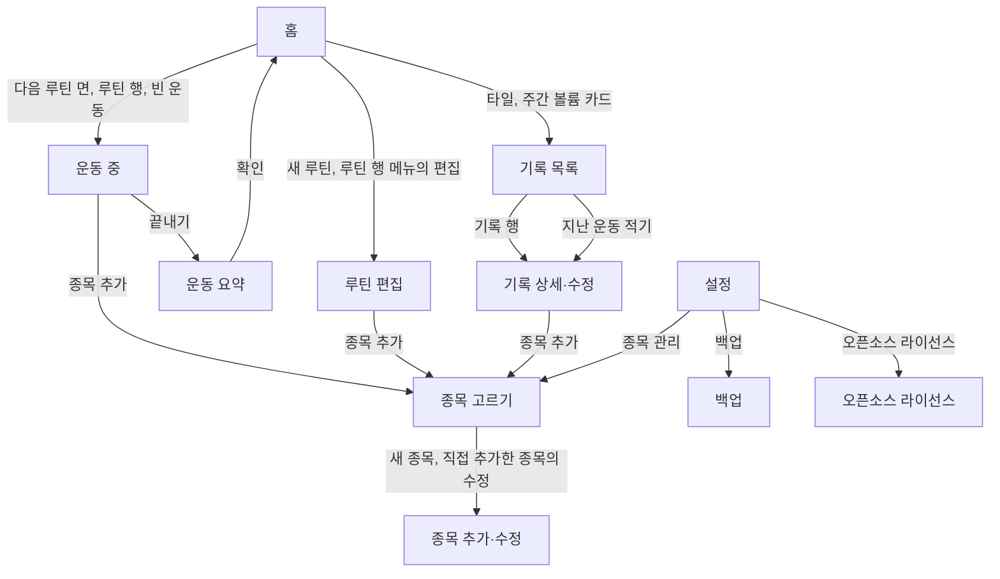
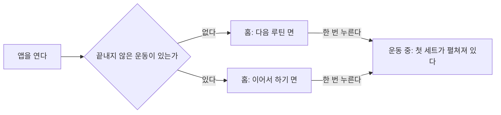

# 디자인 계약

작성일: 2026-11-18. 이슈 [#14](https://github.com/zzunsik/next-set/issues/14). 2026-11-25에 디자인 방향을 블록으로 바꿨다([#88](https://github.com/zzunsik/next-set/issues/88), [#116](https://github.com/zzunsik/next-set/issues/116)).

디자인 방향은 "블록"이다. 꽉 채운 색 면과 큰 숫자를 쓰고 색 셋에 뜻을 하나씩 준다. 처음에는 방향 A "차분한 기록장"으로 정해 v0.1.0을 만들었다(2026-11-18 협의). 그 뒤 출시 앱의 화면을 조사하고([`visual-references.md`](visual-references.md)) 여섯 가지 스타일을 그려 견준 다음 블록으로 바꿨다(#88).

화면을 구현할 때 따를 값과 화면 구성을 적는다. 요구사항은 [`requirements.md`](requirements.md), 원칙은 [`design-references.md`](design-references.md)의 "정리한 원칙"을 따른다. 이 문서에서 "원칙 n"은 그 절의 번호다.

토큰과 공통 부품은 블록 방향으로 옮겼다(#89). 홈·운동 중·운동 요약·기록 목록의 구성은 화면별 이슈에서 옮긴다. 그동안 문서와 코드를 맞춰 두는 방법은 "옮기는 순서"에 적었다.

## 방향

블록으로 정했다(2026-11-25, #88). 고른 뒤 색 면과 큰 숫자를 쓰는 출시 앱 열한 개와 Material 지침, 접근성 기준을 더 보고 값을 고쳤다.

색 셋의 뜻

| 색 | 뜻 | 쓰는 곳 |
|---|---|---|
| 보라 | 누르는 것 | 화면의 주 행동(운동 시작, 확인)과 글자 버튼. 보라 면은 한 화면에 하나다 |
| 라임과 검정 | 하는 중, 끝낸 것 | 지금 하는 세트, 이번 주, 볼륨, 완료 체크, 진행 막대. 어두운 화면은 라임 면에 검정 글자, 밝은 화면은 검정 면에 라임 표시다 |
| 주황 | 최고 기록 | 기록을 세웠을 때만 나온다. 늘 트로피 모양과 함께 쓴다 |

규칙 일곱 가지

1. **색 면은 뜻이 있을 때만 쓴다.** 한 화면에 많아야 셋이고 색마다 하나다. 나머지 면은 무채색 카드다. 보라 면에는 반드시 주 버튼이 있고, 정보를 보여 주는 타일에는 보라를 쓰지 않는다.
2. **라임은 검정과 짝으로만 쓴다.** 라임은 밝은 바탕 위에서 보이지 않는다(바탕과의 대비 1.02). 그래서 밝은 화면에서는 면을 검정으로, 그 위의 체크와 점과 버튼을 라임으로 뒤집는다.
3. **숫자가 주인공이다.** 대표 숫자는 56sp ExtraBold이고 본문(15sp)의 3.7배다. 단위는 작게 붙인다. 면 하나에 대표 숫자는 하나다.
4. **층은 밝기로만 가른다.** 그림자, 그라데이션, 장식 테두리를 쓰지 않는다. 어두운 화면에서 카드는 바탕과 1.27, 칸은 카드와 1.24 벌어진다.
5. **타일 판은 보는 화면에만 둔다.** 홈, 운동 요약, 기록 목록의 위쪽에 2열까지 둔다. 운동 중과 숫자 입력처럼 적는 화면은 한 줄 목록이다. 글자 크기 200%에서는 작은 라벨이 두 배가 되므로 타일은 높이를 고정하지 않고 한 열로 내려간다.
6. **모서리는 네 단이다.** 목록 행 20dp, 카드와 타일 28dp, 화면의 주인공 면 32dp, 버튼과 칩은 알약이다. 큰 면일수록 둥글다.
7. **색만으로 알리지 않는다.** 끝낸 세트는 체크, 최고 기록은 트로피, 오늘은 겹 동그라미를 함께 쓴다(NF-06).

4번의 값은 "대비"의 계산처럼 소수 둘째 자리 아래를 버린 것이다. #88에는 반올림한 1.28과 1.25로 적었다.

방향이 바뀌어도 지키는 것

- 색은 고정한다. 다이내믹 컬러를 쓰지 않는다(NF-05).
- 밝은 화면과 어두운 화면을 함께 맞춘다(NF-04).
- Material 3는 안정판에 들어온 요소만 쓴다(NF-07). 판정 규칙은 "컴포넌트" 절 끝에 적었다.
- 누르는 요소는 48dp 이상이고 글자 크기 200%에서 화면이 깨지지 않는다(NF-10).
- 이동 구조, 한 번 눌러 시작, 끝내기의 순서, 문구 규칙은 방향 A에서 정한 그대로다.

원칙과 달라진 곳

- 원칙 4는 색의 뜻을 둘(누를 수 있음, 완료)로 적는다. 블록은 최고 기록에 셋째 색을 준다. 장식 배경과 큰 그림을 기록 화면에 두지 않는 것은 그대로다.
- 원칙 5는 큰 숫자를 한 화면에 하나로 적는다. 블록은 면 하나에 하나다. 홈처럼 타일이 여럿인 화면에는 대표 숫자가 면마다 있다.
- 원칙 1의 다음 세트는 화면 위에 고정하지 않고 세트 목록 안에서 펼친다("펼친 세트").

방향 A에서 달라진 것

| 무엇 | 방향 A | 블록 |
|---|---|---|
| 색 | 강조색(남보라)과 완료 색(초록) | 보라, 라임과 검정, 주황 |
| 바탕 | 옅은 회색과 짙은 남색 | 회백색 `#F1F1EC`과 검정 `#0A0A0A` |
| 큰 숫자 | 40sp Bold, 한 화면에 한 곳 | 56sp ExtraBold, 면 하나에 하나 |
| 모서리 | 8dp 하나와 알약 | 20dp, 28dp, 32dp, 알약 |
| 홈 | 다음 차례 루틴 카드와 루틴 목록 | 다음 루틴 면, 이번 주와 최고 기록 타일, 주간 볼륨 카드, 루틴 목록 |
| 운동 중 | 위에 고정한 다음 세트 표시와 세트 표. 칸을 눌러 숫자판으로 적는다 | 세트 목록에서 세트 하나를 펼친다. − + 버튼으로 고치고 숫자를 누르면 숫자판이 뜬다 |
| 운동 요약 | 결론 문장, 숫자 셋, 최고 기록 목록, 세트 기록 | 결론 문장, 최고 기록 면, 볼륨 타일, 종목별 볼륨, 세트 기록 |
| 최고 기록 표시 | 글자색 바탕의 반전 배지 | 주황과 트로피 |

## 옮기는 순서

토큰과 공통 부품은 3번까지 옮겼다. 화면별 구성은 4번에서 이어서 옮긴다.

1. 이 문서와 `requirements.md`를 블록으로 고친다(#116). 코드는 바꾸지 않는다.
2. Compose BOM을 올린다([#117](https://github.com/zzunsik/next-set/issues/117)).
3. 토큰(`ui/theme`)과 공통 부품을 바꾼다(#89).
4. 홈, 운동 중, 운동 요약, 기록 목록을 화면별 이슈로 옮긴다. 나머지 화면은 3번의 토큰과 공통 부품이 바뀌면서 함께 바뀐다.
5. 휴대폰에서 보고 값을 고친다.

문서와 코드를 맞춰 두는 방법

- `DesignTokenSyncTest`가 색 19개, 대비 조합, 타이포 열 개, 간격과 모서리 세 값을 코드와 견준다. 한쪽만 바뀌면 실패한다.
- `radius.full`은 높이의 절반인 50% 모서리다.

휴대폰에서 볼 것

시안은 브라우저에서 그린 그림이다. 아래는 계산이나 그림으로 확인하지 못해 기기에서 봐야 하는 것이다.

| 볼 것 | 걸리면 |
|---|---|
| 어두운 화면의 큰 라임 면(펼친 세트)이 눈부신가 | 그 면을 카드로 낮추고 라임을 윤곽선과 "세트 완료" 버튼에만 쓴다 |
| 밝은 화면의 검정 면이 무겁게 보이는가 | 면의 크기나 수를 줄인다 |
| `#0A0A0A` 바탕이 OLED에서 스크롤할 때 번지는가 | 바탕을 더 밝은 값으로 올리고 카드와 칸을 함께 올린다 |
| 대표 숫자 56sp가 360dp 폭의 2열 타일에 들어가는가 | 칸에 맞춰 줄어드는 하한을 조정한다("타이포"의 규칙) |
| 글자 크기 200%에서 타일이 한 열로 내려가고 잘리는 글자가 없는가 | 스크린샷 테스트로 먼저 본다 |
| 펼친 세트의 − + 버튼을 땀 묻은 손으로 누를 때 옆 버튼을 누르지 않는가 | 버튼 사이를 넓힌다 |

컴포넌트 구성, 화면 흐름, 색의 뜻은 이 확인으로 바꾸지 않는다.

## 색

### 토큰

블록의 값이다. `ui/theme`와 `DesignTokenSyncTest`가 이 표를 따른다.

| 토큰 | 이름 | 밝은 화면 | 어두운 화면 | 쓰임새 |
|---|---|---|---|---|
| `bg` | 배경 | `#F1F1EC` | `#0A0A0A` | 화면 바탕, 하단 내비게이션의 바탕 |
| `surface` | 카드 | `#FFFFFF` | `#242424` | 목록 행, 묶음 카드, 무채색 타일, 숫자판의 키 |
| `surface2` | 칸 | `#E4E4DD` | `#343434` | 카드 안의 칸(날짜 칸, 선택 묶음), 막대의 빈 자리, 꺼진 스위치 |
| `line` | 구분선 | `#D3D3CA` | `#454545` | 묶음 카드 안의 행 사이 선, 테두리 버튼의 테두리, 하단 내비게이션의 윗선. 장식이다 |
| `text` | 글자 | `#0A0A0A` | `#FFFFFF` | 제목, 값 |
| `text2` | 보조 글자 | `#5A5A5A` | `#A8A8A8` | 라벨, 단위, 보조 줄, 끝낸 세트의 값 |
| `text3` | 흐린 글자 | `#65655F` | `#969696` | 순번, 고르지 않은 탭, 빈 체크의 테두리. `surface2` 위에는 쓰지 않는다 |
| `accent` | 보라 면 | `#5B3DF5` | `#6A4DFF` | 주 행동이 있는 면, 채운 버튼 |
| `onAccent` | 보라 면 위 글자 | `#FFFFFF` | `#FFFFFF` | 보라 면과 채운 버튼의 글자, 보라 면 위 주 버튼의 바탕 |
| `accentDim` | 짙은 보라 | `#422CB0` | `#4C37B8` | 보라 면 위 보조 버튼의 바탕 |
| `accentText` | 보라 글자 | `#4B2FE0` | `#A999FF` | 글자 버튼, 고른 칸의 테두리 |
| `accentSoft` | 옅은 보라 | `#E1DBFF` | `#322C50` | 고른 칩의 바탕 |
| `go` | 진행 색 | `#0A0A0A` | `#D4FF3A` | 지금 하는 세트의 면, 이번 주와 볼륨 타일, 완료 체크의 바탕, 진행 막대, 켜진 스위치 |
| `onGo` | 진행 면 위 글자 | `#FFFFFF` | `#0A0A0A` | 진행 면의 글자와 숫자 |
| `goMark` | 진행 면 위 표시 | `#D4FF3A` | `#0A0A0A` | 완료 체크의 체크 모양, 요일 점, 진행 면 위 버튼의 바탕 |
| `record` | 기록 면 | `#FF7A45` | `#FF7A45` | 최고 기록 면 |
| `recordText` | 기록 글자 | `#A8410F` | `#FF7A45` | 목록과 세트 행의 최고 기록 표시 |
| `ink` | 면 위 검정 | `#0A0A0A` | `#0A0A0A` | 기록 면의 글자, 보라 면 위 주 버튼의 글자 |
| `error` | 오류 색 | `#B3261E` | `#FF8A80` | 오류 문구, 지우기 확인 버튼의 글자 |

- `accentDim`은 `accent`에 검정을 28% 덮은 값이고 `accentSoft`는 `surface`에 `#6A4DFF`를 20% 덮은 값이다. 투명도를 쓰지 않고 계산한 값을 토큰으로 둔다.
- `error`는 시안에 없던 색이다. 밝은 화면은 방향 A의 값을 그대로 쓰고 어두운 화면은 새 바탕에서 기준을 넘는 값으로 정했다.
- 방향 A의 `done`, `onDone`, `doneSoft`는 없어진다. 완료 체크는 `go`와 `goMark`로 그리고, 끝낸 세트 행은 바탕을 바꾸지 않는다.

### 쓰임새 규칙

- 보라는 누르면 무언가 일어나는 요소에만 쓴다. 제목, 장식, 현재 위치 표시, 정보 타일, 차트의 막대에 쓰지 않는다.
- 보라 면(`accent`)은 한 화면에 하나다. 그 면에는 주 버튼이 있어야 한다. 홈의 다음 루틴 면과 운동 중의 휴식 타이머 바가 보라 면이다. 채운 버튼(운동 요약의 "확인", 루틴 행의 시작 버튼)은 면으로 세지 않는다.
- 보라 면 위의 주 버튼은 `onAccent` 바탕에 `ink` 글자다. 보조 버튼은 `accentDim` 바탕에 `onAccent` 글자다. 면 위의 글자 버튼은 `onAccent` 색이다.
- 바탕과 카드 위의 글자 버튼은 `accentText`다. `accent`는 어두운 화면에서 바탕과의 대비가 3.88이라 글자 색으로 쓰지 않는다.
- 진행 색(`go`)은 지금 하는 것과 끝낸 것에만 쓴다. 지금 하는 세트의 면, 이번 주와 볼륨 타일, 완료 체크, 진행 막대, 차트의 채운 막대, 고른 탭의 표시, 켜진 스위치다. "성공", "좋음", "추천"의 뜻으로 쓰지 않는다.
- 진행 면 위의 글자는 `onGo`만 쓴다. `text2`와 `text3`는 진행 면 위에서 기준에 못 미친다. 면 위의 버튼은 `goMark` 바탕에 `text` 글자와 `go` 아이콘이다.
- 라임(`#D4FF3A`)은 밝은 바탕과 흰 카드 위에 놓지 않는다(대비 1.02, 1.15). 밝은 화면에서 라임은 검정 면 위의 표시(`goMark`)로만 나온다.
- 주황(`record`)은 최고 기록을 세운 것에만 쓴다. 면이나 표시에는 늘 트로피 모양을 함께 둔다. 기록 면 위의 글자는 `ink`다. 목록 행과 세트 행의 작은 표시는 면을 깔지 않고 `recordText` 색 트로피와 글자로 적는다.
- 색 면은 한 화면에 많아야 셋이고 색마다 하나다. 화면별 색 면은 "화면" 절에 적었다. 운동 중 화면의 색 면은 펼친 세트와 휴식 타이머 바뿐이다.
- 완료는 색과 체크 모양을 함께 쓴다(NF-06). 끝낸 세트는 체크가 채워지고 값이 `text2`로 흐려진다. 행의 바탕은 바꾸지 않는다.
- 오류 색은 글자와 아이콘에만 쓴다. 바탕을 오류 색으로 채우지 않는다.
- `line`, `surface`, `surface2`는 서로와 바탕의 대비가 낮다(아래 표). 이 셋만으로 요소를 구분해야 하는 배치를 만들지 않는다.
  - 값이 든 입력 칸은 안의 글자로 알아본다.
  - 값이 없는 입력 칸에는 `text3` 색 1.5dp 테두리를 두른다.
  - 아직 누르지 않은 체크는 `text3` 색 2dp 테두리 동그라미다.
- 그림자, 그라데이션, 장식 테두리를 쓰지 않는다. 층은 `bg`, `surface`, `surface2`의 밝기로 가른다.
- 비활성 요소는 M3의 기본 비활성 표현을 따르고, 대비 기준의 대상이 아니다.
- 운동 중 화면과 기록 화면에는 장식 배경, 그림, 종목 이미지를 두지 않는다.

### 대비

WCAG 2.2의 상대 휘도 공식으로 계산했다. 채널 값 c(0~1)는 c ≤ 0.04045이면 c / 12.92, 아니면 ((c + 0.055) / 1.055)^2.4로 선형화한다. 휘도는 L = 0.2126 R + 0.7152 G + 0.0722 B, 대비는 (L밝은 쪽 + 0.05) / (L어두운 쪽 + 0.05)다. 값은 소수 둘째 자리 아래를 버렸다. 기준은 본문 글자 4.5:1, 큰 글자와 아이콘, 요소 테두리 3:1이다.

| 앞 / 바탕 | 쓰임 | 기준 | 밝은 화면 | 어두운 화면 |
|---|---|---|---|---|
| `text` / `bg` | 본문, 제목 | 4.5 | 17.47 | 19.79 |
| `text` / `surface` | 카드 안 글자, 세트 행의 값 | 4.5 | 19.79 | 15.52 |
| `text` / `surface2` | 칸 안의 글자 | 4.5 | 15.49 | 12.44 |
| `text2` / `bg` | 보조 글자 | 4.5 | 6.08 | 8.32 |
| `text2` / `surface` | 카드 안 보조 글자, 끝낸 세트의 값 | 4.5 | 6.89 | 6.52 |
| `text2` / `surface2` | 칸 안의 보조 글자 | 4.5 | 5.39 | 5.23 |
| `text3` / `bg` | 루틴 행 밖의 흐린 글자, 고르지 않은 탭 | 4.5 | 5.17 | 6.69 |
| `text3` / `surface` | 순번 | 4.5 | 5.86 | 5.24 |
| `text3` / `surface` | 빈 체크의 테두리 | 3 | 5.86 | 5.24 |
| `onAccent` / `accent` | 보라 면과 채운 버튼의 글자 | 4.5 | 6.12 | 5.09 |
| `ink` / `onAccent` | 보라 면 위 주 버튼의 글자 | 4.5 | 19.79 | 19.79 |
| `onAccent` / `accentDim` | 보라 면 위 보조 버튼의 글자 | 4.5 | 9.46 | 8.24 |
| `accentText` / `bg` | 글자 버튼 | 4.5 | 6.66 | 8.19 |
| `accentText` / `surface` | 카드 안의 글자 버튼 | 4.5 | 7.54 | 6.42 |
| `accentText` / `surface2` | 칸 안의 글자 버튼 | 4.5 | 5.90 | 5.15 |
| `accentText` / `accentSoft` | 고른 칩의 글자 | 4.5 | 5.67 | 5.39 |
| `text` / `accentSoft` | 고른 칩 안의 값 | 4.5 | 14.87 | 13.02 |
| `onGo` / `go` | 진행 면의 글자 | 4.5 | 19.79 | 17.12 |
| `goMark` / `go` | 완료 체크의 체크 모양, 요일 점 | 3 | 17.12 | 17.12 |
| `text` / `goMark` | 진행 면 위 버튼의 글자 | 4.5 | 17.12 | 19.79 |
| `go` / `goMark` | 진행 면 위 버튼의 아이콘 | 3 | 17.12 | 17.12 |
| `go` / `bg` | 진행 막대, 고른 탭의 표시 | 3 | 17.47 | 17.12 |
| `go` / `surface` | 카드 안의 완료 체크와 막대 | 3 | 19.79 | 13.42 |
| `go` / `surface2` | 막대의 채운 부분과 빈 자리 | 3 | 15.49 | 10.76 |
| `ink` / `record` | 기록 면의 글자 | 4.5 | 7.65 | 7.65 |
| `recordText` / `bg` | 최고 기록 표시 | 4.5 | 5.40 | 7.65 |
| `recordText` / `surface` | 카드 안의 최고 기록 표시 | 4.5 | 6.12 | 6.00 |
| `error` / `bg` | 오류 문구 | 4.5 | 5.76 | 8.67 |
| `error` / `surface` | 카드 안 오류 문구 | 4.5 | 6.53 | 6.79 |
| `error` / `surface2` | 칸 안 오류 문구 | 4.5 | 5.11 | 5.45 |

모든 조합이 기준을 넘는다. 글자 조합에서 가장 낮은 값은 어두운 화면의 `onAccent` / `accent` 5.09다.

표에 없는 조합은 쓰지 않는다. `text3` / `surface2`는 어두운 화면에서 4.20이라 기준에 못 미친다.

면과 바탕 사이, 층 사이의 값은 기준의 대상이 아니다. 참고로 적는다.

| 조합 | 밝은 화면 | 어두운 화면 |
|---|---|---|
| `surface` / `bg` | 1.13 | 1.27 |
| `surface2` / `surface` | 1.27 | 1.24 |
| `surface2` / `bg` | 1.12 | 1.59 |
| `line` / `bg` | 1.32 | 2.06 |
| `line` / `surface` | 1.50 | 1.61 |
| `accentSoft` / `surface` | 1.33 | 1.19 |
| `accent` / `bg` | 5.40 | 3.88 |
| `accent` / `surface` | 6.12 | 3.04 |
| `record` / `bg` | 2.28 | 7.65 |
| `record` / `surface` | 2.58 | 6.00 |

- WCAG 1.4.11은 안에 글자나 아이콘이 있는 면의 경계를 3:1 대상에서 뺀다. 밝은 화면의 기록 면(바탕과 2.28)과 어두운 화면의 보라 면(카드와 3.04)이 여기에 든다. 면의 뜻은 안의 글자와 트로피, 버튼이 전한다.
- 진행 막대, 체크, 요일 점처럼 모양만으로 뜻을 전하는 표시에는 3:1을 넘는 조합(위 표의 `go`와 `goMark`)만 쓴다.

#89에서 `ui/theme`의 색 값으로 위 표의 대비를 다시 계산하는 테스트를 이 표에 맞춘다.

### 적록 색각에서의 구분

뜻이 다른 세 색이 적록 색각 이상에서 같은 색으로 보이지 않는지 계산으로 확인했다.

한 일

1. sRGB 값을 선형 RGB로 바꿨다(대비 계산과 같은 식).
2. Viénot, Brettel, Mollon(1999)의 행렬로 선형 RGB를 LMS로 바꾸고, 제1색각(L 원뿔 없음)과 제2색각(M 원뿔 없음)의 투영 행렬을 곱한 뒤 RGB로 되돌렸다. 범위를 벗어난 값은 0과 1로 잘랐다.
3. 변환한 두 색의 색차를 CIEDE2000(ΔE00)으로, 밝기 차이를 휘도 대비로 구했다. ΔE00 구현은 Sharma 등(2005)의 검증 값 한 쌍으로 맞는지 확인했다.

| 화면 | 색 쌍 | 보는 조건 | 앞의 색 | 뒤의 색 | ΔE00 | 휘도 대비 |
|---|---|---|---|---|---|---|
| 어두운 | `accent` / `go` | 변환 없음 | #6A4DFF | #D4FF3A | 95.5 | 4.41 |
| 어두운 | `accent` / `go` | 제1색각 | #5151FF | #FBFB39 | 89.8 | 4.77 |
| 어두운 | `accent` / `go` | 제2색각 | #5757FF | #F3F33F | 87.0 | 4.20 |
| 밝은 | `accent` / `go` | 변환 없음 | #5B3DF5 | #0A0A0A | 41.6 | 3.23 |
| 밝은 | `accent` / `go` | 제1색각 | #4141F5 | #0A0A0A | 41.0 | 3.11 |
| 밝은 | `accent` / `go` | 제2색각 | #4747F5 | #0A0A0A | 41.6 | 3.28 |
| 어두운 | `accent` / `record` | 변환 없음 | #6A4DFF | #FF7A45 | 51.6 | 1.97 |
| 어두운 | `accent` / `record` | 제1색각 | #5151FF | #919147 | 67.7 | 1.59 |
| 어두운 | `accent` / `record` | 제2색각 | #5757FF | #AFAF39 | 75.9 | 2.13 |
| 밝은 | `accent` / `record` | 변환 없음 | #5B3DF5 | #FF7A45 | 53.9 | 2.36 |
| 밝은 | `accent` / `record` | 제1색각 | #4141F5 | #919147 | 69.6 | 1.92 |
| 밝은 | `accent` / `record` | 제2색각 | #4747F5 | #AFAF39 | 78.4 | 2.58 |
| 어두운 | `go` / `record` | 변환 없음 | #D4FF3A | #FF7A45 | 55.4 | 2.23 |
| 어두운 | `go` / `record` | 제1색각 | #FBFB39 | #919147 | 29.1 | 2.98 |
| 어두운 | `go` / `record` | 제2색각 | #F3F33F | #AFAF39 | 17.1 | 1.96 |
| 밝은 | `go` / `record` | 변환 없음 | #0A0A0A | #FF7A45 | 58.6 | 7.65 |
| 밝은 | `go` / `record` | 제1색각 | #0A0A0A | #919147 | 48.6 | 5.98 |
| 밝은 | `go` / `record` | 제2색각 | #0A0A0A | #AFAF39 | 61.3 | 8.49 |
| 어두운 | `accentText` / `recordText` | 변환 없음 | #A999FF | #FF7A45 | 43.7 | 1.06 |
| 어두운 | `accentText` / `recordText` | 제1색각 | #9B9BFF | #919147 | 56.7 | 1.34 |
| 어두운 | `accentText` / `recordText` | 제2색각 | #9E9EFF | #AFAF39 | 61.9 | 1.02 |
| 밝은 | `accentText` / `recordText` | 변환 없음 | #4B2FE0 | #A8410F | 48.3 | 1.23 |
| 밝은 | `accentText` / `recordText` | 제1색각 | #3333E0 | #555512 | 65.0 | 1.00 |
| 밝은 | `accentText` / `recordText` | 제2색각 | #3939E0 | #6D6D00 | 70.8 | 1.35 |

읽는 법

- 보라는 변환한 뒤에도 파랑 쪽에 남아 라임, 주황과 색차가 크다.
- 라임과 주황은 제2색각에서 둘 다 누런 색이 되어 색차가 17.1까지 줄어든다. 밝기 차이는 남는다(휘도 대비 1.96). 그래서 주황에는 늘 트로피를, 완료에는 늘 체크를 함께 쓴다(규칙 7).
- 밝은 화면의 진행 면은 검정이라 주황과 밝기로 갈린다. 다만 검정 면 위의 라임 표시와 주황 면은 어두운 화면과 같은 색 쌍이다.
- 글자 색 쌍(`accentText`와 `recordText`)은 밝기가 비슷하다. 최고 기록 표시는 트로피 모양이 있어 글자 버튼과 헷갈리지 않는다.

이 확인의 한계는 "확인하지 못한 것"에 적었다.

### M3 색 역할과의 대응

`ColorScheme`은 아래 대응을 구현한다(#89). 표에 없는 역할도 앱 토큰으로 채워 M3 기본 색이 섞이지 않게 한다.

| M3 역할 | 이 문서의 토큰 | 비고 |
|---|---|---|
| `background`, `surface` | `bg` | M3의 `surface`는 화면 바탕이다. 이 문서의 `surface`가 아니다 |
| `surfaceContainer` 계열, `surfaceVariant` | `surface` | 카드, 대화상자, 메뉴의 바탕 |
| `surfaceContainerHighest` | `surface2` | M3가 칸과 꺼진 스위치에 쓰는 역할이다 |
| `onBackground`, `onSurface` | `text` | |
| `onSurfaceVariant` | `text2` | |
| `outline` | `text3` | 테두리가 3:1을 넘어야 하는 곳에 쓰인다 |
| `outlineVariant` | `line` | |
| `primary`, `onPrimary` | `accentText`, `bg` | M3 글자 버튼, 라디오 버튼, 입력 칸의 커서가 `primary`를 글자와 표시 색으로 쓴다. `accent`를 넣으면 어두운 화면에서 대비가 3.88이 된다 |
| `primaryContainer`, `secondaryContainer` | `accentSoft` | 그 위 글자는 `text` |
| `error` | `error` | |

`accent`, `onAccent`, `accentDim`, `go`, `onGo`, `goMark`, `record`, `recordText`, `ink`는 M3 역할에 넣지 않고 앱의 확장 색으로 둔다. 채운 버튼은 M3 기본 색을 쓰지 않고 `accent`와 `onAccent`를 직접 넘긴다. `tertiary`에 진행 색이나 주황을 넣으면 M3 컴포넌트가 뜻과 상관없는 곳에 그 색을 쓸 수 있으므로 `secondary`와 `tertiary`는 `accentText`로 채운다.

## 타이포

글꼴은 본문과 숫자 모두 Pretendard다(2026-11-18 협의). 파일과 적용 방법은 이 절의 "글꼴"에 적었다.

블록의 값이다. `ui/theme`와 `DesignTokenSyncTest`가 이 표를 따른다. 크기는 여덟 단계다.

| 토큰 | 크기 / 줄 높이 | 굵기 | 쓰임 |
|---|---|---|---|
| `numeralHero` | 56sp / 68sp | ExtraBold(800) | 대표 숫자. 타일의 숫자, 운동 중의 경과 시간, 펼친 세트의 무게와 횟수 |
| `display` | 44sp / 54sp | ExtraBold(800) | 다음 루틴 이름, 요약의 볼륨, 최고 기록이 둘 이상일 때의 값 |
| `headline` | 36sp / 44sp | ExtraBold(800) | 요약의 결론 문장, 휴식 남은 시간, 홈의 요일, 주간 볼륨 |
| `title` | 26sp / 32sp | ExtraBold(800) | 종목 이름, 화면 제목, 숫자판의 숫자 키 |
| `numeralRow` | 20sp / 24sp | ExtraBold(800) | 세트 행의 값, 완료한 세트 수, 루틴 행의 순번 |
| `heading` | 17sp / 24sp | ExtraBold(800) | 구역 머리, 주 버튼, 펼친 세트의 머리, 상단 바의 루틴 이름, 대표 숫자 옆의 단위 |
| `bodyStrong` | 15sp / 22sp | Bold(700) | 목록 행 제목, 일반 버튼, 글자 버튼, 설정의 값 |
| `body` | 15sp / 22sp | Regular(400) | 문장으로 된 본문, 안내 글 |
| `label` | 13sp / 18sp | ExtraBold(800) | 면과 카드의 머리 라벨, 최고 기록 표시, 종목 순번 알약 |
| `caption` | 13sp / 18sp | SemiBold(600) | 보조 줄, 날짜, 세트 행의 단위, 요일, 하단 내비게이션의 탭 이름 |

시안의 글자 크기는 열 가지쯤으로 흩어져 있었다(10~56). 가까운 것끼리 묶어 여덟 단계로 줄였다. 시안의 10~12는 13sp로 올렸다. 글자 크기 200%에서 가장 작은 글자부터 넘치기 때문에 방향 A의 하한(13sp)을 지킨다.

규칙

- 대표 숫자(`numeralHero`)는 면 하나에 하나다(규칙 3). 최고 기록이 둘 이상인 기록 면처럼 한 면에 값이 여럿이면 `display`로 내린다.
- 숫자는 크게, 단위는 작게 쓴다. `numeralHero`와 `display` 옆의 단위(kg, 회)는 `heading`, `numeralRow` 옆의 단위는 `caption`이다. 단위는 숫자의 글자 밑선에 맞춘다.
- 모든 스타일에 폭이 같은 숫자를 켠다(`fontFeatureSettings = "tnum"`). 값이 바뀌어도 자리가 흔들리지 않는다. 휴식 시간, 경과 시간, 세트의 값이 대상이다.
- 쓰는 굵기는 Regular(400), SemiBold(600), Bold(700), ExtraBold(800) 넷이다. 다른 굵기를 쓰지 않는다.
- 자간은 모든 스타일에서 0이다. 시안은 큰 글자의 자간을 조였다. 조일지는 기기 화면에서 보고 정한다.
- 크기는 sp로 둔다. 기기의 글자 크기 설정을 따른다(NF-10).
- `numeralHero`, `display`, `headline`으로 적는 한 줄짜리 숫자와 이름은 칸에 들어가지 않으면 줄을 바꾸지 않고 크기를 줄인다. 하한은 28sp다. M3 `Text`의 `autoSize`를 쓴다. 다음 루틴 이름과 결론 문장은 두 줄까지 쓰고, 그래도 넘치면 줄인다.
- 행, 타일, 버튼의 높이는 고정하지 않고 최소 높이로 잡는다. 글자가 커지면 늘어난다.
- 2열 타일은 글자 크기를 키워 라벨이나 보조 줄이 한 줄에 들어가지 않으면 한 열로 내려간다. 내려가는 기준은 글자 크기 배율 1.3 이상이다. 라벨은 잘리지 않고 줄을 바꾼다.
- 줄어든 글자가 잘릴 자리에는 말줄임을 쓰되 숫자와 단위는 자르지 않는다. 자리가 모자라면 종목 이름을 먼저 줄인다.
- 한국어는 어절(띄어쓰기) 단위로 줄을 바꾼다. 자세한 내용은 아래 "줄바꿈"에 적었다.

글자 크기 200%의 계산

- Android 14부터 글자 크기 설정은 큰 글자를 덜 키운다. AOSP의 배율 표로 계산하면 200%에서 13sp는 26dp(2배), 56sp는 61dp쯤(1.09배)이 된다.
- 그래서 200%에서 먼저 넘치는 것은 대표 숫자가 아니라 라벨과 보조 줄이다. 위의 "한 열로 내려간다"와 "높이를 고정하지 않는다"가 이 때문에 있다.
- Compose가 같은 표를 쓰는지는 소스로 확인하지 않았다. #89의 스크린샷 테스트(글자 크기 200%)로 확인한다.

### 줄바꿈

Compose `Text`의 기본 줄바꿈은 한국어를 글자 단위로 끊는다. "다른 기기로"가 "다/른 기기로"로 끊기는 식이다(#71). 그래서 모든 타입 토큰에 아래 두 값을 넣는다(`ui/theme/Type.kt`). 화면 코드는 테마의 스타일을 쓰므로 따로 할 일이 없다.

- `lineBreak = LineBreak(Strategy.Simple, Strictness.Normal, WordBreak.Phrase)`: 단어 경계만 `Phrase`로 바꾼다. 줄을 고르는 방식과 금칙 강도는 Compose 기본값(`LineBreak.Simple`)과 같다.
- `localeList = LocaleList("ko-KR")`: `Phrase`는 글자의 언어가 한국어나 일본어일 때만 듣는다. 언어를 적지 않으면 기기 언어를 따르므로 기기 언어가 영어면 글자 단위로 끊는다. 앱 문구는 한국어뿐이라 스타일에 한국어를 적는다.

API 버전별 동작

- Android 15(API 35) 이상: 어절 단위로 끊는다.
- Android 13–14(API 33–34): 플랫폼이 설정을 받지만 이 버전의 `Phrase`는 일본어에만 듣는다. 한국어는 지금처럼 글자 단위로 끊는다.
- Android 8.0–12L(API 26–32): 플랫폼에 이 설정이 없다. Compose가 값을 넘기지 않으므로 예외 없이 지금처럼 글자 단위로 끊는다.
- 세 경우 모두 넘치거나 잘리지 않는다. API 35 아래에서 어절 단위로 끊는 대체 처리(줄바꿈 위치를 직접 계산하는 등)는 넣지 않는다.
- 확인 방법: #71에서 백업 화면 문장을 Robolectric(NATIVE 그래픽)의 SDK 32, 33, 34, 35, 36에서 재 봤다. 35와 36만 띄어쓰기에서 끊었다. Robolectric은 SDK마다 그 버전의 줄바꿈 엔진(ICU, Minikin)으로 그린다.

넘치지 않는 것

- 한 어절이 한 줄보다 길면(긴 종목 이름, 큰 글자 크기) 그 어절 안에서 끊는다. 잘리거나 넘치지 않는다.
- 영어, 숫자와 단위, URL은 지금과 같이 끊는다. URL은 `/`와 `.` 앞에서 끊는다(라이선스 화면).
- 사용자가 적은 영어 이름도 띄어쓰기에서 끊으므로 달라지지 않는다.

`LineBreakTest`가 모든 토큰의 설정, 백업 화면 문장이 띄어쓰기에서만 끊기는지, 긴 어절과 URL이 넘치지 않는지를 본다. 테스트 SDK(36)의 Robolectric도 이 줄바꿈으로 그리므로 스크린샷에 그대로 나온다.

### 글꼴

Pretendard 파일을 앱에 넣는다. Regular, SemiBold, Bold는 #19에서 넣었다. 블록이 쓰는 ExtraBold는 #89에서 더한다.

| 항목 | 정한 것 |
|---|---|
| 파일 | 굵기별 정적 파일 넷. `Pretendard-Regular.otf`(400), `Pretendard-SemiBold.otf`(600), `Pretendard-Bold.otf`(700), `Pretendard-ExtraBold.otf`(800). 공식 저장소의 v1.3.9 릴리스에서 받는다. ExtraBold도 넣었다(#89) |
| 두는 곳 | `app/src/main/res/font/`. 리소스 파일 이름은 소문자여야 하므로 `pretendard_regular.otf`, `pretendard_semibold.otf`, `pretendard_bold.otf`, `pretendard_extrabold.otf`로 넣는다. 글꼴 데이터는 바꾸지 않는다 |
| 크기 | 지금 든 세 파일을 더해 4,734,716바이트(약 4.7MB). ExtraBold는 1,568,512바이트이고 정적 OTF 네 파일의 합은 6,303,228바이트다(#89) |
| 숫자 폭 | 모든 텍스트 스타일에 `fontFeatureSettings = "tnum"` |
| 글자 크기 | sp. 기기의 글자 크기 설정을 따른다 |
| 대체 글꼴 | 시스템 기본 글꼴(`FontFamily.Default`) |
| 라이선스 | SIL OFL 1.1. 설정의 "오픈소스 라이선스"에 저작권 표시와 라이선스 전문을 싣는다 |

정적 파일 셋을 고른 근거

| | 정적 OTF 셋 | 가변 TTF 하나 | 정적 TTF 셋 |
|---|---|---|---|
| 파일 크기 | 4,734,716바이트 | 6,739,336바이트 | 8,059,048바이트 |
| zip 최고 압축 크기 | 3,192,780바이트 | 2,961,883바이트 | 재지 않음 |
| 담긴 굵기 | 400, 600, 700 | 45~930 전부 | 400, 600, 700 |
| 불러오는 법 | 굵기마다 파일을 지정한다 | 굵기를 변형 설정으로 지정한다 | 굵기마다 파일을 지정한다 |

- 방향 A는 굵기를 셋만 썼다. 블록은 넷을 쓴다. 가변 파일에 든 나머지 굵기는 쓰지 않는다.
- 아래 크기 비교는 정적 파일이 셋일 때 잰 것이다. 넷이 되면 가변 파일과의 차이가 줄거나 뒤집힐 수 있다. 다시 재지 않았다. 가변 글꼴의 불러오기가 여전히 실험 API면 정적 파일을 유지한다(#89에서 확인).
- 파일 크기는 정적 OTF 셋이 가변 파일보다 약 2.0MB 작다. zip으로 압축하면 가변 파일이 약 0.2MB 작다. 내려받는 크기는 비슷하다.
- 정적 파일은 `Font(리소스, 굵기)`로 불러온다. 가변 글꼴은 Compose 글꼴 문서의 예제가 실험 API 옵트인(`ExperimentalTextApi`)을 달고 있다.
- `res/font`는 `.ttf`, `.ttc`, `.otf`, `.xml`을 받는다(Font resources 문서).
- 크기는 2026-11-18에 v1.3.9 태그의 파일로 쟀다. #19에서 서명하지 않은 릴리스 APK 안의 세 파일을 재 보니 압축된 크기가 합쳐 3,182,352바이트(약 3.2MB)였다.

폭이 같은 숫자

- Pretendard의 기본 숫자는 폭이 제각각이다. Regular에서 1은 898, 4는 1278이다(1em = 2048).
- `tnum`을 켜면 열 개 숫자의 폭이 같아진다. Regular 1258, SemiBold 1314, Bold 1340이다. 세 파일 모두 `tnum` 기능이 있다(글꼴 파일을 열어 확인). ExtraBold의 `tnum` 숫자 0~9 폭은 모두 1368이다(1em = 2048). GSUB `tnum` 치환과 hmtx advance width를 읽어 확인했다(#89).
- 그래서 `tnum`을 빠뜨리면 휴식 시간과 세트 표의 숫자가 값이 바뀔 때마다 흔들린다. `Typography`의 모든 `TextStyle`에 `fontFeatureSettings = "tnum"`을 넣고 화면 코드는 테마의 스타일만 꺼내 쓴다. 스타일을 새로 만들어 쓰지 않는다.
- 굵기가 다르면 숫자 폭도 다르다. 같은 열에 놓이는 숫자는 상태가 바뀌어도 굵기를 바꾸지 않는다. 세트 행의 값은 대기와 완료에서 굵기가 같고 색만 다르다.
- #19에서 숫자 스타일마다 "111"과 "000"의 폭이 같은지 재는 테스트를 둔다.

줄 높이와 자간

- Pretendard의 줄 높이 지표는 ascender 1950, descender −494, lineGap 0이다(1em = 2048). 글꼴이 정한 줄 높이는 크기의 1.193배다. 세 굵기가 같다.
- 타입 표의 줄 높이는 모두 크기의 1.2배 이상이다. 가장 빠듯한 것은 `numeralRow`(20sp / 24sp)로 1.2배다. 표의 값을 그대로 쓴다.
- 시안은 대표 숫자의 줄 높이를 글자 크기와 같게 그렸다. 글꼴이 정한 줄 높이보다 좁아 글자 위아래가 잘릴 수 있다. 그래서 표의 값을 쓰고 면의 안쪽 여백으로 간격을 맞춘다.
- M3의 기본 타입 스케일은 스타일마다 자간 토큰을 따로 둔다. M3 기본 `Typography`에서 글꼴만 바꾸면 그 자간이 남는다. 모든 스타일에 `letterSpacing = 0.sp`를 적는다.
- 큰 숫자의 자간을 조일지는 기기 화면 검토에서 본다.

대체 글꼴

- 글꼴 파일은 앱 리소스로 들어간다. 그래도 파일을 읽지 못하는 경우 앱이 멈추지 않고 시스템 기본 글꼴로 그려야 한다. #19에서 글꼴이 아닌 리소스를 `Font(리소스, 굵기)`로 읽게 해 보니 Compose가 예외 없이 시스템 기본 글꼴로 그렸다(Robolectric, `FontTest`). 그래서 따로 대체 처리를 넣지 않았다.
- 배치는 Pretendard의 글자 폭에 기대지 않는다. 행과 버튼은 최소 크기로 잡고 큰 숫자는 `autoSize`로 줄어든다. 시스템 글꼴로 그려져도 글자가 잘리지 않아야 한다.

라이선스 고지

- OFL 1.1은 글꼴을 소프트웨어에 넣어 배포할 때 저작권 표시와 라이선스를 함께 넣으라고 요구하고 사용자가 쉽게 볼 수 있어야 한다고 적는다(LICENSE의 조건 2).
- 설정의 "오픈소스 라이선스"에 Pretendard 항목을 두고 저장소 LICENSE 파일의 저작권 표시와 라이선스 전문을 그대로 싣는다. 저작권 표시에는 Pretendard와 함께 바탕이 된 글꼴(Source, Inter, M PLUS 1)의 줄이 들어 있다.
- 저장소에도 글꼴의 출처와 라이선스를 적는다(`AGENTS.md`의 공개 저장소 규칙). 자리는 `README.md`의 "글꼴" 절이다(#19).

## 간격, 모서리, 누르는 영역

간격

| 토큰 | 값 | 쓰임 |
|---|---|---|
| `space.xs` | 4dp | 숫자와 단위 사이, 제목과 보조 줄 사이 |
| `space.sm` | 8dp | 행 안의 요소 사이, 숫자판 키 사이 |
| `space.md` | 12dp | 카드 안 묶음 사이, 칩 사이, 타일 사이 |
| `space.lg` | 16dp | 화면 좌우 여백, 카드 안쪽 여백 |
| `space.xl` | 24dp | 종목과 종목 사이, 구역 사이 |
| `space.xxl` | 32dp | 빈 상태 문구 위아래 |

모서리

| 토큰 | 값 | 쓰임 |
|---|---|---|
| `radius.row` | 20dp | 목록 행, 세트 행, 숫자판 키, 입력 칸, 날짜 칸 |
| `radius.card` | 28dp | 카드, 타일, 묶음 카드, 펼친 세트의 면, 휴식 타이머 바의 위쪽 모서리 |
| `radius.hero` | 32dp | 화면의 주인공 면. 홈의 다음 루틴 면, 운동 요약의 최고 기록 면 |
| `radius.full` | 높이의 절반 | 버튼, 칩, 체크, 검색 칸, 순번 알약 |

큰 면일수록 둥글다(규칙 6). 주인공 면은 한 화면에 하나다. 하단 시트와 대화상자는 M3 기본 모양을 그대로 둔다. 방향 A의 `radius.md`(8dp)는 #89에서 없앤다.

크기

| 요소 | 값 |
|---|---|
| 누르는 요소의 최소 영역 | 48 × 48dp(NF-10). 보이는 모양이 작아도 영역은 48dp를 채운다 |
| 누르는 요소의 보이는 모양 사이 | 8dp 이상 |
| 세트 행의 최소 높이 | 52dp |
| 목록 행(두 줄)의 최소 높이 | 56dp |
| 입력 칸 | 보이는 높이 40dp, 누르는 영역 48dp |
| 완료 체크 | 보이는 크기 지름 32dp, 누르는 영역 48 × 48dp |
| 펼친 세트의 − + 버튼 | 지름 52dp |
| 숫자판 키 | 높이 52dp |
| 주 버튼(운동 시작, 이어서 하기) | 높이 56dp, 면이나 화면의 폭을 채운다 |
| 펼친 세트의 "세트 완료", 운동 요약의 "확인" | 높이 60dp |
| 일반 버튼, 휴식 타이머 바의 버튼 | 높이 48dp |
| 루틴 행의 시작 버튼 | 보이는 크기 지름 44dp, 누르는 영역 48 × 48dp |
| 숫자 타일의 최소 높이 | 150dp(운동 요약과 기록 목록은 136dp). 고정하지 않는다 |
| 진행 막대의 두께 | 8dp. 종목별 볼륨 막대는 10dp |
| 요일 점 | 지름 12dp |
| 아이콘 | 24dp. 라벨 앞의 트로피는 16dp |

## 컴포넌트

상태 이름은 표마다 같다. 눌림은 M3의 기본 눌림 표시(물결)를 쓴다. 색 면 위에서도 같다.

### 다음 루틴 면 `NextRoutineCard`

쓰이는 화면: 홈. 홈의 보라 면이다.

| 구성 요소 | 내용 |
|---|---|
| 라벨 | "다음 루틴"(`label`, `onAccent`). 직접 고른 루틴이면 "직접 고름"과 "자동 순서로" 글자 버튼(`onAccent`) |
| 루틴 이름 | `display`, `onAccent`. 두 줄까지 |
| 보조 줄 | "종목 4개 · 16세트"(`caption`, `onAccent`). 한 적이 있으면 "· 지난번 48분"을 붙인다 |
| 시작 버튼 | "운동 시작". `onAccent` 바탕에 `ink` 글자(`heading`), 높이 56dp, 면의 폭을 채운다. 오른쪽 끝에 `ink` 바탕의 동그란 화살표 표시 |
| 더보기 버튼 | 면 오른쪽 위. 아이콘은 `onAccent`. 메뉴: 편집, 지우기 |

| 상태 | 모습 |
|---|---|
| 기본 | `accent` 바탕, 모서리 `radius.hero`. 더보기 버튼을 뺀 면 전체가 누르는 영역이고 시작 버튼과 같은 일을 한다 |
| 눌림 | 면 전체에 눌림 표시 |
| 직접 고름 | 라벨이 바뀌고 "자동 순서로" 버튼이 생긴다 |
| 진행 중 | 이어서 하기 면으로 바뀐다. 라벨 "진행 중", 루틴 이름, "12세트 중 5세트 완료 · 32분째", 버튼 "이어서 하기" |
| 비활성 | 없다. 루틴이 하나도 없으면 면 대신 빈 상태를 보인다 |

- 보조 줄의 세트 수는 루틴에 저장한 종목별 세트 수의 합이다.
- 시안에는 "약 45분"이 있었다. 예상 시간을 추정하는 규칙이 없어 넣지 않고, 같은 루틴으로 마지막에 한 운동의 시간을 적는다.

### 숫자 타일 `StatTile`

쓰이는 화면: 홈, 운동 요약, 기록 목록. 숫자 하나와 라벨을 담는 면이다. 2열로 놓는다.

| 구성 요소 | 내용 |
|---|---|
| 라벨 | "이번 주"(`label`). 기록 타일은 앞에 트로피 아이콘 16dp |
| 대표 숫자 | "2"(`numeralHero`)와 단위 "회"(`heading`). 요약의 볼륨은 `display` |
| 아래 줄 | 보조 줄(`caption`), 요일 점, 막대 가운데 하나. 타일의 아래쪽에 붙인다 |

| 종류 | 모습 |
|---|---|
| 진행 타일 | `go` 바탕, 글자 `onGo` |
| 기록 타일 | `record` 바탕, 글자 `ink`. 라벨 앞에 트로피 |
| 무채색 타일 | `surface` 바탕, 글자 `text`, 라벨과 보조 줄은 `text2` |

- 모서리 `radius.card`, 안쪽 여백 16dp, 최소 높이 150dp(요약과 기록 목록은 136dp). 높이를 고정하지 않는다.
- 타일 사이는 12dp다. 글자 크기 배율이 1.3 이상이면 한 열로 내려간다.
- 홈과 기록 목록의 타일은 누르는 요소다. 요약의 타일은 누르는 요소가 아니다.
- 보라 타일은 없다(규칙 1).
- `StatTile`의 `valueSize`는 기본 `Hero`(`numeralHero`, 56sp)이며 `Display`(`display`, 44sp)를 고를 수 있다. 두 크기 모두 단위와 밑선을 맞추고 칸이 좁으면 28sp까지 줄어든다.

### 요일 점 `WeekDots`

쓰이는 화면: 홈의 이번 주 타일.

| 구성 요소 | 내용 |
|---|---|
| 점 | 지름 12dp 동그라미 일곱. 월요일부터 일요일까지. 테두리 2dp `goMark` |
| 요일 | 점 아래에 "월"(`caption`, `onGo`) |

| 상태 | 모습 |
|---|---|
| 운동한 날 | `goMark`로 채운다 |
| 안 한 날 | 테두리만 |
| 오늘 | 점 바깥에 `goMark` 고리를 하나 더 두른다(겹 동그라미). 채움은 오늘 운동했는지에 따른다 |

화면 낭독기에는 점 일곱을 한 문장으로 읽힌다("이번 주 월요일, 수요일에 운동함"). 누르는 요소가 아니다.

### 볼륨 막대 `VolumeBars`

쓰이는 화면: 홈(요일별 볼륨 일곱), 운동 요약(최근 다섯 번의 볼륨, 종목별 볼륨).

| 종류 | 모습 |
|---|---|
| 세로 막대 | 폭을 똑같이 나눈 막대, 사이 6dp, 위쪽 모서리 5dp. 값이 있는 막대는 `go`, 값이 0이면 `surface2` 색의 높이 6dp 막대. 요약의 최근 다섯 번에서는 이번 운동만 `go`이고 지난 네 번은 `text3`다 |
| 가로 막대 | 종목별 볼륨. 종목 이름(`caption`, `text2`), 두께 10dp 막대(채운 부분 `go`, 빈 자리 `surface2`), 값(`label`, `text`). 가장 큰 종목이 막대를 다 채운다 |

- `Canvas`나 일반 배치로 직접 그린다. 차트 라이브러리를 더하지 않는다.
- 축, 눈금, 값 라벨을 두지 않는다. 화면 낭독기에는 묶음 하나로 읽히고 값은 문장으로 준다("최근 다섯 번 가운데 이번이 가장 높음").
- 누르는 요소가 아니다. 보라를 쓰지 않는다.

### 루틴 목록 행 `RoutineRow`

쓰이는 화면: 홈.

| 구성 요소 | 내용 |
|---|---|
| 순번 | "02"(`numeralRow`, `text3`). 루틴 목록의 순서다(RTN-05). 두 자리로 적는다 |
| 루틴 이름 | `bodyStrong` |
| 보조 줄 | "종목 5개 · 지난번 11월 12일 (목)"(`caption`, `text2`) |
| 시작 버튼 | 오른쪽의 지름 44dp `accent` 동그라미에 `onAccent` 시작 아이콘. 누르는 영역 48dp |
| 더보기 버튼 | 메뉴: 맨 위에 올리기, 편집, 지우기 |

| 상태 | 모습 |
|---|---|
| 기본 | `surface` 바탕, 모서리 `radius.row`, 최소 높이 56dp. 행 사이 8dp |
| 눌림 | 행 전체에 눌림 표시. 행을 눌러도 시작 버튼과 같이 운동 중 화면으로 넘어간다 |
| 순서 편집 | 시작 버튼과 더보기 버튼이 순서 바꾸기 손잡이와 지우기 버튼으로 바뀐다. 행을 눌러도 시작하지 않고 루틴 편집을 연다 |
| 비활성 | 없다 |

### 운동 진행 표시 `WorkoutProgress`

쓰이는 화면: 운동 중. 상단 바 아래에 둔다. 목록과 함께 움직인다(LOG-16).

| 구성 요소 | 내용 |
|---|---|
| 경과 시간 | "32:10"(`numeralHero`, `text`). 한 시간을 넘으면 "1:02:10" |
| 세트 수 | "5/16 세트". 완료한 수는 `title`, 전체 수는 `numeralRow`, "세트"는 `caption`(`text2`) |
| 진행 막대 | 폭을 채우는 두께 8dp 막대. 완료한 비율만큼 `go`, 나머지는 `surface2` |

- 전체 세트 수는 지금 운동에 있는 세트의 수다. 세트를 더하거나 지우면 바뀐다.
- 누르는 요소가 아니다.

### 종목 머리 `ExerciseHeader`

쓰이는 화면: 운동 중, 기록 상세·수정, 운동 요약.

| 구성 요소 | 내용 |
|---|---|
| 종목 이름 | `title`, `text`. 누르는 요소가 아니다 |
| 보조 줄 | "목표 8~12회"(`caption`, `text2`)와 "휴식 2:00" 글자 버튼(`bodyStrong`, `accentText`). 목표가 없으면 휴식 시간만 적는다(LOG-05). 휴식 시간을 누르면 이 종목의 휴식 시간을 고친다. 휴식 시간은 종목마다 값 하나다. 정하지 않은 종목은 설정의 기본값을 따른다(REST-03) |
| 순번 알약 | "종목 1/5"(`label`, `text2`). `line` 테두리의 알약. 누르는 요소가 아니다 |
| 메모 | 적은 메모 한 줄(`caption`, `text2`). 없으면 줄을 비운다. 메뉴에서 연다(LOG-11) |
| 더보기 버튼 | 메뉴: 메모, 위로 옮기기, 아래로 옮기기, 마지막 세트 지우기, 종목 빼기 |

| 상태 | 모습 |
|---|---|
| 기본 | 위 구성 |
| 모두 완료 | 종목 이름 옆에 완료 체크(`go` 동그라미에 `goMark` 체크 모양) |
| 읽기 전용 | 기록 상세와 운동 요약. 휴식 시간, 순번 알약, 더보기 버튼이 없다 |

방향 A의 세트 표 머리("세트", "지난번", "kg", "회")는 없앤다. 세트 행이 값 옆에 단위를 적는다.

### 세트 행 `SetRow`

쓰이는 화면: 운동 중, 기록 상세·수정, 운동 요약(읽기 전용). 펼치지 않은 세트의 모습이다.

| 구성 요소 | 내용 |
|---|---|
| 순번 | "1"(`bodyStrong`, `text3`) |
| 값 | "60kg × 8회". 숫자는 `numeralRow`, 단위와 곱셈표는 `caption`. 횟수만 종목은 "12회", 시간 종목은 "1:00" |
| 최고 기록 표시 | 최고 기록을 세운 세트에만. 값 옆에 `recordText` 트로피 아이콘 |
| 완료 체크 | 오른쪽 끝. 보이는 크기 지름 32dp, 누르는 영역 48dp |

| 상태 | 모습 |
|---|---|
| 대기 | `surface` 바탕, 모서리 `radius.row`, 최소 높이 52dp. 미리 채운 값 그대로인 값은 `text2`, 직접 고친 값은 `text`다(LOG-03, #24). 체크는 `text3` 2dp 테두리 동그라미 |
| 완료 | 값이 `text2`가 된다. 체크는 `go` 바탕에 `goMark` 체크 모양. 행의 바탕은 바꾸지 않는다 |
| 완료, 최고 기록 | 완료 모습에 트로피가 붙는다 |
| 값 없음 | 값 자리에 `text3` 1.5dp 테두리 칸. 체크를 누르면 완료되지 않고 그 세트가 펼쳐지며 빈 칸의 숫자판이 열린다 |
| 눌림 | 행과 체크에 눌림 표시 |
| 읽기 전용 | 기록 상세와 운동 요약. 체크가 없다. 값은 `text` 색 |

동작

- 행을 누르면 그 세트가 펼쳐진다(아래 "펼친 세트"). 끝낸 세트도 같다(LOG-17).
- 대기 행의 체크를 누르면 값을 고치지 않고도 세트가 완료된다(LOG-04). 휴식 타이머가 시작된다(REST-01).
- 완료한 행의 체크를 다시 누르면 완료가 풀린다. 그 세트로 시작한 휴식 타이머도 멈춘다. 확인을 묻지 않는다.
- 행을 길게 누르면 "이 세트 지우기" 메뉴가 뜬다. 지운 뒤에는 "되돌리기"가 있는 알림 줄을 보인다(LOG-09).
- 세트 목록 아래에 "세트 추가" 글자 버튼(`accentText`)이 있다. 새 행의 값은 바로 위 행의 값이다.
- 직전 기록은 접힌 행에 적지 않는다. 펼친 세트에만 적는다.

### 펼친 세트 `CurrentSetPanel`

쓰이는 화면: 운동 중. 방향 A의 다음 세트 표시(`NextSetDisplay`)를 대신한다. 세트 목록 안의 제자리에서 행 하나가 큰 면으로 펼쳐진다(LOG-02, LOG-06).

| 구성 요소 | 내용 |
|---|---|
| 머리 | 왼쪽에 "3세트"(`heading`), 오른쪽에 "지난번 60kg × 8"(`caption`). 직전 기록이 없으면 오른쪽을 비운다(원칙 2) |
| 값 줄 | 값마다 한 줄. 왼쪽 − 버튼, 가운데 숫자(`numeralHero`)와 단위(`heading`), 오른쪽 + 버튼. 무게와 횟수 종목은 두 줄, 횟수만 종목과 시간 종목은 한 줄 |
| − + 버튼 | 지름 52dp 동그라미. `goMark` 바탕에 `go` 아이콘. 접근성 이름 "무게 줄이기", "무게 늘리기", "횟수 줄이기", "횟수 늘리기", "시간 줄이기", "시간 늘리기" |
| 완료 버튼 | "세트 완료". `goMark` 바탕에 `text` 글자(`heading`)와 체크 아이콘, 높이 60dp, 면의 폭을 채운다 |

| 상태 | 모습 |
|---|---|
| 다음 세트 | `go` 바탕, 글자 `onGo`, 모서리 `radius.card`, 안쪽 여백 16dp. 운동 중 화면의 진행 면이다 |
| 끝낸 세트를 펼침 | `surface` 바탕, 글자 `text`. − + 버튼은 `surface2` 바탕에 `text` 아이콘. 완료 버튼 자리에 "완료 풀기" 글자 버튼(`accentText`)을 둔다. 진행 면은 다음 세트 하나뿐이어야 하므로 색 면으로 그리지 않는다 |
| 다음 세트가 아닌 대기 세트를 펼침 | 끝낸 세트를 펼친 모습과 같되 완료 버튼은 "세트 완료"(`accent` 바탕, `onAccent` 글자)다 |
| 값 없음 | 숫자 자리에 "직접 입력" 글자 버튼. 누르면 그 값의 숫자판이 열린다. "세트 완료"는 비활성이다 |
| 숫자판 열림 | 고른 값의 숫자 둘레에 `accentText` 2dp 테두리. 진행 면 위에서는 테두리가 `goMark`다 |
| 모두 완료 | 펼친 세트가 없다. 목록 아래에 "모든 세트를 끝냈어요."와 "운동 끝내기" 채운 버튼을 보인다 |

동작

- 펼친 세트는 한 번에 하나다. 처음에는 다음 세트(완료하지 않은 첫 세트)가 펼쳐져 있다. 다른 행을 누르면 그 세트가 펼쳐지고 먼저 펼쳤던 세트는 접힌다.
- "세트 완료"를 누르면 세트가 완료되고 접힌다. 다음 세트가 펼쳐지고 목록이 그 자리로 움직인다. 휴식 타이머가 시작된다(REST-01).
- − + 버튼의 폭은 무게 2.5kg, 횟수 1회, 시간 5초다. 값은 누를 때마다 저장된다(NF-09). 0 아래로 내려가지 않는다. 빈 값은 0으로 보고 계산한다.
- 숫자를 누르면 그 값의 자체 숫자판이 열린다(LOG-07). 다른 폭으로 고치거나 값을 새로 칠 때 쓴다.
- 끝낸 세트를 펼쳐 고친 값은 바로 저장된다. 고쳐도 완료는 풀리지 않는다. 최고 기록은 다시 계산된다.
- 값은 LOG-03에서 미리 채운 값이다. 접힌 행의 값과 늘 같다.

### 다음 종목 막대 `NextExerciseBar`

쓰이는 화면: 운동 중. 화면 아래에 고정한다. 휴식 타이머 바나 숫자판이 떠 있으면 보이지 않는다.

| 구성 요소 | 내용 |
|---|---|
| 라벨 | "다음 종목"(`caption`, `text2`) |
| 종목 이름 | `bodyStrong`, `text`. 한 줄, 넘치면 말줄임 |
| 세트 수 | "3세트"(`caption`, `text2`) |
| 아이콘 | 위쪽 화살표, `text2` |

- `bg` 바탕, 윗선 `line`, 최소 높이 64dp. 색 면이 아니다.
- 다음 종목은 펼친 세트가 있는 종목의 다음 순서 종목이다. 마지막 종목이면 막대를 보이지 않는다.
- 누르면 목록이 그 종목 머리로 움직인다. 운동을 바꾸지 않는다.

### 자체 숫자판 `NumberPad`

쓰이는 화면: 운동 중, 기록 상세·수정, 루틴 편집(목표 값). 펼친 세트의 숫자나 입력 칸을 누르면 화면 아래에서 올라온다. 시스템 키보드를 띄우지 않는다(LOG-07).

배치는 네 열이다.

| 줄 | 1열 | 2열 | 3열 | 4열 |
|---|---|---|---|---|
| 증감 줄 | −2.5 | −1 | +1 | +2.5 |
| 1 | 1 | 2 | 3 | 지우기 |
| 2 | 4 | 5 | 6 | 다음 |
| 3 | 7 | 8 | 9 | (다음이 이어진다) |
| 4 | . | 0 | 숫자판 닫기 | (다음이 이어진다) |

"다음" 키 하나가 2~4줄의 4열을 세로로 차지한다.

| 칸 종류 | 증감 줄 | 소수점 키 | 입력 범위 |
|---|---|---|---|
| 무게 | −2.5, −1, +1, +2.5 | 있음 | 0~999.99, 소수 둘째 자리까지 |
| 횟수 | −1, +1(두 키가 줄을 나눠 쓴다) | 없음(빈 자리) | 0~999 |
| 시간 | −15초, −5초, +5초, +15초 | 없음(빈 자리) | 0:00~59:59. 숫자를 누르면 오른쪽부터 채운다(1, 3, 0 → 1:30) |

| 구성 요소 | 모습 |
|---|---|
| 숫자 키 | `surface` 바탕, 모서리 `radius.row`, 숫자는 `title` |
| 증감 키 | `surface` 바탕, 값은 `bodyStrong`, `accentText` 색. 아이콘만 두지 않고 값을 적는다 |
| 지우기 | 아이콘과 접근성 이름 "지우기". 한 번 누르면 한 글자, 길게 누르면 전부 지운다 |
| 다음 | `accent` 바탕에 `onAccent` 글자. 행의 마지막 칸에서는 글자가 "완료"로 바뀐다 |
| 숫자판 닫기 | 아이콘과 접근성 이름 "숫자판 닫기" |

| 상태 | 모습 |
|---|---|
| 닫힘 | 보이지 않는다 |
| 열림 | 화면 아래 고정. 바탕 `bg`, 윗선 `line`. 휴식 타이머 바는 숫자판 위에 붙는다 |
| 눌림 | 키에 눌림 표시 |
| 비활성 키 | 칸 종류에 없는 키는 자리만 남기고 그리지 않는다 |

시안의 숫자 입력은 화면 하나를 다 쓰는 그림이었다. 키의 배치와 동작은 지금 숫자판을 그대로 두고 색과 모서리만 바꾼다.

동작

- 칸을 누르면 그 칸의 값 전체가 선택된다. 첫 숫자를 누르면 값이 새 숫자로 바뀐다. 증감 키는 지금 값에 더하거나 뺀다.
- 증감으로 값이 0 아래로 내려가지 않는다. 빈 칸은 0으로 보고 계산한다.
- 증감 키를 누른 뒤에도 값 전체가 선택된 채로 남는다. 이어서 숫자를 치면 새 값이 된다. 증감으로 입력 범위의 위끝을 넘지 않는다.
- 값 전체가 선택된 상태에서 지우기를 누르면 값이 지워진다.
- 시간 칸에서 오른쪽 두 자리가 60 이상이면(0:75) 친 그대로 보이고 저장할 때 분으로 넘긴다(1:15). 59:59를 넘으면 59:59로 저장한다.
- "다음"은 같은 세트의 다음 값으로 옮긴다. 운동 중 화면에서 마지막 값의 "완료"는 세트를 완료하고 숫자판을 닫는다. 휴식 타이머가 시작된다.
- 루틴 편집과 기록 수정에서는 "완료"가 숫자판만 닫는다.
- 값은 키를 누를 때마다 저장된다(NF-09).
- 무게는 뒤따르는 0을 떼고 적는다(60, 62.5, 61.25).

### 휴식 타이머 하단 바 `RestTimerBar`

쓰이는 화면: 운동 중. 화면 아래에 고정한다. 세트 목록을 가리지 않도록 목록의 아래 여백을 바 높이만큼 늘린다(REST-02, 원칙 3). 휴식 중에는 이 바가 운동 중 화면의 보라 면이다.

| 구성 요소 | 내용 |
|---|---|
| 라벨 | "휴식"(`label`, `onAccent`) |
| 다음 세트 | "다음 3세트 · 62.5kg × 8"(`label`, `onAccent`). 한 줄. 다음 세트가 다른 종목이면 종목 이름을 앞에 적는다("다음 인클라인 덤벨 프레스 1세트 · 20kg × 10") |
| 남은 시간 | "1:30"(`headline`, `onAccent`) |
| 줄이기 버튼 | "−15초". `accentDim` 바탕에 `onAccent` 글자(`bodyStrong`) |
| 늘리기 버튼 | "+15초". 줄이기 버튼과 같다 |
| 건너뛰기 버튼 | "건너뛰기". `onAccent` 바탕에 `ink` 글자(`bodyStrong`). 이 면의 주 버튼이다 |
| 알림 켜기 버튼 | "알림 켜기" 글자 버튼(`onAccent`). 윗줄 오른쪽 끝. 조건이 맞을 때만 보인다(아래 "알림 켜기 버튼") |

두 줄로 놓는다. 윗줄은 라벨, 다음 세트, 알림 켜기 버튼이고 아랫줄은 남은 시간과 버튼 셋이다. 버튼의 높이는 48dp이고 알약 모양이다. 아이콘만 두지 않고 값을 글자로 적는다. 바의 바탕은 `accent`이고 위쪽 두 모서리가 `radius.card`다. 글자를 키워 버튼 글자가 한 줄에 들어가지 않으면 `caption` 크기까지 줄이고, 그래도 넘치면 두 줄로 쓴다(#26). 아랫줄에 남은 시간과 버튼 셋이 함께 들어가지 않으면 남은 시간을 윗줄로 올리고 버튼 셋이 아랫줄의 폭을 나눠 쓴다.

방향 A의 진행 막대(바 윗변의 4dp)는 두지 않는다. 남은 시간은 숫자가 알린다.

| 상태 | 모습 |
|---|---|
| 숨김 | 휴식 중이 아니다. 바가 없다. 다음 종목 막대가 그 자리에 보인다 |
| 진행 중 | 위 구성. 남은 시간이 1초마다 바뀐다 |
| 눌림 | 버튼에 눌림 표시 |
| 종료 | 남은 시간 "0:00"을 2초 보인 뒤 바가 내려간다 |
| 숫자판 열림 | 바가 숫자판 바로 위에 붙고 한 줄로 줄어든다. 남은 시간과 버튼 셋만 남긴다. 라벨, 다음 세트, 알림 켜기 버튼을 숨긴다 |

동작

- 남은 시간이 15초 이하일 때 "−15초"를 누르면 휴식이 끝난다. "+15초"는 남은 시간이 10분이 될 때까지 누를 수 있다.
- 끝나기 전의 신호(REST-04)는 소리와 진동으로만 준다. 바의 색이나 크기를 바꾸지 않는다.
- 방해 금지 모드가 켜져 있으면 소리와 진동 신호를 내지 않는다. 바와 알림 표시는 그대로다(2026-11-18 협의).
- 휴식 중에 다른 세트를 완료하면 타이머가 그 세트의 휴식 시간으로 다시 시작된다.
- 앱 밖의 표시는 휴식 타이머 조사(#16)가 정한다. 휴식 중 알림에는 남은 시간, 다음 세트, 버튼 셋(시간 줄이기, 시간 늘리기, 건너뛰기)을 둔다. 버튼 글자는 이 바와 같게 "−15초", "+15초", "건너뛰기"로 적는다(REST-07).
- 상태바 칩은 기기마다 다르다. Android가 알림을 승격해도 제조사 화면이 칩을 그리지 않을 수 있다. 삼성 기기(Android 17)에서는 승격 표시가 붙었는데 칩 없이 점 표시만 보였다. 삼성은 앱별 "실시간 알림"(잠금 화면 설정의 Now bar 앱 목록)으로 따로 고른다. 앱은 승격 조건을 지키는 데까지만 하고 설정 화면에 따로 안내하지 않는다(#70, `docs/rest-timer.md` "삼성 기기에서 상태바 칩이 보이지 않은 문제").

알림 켜기 버튼

앱은 알림 권한을 먼저 묻지 않는다. 이 버튼을 눌렀을 때만 묻는다(2026-11-18 협의).

| 항목 | 내용 |
|---|---|
| 자리 | 윗줄 오른쪽 끝. 다음 세트 글자가 남는 폭을 쓰고 좁으면 종목 이름부터 줄인다 |
| 모습 | 글자 버튼 "알림 켜기"(`bodyStrong`, `onAccent`). 누르는 영역 48dp |
| 보이는 조건 | 알림이 꺼져 있고 아직 거절한 적이 없을 때 |
| 누른 뒤 | 시스템의 알림 허용 창이 뜬다 |
| 허용한 뒤 | 버튼이 사라진다. 그 휴식부터 알림과 상태바 표시가 나온다 |
| 거절한 뒤 | 버튼을 숨긴다. 그 뒤로는 설정 화면의 "알림 꺼짐" 표시와 "알림 켜기" 버튼으로만 안내한다. 다시 묻는 문구나 알림 줄을 띄우지 않는다 |

- 알림이 꺼져 있어도 이 바와 소리·진동 신호는 그대로다.
- 버튼이 있고 없음에 따라 바의 높이가 바뀌지 않는다.
- 선택 없이 창을 닫은 경우와 Android 버전에 따른 차이는 휴식 타이머 조사(#16)가 정한다. 이 문서는 "거절하면"까지만 적는다.

### 종목 목록 행 `ExerciseRow`

쓰이는 화면: 종목 고르기, 루틴 편집, 운동 중의 종목 순서 바꾸기.

| 구성 요소 | 내용 |
|---|---|
| 종목 이름 | `bodyStrong` |
| 보조 줄 | "가슴 · 바벨"(`caption`, `text2`). 직접 추가한 종목은 "가슴 · 바벨 · 직접 추가". 세부 부위가 있는 종목은 부위 자리에 세부 부위를 적는다("허벅지 앞 · 바벨") |
| 끝 요소 | 화면에 따라 다르다(아래) |

행은 묶음 카드(`surface`, 모서리 `radius.card`) 안에 놓고 행 사이에 `line`을 둔다.

| 상태 | 모습 |
|---|---|
| 고르기 | 끝에 `text3` 2dp 테두리 동그라미. 행을 누르면 선택이 켜지고 꺼진다 |
| 선택됨 | 동그라미가 `go` 바탕에 `goMark` 체크 모양이 된다. 행 바탕은 바꾸지 않는다 |
| 관리 | 끝 요소가 없다. 직접 추가한 종목의 행을 누르면 종목 수정이 열린다. 내장 종목의 행은 누르는 요소가 아니다 |
| 루틴 편집 | 앞에 순서 바꾸기 손잡이, 보조 줄에 "3세트 · 60kg × 8~12회". 행을 누르면 종목 설정 화면이 열린다 |
| 운동 중 순서 바꾸기 | 앞에 순서 바꾸기 손잡이, 이름만 있다. 누르는 요소가 아니다. 대화상자 위라 바탕이 `surface`, 끄는 동안 `surface2`다(#74) |

고른 종목의 체크는 "골라 둔 것"이라 진행 색을 쓴다. 방향 A에서는 강조색 체크 상자였다.

### 검색 칸 `SearchField`

쓰이는 화면: 종목 고르기.

검색 칸의 입력은 `body`다. 종목·루틴 이름을 고치는 입력 칸은 값과 안내 글 모두 `heading`(17sp ExtraBold)으로 적는다. 15sp에서 짧은 한글 이름의 획이 흐리게 그려지는 경우가 있어 키웠다(#89). 배경과 모서리는 입력 요소 바깥에서 그리고 글자는 그 안에 놓는다.

| 구성 요소 | 내용 |
|---|---|
| 돋보기 아이콘 | `text3` |
| 입력 | 안내 글 "종목 이름 검색"(`body`, `text2`). 시스템 키보드를 쓴다 |
| 지우기 버튼 | 글자가 있을 때만 보인다 |

| 상태 | 모습 |
|---|---|
| 기본 | `surface` 바탕, 높이 48dp, 알약 모양 |
| 입력 중 | `accentText` 2dp 테두리 |
| 결과 없음 | 목록 자리에 빈 상태를 보인다 |

이름과 별칭 모두에서 찾는다(EX-02). 글자를 칠 때마다 목록이 바뀐다.

### 부위 필터 `BodyPartFilter`

쓰이는 화면: 종목 고르기, 종목 추가·수정(세부 부위 선택). 검색 칸 아래에 가로로 한 줄 놓고 넘치면 옆으로 민다. 하체나 팔을 고르면 세부 부위 칩이 한 줄 더 나온다.

| 줄 | 칩 |
|---|---|
| 부위 | 전체, 가슴, 등, 어깨, 팔, 하체, 코어 |
| 세부 부위(하체를 골랐을 때) | 허벅지 앞, 허벅지 뒤, 엉덩이, 종아리 |
| 세부 부위(팔을 골랐을 때) | 이두, 삼두, 전완 |

부위는 [`exercise-data.md`](exercise-data.md)의 큰 분류 여섯이다. 세부 부위는 하체와 팔만 한 단계 더 나눈 것이다(2026-11-18 협의).

| 상태 | 모습 |
|---|---|
| 기본 | `surface` 바탕, 글자 `text2`(`bodyStrong`)를 가운데에. 높이 36dp, 알약 모양, 누르는 영역 48dp. 폭은 체크 아이콘이 들어갈 자리까지 늘 잡아 둔다 |
| 선택됨 | `accentSoft` 바탕, 글자 `accentText`, 앞에 체크 아이콘(색만으로 알리지 않는다). 폭은 기본과 같아서 고르거나 풀어도 다른 칩이 옆으로 밀리거나 다른 줄로 옮겨 가지 않는다(#56). 줄마다 한 번에 하나만 선택된다 |
| 눌림 | 눌림 표시 |
| 세부 부위 줄 | 하체나 팔을 고르면 부위 줄 아래에 나타난다. 다른 부위나 "전체"를 고르면 사라지고 고른 세부 부위도 풀린다 |

- 검색어와 부위 필터는 함께 적용된다(EX-03).
- 세부 부위를 고르지 않으면 그 부위의 종목이 모두 보인다. 세부 부위 줄에는 "전체" 칩을 두지 않는다. 고른 칩을 다시 누르면 풀린다.
- 세부 부위를 고르면 그 세부 부위의 종목만 보인다. 세부 부위를 정하지 않은 직접 추가 종목은 이때 보이지 않는다.

### 최고 기록 표시 `RecordBadge`

쓰이는 화면: 운동 중(세트 행), 운동 요약, 기록 상세·수정, 기록 목록, 홈.

| 구성 요소 | 내용 |
|---|---|
| 아이콘 | 트로피 모양, 16dp |
| 글자 | "최고 기록"(`label`) |

| 상태 | 모습 |
|---|---|
| 면 | `record` 바탕에 `ink` 색 트로피와 글자. 홈과 기록 목록의 최고 기록 타일, 운동 요약과 기록 상세의 최고 기록 면에서 쓴다. 타일이나 면의 머리 라벨이다 |
| 글자 표시 | 바탕 없이 `recordText` 색 트로피와 "최고 기록" 글자. 기록 목록의 행에서 쓴다 |
| 아이콘만 | `recordText` 색 트로피만 둔다. 접근성 이름 "최고 기록"을 붙인다. 세트 행에서 쓴다 |
| 등장 | 운동 중에 최고 기록을 넘는 세트를 완료한 순간. 트로피가 expressive 모션으로 나타나고 진동이 한 번 울린다. 화면 아래 알림 줄에 "벤치 프레스 최고 기록이에요."를 3초 보인다(LOG-14, 원칙 6) |

누르는 요소가 아니다. 주황을 쓰는 곳에는 늘 트로피가 있다(규칙 7). 운동 중 화면에는 기록 면을 두지 않는다. 세트 행의 아이콘과 알림 줄로만 알린다.

### 하단 내비게이션

쓰이는 화면: 홈, 기록 목록, 설정.

| 상태 | 모습 |
|---|---|
| 기본 | `bg` 바탕, 윗선 `line`. 탭마다 아이콘 24dp와 이름(`caption`) |
| 고른 탭 | 아이콘과 이름이 `text`. 탭 위쪽에 폭 36dp, 두께 3dp의 `go` 표시 |
| 고르지 않은 탭 | 아이콘과 이름이 `text3` |

고른 탭은 "지금 있는 곳"이라 보라를 쓰지 않는다. 색만으로 알리지 않도록 위쪽 표시를 함께 둔다.

### Material 3 요소를 고르는 규칙

- `@OptIn` 표시 없이 컴파일되는 API만 쓴다. 실험 API는 옵트인을 요구하므로 이 규칙으로 NF-07을 검사한다.
- 릴리스 노트로 보면 2026-11-18 기준 안정판에서 `MotionScheme`, `ButtonGroup`, `MaterialExpressiveTheme`은 공개 API가 아니다. 안정판을 내기 전에 실험 API를 모두 뺐고, 이 셋은 출시 후보 단계인 다음 버전에서 안정 API가 됐다. `MaterialShapes`와 `LoadingIndicator`는 다음 버전에서도 안정 승격이 되돌려졌다(Compose Material 3 릴리스 노트).
- 그래서 이 문서의 컴포넌트는 버튼 묶음 컴포넌트와 도형 변형에 기대지 않는다. 버튼을 나란히 놓는 곳은 일반 행 배치로 만든다.
- 이 저장소가 쓰는 Material 3 1.4.0에서 `ModalBottomSheet`과 `TopAppBar`는 실험 API다. 옵트인 없이 컴파일하면 오류가 난다(#28에서 확인). 설정 화면은 상단 바를 일반 행 배치로 만들고, 값 고르기를 대화상자(`AlertDialog`)로 한다.

## 화면

블록에서 구성이 바뀌는 화면은 홈, 운동 중, 운동 요약, 기록 목록 넷이다. 기록 상세·수정은 운동 요약을 따라 바뀐다. 나머지 화면(루틴 편집, 종목 고르기, 종목 추가·수정, 설정, 백업, 오픈소스 라이선스)은 구성과 동작을 그대로 두고 토큰과 공통 부품만 따른다. 이 화면들에는 색 면이 없다.

시안은 나머지 화면을 뼈대만 그렸다. 지금 화면에 없는 요소(루틴 편집의 "저장"과 "이 루틴으로 시작", 종목 고르기의 "최근에 한 종목", 설정의 스위치와 선택 묶음)는 넣지 않는다.

목록 화면의 행은 묶음 카드(`surface`, 모서리 `radius.card`) 안에 놓고 행 사이에 `line`을 둔다. 홈의 루틴 행과 운동 중의 세트 행만 행 하나가 카드 하나다.

### 이동 구조

하단 내비게이션에 "홈", "기록", "설정" 셋을 둔다. 운동 중과 그 밖의 하위 화면에서는 하단 내비게이션을 숨긴다.

### 한 번 눌러 시작

앱을 열어 운동을 시작하기까지 누르는 횟수는 한 번이다(HOME-01). 확인 화면, 준비 화면, 로딩 화면을 사이에 두지 않는다.

잘못 눌렀을 때를 위한 장치

- 완료한 세트도 고친 값도 없는 운동은 화면을 나가면 묻지 않고 버린다. 홈에 "이어서 하기"가 남지 않는다.
  - 손댄 것으로 보는 것: 세트 완료(뒤에 풀어도), 미리 채운 값과 다른 값으로 고침, 세트나 종목을 더하고 빼고 순서를 바꿈, 운동 메모나 종목 메모(#73). 자세한 규칙은 docs/architecture.md "진행 중인 운동의 저장"에 있다.
  - 화면을 나가는 것은 시스템 뒤로 가기와 상단 바의 뒤로 가기다. 종목 고르기로 가는 것은 나가는 것이 아니다.
- 세트를 하나라도 완료했거나 값을 고쳤으면 운동이 남는다. 홈 맨 위에 이어서 하기 면이 뜬다(HOME-06).

### 홈

| 순서 | 요소 |
|---|---|
| 1 | 머리. 왼쪽에 오늘의 요일 "목요일"(`headline`)과 날짜 "11월 26일"(`caption`, `text2`). 오른쪽에 "빈 운동" 테두리 버튼(HOME-05). 방향 A의 상단 바 제목 "다음 세트"는 없앤다 |
| 2 | 다음 루틴 면. 끝내지 않은 운동이 있으면 이어서 하기 면(HOME-01, HOME-06) |
| 3 | 숫자 타일 둘. 왼쪽은 이번 주(진행 타일), 오른쪽은 최고 기록(기록 타일) |
| 4 | 주간 볼륨 카드(무채색) |
| 5 | 구역 머리 "내 루틴"(`heading`)과 "순서 편집", "새 루틴" 글자 버튼 |
| 6 | 루틴 목록 행. 맨 위 면의 루틴은 뺀다 |
| 7 | 하단 내비게이션 |

색 면은 다음 루틴 면(보라), 이번 주 타일(진행 색), 최고 기록 타일(주황) 셋이다.

3번과 4번의 내용(HOME-07~HOME-10)

| 요소 | 내용 | 계산 |
|---|---|---|
| 이번 주 타일 | 라벨 "이번 주", 숫자 "2회", 요일 점 일곱 | 이번 주 월요일 0시부터 지금까지 시작해 끝낸 운동의 수. 하루에 두 번 했으면 2로 세고 그날 점은 하나다 |
| 최고 기록 타일 | 라벨 "최고 기록"과 트로피, 값 "65kg × 5", 보조 줄 "벤치 프레스 · 3일 전" | 끝낸 운동 전체에서 최고 기록을 세운 세트(HIST-03의 규칙) 가운데 가장 늦게 끝낸 운동의 것. 한 운동에 여럿이면 종목 순서가 앞선 것. 값은 그 종목에서 그 운동의 가장 좋은 세트다 |
| 주간 볼륨 카드 | 라벨 "주간 볼륨", 숫자 "8,240kg"(`headline`), 보조 줄 "월 · 수 2회", 오른쪽에 요일별 세로 막대 일곱 | 이번 주에 끝낸 운동의 볼륨 합(HIST-02의 볼륨). 막대는 요일마다 그날 운동의 볼륨 합이다 |

- 값은 끝난 운동 기록에서 계산한다. 따로 저장하지 않는다. 진행 중인 운동은 넣지 않는다.
- 3번과 4번을 누르면 기록 목록으로 간다. 타일마다 다른 화면으로 가지 않는다.
- 최고 기록 타일의 날짜는 오늘이면 "오늘", 어제면 "어제", 그 뒤는 "3일 전", 30일을 넘으면 날짜("10월 12일")로 적는다.
- 끝낸 운동이 하나도 없으면 3번과 4번을 보이지 않는다. 처음 쓰는 화면이 방향 A와 같이 다음 루틴 면과 루틴 목록만 남는다.
- 세운 최고 기록이 없으면 최고 기록 타일을 보이지 않고 이번 주 타일이 한 줄을 다 쓴다(HOME-08).
- 이번 주에 운동이 없으면 이번 주 타일은 "0회"와 빈 점 일곱이고, 주간 볼륨 카드는 "0kg"와 빈 막대 일곱이다. 볼륨이 0인데 운동은 했으면(횟수만, 시간 종목만) 보조 줄만 적는다.
- 주 목표 횟수와 연속 주 표시는 두지 않는다(`requirements.md` "범위 밖").
- 빈 상태: 루틴이 없으면 2 자리에 "아직 루틴이 없어요."와 "루틴 만들기" 채운 버튼을 보이고 5~6을 보이지 않는다. "빈 운동"은 그대로 둔다.
- 루틴이 하나뿐이면 6을 보이지 않는다. 구역 머리에는 "새 루틴"만 남긴다.
- 순서 편집: "순서 편집"을 누르면 목록이 맨 위 면의 루틴까지 넣은 전체 목록으로 바뀌고 행이 순서 편집 상태가 된다. 버튼 글자는 "완료"로 바뀐다(RTN-05).
- 글자 크기 배율이 1.3 이상이면 3번의 타일 둘이 한 열로 내려간다. 4번의 막대는 숫자 아래로 내려간다.
- 들어오는 길: 앱 실행, 하단 내비게이션, 운동 요약의 "확인", 운동 중 화면의 뒤로 가기.
- 나가는 길: 운동 중(면, 행, 빈 운동), 루틴 편집(새 루틴, 행 메뉴의 편집), 기록 목록(타일, 주간 볼륨 카드, 하단 내비게이션), 설정(하단 내비게이션).

### 운동 중

| 순서 | 요소 |
|---|---|
| 1 | 상단 바. 뒤로 가기(`surface` 동그라미), 루틴 이름(`heading`), "끝내기" 테두리 버튼, 더보기 버튼 |
| 2 | 운동 진행 표시. 경과 시간, 완료한 세트 수, 진행 막대(LOG-16) |
| 3 | 종목 블록의 목록. 블록마다 종목 머리, 세트 행, "세트 추가". 세트 하나는 펼친 세트다. 블록 사이는 24dp(LOG-01) |
| 4 | "종목 추가" 버튼 |
| 5 | 다음 종목 막대(휴식 중이 아니고 숫자판이 닫혀 있을 때) |
| 6 | 휴식 타이머 하단 바(휴식 중일 때) |
| 7 | 자체 숫자판(숫자를 골랐을 때) |

색 면은 펼친 세트(진행 색)와 휴식 타이머 바(보라) 둘뿐이다. 주황 면은 두지 않는다.

- 2번은 목록의 맨 위 항목이다. 목록을 내리면 함께 올라간다. 고정하지 않는다.
- 종목 블록은 카드로 감싸지 않는다. `bg` 위에 종목 머리를 놓고 세트 행 하나하나가 `surface` 카드다. 세트 행 사이는 8dp다.
- 세트를 완료하면 다음 세트가 펼쳐지고 목록이 그 자리로 움직인다.
- 화면을 열면 목록이 펼친 세트가 보이는 곳에 있다. 이어서 하기로 들어와도 같다.
- 더보기 메뉴: 운동 메모(LOG-11), 종목 순서 바꾸기(LOG-10), 운동 버리기.
- 종목 순서 바꾸기는 종목 이름만 나열한 대화상자에서 한다. M3 1.4.0의 `ModalBottomSheet`가 실험 API라 시트 대신 대화상자(`AlertDialog`)다(#24). 행은 루틴 편집, 홈 순서 편집과 같은 손잡이 행이다. 앞의 손잡이를 끌어 옮기고, 손을 놓으면 바로 저장한다(NF-09). 행 바탕은 대화상자 바탕과 같은 `surface`이고 끄는 동안 `surface2`가 된다. 행을 눌러도 아무 일이 없다. 화면 낭독기에는 행마다 "위로 옮기기", "아래로 옮기기" 동작이 있고 한 칸 옮길 때마다 저장한다. 버튼은 "닫기" 하나다(#74).
- 종목 빼기는 적은 세트가 함께 지워져 되돌릴 수 없으므로 "○○ 종목을 뺄까요? 적은 세트도 함께 지워져요."를 확인한다(#24).
- 화면이 저절로 꺼지지 않는다(LOG-12).
- 빈 상태: 종목이 없으면 3 자리에 "종목을 추가해 주세요."와 "종목 추가" 채운 버튼을 보인다. 빈 운동을 시작한 직후가 이 상태다. 2번의 세트 수는 "0/0 세트"이고 막대는 비어 있다.
- 들어오는 길: 홈의 다음 루틴 면, 루틴 행, 이어서 하기 면, 빈 운동.
- 나가는 길
  - 뒤로 가기: 홈으로 간다. 운동은 계속된다. 손대지 않은 운동은 버린다("한 번 눌러 시작").
  - 끝내기: 아래 순서로 묻고 운동 요약으로 간다(#27).
  - 운동 버리기: "이 운동을 버릴까요? 완료한 세트도 지워져요."를 확인한 뒤 홈으로 간다.
  - 종목 추가: 종목 고르기.

끝내기의 순서

| 조건 | 묻는 것 | 선택 |
|---|---|---|
| 완료한 세트가 없다 | "완료한 세트가 없어요. 운동을 버릴까요?" | 계속 운동, 버리기 |
| 완료하지 않은 세트가 있다 | "완료하지 않은 세트 3개는 기록에 남지 않아요." | 계속 운동, 끝내기 |
| 종목을 더하거나 빼거나 순서를 바꿨다 | "바뀐 종목 구성을 루틴에 반영할까요?"(LOG-10) | 이번만, 루틴에 반영 |

조건에 맞는 것만 차례로 묻는다. 맞는 조건이 없으면 바로 운동 요약으로 간다.

"루틴에 반영"을 골랐는데 반영이 실패하면 운동을 끝내지 않고 운동 중 화면에서 대화상자로 알린다(#80).

| 대화상자의 요소 | 내용 |
|---|---|
| 문장 | "루틴에 반영하지 못했어요. 운동 기록과 루틴은 그대로예요. 다시 시도하거나 이번만 끝내 주세요." |
| 선택 | "이번만 끝내기"(반영하지 않고 끝내고 운동 요약으로 간다), "다시 시도"(반영을 다시 하고 되면 끝낸다) |

- 반영은 한 트랜잭션이라(#72) 실패하면 루틴은 반영 전 그대로다. 운동은 진행 중인 채 저장돼 있어 완료한 세트를 잃지 않는다. 앱이 꺼져도 홈에서 이어서 한다.
- 끝낸 뒤 요약에서 알리지 않고 끝내기 전에 묻는 까닭: 끝낸 운동은 다시 반영할 길이 없어 "다시 시도"를 줄 수 없다. 반영과 끝내기를 한 트랜잭션으로 묶어도 실패하면 운동이 끝나지 않으므로 알리는 화면은 그대로 필요하다.
- 바깥을 누르거나 뒤로 가기로 닫으면 운동 중 화면에 남는다. "끝내기"를 다시 누르면 처음부터 묻는다.

### 운동 요약

| 순서 | 요소 |
|---|---|
| 1 | 머리 라벨 "가슴과 삼두 · 11월 26일 (목)"(`label`, `text2`). 빈 운동이면 날짜만 적는다 |
| 2 | 결론 문장(`headline`). 첫 줄 "가슴 루틴을 끝냈어요.", 둘째 줄 "52분, 16세트." 조사는 루틴 이름 끝소리에 맞추고, 끝소리를 정할 수 없는 이름은 "Push Day 루틴을 끝냈어요."로 적는다("문구"의 조사)(원칙 5) |
| 3 | 최고 기록 면(주황). 최고 기록을 세웠을 때만 보인다(HIST-03, HIST-07) |
| 4 | 숫자 타일 둘. 왼쪽은 볼륨(진행 타일), 오른쪽은 최근 다섯 번의 볼륨(무채색 타일)(HIST-02, HIST-08) |
| 5 | 종목별 볼륨 카드(무채색). 가로 막대(HIST-08) |
| 6 | 종목별 세트 기록. 종목 머리와 세트 행(읽기 전용) |
| 7 | 운동 메모 행. 메모가 없으면 "운동 메모 남기기"와 더하기 아이콘, 있으면 메모 글. 누르면 입력 칸이 열린다(LOG-11) |
| 8 | "확인" 채운 버튼(아래 고정). `accent` 바탕, 높이 60dp |

색 면은 최고 기록 면(주황)과 볼륨 타일(진행 색) 둘이다. 보라는 "확인" 버튼에만 쓴다.

| 요소 | 내용 | 계산 |
|---|---|---|
| 최고 기록 면 | 머리 "최고 기록 2개"와 트로피. 기록마다 값("65kg × 5")과 보조 줄 "벤치 프레스 · 이전 62.5kg". `record` 바탕, 글자 `ink`, 모서리 `radius.hero` | 기록의 수는 기록을 세운 종목 블록의 수다. 값은 그 종목에서 이 운동의 가장 좋은 세트다(#27). "이전"은 이 운동보다 먼저 시작한 운동에서의 그 종목 최고 기록이다. 무게가 같고 횟수가 늘었으면 "이전 5회"처럼 횟수를 적는다 |
| 볼륨 타일 | 라벨 "볼륨", 숫자 "4,820kg"(`display`), 보조 줄 "지난번보다 +345kg" | HIST-02의 볼륨. 보조 줄은 같은 루틴의 바로 앞 기록과의 차이다. 없으면 줄을 비운다 |
| 최근 다섯 번 타일 | 라벨 "최근 5번 볼륨", 세로 막대 다섯 | 같은 루틴으로 끝낸 운동 가운데 이 운동까지의 최근 다섯 건의 볼륨. 왼쪽이 오래된 것이고 맨 오른쪽이 이번이다. 다섯 건이 안 되면 있는 만큼만 그린다 |
| 종목별 볼륨 카드 | 라벨 "종목별 볼륨", 종목마다 가로 막대와 값 | 종목 블록마다 무게와 횟수로 적은 완료 세트의 무게 × 횟수 합 |

- 최고 기록이 하나면 값을 `numeralHero`로 한 줄에 적는다. 둘 이상이면 `display`로 2열에 놓고 줄을 늘린다. 글자 크기 배율이 1.3 이상이면 한 열이다.
- 방향 A의 결론 문장 둘째 줄 "최고 기록 2개를 세웠어요."는 최고 기록 면의 머리로 옮겼다. 숫자 셋(운동 시간, 세트 수, 볼륨) 가운데 운동 시간과 세트 수는 결론 문장의 둘째 줄로, 볼륨은 타일로 옮겼다.
- 빈 운동이거나 같은 루틴의 지난 기록이 없으면 최근 다섯 번 타일을 보이지 않고 볼륨 타일이 한 줄을 다 쓴다.
- 볼륨이 0이면(횟수만, 시간 종목만 한 운동) 4번과 5번을 보이지 않는다. 볼륨이 0인 종목은 5번에 적지 않는다.
- 빈 상태: 없다. 완료한 세트가 없는 운동은 요약으로 오지 않는다.
- 들어오는 길: 운동 중의 "끝내기".
- 나가는 길: "확인"과 뒤로 가기 모두 홈으로 간다. 운동 중 화면으로 돌아가지 않는다.

### 루틴 편집

| 순서 | 요소 |
|---|---|
| 1 | 상단 바. 뒤로 가기, 제목 "루틴 편집" 또는 "새 루틴" |
| 2 | 루틴 이름 입력 칸(시스템 키보드) |
| 3 | 종목 목록 행(루틴 편집 상태). 순서 바꾸기 손잡이가 있다(RTN-02) |
| 4 | "종목 추가" 버튼 |
| 5 | "루틴 지우기" 글자 버튼(`error`). 새 루틴에서는 보이지 않는다 |

- 종목 행을 누르면 종목 설정 화면이 열린다. 세트 수(− 3 +), 목표 값, 휴식 시간, "루틴에서 빼기"가 있다(RTN-03, REST-03).
  - 하단 시트(`ModalBottomSheet`)는 Material 3 안정판에서 실험 API라(NF-07) 상단 바(뒤로 가기, 종목 이름)가 있는 화면 하나로 연다. 숫자판은 이 화면 아래에서 올라온다(#22).
  - "루틴에서 빼기"는 묻지 않고 빼고 루틴 편집으로 돌아가 "되돌리기"가 있는 알림 줄을 보인다("문구"의 버튼 규칙). 되돌리면 같은 자리에 같은 세트 수와 목표로 돌아온다.
  - 목표 횟수의 하한이 상한보다 크면 "최소 횟수가 최대 횟수보다 커요. 값을 고쳐 주세요."(`error`)를 보이고 고칠 때까지 그 목표를 저장하지 않는다.
  - 목표 값은 기록 방식에 따라 무게와 횟수 범위, 횟수 범위, 시간이다. 자체 숫자판으로 적는다. 비워 둬도 된다(RTN-04).
  - 휴식 시간은 "기본값 따름"과 직접 정한 값 가운데 고른다. 값은 종목에 하나만 저장된다. 여기서 고치면 다른 루틴과 운동 중 화면에서도 같은 값이다.
- 저장 버튼이 없다. 고친 내용은 바로 저장된다(NF-09). 이름을 비우면 "새 루틴"으로 저장한다. 이름도 종목도 없는 새 루틴은 화면을 나갈 때 버린다.
- 루틴 지우기는 "이 루틴을 지울까요? 운동 기록은 남아요."를 확인한다(RTN-01).
- 빈 상태: 종목이 없으면 3 자리에 "종목을 추가해 주세요."를 보인다.
- 들어오는 길: 홈의 "새 루틴", 루틴 행 메뉴의 "편집", 순서 편집 상태의 행.
- 나가는 길: 뒤로 가기(홈), 종목 추가(종목 고르기).

### 종목 고르기

| 순서 | 요소 |
|---|---|
| 1 | 상단 바. 뒤로 가기, 제목 "종목 고르기"(관리로 들어오면 "종목 관리"), "새 종목" 글자 버튼 |
| 2 | 검색 칸 |
| 3 | 부위 필터. 하체나 팔을 고르면 세부 부위 칩 줄이 한 줄 더 나온다 |
| 4 | 종목 목록 행 |
| 5 | "3개 추가" 채운 버튼(아래 고정). 하나 이상 골랐을 때만 보인다. 관리로 들어오면 없다 |

- 빈 상태: 검색 결과가 없으면 "'케틀벨 스윙'에 맞는 종목이 없어요."와 "'케틀벨 스윙' 종목 만들기" 버튼을 보인다. 누르면 이름이 채워진 종목 추가가 열린다(EX-04).
- 들어오는 길: 루틴 편집, 운동 중, 기록 상세·수정의 "종목 추가"(고르기). 설정의 "종목 관리"(관리).
- 나가는 길: "n개 추가"를 누르면 고른 종목을 넘기고 앞 화면으로 돌아간다. 뒤로 가기는 고른 것을 버린다. "새 종목"과 직접 추가한 종목의 수정은 종목 추가·수정으로 간다.

### 종목 추가·수정

| 순서 | 요소 |
|---|---|
| 1 | 상단 바. 뒤로 가기, 제목 "새 종목" 또는 "종목 수정" |
| 2 | 이름 입력 칸(꼭 적는다) |
| 3 | 부위. 칩 여섯 가운데 하나 |
| 4 | 세부 부위. 부위가 하체나 팔일 때만 보인다. 고르지 않아도 된다 |
| 5 | 장비. 칩 여덟(바벨, 덤벨, 머신, 케이블, 맨몸, 케틀벨, 밴드, 기타) 가운데 하나 |
| 6 | 기록 방식. "무게와 횟수", "횟수만", "시간" 가운데 하나(LOG-08). 수정에서 방식을 바꾸면 아래에 안내 문구가 나온다 |
| 7 | "저장" 채운 버튼(아래 고정). 이름을 적고 부위나 장비를 고르지 않았으면 버튼 바로 위에 고를 항목을 적는다 |
| 8 | "종목 지우기" 글자 버튼(`error`). 수정에서만 보인다 |

- 이 화면에는 저장 버튼을 둔다. 이름, 부위, 장비가 정해지고 이름이 다른 종목과 겹치지 않아야 "저장"이 활성이다. 세부 부위는 고르지 않아도 되고 기록 방식은 처음부터 "무게와 횟수"가 골라져 있다.
  - 이름이 비면 "저장"이 비활성이다. 빈 이름 칸이 이유이므로 따로 문구를 두지 않는다.
  - 이름이 겹치면 이름 칸 아래에 "이미 있는 종목 이름이에요. 다른 이름을 적어 주세요."를 보인다.
  - 이름을 적었는데 부위나 장비를 고르지 않았으면 "저장" 바로 위에 빠진 항목을 적는다(`caption`, `text2`): "부위를 골라야 저장할 수 있어요.", "장비를 골라야 저장할 수 있어요.", "부위와 장비를 골라야 저장할 수 있어요." 고르면 문구가 바뀌거나 사라진다. 화면 읽기 프로그램은 바뀐 문구를 읽어 준다(live region). 버튼은 화면 아래에 고정되어 글자가 커져 고를 항목이 화면 밖에 있어도 문구가 버튼 옆에 보인다(#55).
  - 저장을 누를 수 있게 두고 누른 뒤 알리거나 부위와 장비를 미리 골라 두지 않는다. 채우지 않은 항목이 있으면 "저장"이 비활성인 규칙을 하나로 두고, 맞지 않는 기본값이 모르는 사이에 저장되지 않게 하려는 것이다(#55).
- 직접 추가한 종목만 수정할 수 있다. 내장 종목은 고치거나 지우지 못한다(EX-04).
- 세부 부위의 칩은 부위 필터의 세부 부위와 같다. 고르지 않고 저장해도 된다. 부위를 바꾸면 고른 세부 부위는 풀린다.
- 기록이 쌓인 뒤에도 기록 방식을 바꾸게 둔다(2026-11-18 협의). 기록이 있는 종목의 방식을 바꾸면 선택 칸 아래에 "기록 방식을 바꾸면 최고 기록과 지난번 기록은 새 방식으로 적은 세트만 봐요. 지난 기록은 그대로 남아요."를 보인다.
- 지난 세트는 지우거나 바꾸지 않는다. 방식을 되돌리면 예전 세트가 다시 비교 대상이 된다.
- 종목 지우기는 "이 종목을 지울까요? 운동 기록은 남아요."를 확인한다. 기록이 있는 종목은 목록에서 숨기기만 하고 기록은 둔다.
- 빈 상태: 없다.
- 들어오는 길: 종목 고르기의 "새 종목", 검색 빈 상태의 만들기 버튼, 직접 추가한 종목의 행.
- 나가는 길: "저장"과 뒤로 가기 모두 종목 고르기로 돌아간다. 새로 만든 종목은 고른 상태로 목록에 들어간다.

### 기록 목록

| 순서 | 요소 |
|---|---|
| 1 | 머리. 제목 "기록"(`title`), "지난 운동 적기" 글자 버튼(HIST-06) |
| 2 | 숫자 타일 둘. 왼쪽은 이번 달(진행 타일), 오른쪽은 최고 기록(기록 타일)(HIST-09) |
| 3 | 달 머리 "2026년 11월"(`caption`, `text2`) |
| 4 | 달마다 묶음 카드 하나(`surface`, 모서리 `radius.card`). 그 안에 기록 행을 놓고 행 사이에 `line`을 둔다 |
| 5 | 하단 내비게이션 |

색 면은 2번의 타일 둘뿐이다.

| 요소 | 내용 | 계산 |
|---|---|---|
| 이번 달 타일 | 라벨 "이번 달", 숫자 "9회", 보조 줄 "34,120kg · 평균 49분" | 이번 달 1일 0시부터 지금까지 시작해 끝낸 운동의 수, 볼륨 합, 운동 시간의 평균(분, 소수점 아래는 버린다) |
| 최고 기록 타일 | 라벨 "최고 기록"과 트로피, 숫자 "4개" | 이번 달 운동에서 최고 기록을 세운 종목 블록의 수(운동 요약의 "최고 기록 n개"를 더한 값) |
| 기록 행 | 날짜 칸(`surface2`, 모서리 `radius.row`, 일 "26"은 `heading`, 요일 "목"은 `caption`), 루틴 이름(`bodyStrong`), 보조 줄 "48분 · 15세트 · 4,250kg"(`caption`, `text2`), 최고 기록이 있으면 글자 표시 | 지금과 같다 |

- 시안은 "평균 49분"을 최고 기록 타일에 적었다. 주황 면에는 최고 기록만 적으므로(규칙 1) 이번 달 타일로 옮겼다.
- 최근 날짜가 위다(HIST-01).
- 이번 달에 세운 최고 기록이 없으면 최고 기록 타일을 보이지 않고 이번 달 타일이 한 줄을 다 쓴다. 이번 달 운동이 없으면 "0회"만 적는다.
- 타일은 누르는 요소가 아니다. 이 화면이 타일이 가리키는 곳이다.
- 빈 상태: 기록이 하나도 없으면 2~4를 보이지 않고 "아직 기록이 없어요. 운동을 마치면 여기에 쌓여요."와 "홈으로" 버튼을 보인다.
- 지난 운동 적기: 날짜를 고른 뒤 루틴이나 "빈 기록"을 고르면 기록 상세·수정이 수정 상태로 열린다.
- 들어오는 길: 하단 내비게이션, 홈의 타일과 주간 볼륨 카드.
- 나가는 길: 기록 상세·수정(기록 행, 지난 운동 적기).

### 기록 상세·수정

| 순서 | 요소 |
|---|---|
| 1 | 상단 바. 뒤로 가기, 날짜, "수정" 글자 버튼, 더보기 버튼(지우기) |
| 2 | 루틴 이름(`headline`)과 시작 시각 |
| 3 | 운동 시간과 세트 수 "52분 · 16세트"(`heading`, `text2`)(HIST-02) |
| 4 | 최고 기록 면. 운동 요약과 같다(#27, HIST-07) |
| 5 | 볼륨 타일과 최근 다섯 번 타일, 종목별 볼륨 카드. 운동 요약과 같다(HIST-08) |
| 6 | 종목별 세트 기록. 종목 머리와 세트 행(읽기 전용). 최고 기록을 세운 세트의 값 옆에 트로피 아이콘(HIST-03) |
| 7 | 운동 메모 |

- 4부터 7까지는 운동 요약의 3~7과 같은 내용을 같은 배치로 보인다(#27). 운동 요약에만 결론 문장과 "확인"이 있고, 기록 상세에만 상단 바와 시작 시각, 3번 줄이 있다.
- 최근 다섯 번 타일은 이 기록까지의 다섯 건이다. 뒤에 한 운동은 넣지 않는다.
- 지우기는 "이 기록을 지울까요? 되돌릴 수 없어요."를 확인한다.
- 세트는 적을 당시의 기록 방식대로 보인다. 종목의 기록 방식을 나중에 바꿔도 지난 기록의 표 머리와 값은 그대로다.
- 빈 상태: 지난 운동 적기로 들어와 종목이 없으면 "종목을 추가해 주세요."와 "종목 추가" 버튼을 보인다.
- 들어오는 길: 기록 목록의 행(보기), 지난 운동 적기(수정).
- 나가는 길: 뒤로 가기(기록 목록), 종목 추가(종목 고르기).

수정 상태에서 바뀌는 것(HIST-05)

- "수정"이 "완료"로 바뀐다.
- 날짜와 시작 시각, 운동 시간을 고친다.
- 세트 행의 값을 눌러 자체 숫자판으로 고친다. 행을 펼치지 않는다. 체크는 없다.
- 세트 추가, 세트 지우기, 종목 추가, 종목 빼기가 생긴다.
- 고친 내용은 바로 저장되고 최고 기록은 다시 계산된다.
- 날짜와 시작 시각은 플랫폼의 날짜·시각 고르기 창으로 고친다. Material 3 1.4.0의 `DatePicker`, `TimePicker`가 실험 API라서다(NF-07). 날짜를 바꿔도 시작 시각과 운동 시간은 그대로다. 운동 시간은 분으로 적고 자체 숫자판(횟수 칸과 같은 ±1)으로 고친다(#27).
- 체크가 없으므로 값이 모두 찬 세트는 완료한 세트로, 빈 값이 있는 세트는 완료하지 않은 세트로 둔다. "완료"를 누르거나 화면을 나가면 빈 세트와 세트가 없는 종목을 지운다(#27).
- 지난 운동 적기로 막 만든 기록을 완료한 세트 없이 나가면 기록을 지운다. 빈 기록을 남기지 않는다(#27).

### 설정

| 순서 | 요소 |
|---|---|
| 1 | 상단 바. 제목 "설정" |
| 2 | "휴식 시간 기본값" 행. 지금 값 "2분". 누르면 값을 고르는 대화상자(SET-01) |
| 3 | "화면 모드" 행. 지금 값 "시스템 설정 따름". 누르면 셋 가운데 고르는 대화상자(SET-02) |
| 4 | "알림" 행. 알림이 꺼져 있을 때만 보인다. "알림 꺼짐" 표시와 "알림 켜기" 버튼 |
| 5 | "종목 관리" 행 |
| 6 | "백업" 행 |
| 7 | "오픈소스 라이선스" 행(SET-03) |
| 8 | "소스 코드" 행. 보조 줄에 저장소 주소 "github.com/zzunsik/next-set". 누르면 기기의 브라우저로 연다 |
| 9 | 앱 버전 "버전 0.1.0"(`caption`, `text2`). 누르는 요소가 아니다 |
| 10 | 하단 내비게이션 |

- 휴식 시간 기본값의 처음 값은 2분이다. 30초부터 5분까지 15초 단위로 고른다. 휴식 시간을 따로 정한 종목은 이 값을 따르지 않는다(REST-03).
- 값은 "2분", "45초", "1분 30초"로 적는다. 행의 보조 줄과 대화상자의 선택지가 같다.
- 휴식 시간과 화면 모드의 대화상자는 줄마다 라디오 버튼이 있는 목록이다. 고르면 바로 저장하고 적용한 뒤 닫힌다. 버튼은 "닫기" 하나다. 휴식 시간 대화상자는 목록 위에 "휴식 시간을 따로 정한 종목은 그 값을 따라요."를 적는다.
- 화면 모드를 고르면 화면과 함께 상태 표시줄, 내비게이션 바의 아이콘 색도 고른 모드를 따른다.
- 앱을 켤 때 시스템이 그리는 시작 화면(splash)도 Android 12 이상에서는 고른 모드를 따른다. "시스템 설정 따름"이면 시스템을 따른다. Android 8~11은 시작 화면이 늘 시스템 설정을 따르고, 앱 화면이 그려지면 고른 모드로 바뀐다(#54).
- 행은 묶음 카드 안에 놓는다. 색 면이 없다. 값을 고르는 방법은 지금의 대화상자 그대로다.
- 갈 화면이 아직 없는 행은 보조 줄에 "준비 중이에요."를 적고 누르는 요소로 두지 않는다. 그 화면이 생기면 보조 줄을 지운다. 종목 관리(#21)와 백업(#29)은 화면이 생겨 누르는 행이다.
- 소스 코드 행은 브라우저를 연다. 앱은 네트워크에 접속하지 않는다(DATA-02). 열 브라우저가 없으면 "주소를 열 브라우저를 찾지 못했어요. 브라우저 앱을 켠 뒤 다시 눌러 주세요." 알림 줄을 보인다.
- 알림 행의 보조 문구는 "켜면 다른 앱을 쓰는 동안에도 남은 휴식 시간이 보여요."다. "알림 켜기"를 누르면 시스템의 알림 허용 창이 뜬다. 창이 뜨지 않는 상태면 기기의 앱 알림 설정 화면으로 간다. 어느 쪽이 되는지는 휴식 타이머 조사(#16)가 정한다. 알림이 켜지면 행이 사라진다.
- 오픈소스 라이선스를 누르면 목록 화면이 열린다. Pretendard, Material Symbols, 앱이 쓰는 라이브러리를 한 줄씩 보이고 줄을 누르면 저작권 표시와 라이선스 전문을 보인다. 앱이 인터넷을 쓰지 않으므로 전문을 앱에 넣는다(DATA-02).
  - 목록과 전문 화면의 상단 바는 뒤로 가기 버튼과 제목이다. 목록 행은 이름(`body`)과 "만든 곳 · 라이선스 이름"(`caption`, `text2`)이다. 전문은 `caption`으로 적는다.
- 빈 상태: 없다.
- 들어오는 길: 하단 내비게이션.
- 나가는 길: 종목 고르기(관리), 백업, 오픈소스 라이선스, 기기의 브라우저(소스 코드), 시스템의 알림 허용 창이나 알림 설정 화면.

### 백업

| 순서 | 요소 |
|---|---|
| 1 | 상단 바. 뒤로 가기, 제목 "백업" |
| 2 | 설명 "기록은 이 기기에만 저장돼요. 파일로 내보내 두면 다른 기기로 옮길 수 있어요."(`body`). 그 아래 "백업 파일에는 운동 기록이 암호화되지 않은 채 들어가요. 믿을 수 있는 곳에 저장해 주세요."(`caption`, `text2`) |
| 3 | "백업 파일 내보내기" 채운 버튼과 "마지막으로 내보낸 날 11월 10일 (화)"(`caption`, `text2`, DATA-03). 날짜는 "숫자와 단위"의 날짜 규칙을 따른다 |
| 4 | "백업 파일에서 가져오기" 테두리 버튼(DATA-04). 일반 버튼 높이 48dp, 화면 폭을 채운다. 글자는 `accentText`, 테두리는 `line` |
| 5 | 오류 문구(`body`, `error`). 오류가 있을 때만 보인다 |

- 내보내기: 시스템의 파일 저장 화면이 열린다. 끝나면 "백업 파일을 저장했어요." 알림 줄을 보인다.
- 가져오기: 시스템의 파일 선택 화면이 열린다. 파일을 읽은 뒤 내용("운동 기록 42건, 루틴 4개")을 보여 주고 확인을 받는다. 확인하면 지금 기록을 모두 지우고 백업 파일의 기록으로 바꾼다(2026-11-18 협의). 문구는 "지금 기록을 모두 지우고 백업 파일의 기록으로 바꿀까요? 되돌릴 수 없어요."이고 버튼은 "취소"와 "바꾸기"다. 끝나면 "백업 파일의 기록으로 바꿨어요." 알림 줄을 보인다.
  - 확인 대화상자의 제목은 "백업 파일에서 가져오기"다. 본문은 "백업 파일: 운동 기록 42건, 루틴 4개", "이 기기: 운동 기록 3건, 루틴 1개", 물음 순서다. 운동 기록은 끝난 기록만 센다.
  - 기기에 진행 중인 운동이 있으면 물음 앞에 "이 기기에서 진행 중인 운동도 지워져요."를 더한다. 가져오기를 막지 않는다(#29).
  - "바꾸기"는 지우는 일이라 `error` 색 글자 버튼이다. 종목 지우기 확인과 같다.
- 오류: 기존 기록을 건드리지 않고 버튼 아래에 문구를 보인다. 다시 누르면 지운다.

| 경우 | 문구 |
|---|---|
| JSON이 아니거나 이 앱의 형식이 아님, 너무 큰 파일 | "이 앱의 백업 파일이 아니에요. 다른 파일을 골라 주세요." |
| 이 앱보다 높은 형식 버전 | "이 앱보다 새 버전에서 만든 백업 파일이에요. 앱을 업데이트한 뒤 다시 가져와 주세요." |
| 이 앱의 형식이지만 깨짐 | "백업 파일이 손상돼 읽을 수 없어요. 다른 백업 파일을 골라 주세요." |
| 파일을 읽지 못함 | "파일을 읽지 못했어요. 다시 골라 주세요." |
| 파일을 쓰지 못함 | "백업 파일을 저장하지 못했어요. 다른 곳을 골라 다시 내보내 주세요." |
| 바꾸다 실패함 | "기록을 바꾸지 못했어요. 지금 기록은 그대로 남아 있어요." |
| 파일 선택 화면을 열 앱이 없음 | "파일을 고를 화면을 열지 못했어요. 기기의 파일 앱을 켠 뒤 다시 눌러 주세요." |

- 파일을 읽고 쓰는 동안 두 버튼은 비활성이다.
- 빈 상태: 내보낸 적이 없으면 3의 날짜 줄을 보이지 않는다.
- 들어오는 길: 설정의 "백업".
- 나가는 길: 뒤로 가기(설정).

### 진행 중인 운동이 있을 때 다른 루틴을 시작하려 하면

묻는다(2026-11-18 협의).

- 끝내지 않은 운동이 있으면 홈 맨 위는 이어서 하기 면이다. 루틴 목록 행과 "빈 운동"은 그대로 보인다.
- 묻는 것은 손댄 운동(기록이 있는 운동)일 때뿐이다. 손대지 않은 운동은 화면을 나갈 때 이미 버려져 남아 있지 않다. 뒤로 가기가 아닌 길(앱 전환 뒤 프로세스 종료 등)로 남았으면 묻지 않고 버린 뒤 새로 시작한다(#73).
- 이 상태에서 루틴 행이나 "빈 운동"을 누르면 바로 시작하지 않고 대화상자(`AlertDialog`)로 묻는다. 하단 시트(`ModalBottomSheet`)가 Material 3 안정판에서 실험 API라 NF-07에 걸린다(#23). 선택 셋은 세로로 놓고 채운 버튼이 맨 위다.

| 대화상자의 요소 | 내용 |
|---|---|
| 문장 | "진행 중인 운동이 있어요." |
| 보조 문장 | "가슴 루틴 · 5세트 완료" |
| 선택 1 | "이어서 하기"(채운 버튼). 진행 중인 운동으로 간다 |
| 선택 2 | "끝내고 새로 시작". 진행 중인 운동을 완료한 세트만으로 저장하고 새 운동을 시작한다 |
| 선택 3 | "취소" |

- "끝내고 새로 시작"은 운동 요약을 건너뛴다. 종목 구성 변경을 루틴에 반영할지도 묻지 않고 반영하지 않는다.
- 진행 중인 운동을 묻지 않고 버리는 길은 두지 않는다. 버리기는 운동 중 화면의 메뉴에만 있다.
- 이 물음은 HOME-01의 "확인 화면을 두지 않는다"의 예외다. 요구사항에도 예외로 적었다.

## 모션

반복하는 동작은 standard, 드문 순간만 expressive로 한다(원칙 6). 모양이나 크기가 바뀌면 spatial, 색과 투명도만 바뀌면 effects다.

| 동작 | 구분 | 종류 | 내용 |
|---|---|---|---|
| 세트 체크 | standard | effects, 빠름 | 체크와 값의 색이 바뀐다. 크기는 바뀌지 않는다 |
| 완료 풀기 | standard | effects, 빠름 | 색이 돌아온다 |
| 값 입력, 증감 | 없음 | | 숫자가 바로 바뀐다. 굴러가거나 흐려지지 않는다 |
| 값 선택 | standard | effects, 빠름 | 테두리 |
| 숫자판 열고 닫기 | standard | spatial, 기본 | 아래에서 올라오고 내려간다 |
| 세트가 펼쳐지고 접힘 | standard | spatial, 기본 | 행의 높이가 바뀐다. 완료한 세트가 접히면서 다음 세트가 펼쳐진다 |
| 운동 진행 막대 | standard | spatial, 기본 | 세트를 완료하면 채운 길이가 늘어난다 |
| 다음 종목 막대가 나타나고 사라짐 | standard | spatial, 기본 | 휴식 타이머 바와 자리를 바꾼다 |
| 휴식 타이머 바가 나타나고 사라짐 | standard | spatial, 기본 | 아래에서 올라오고 내려간다 |
| 세트 완료 뒤 목록 이동 | standard | spatial, 기본 | 펼쳐진 다음 세트까지 |
| 세트와 종목을 더하고 뺌, 순서 바꾸기 | standard | spatial, 기본 | 항목이 자리를 찾아 움직인다 |
| 칩 선택, 종목 고르기의 고른 표시 | standard | effects, 빠름 | 색과 체크 표시만 바뀐다. 칩의 크기와 자리는 바뀌지 않는다 |
| 화면 전환, 시트, 대화상자, 메뉴 | standard | | M3와 시스템의 기본 움직임 |
| 최고 기록 트로피의 등장 | expressive | spatial, 빠름 | 작게 시작해 살짝 넘쳤다가 제 크기가 된다. 진동 한 번 |
| 운동 요약의 결론 문장과 면이 나타남 | expressive | spatial, 기본 | 아래에서 올라오며 차례로 나타난다. 진동 한 번 |

- expressive는 위의 두 곳뿐이다. 한 번 운동에 수십 번 일어나는 동작에는 쓰지 않는다.
- 진동도 그 두 곳과 휴식 신호(REST-04)에만 쓴다. 세트 체크와 숫자판 키에는 진동을 주지 않는다.
- 안정판에서 `MotionScheme`을 쓸 수 있게 될 때까지는 아래 스프링 값을 한곳에 모아 쓴다. 2026-11-18에 androidx 소스의 모션 토큰에서 옮긴 값이다.

| 스킴 | 종류 | 빠름 | 기본 | 느림 |
|---|---|---|---|---|
| standard | spatial | 감쇠 0.9, 강성 1400 | 감쇠 0.9, 강성 700 | 감쇠 0.9, 강성 300 |
| expressive | spatial | 감쇠 0.6, 강성 800 | 감쇠 0.8, 강성 380 | 감쇠 0.8, 강성 200 |
| 둘 다 | effects | 감쇠 1.0, 강성 3800 | 감쇠 1.0, 강성 1600 | 감쇠 1.0, 강성 800 |

## 문구

말투

- 해요체로 쓴다(2026-11-18 협의). 지금 시작 화면의 "아직 준비 중이에요."와 같다.
- 문장은 마침표로 끝낸다. 버튼, 라벨, 메뉴 항목에는 마침표를 붙이지 않는다.
- 느낌표와 이모지를 쓰지 않는다. 사용자를 탓하는 말을 쓰지 않는다.
- 문구는 문자열 리소스에 둔다(NF-03).

낱말

- 요구사항의 용어를 그대로 쓴다. 종목, 세트, 루틴, 운동 기록, 다음 세트, 최고 기록.
- "직전 기록"은 화면에서 "지난번"으로 적는다.
- 영어 약어(PR, 1RM, Rest)를 쓰지 않는다.

조사

- 사용자가 지은 이름(루틴, 종목) 뒤의 조사는 이름 끝소리에 맞춰 고른다. "을(를)", "이(가)", "(으)로"처럼 두 꼴을 함께 적지 않는다(#93).
- 끝소리는 이렇게 정한다(`domain/rule/KoreanParticle.kt`). 끝의 공백과 닫는 괄호·따옴표는 건너뛴다("가슴 (B)를").
  - 한글: 받침이 있으면 "을·이·은·과·으로", 없으면 "를·가·는·와·로". "(으)로"만 ㄹ 받침 뒤에서 "로"다("상체 풀로").
  - 숫자: 읽는 소리로 정한다. 0(영)·1(일)·3(삼)·6(육)·7(칠)·8(팔)은 받침이 있고 1·7·8은 ㄹ이다("루틴 3을", "루틴 2를", "루틴 8로").
  - 앞이 영어 글자가 아닌 영어 한 글자: 글자 이름으로 읽는다. L(엘)·R(알)은 ㄹ, M(엠)·N(엔)은 받침이 있고 나머지는 없다("Push Day A를", "Leg Day L을").
  - 영어 낱말, 기호, 이모지, 한글 자모: 철자만으로 읽는 소리를 알 수 없어 조사를 붙이지 않는다. 영어 낱말은 철자로 받침을 가릴 수 없다("Push"는 푸시, "Back"은 백, "Done"은 던). 이때는 조사가 이름에 붙지 않는 문장으로 적는다("Push Day 루틴을 끝냈어요.").
- 조사가 이름 끝소리와 상관없는 꼴("에", "의", "도", "만")은 그대로 쓴다.

버튼

- 하는 일을 적는다. "확인"은 요약을 닫을 때만 쓴다.
- 여섯 자 안팎의 이름꼴로 적는다. "운동 시작", "이어서 하기", "세트 추가", "건너뛰기".
- 지우기처럼 되돌릴 수 없는 일만 대화상자로 확인한다. 확인 버튼에는 그 일을 적는다("지우기"). "예", "아니요"를 쓰지 않는다.
- 되돌릴 수 있는 일은 묻지 않고 한 뒤 "되돌리기"가 있는 알림 줄을 보인다.
- 시간 조절 버튼은 값을 적는다("+15초"). 아이콘만 두지 않는다.

빈 상태

- 지금 상태를 한 문장으로 적고 다음에 할 일을 버튼 하나로 준다.
- 설명을 길게 쓰지 않는다. 그림을 넣지 않는다.

오류

- 무슨 일이 있었는지와 할 일을 적는다. "이 앱의 백업 파일이 아니에요. 다른 파일을 골라 주세요."
- 오류 번호나 기술 용어를 보이지 않는다.

숫자와 단위

| 대상 | 적는 법 | 예 |
|---|---|---|
| 무게와 횟수 | 숫자와 단위를 붙이고 곱셈표 양옆을 띄운다 | 60kg × 10회 |
| 직전 기록, 좁은 자리 | 횟수 단위를 뗀다 | 60kg × 10 |
| 펼친 세트 | 값마다 한 줄. 숫자 뒤에 단위를 작게 붙인다 | 62.5kg, 8회 |
| 시간 | 분:초 | 1:30 |
| 운동 시간 | 분 단위. 한 시간을 넘으면 시간과 분 | 48분, 1시간 12분 |
| 날짜 | 월 일 (요일). 올해가 아니면 연도를 붙인다 | 11월 14일 (토) |
| 볼륨 | 천 단위 쉼표 | 4,250kg |
| 범위 | 물결표 | 8~12회 |

## UI 라이브러리 선택

글꼴, 아이콘, 순서 바꾸기 방식은 2026-11-18 협의에서 정했다. 저장소 상태는 같은 날 공식 저장소와 문서에서 확인했다. 버전은 `gradle/libs.versions.toml`에서만 관리한다.

| 항목 | 후보 | 결정 | 이유 | 라이선스 | 상태 | 출처 |
|---|---|---|---|---|---|---|
| 글꼴 | Pretendard 내장 | 정함 | 어느 기기에서나 같은 모양이다. `tnum` 기능이 있다(글꼴 파일을 열어 확인). 파일과 적용 방법은 "타이포"의 "글꼴"에 있다. 필요한 글자만 추려 줄이면 OFL의 예약 이름 조항 때문에 이름을 바꿔야 하므로 추리지 않는다 | SIL OFL 1.1. 저작권 표시와 라이선스 전문을 앱에 넣어야 한다 | 보관 처리되지 않았다. 마지막 릴리스 2023-11-05, 기본 브랜치의 마지막 커밋 2025-06-28 | [orioncactus/pretendard](https://github.com/orioncactus/pretendard), [OFL FAQ](https://openfontlicense.org/ofl-faq/) |
| 글꼴 | 시스템 글꼴 | 쓰지 않음 | 파일이 늘지 않고 기기에서 고른 글꼴을 따른다. AOSP의 Roboto는 숫자 폭이 처음부터 같다(글꼴 파일을 열어 확인). 기기마다 숫자 모양이 달라진다 | 기기에 든 글꼴이라 앱이 배포하지 않는다 | 플랫폼 기본 | [Compose 글꼴 문서](https://developer.android.com/develop/ui/compose/text/fonts), [AOSP roboto-fonts](https://android.googlesource.com/platform/external/roboto-fonts/) |
| 아이콘 | Material Symbols를 필요한 것만 벡터 XML로 내장 | 정함. 모양은 Rounded | Android 공식 문서가 권하는 방법이다. 쓰는 아이콘이 20개 안팎이라 손으로 관리할 만하다 | Apache-2.0. 출처를 "오픈소스 라이선스"에 적는다 | 저장소 마지막 푸시 2026-10-23 | [Compose 아이콘 문서](https://developer.android.com/develop/ui/compose/graphics/images/material), [Google Fonts Icons](https://fonts.google.com/icons), [google/material-design-icons](https://github.com/google/material-design-icons) |
| 아이콘 | `material-icons-extended` 라이브러리 | 쓰지 않음 | 공식 문서가 더는 관리하지 않고 권하지 않는다고 적는다. 옛 모양이고 빌드 시간이 크게 늘어난다고 한다 | Apache-2.0 | 관리 중단(공식 문서) | [Compose 아이콘 문서](https://developer.android.com/develop/ui/compose/graphics/images/material), [Compose Material 3 릴리스 노트](https://developer.android.com/jetpack/androidx/releases/compose-material3) |
| 목록 순서 바꾸기 | 손잡이 끌기. Calvin-LL/Reorderable | 정함 | `LazyColumn`에서 손잡이 끌기, 가장자리 자동 스크롤, 항목 이동 애니메이션을 준다. 공개 앱 여럿이 쓴다. 화면 낭독기용 "위로", "아래로" 동작은 README의 안내대로 직접 붙인다 | Apache-2.0 | 마지막 릴리스 2026-04-20, 열린 이슈 19건. 개인 계정의 저장소이고 커밋 대부분을 한 사람이 했다 | [Calvin-LL/Reorderable](https://github.com/Calvin-LL/Reorderable) |
| 목록 순서 바꾸기 | aclassen/ComposeReorderable | 쓰지 않음 | 마지막 릴리스가 2022-11-13이다. 기본 브랜치의 최근 커밋 둘(2025-05, 2026-02)은 의존성 갱신이다 | Apache-2.0 | 4년 동안 새 릴리스가 없다 | [aclassen/ComposeReorderable](https://github.com/aclassen/ComposeReorderable) |
| 목록 순서 바꾸기 | 손잡이 끌기를 직접 구현 | 쓰지 않음 | 의존성이 늘지 않는다. 끌기 판정, 자동 스크롤, 놓을 자리 계산을 직접 만들고 테스트해야 한다. Compose에 목록 순서 바꾸기 전용 공식 API가 있다는 근거는 찾지 못했다 | 없음 | | |
| 목록 순서 바꾸기 | 끌기 없이 "위로", "아래로" 버튼만 | 쓰지 않음 | 라이브러리도 끌기 구현도 필요 없지만 멀리 옮길 때 여러 번 눌러야 한다. 메뉴 항목으로는 남긴다(아래) | 없음 | | |

덧붙임

- 순서는 손잡이를 끌어서 바꾼다. 종목 머리 메뉴의 "위로 옮기기", "아래로 옮기기"는 끌기가 어려운 사용자와 화면 낭독기를 위해 함께 둔다.
- 아이콘은 Rounded 모양으로 통일한다. 굵기 400, 채움 0, 등급 0, 24px로 정했다(#19). Material Symbols의 기본값이고 `google/material-design-icons` 저장소의 `symbols/android/<이름>/materialsymbolsrounded/<이름>_24px.xml`을 `res/drawable/ic_<이름>.xml`로 넣는다. 받은 파일의 `android:tint="?attr/colorControlNormal"`은 AppCompat의 속성이라 이 앱에서 빌드가 안 되므로 그 한 줄만 지운다. 색은 Compose `Icon`의 `tint`로 입힌다. 출처는 `README.md`의 "아이콘" 절에 적는다.
- 글꼴, 아이콘, 라이브러리의 저작권 표시와 라이선스는 설정의 "오픈소스 라이선스"에 싣는다(SET-03).

## 요구사항 대응

| ID | 화면 | 컴포넌트, 비고 |
|---|---|---|
| HOME-01 | 홈 | 다음 루틴 면. "한 번 눌러 시작" 절. 예외는 "진행 중인 운동이 있을 때 다른 루틴을 시작하려 하면" 절 |
| HOME-02 | 홈 | 다음 루틴 면에 올릴 루틴의 계산. "확인이 남은 항목에서 정한 것" 1번 |
| HOME-03 | 홈 | 루틴 목록 행 메뉴의 "맨 위에 올리기", 다음 루틴 면의 "자동 순서로" |
| HOME-04 | 홈 | 루틴 목록 행 |
| HOME-05 | 홈, 운동 중 | 머리의 "빈 운동", 운동 중의 빈 상태 |
| HOME-06 | 홈 | 이어서 하기 면 |
| HOME-07 | 홈 | 이번 주 타일, 요일 점 |
| HOME-08 | 홈 | 최고 기록 타일 |
| HOME-09 | 홈 | 주간 볼륨 카드, 볼륨 막대 |
| HOME-10 | 홈 | 타일과 카드의 계산 규칙, 누르면 기록 목록 |
| RTN-01 | 홈, 루틴 편집 | "새 루틴", 이름 입력 칸, "루틴 지우기" |
| RTN-02 | 루틴 편집, 종목 고르기 | 종목 목록 행(루틴 편집 상태), "종목 추가" |
| RTN-03 | 루틴 편집 | 종목 설정 화면 |
| RTN-04 | 루틴 편집 | 종목 설정 화면. 목표는 비워 둔다 |
| RTN-05 | 홈 | 순서 편집 상태 |
| LOG-01 | 운동 중 | 종목 블록의 목록 |
| LOG-02 | 운동 중 | 세트 행, 펼친 세트 |
| LOG-03 | 운동 중 | 세트 행의 대기 상태, 펼친 세트 |
| LOG-04 | 운동 중 | 펼친 세트의 "세트 완료", 세트 행의 체크 |
| LOG-05 | 운동 중 | 종목 머리의 보조 줄("목표 8~12회") |
| LOG-06 | 운동 중 | 펼친 세트 |
| LOG-07 | 운동 중, 기록 상세·수정, 루틴 편집 | 펼친 세트의 − + 버튼, 자체 숫자판 |
| LOG-08 | 운동 중, 종목 추가·수정 | 세트 행과 펼친 세트의 값 줄, 숫자판의 칸 종류, 기록 방식 선택 |
| LOG-09 | 운동 중 | "세트 추가", 행을 길게 눌러 지우기, 종목 머리 메뉴 |
| LOG-10 | 운동 중, 종목 고르기 | "종목 추가", 종목 머리 메뉴, 종목 순서 바꾸기 대화상자, 끝내기의 물음 |
| LOG-11 | 운동 중, 운동 요약, 기록 상세·수정 | 종목 머리의 메모, 운동 메모 |
| LOG-12 | 운동 중 | 화면 요소 없음. 화면 켜 두기 |
| LOG-13 | 홈 | 이어서 하기 면 |
| LOG-14 | 운동 중 | 최고 기록 표시의 등장 |
| LOG-15 | 운동 요약 | |
| LOG-16 | 운동 중 | 운동 진행 표시 |
| LOG-17 | 운동 중 | 세트 행을 눌러 펼치기, 펼친 세트의 "끝낸 세트를 펼침" 상태 |
| REST-01 | 운동 중 | "세트 완료"와 세트 행의 체크가 휴식 타이머 하단 바를 연다 |
| REST-02 | 운동 중 | 휴식 타이머 하단 바 |
| REST-03 | 설정, 운동 중, 루틴 편집 | "휴식 시간 기본값", 종목 머리의 "휴식 2:00", 종목 설정 화면 |
| REST-04 | 운동 중 | 소리와 진동. 바의 모습은 바뀌지 않는다 |
| REST-05 | 화면 없음 | #16에서 정한다 |
| REST-06 | 화면 없음 | #16에서 정한다 |
| REST-07 | 앱 밖(상태바 칩, 알림) | 적을 내용만 이 문서의 휴식 타이머 하단 바 절에 있다. #16에서 정한다 |
| REST-08 | 앱 밖(알림) | #16에서 정한다 |
| REST-09 | 운동 중, 설정 | 휴식 타이머 하단 바의 "알림 켜기", 설정의 "알림" 행. 휴식 타이머 조사(#16)가 새로 만든 요구사항이다 |
| EX-01 | 종목 고르기 | 종목 목록 행의 이름과 보조 줄 |
| EX-02 | 종목 고르기 | 검색 칸 |
| EX-03 | 종목 고르기 | 부위 필터와 세부 부위 칩 줄 |
| EX-04 | 종목 고르기, 종목 추가·수정 | "새 종목", 관리 상태, 세부 부위 선택, 기록 방식 안내 문구, "종목 지우기" |
| HIST-01 | 기록 목록 | 기록 행 |
| HIST-02 | 기록 상세·수정, 운동 요약 | 결론 문장의 운동 시간과 세트 수, 볼륨 타일, 종목별 세트 기록 |
| HIST-03 | 기록 상세·수정, 운동 요약, 기록 목록 | 최고 기록 표시 |
| HIST-04 | 화면 없음 | 최고 기록의 계산 기준. 표시만 이 문서가 맡는다 |
| HIST-05 | 기록 상세·수정 | 수정 상태, 지우기 |
| HIST-06 | 기록 목록, 기록 상세·수정 | "지난 운동 적기" |
| HIST-07 | 운동 요약, 기록 상세·수정 | 최고 기록 면 |
| HIST-08 | 운동 요약, 기록 상세·수정 | 최근 다섯 번 타일, 종목별 볼륨 카드, 볼륨 막대 |
| HIST-09 | 기록 목록 | 이번 달 타일, 최고 기록 타일 |
| SET-01 | 설정 | "휴식 시간 기본값" |
| SET-02 | 설정 | "화면 모드" |
| SET-03 | 설정 | "오픈소스 라이선스" |
| DATA-03 | 백업 | "백업 파일 내보내기" |
| DATA-04 | 백업 | "백업 파일에서 가져오기" |

## 확인이 남은 항목에서 정한 것

요구사항 문서의 "확인이 남은 항목" 가운데 이 이슈가 맡은 것이다. 2026-11-18 협의에서 정했고 `requirements.md`에 옮겨 적었다.

### 1번. 직접 고른 맨 위 루틴이 언제까지 유지되는가

그 루틴으로 운동을 마칠 때까지 유지한다.

- 직접 고른 루틴으로 운동을 마치면 선택이 풀리고 자동 순서로 돌아간다. 다음 차례는 방금 한 루틴의 다음 순서다(HOME-02).
- 다른 루틴이나 빈 운동을 마쳐도 선택은 풀리지 않는다.
- 다음 루틴 면의 "자동 순서로"를 누르거나 고른 루틴을 지우면 풀린다.
- 운동을 버리면 풀리지 않는다.

이유: "맨 위에 올리기"는 "다음에 이것을 하겠다"는 뜻이다. 한 번 하면 뜻을 다한 것이다. 계속 고정하면 HOME-02의 자동 순서가 쓸모없어지고, 다른 운동을 한 번 했다고 풀면 고른 뜻이 사라진다.

함께 정한 것(HOME-02의 빈 곳)

- 빈 운동은 순서 계산에 넣지 않는다. 마지막으로 한 "루틴"이 기준이다.
- 한 적이 없거나 마지막으로 한 루틴이 지워졌으면 목록의 첫 루틴이 다음 차례다.

### 2번. 휴식 시간의 기본값과 조절 폭

기본 2분, 15초씩이다.

- 기본값 2분은 Strong의 기본값과 같다(`design-references.md` 3번 관찰).
- 조절 폭은 참고 앱에서 10초(Strong, 번핏)와 15초(Hevy)로 갈린다. 15초는 두 번 누르면 30초라 계산이 쉽고, 설정의 선택 단위(15초)와 같아진다.
- 설정과 종목별 값은 30초부터 5분까지 15초 단위로 고른다.
- 휴식 시간은 종목마다 값 하나다. 정하지 않은 종목은 설정의 기본값을 따른다.
- 남은 시간이 15초 이하일 때 "−15초"는 휴식을 끝낸다. "+15초"는 남은 시간 10분까지 받는다.

### 10번. 색의 값

"색" 절의 토큰 값이다. 2026-11-18에는 방향 A의 강조색(밝은 화면 `#3F3DB8`, 어두운 화면 `#A9A8FF`)과 완료 색(`#1A7A48`, `#6FD39A`)으로 정했다. 2026-11-25에 블록의 값으로 바꿨다(#88).

| | 밝은 화면 | 어두운 화면 |
|---|---|---|
| 보라 면 | `#5B3DF5` | `#6A4DFF` |
| 진행 색 | `#0A0A0A` | `#D4FF3A` |
| 기록 면 | `#FF7A45` | `#FF7A45` |

이유: 두 화면 모두 대비 기준을 넘는다. 라임이 밝은 바탕에서 보이지 않아 밝은 화면에서는 검정 면과 라임 표시로 뒤집었다. 적록 색각 계산에서 라임과 주황의 색차가 줄어드는 것은 트로피와 체크 모양으로 메운다. 기기 화면에서 값을 바꾸면 "색" 절의 표와 계산을 다시 채운다.

### 진행 중인 운동이 있는데 다른 루틴을 시작하려 할 때

대화상자로 묻는다(처음에는 하단 시트로 정했고 #23에서 바꿨다). 선택지는 "이어서 하기", "끝내고 새로 시작", "취소" 셋이다. 기록이 있는 운동일 때만 묻는다. "화면" 절의 같은 이름 항목에 적었다.

이유: 묻지 않고 새로 시작하면 하던 운동이 조용히 끝나고, 막기만 하면 운동을 끝내러 들어갔다 나와야 한다. 물으면 누르는 횟수는 한 번 늘지만 기록을 잃지 않는다.

## 이 문서에서 새로 정한 것

요구사항과 이슈에 적히지 않아 이 문서가 채운 것이다. 2026-11-18 협의에서 그대로 두기로 했다. "개정"이라고 적은 줄은 그 뒤 답을 반영하며 더한 것이라 아직 검토받지 않았다.

| 정한 것 | 이유 |
|---|---|
| 하단 내비게이션에 홈, 기록, 설정을 둔다 | 한 손으로 닿는 자리다. 최상위 화면이 셋이다 |
| 종목 관리는 설정에서 종목 고르기 화면으로 들어간다 | 화면 목록에 종목 관리 화면이 따로 없다 |
| 손대지 않은 운동은 화면을 나가면 버린다 | 한 번 눌러 시작하므로 잘못 누르는 일이 생긴다 |
| 시간 칸의 증감 키는 ±5초, ±15초다 | LOG-07이 시간 칸의 증감을 정하지 않았다 |
| 무게는 소수 둘째 자리까지 받는다 | 1.25kg 원판을 적을 수 있어야 한다. 데이터 설계(#15)와 맞춘다 |
| 숫자판의 "다음" 키는 마지막 칸에서 "완료"가 된다 | 숫자판에서 손을 옮기지 않고 세트를 끝낸다 |
| 목표 횟수 범위는 세트 표 머리에 적는다 | 목표는 종목마다 하나다. 360dp 폭의 행에 자리가 없다. LOG-05의 "횟수 칸 옆"을 "횟수 열의 머리"로 읽었다. 블록에서 바뀌었다. 세트 표 머리가 없어져 종목 머리의 보조 줄에 적고 LOG-05도 고쳤다 |
| 세트는 행을 길게 눌러 지우고 종목 메뉴에 "마지막 세트 지우기"를 둔다 | 밀어서 지우기는 땀 묻은 손에 잘못 걸린다 |
| 종목 추가·수정에만 저장 버튼을 둔다 | 이름과 기록 방식이 정해져야 종목이 된다 |
| 다음 세트 행을 색으로 강조하지 않는다 | 색의 뜻을 둘로 지킨다(원칙 4). 블록에서 바뀌었다. 다음 세트는 진행 면으로 펼친다 |
| 최고 기록 표시는 반전 배지다 | 세 번째 색을 들이지 않는다. 블록에서 바뀌었다. 주황과 트로피다 |
| 진동은 최고 기록, 운동 완료, 휴식 신호에만 쓴다 | 원칙 6 |
| 설정에 "오픈소스 라이선스"를 둔다 | 글꼴과 아이콘, 라이브러리의 라이선스를 실을 자리가 필요하다. 요구사항 SET-03으로 옮겼다 |
| 개정: 글꼴 파일은 굵기별 정적 파일 셋이다 | "타이포"의 "글꼴"에 근거를 적었다 |
| 개정: `numeralMedium`을 28sp로 줄였다 | 큰 숫자가 40sp가 되어 32sp와의 차이가 작아졌다. 블록에서 타입 단계를 다시 정했다 |
| 개정: 모서리를 8dp 하나로 합쳤다 | 방향 A의 모서리 값이 하나다. 블록에서 네 단으로 바꿨다 |
| 개정: 세부 부위가 있는 종목은 목록의 보조 줄에 세부 부위를 적는다 | 하체와 팔은 종목이 많아 부위 이름만으로는 가르기 어렵다 |
| 개정: 세부 부위 칩 줄에 "전체" 칩을 두지 않는다 | 고른 칩을 다시 누르면 풀리므로 줄이 짧아진다 |
| 개정: 설정의 알림 행은 알림이 꺼져 있을 때만 보인다 | 켜져 있으면 안내할 것이 없다 |
| 개정: 휴식 시간 기본값은 시트가 아니라 대화상자에서 고른다 | 하단 시트(`ModalBottomSheet`)가 Material 3 안정판에서 실험 API라 NF-07에 걸린다. 화면 모드와 같은 모양이 된다(#28) |
| 개정: 설정에 "소스 코드" 행을 둔다 | 이슈 #28의 앱 정보(저장소 주소)를 둘 자리가 필요하다. 앱 버전 줄은 누르는 요소가 아니라 따로 둔다 |
| 개정: 숫자판의 증감 키를 누른 뒤에도 값 전체가 선택된 채로 남는다 | 증감으로 맞춘 값을 다시 고칠 때 지우지 않고 바로 친다(#25) |
| 개정: 시간 칸에서 60초 이상으로 친 초는 저장할 때 분으로 넘긴다 | 오른쪽부터 채우면 치는 도중의 초 자리를 막을 수 없다(#25) |
| 개정: "진행 중인 운동이 있어요."는 하단 시트가 아니라 대화상자다 | 하단 시트(`ModalBottomSheet`)가 Material 3 안정판에서 실험 API라 NF-07에 걸린다. 설정과 루틴 편집이 시트를 대신한 것과 같다(#23) |
| 개정: 하단 내비게이션은 `surface` 바탕이고 고른 탭은 `accentSoft` 표시 위에 `text` 색 아이콘과 글자, 고르지 않은 탭은 `text2`다 | 강조색은 누르는 요소에만 쓰고 현재 위치 표시에 쓰지 않는다("쓰임새 규칙"). `accentSoft`는 "선택된 칸"의 바탕이라 뜻이 같다(#23). 블록에서 바뀌었다. `bg` 바탕에 고른 탭은 `text` 색과 `go` 표시다 |
| 개정: 진행 중인 운동이 있으면 홈의 루틴 목록에 모든 루틴을 보인다 | 맨 위가 이어서 하기 면이라 다음 차례 루틴이 가려지지 않게 한다(#23) |
| 개정: 루틴 목록 행의 보조 줄 날짜에도 요일을 붙인다("종목 5개 · 지난번 11월 12일 (목)") | 날짜 적는 법("숫자와 단위")을 한 가지로 둔다. 360dp에서 줄이 넘치면 행이 늘어난다(#23) |
| 개정: 루틴이 없을 때 "새 루틴" 글자 버튼을 숨긴다 | 빈 상태의 "루틴 만들기"와 같은 일을 하는 버튼이 둘이 된다(#23) |
| 개정: 루틴 편집의 종목 설정은 하단 시트가 아니라 화면 하나다 | 하단 시트(`ModalBottomSheet`)가 Material 3 안정판에서 실험 API라 NF-07에 걸린다. 숫자판을 화면 아래에 붙이는 틀을 다른 화면과 같게 쓴다(#22) |
| 개정: 기록 상세에도 최고 기록 목록을 둔다 | 운동 요약과 기록 상세를 같은 구성으로 만든다(#27) |
| 개정: 요약의 결론 문장에서 최고 기록 수는 기록을 세운 종목 블록의 수다 | 한 종목에서 세트 여럿이 최고 기록을 넘어도 "최고 기록 목록"에는 그 운동의 가장 좋은 기록 하나만 보인다. 문장의 수와 목록의 줄 수를 같게 둔다(#27) |
| 개정: 기록 목록의 보조 줄에서 볼륨이 0이면 볼륨을 뺀다 | 횟수만, 시간 종목만 한 기록에 "0kg"이 보이지 않게 한다(#27) |
| 개정: 지난 운동 적기의 처음 시각은 고른 날의 지금 시각에서 한 시간 앞, 운동 시간은 한 시간이다 | 오늘을 골라도 끝난 시각이 지금보다 뒤가 아니다. 기록 상세에서 고친다(#27) |
| 개정: 선택 칩은 고르기 전후로 폭이 같다. 체크 자리를 늘 잡아 두고 고르지 않은 칩은 글자를 가운데에 놓는다 | 고를 때 체크가 붙어 폭이 늘면 여러 줄로 놓인 칩이 다른 줄로 밀려 화면이 흔들린다. 체크는 색이 아닌 선택 표시라 남긴다(#56) |
| 개정: 운동 중 종목 순서 바꾸기는 위로·아래로 버튼 대신 손잡이를 끌어 옮긴다. 대화상자는 그대로 둔다 | 루틴 편집, 홈 순서 편집과 같은 방식으로 맞춘다. 운동 중 화면 안에 순서 편집 상태를 두면 종목 블록(세트 행)을 접어야 해 화면 구성이 바뀌고, 시트는 실험 API다. 위로·아래로는 화면 낭독기 동작과 종목 머리 메뉴로 남긴다(#74) |
| 개정: 끝내기에서 루틴 반영이 실패하면 운동을 끝내지 않고 "다시 시도"와 "이번만 끝내기"를 묻는다 | 기록을 잃지 않고 실패를 알린다. 끝낸 운동은 다시 반영할 길이 없어 끝내기 전에 묻는다(#80) |

### 블록으로 바꾸며 새로 정한 것

시안과 #88의 규칙 일곱 가지에 없어 이 문서가 채운 것이다(2026-11-25, #116). 아직 검토받지 않았다.

| 정한 것 | 이유 |
|---|---|
| 토큰 이름은 방향 A의 이름을 되도록 잇는다(`bg`, `surface`, `text`, `text2`, `line`, `accent`, `onAccent`, `accentSoft`, `error`). 새 이름은 `surface2`, `text3`, `accentDim`, `accentText`, `go`, `onGo`, `goMark`, `record`, `recordText`, `ink`다 | 코드에서 바꿀 곳을 줄인다. `accent`는 채운 면의 색으로 남기고 글자에는 `accentText`를 따로 둔다 |
| `accentDim`, `accentSoft`는 시안의 투명도 값을 바탕에 덮어 계산한 색이다 | 투명한 색은 놓인 바탕마다 대비가 달라져 표로 검사할 수 없다 |
| `error`의 값. 밝은 화면은 방향 A 그대로, 어두운 화면은 `#FF8A80` | 시안에 오류 색이 없었다. 새 바탕과 카드, 칸 위에서 4.5를 넘는 값이다 |
| 목록 행의 최고 기록 표시에는 옅은 주황 바탕을 깔지 않는다 | 시안의 옅은 바탕 위에서 어두운 화면의 글자 대비가 4.49였다 |
| 타입 단계는 크기 여덟, 토큰 열이다. 가장 작은 글자는 13sp다 | 시안의 열 가지쯤을 묶었다. 시안의 10~12는 글자 크기 200%에서 먼저 넘친다 |
| 줄 높이는 모두 크기의 1.2배 이상이다 | 시안의 줄 높이 1.0은 Pretendard가 정한 줄 높이(1.193배)보다 좁다 |
| 2열 타일은 글자 크기 배율 1.3 이상에서 한 열로 내려간다 | 규칙 5는 200%에서 내려간다고만 정했다. 13sp 라벨이 타일 폭을 넘기 시작하는 배율로 잡았다. 스크린샷으로 확인해 고친다 |
| 다음 루틴 면의 보조 줄은 종목 수, 세트 수, 지난번 운동 시간이다 | 시안의 "약 45분"은 추정 규칙이 없다 |
| 홈의 타일과 주간 볼륨 카드는 끝낸 운동이 하나도 없으면 보이지 않는다 | 처음 쓰는 화면에 0만 적힌 색 면 셋이 뜨지 않게 한다 |
| 한 주는 월요일에 시작한다. 하루에 두 번 운동하면 횟수는 2, 요일 점은 하나다 | 시안의 요일 줄이 월요일부터다 |
| 홈의 최고 기록 타일은 가장 최근에 세운 기록 하나를 보여 주고 기간 제한을 두지 않는다 | 주황 면이 자주 사라지지 않게 한다. 얼마나 지났는지는 보조 줄이 알린다 |
| 홈의 타일과 주간 볼륨 카드를 누르면 모두 기록 목록으로 간다 | 타일마다 갈 화면이 따로 없다 |
| 펼친 세트는 한 번에 하나다. 끝낸 세트를 펼치면 무채색 면이고 "완료 풀기"가 있다 | 진행 면은 다음 세트 하나여야 색의 뜻이 지켜진다 |
| − + 버튼의 폭은 무게 2.5kg, 횟수 1회, 시간 5초다 | 시안의 값이 62.5kg이다. 숫자판 증감 키의 큰 폭(무게)과 작은 폭(횟수, 시간)을 따랐다 |
| 직전 기록은 펼친 세트에만 적는다 | 접힌 행에는 순번, 값, 체크만 둔다(LOG-02). 원칙 2의 "입력 칸 옆"은 펼친 세트에서 지킨다 |
| 세트 표 머리를 없애고 목표 횟수를 종목 머리의 보조 줄에 적는다 | 세트 행이 값 옆에 단위를 적어 머리가 할 일이 없다 |
| 운동 진행 표시는 목록과 함께 움직인다 | 고정하면 펼친 세트와 휴식 타이머 바 사이에 세트 행이 들어갈 자리가 줄어든다 |
| 다음 종목 막대를 둔다 | 시안에 있다. 종목 하나의 세트가 화면을 채우면 다음 종목이 보이지 않는다. 표시일 뿐이고 운동을 바꾸지 않는다 |
| 휴식 타이머 바의 진행 막대를 뺀다. 버튼 글자는 "−15초", "+15초"를 그대로 쓴다 | 시안에 막대가 없다. 시안의 "−15"는 "문구"의 버튼 규칙과 알림의 버튼 글자에 맞추지 않은 것이다 |
| 숫자판은 지금의 배치와 동작을 그대로 둔다 | 시안의 숫자 입력은 화면 하나를 다 쓰는 뼈대였고 증감 키의 폭도 지금과 달랐다 |
| 운동 요약의 결론 문장은 지금 문구를 잇고 둘째 줄에 운동 시간과 세트 수를 적는다 | 시안의 "수고했어요."는 지어낸 예시다. 루틴 이름과 조사 규칙(#93)을 그대로 쓴다 |
| 최고 기록 면의 값은 하나면 `numeralHero`, 둘 이상이면 `display` 2열이다 | 대표 숫자는 면 하나에 하나다(규칙 3) |
| 운동 요약의 최근 다섯 번은 같은 루틴의 기록만 본다. 빈 운동에는 없다 | 루틴이 다르면 볼륨을 견줄 수 없다. "지난번보다"와 같은 기준이다 |
| 기록 목록의 "평균 49분"은 이번 달 타일에 적는다 | 주황 면에는 최고 기록만 적는다(규칙 1) |
| 기록 상세에도 최고 기록 면과 볼륨 타일을 둔다 | 운동 요약과 기록 상세를 같은 구성으로 둔다(#27) |
| 종목 고르기의 고른 표시는 진행 색 체크다 | 시안이 그렇다. "골라 둔 것"으로 읽었다 |
| M3 `primary`에는 `accent`가 아니라 `accentText`를 넣는다 | M3가 `primary`를 글자 색으로 쓰는 곳에서 어두운 화면의 대비가 3.88이 된다 |
| 루틴 편집, 종목 고르기, 종목 추가·수정, 설정, 백업은 구성을 바꾸지 않는다 | 시안이 지금 화면과 하나하나 대조한 그림이 아니다 |

## 확인하지 못한 것

기기에서 보지 못한 것

- 이 문서의 색, 크기, 배치는 계산과 문서로만 정했다. 기기 화면이나 에뮬레이터에서 그려 보지 않았다.
- 360dp 폭에서 세트 행의 열, 숫자판, 휴식 타이머 하단 바가 함께 들어가는지는 폭을 더해 본 것이 전부다.
- 글자 크기 설정을 200%로 키웠을 때 화면이 깨지지 않는지는 시작 화면과 기본 컴포넌트(#19), 설정과 오픈소스 라이선스 화면(#28)만 스크린샷 테스트로 봤다. 다른 화면은 만들 때 같은 조합으로 찍는다.
- Pretendard가 기기에서 어떻게 그려지는지 보지 않았다. 글꼴 파일의 표(굵기, 숫자 폭, 줄 높이 지표)를 읽은 것이 전부다. OTF 글꼴이 Android 8.0부터 지금 버전까지 같은 모양으로 그려지는지 확인하지 않았다. Robolectric 스크린샷 테스트는 이 글꼴을 그린다(#19).
- 시스템에서 애니메이션을 끈 기기에서 expressive 모션이 어떻게 보이는지 확인하지 않았다.

계산의 한계

- 색각 확인은 2색형(원뿔 하나가 없는 경우) 시뮬레이션 계산이다. 색각 이상이 있는 사람이나 검증된 도구로 확인하지 않았다. 원 논문과 달리 sRGB 식으로 선형화했고 범위를 벗어난 값을 잘랐다.
- 제3색각(청황)은 계산하지 않았다.
- ΔE00이 얼마 이상이면 구분된다는 기준값은 세우지 않았다. 변환 전의 색차와 견주기만 했다.

라이브러리와 API

- `MotionScheme`이 안정판에서 공개 API가 아니라는 것은 릴리스 노트(실험 API를 안정판에서 뺐다는 기록과 다음 버전에서 실험 표시를 뗐다는 기록)로 미루어 판단했다. 컴파일해 보지 않았다.
- M3 컴포넌트가 기본으로 어느 색 역할을 쓰는지 컴포넌트마다 확인하지 않았다.
- Reorderable이 이 저장소의 Compose 버전과 함께 빌드되는지 확인하지 않았다.
- Pretendard를 넣었을 때 APK가 실제로 얼마나 커지는지 재지 않았다. 적은 값은 파일 크기와 zip으로 압축해 본 크기다.
- 글꼴 파일을 읽지 못할 때 Compose가 어떻게 하는지 문서에서 찾지 못했다. FontLoadingStrategy 문서는 선택 글꼴(`OptionalLocal`)이 실패하면 다음 글꼴로 넘어간다고만 적는다.
- Pretendard에 없는 글자(이모지 등)가 시스템 글꼴로 그려지는지 확인하지 않았다.
- 글꼴 파일의 이름을 소문자로 바꾸는 것이 OFL의 예약 이름 조항에 걸리는지 OFL FAQ에 답이 없다. FAQ는 글꼴 안의 이름과 사용자가 보는 이름을 다루고 파일 이름은 다루지 않는다. 글꼴 데이터를 바꾸지 않은 포장에는 이름 변경이 필요 없다는 답이 가장 가깝다.
- M3 기본 타입 스케일의 자간은 토큰이 스타일마다 있다는 것만 소스에서 확인했다. 값은 확인하지 않았다.
- Compose에 목록 순서 바꾸기 공식 API가 없다는 것은 검색 결과가 없었다는 뜻이다. 릴리스 노트 전체를 읽지는 않았다.
- 쓸 Material Symbols 아이콘의 이름, 굵기, 채움 값은 정하지 않았다. 모양은 Rounded로 정했다.

다른 이슈에서 정해져야 하는 것

- 목표 횟수가 범위일 때 입력 칸에 미리 채울 값(LOG-03). 아래 끝인지 위 끝인지 요구사항에 없다.
- 선택 없이 알림 허용 창을 닫은 경우와 Android 버전에 따른 "알림 켜기"의 동작. 휴식 타이머 조사(#16)가 정한다.
- 승격된 알림에서 버튼 셋이 실제로 다 보이는지. 휴식 타이머 조사(#16)가 에뮬레이터로 확인한다.
- 휴식 타이머를 끄는 선택지. 요구사항에 없어 넣지 않았다.
- 루틴이 없는 첫 화면에 예시 루틴을 깔아 둘지. `design-references.md` 6번 관찰이 권하지만 요구사항에 없어 넣지 않았다.

블록으로 바꾸며 확인하지 못한 것

- 시안은 브라우저에서 그린 그림이다. 휴대폰에서의 크기와 색은 보지 못했다. 볼 것은 "옮기는 순서"의 표에 적었다.
- `#0A0A0A` 바탕이 순수 검정보다 번짐을 줄이는지는 측정한 자료를 찾지 못했다.
- 글자 크기 200%는 그려 보지 않았다. 배율은 AOSP의 표로 계산한 값이고 Compose가 같은 표를 쓰는지 소스로 확인하지 않았다.
- 적록 색각은 계산만 했다. 변환한 화면을 눈으로 보지 않았다.
- 대표 숫자에 `autoSize`를 쓸 때 단위와 글자 밑선이 맞는지, 줄 높이 1.2배가 타일 안에서 어떻게 보이는지 그려 보지 않았다.
- Pretendard ExtraBold는 1,568,512바이트, `tnum` 숫자 폭은 1368/2048em으로 확인했다(#89). 정적 파일 넷과 가변 파일 하나의 크기도 다시 견주지 않았다.
- "M3 색 역할과의 대응"은 `ColorScheme`에 반영했다(#89). 컴포넌트마다 쓰는 모든 역할을 개별 확인한 것은 아니다.
- 세트가 많은 종목에서 펼친 세트, 휴식 타이머 바, 숫자판이 함께 떴을 때 목록이 얼마나 남는지 그려 보지 않았다.
- 조사한 앱은 스토어 화면만 봤다. 조사의 한계는 `visual-references.md`와 #88에 적었다.
- "블록으로 바꾸며 새로 정한 것"은 소유자가 아직 검토하지 않았다.

## 출처

계산식과 기준

- [WCAG 2.2: relative luminance](https://www.w3.org/TR/WCAG22/#dfn-relative-luminance), [contrast ratio](https://www.w3.org/TR/WCAG22/#dfn-contrast-ratio)
- [WCAG 2.2: 1.4.3 Contrast (Minimum)](https://www.w3.org/TR/WCAG22/#contrast-minimum), [1.4.11 Non-text Contrast](https://www.w3.org/TR/WCAG22/#non-text-contrast)
- Viénot, F., Brettel, H., Mollon, J. D. (1999). Digital video colourmaps for checking the legibility of displays by dichromats. Color Research & Application, 24(4), 243~252.
- Sharma, G., Wu, W., Dalal, E. N. (2005). The CIEDE2000 color-difference formula: Implementation notes, supplementary test data, and mathematical observations. Color Research & Application, 30(1), 21~30.

플랫폼 공식 문서

- [Compose 글꼴 문서](https://developer.android.com/develop/ui/compose/text/fonts)
- [Font resources](https://developer.android.com/guide/topics/resources/font-resource)(`res/font`가 받는 파일 형식)
- [FontLoadingStrategy API](https://developer.android.com/reference/kotlin/androidx/compose/ui/text/font/FontLoadingStrategy)
- [Compose 아이콘 문서](https://developer.android.com/develop/ui/compose/graphics/images/material)
- [Compose Material 3 릴리스 노트](https://developer.android.com/jetpack/androidx/releases/compose-material3)
- [MotionScheme API](https://developer.android.com/reference/kotlin/androidx/compose/material3/MotionScheme)
- androidx 소스의 모션 토큰: [StandardMotionTokens.kt](https://android.googlesource.com/platform/frameworks/support/+/refs/heads/androidx-main/compose/material3/material3/src/commonMain/kotlin/androidx/compose/material3/tokens/StandardMotionTokens.kt), [ExpressiveMotionTokens.kt](https://android.googlesource.com/platform/frameworks/support/+/refs/heads/androidx-main/compose/material3/material3/src/commonMain/kotlin/androidx/compose/material3/tokens/ExpressiveMotionTokens.kt)
- androidx 소스의 타입 스케일 토큰: [TypeScaleTokens.kt](https://android.googlesource.com/platform/frameworks/support/+/refs/heads/androidx-main/compose/material3/material3/src/commonMain/kotlin/androidx/compose/material3/tokens/TypeScaleTokens.kt)
- [AOSP roboto-fonts](https://android.googlesource.com/platform/external/roboto-fonts/)

라이브러리와 글꼴

- [orioncactus/pretendard](https://github.com/orioncactus/pretendard), [v1.3.9 릴리스](https://github.com/orioncactus/pretendard/releases/tag/v1.3.9), [LICENSE](https://github.com/orioncactus/pretendard/blob/v1.3.9/LICENSE), [글꼴 파일](https://github.com/orioncactus/pretendard/tree/v1.3.9/packages/pretendard/dist/public)
- [OFL FAQ](https://openfontlicense.org/ofl-faq/)(앱에 넣을 때 포함할 것, 글자를 추린 글꼴은 예약 이름을 쓰지 못한다는 답, 글꼴 데이터를 바꾸지 않은 포장에 관한 답)
- [Google Fonts Icons](https://fonts.google.com/icons), [google/material-design-icons](https://github.com/google/material-design-icons)
- [Calvin-LL/Reorderable](https://github.com/Calvin-LL/Reorderable)
- [aclassen/ComposeReorderable](https://github.com/aclassen/ComposeReorderable)

저장소 안의 문서

- [요구사항](requirements.md), [디자인 레퍼런스](design-references.md), [시각 디자인 레퍼런스](visual-references.md), [종목 데이터 조사](exercise-data.md)
