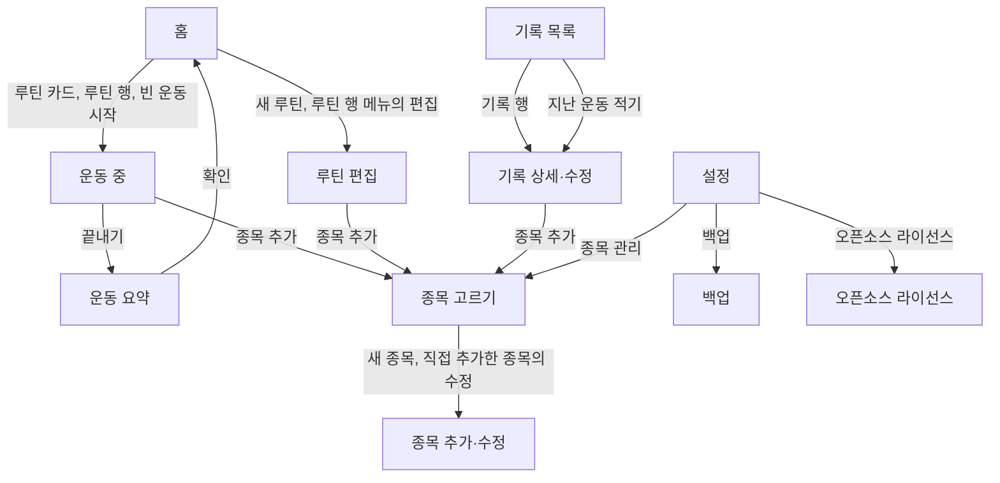
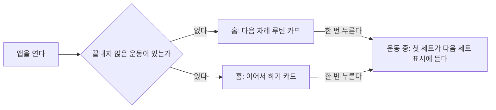

# 디자인 계약

작성일: 2026-11-18. 이슈 [#14](https://github.com/zzunsik/next-set/issues/14).

디자인 방향은 A "차분한 기록장"으로 정했다(2026-11-18 협의). 이 문서의 색, 크기, 모서리 값은 방향 A를 기준으로 적었다. 값은 실제 기기 화면을 보고 한 번 더 고친다. 순서는 "값을 확정하는 절차"에 있다.

화면을 구현할 때 따를 값과 화면 구성을 적는다. 요구사항은 [`requirements.md`](requirements.md), 원칙은 [`design-references.md`](design-references.md)의 "정리한 원칙"을 따른다. 이 문서에서 "원칙 n"은 그 절의 번호다. 토큰을 Compose 테마로 옮기는 일은 [#19](https://github.com/zzunsik/next-set/issues/19)에서 한다.

## 방향

후보 셋 가운데 A로 정했다. 방향이 달라도 컴포넌트 구성과 화면 흐름은 같고 아래 표의 값과 색 토큰만 다르다.

| 값 | A 차분한 기록장(정함) | B 굵은 숫자 | C 부드러운 카드 |
|---|---|---|---|
| 바탕 | 옅은 회색 | 대비가 높은 흰색과 검정 | 남보라 기운 |
| 세트 행 높이 | 48dp | 56dp | 52dp |
| 모서리 | 8dp | 14dp | 22dp |
| 큰 숫자 | 40sp Bold | 56sp ExtraBold | 44sp |

세 방향이 함께 지키는 것

- 색은 고정한다. 다이내믹 컬러를 쓰지 않는다(NF-05).
- 강조색은 남보라 계열이고 "누를 수 있음"만 뜻한다. 완료 색은 초록 계열이고 "끝남"만 뜻한다(원칙 4).
- 밝은 화면과 어두운 화면을 함께 맞춘다(NF-04).
- Material 3는 안정판에 들어온 요소만 쓴다(NF-07). 판정 규칙은 "컴포넌트" 절 끝에 적었다.

## 값을 확정하는 절차

소유자는 방향을 고르면서 화면 구성은 그대로 두고 겉모습은 실제 화면을 보고 더 다듬자고 했다(2026-11-18 협의). 방향을 고를 때 본 것은 견본 그림이고 기기에 그린 화면이 아니다. 이 문서의 값도 계산과 문서로만 정했다. 값은 아래 순서로 확정한다.

1. #19에서 이 문서의 색, 타이포, 간격, 모서리 값을 테마 코드로 옮기고 Pretendard를 넣는다.
2. 같은 이슈에서 홈과 운동 중 화면을 견본 데이터로 그린다. 기능은 붙이지 않는다. 데이터는 지어낸 루틴과 기록을 쓴다.
3. 아래 장면을 실제 기기 화면으로 찍는다. 밝은 화면과 어두운 화면을 모두 찍는다.
4. 소유자가 찍은 화면과 기기를 보고 아래 항목을 검토한다.
5. 검토 결과로 이 문서의 값을 고친다. 색을 바꾸면 대비 표와 색각 계산을 다시 한다. 테마 코드도 같은 PR에서 맞춘다.
6. 그 뒤에 화면 구현 이슈(#21부터)에 들어간다.

찍을 장면

| 화면 | 장면 |
|---|---|
| 홈 | 루틴이 여럿 있는 상태, 이어서 하기 카드가 뜬 상태 |
| 운동 중 | 세트 몇 개를 완료한 상태, 휴식 타이머 하단 바가 뜬 상태, 숫자판이 열린 상태 |

검토할 항목

| 항목 | 지금 값 | 볼 것 |
|---|---|---|
| 숫자 크기와 굵기 | `numeralLarge` 40sp Bold, `numeralMedium` 28sp Bold, `numeralRow` 20sp Bold | 다음 세트가 팔 길이에서 읽히는가. 세트 행의 값이 너무 굵거나 가늘지 않은가. Pretendard 숫자의 모양과 자간 |
| 행 높이와 여백 | 세트 행 48dp, 입력 칸 40dp, 목록 행 56dp, 좌우 여백 16dp, 종목 사이 24dp | 한 화면에 세트가 몇 개 보이는가. 옆 행을 잘못 누르지 않는가 |
| 강조색 면적 | 채운 강조색은 시작 버튼, 숫자판의 "다음" 키, 휴식 진행 막대, 선택된 체크 상자 | 한 화면에 강조색이 너무 많거나 적지 않은가. 글자 버튼이 누르는 요소로 보이는가 |
| 완료 표시 | 행 바탕 `doneSoft`, 체크 버튼 `done` | 완료한 행과 안 한 행이 한눈에 갈리는가. 어두운 화면에서 초록이 튀지 않는가 |
| 휴식 바 | 두 줄, 남은 시간 28sp, 버튼 높이 48dp | 세트 표를 얼마나 가리는가. 숫자판과 함께 떴을 때 목록이 얼마나 남는가 |
| 카드와 배경 | `surface`와 `bg`의 대비 1.07(밝은 화면), 1.09(어두운 화면) | 카드의 경계가 보이는가. 테두리가 필요한가 |

이 절차가 끝나기 전의 값은 출발점이다. 컴포넌트 구성, 화면 흐름, 색의 뜻은 이 절차로 바꾸지 않는다.

## 색

### 토큰

| 토큰 | 이름 | 밝은 화면 | 어두운 화면 | 쓰임새 |
|---|---|---|---|---|
| `bg` | 배경 | `#F6F7F9` | `#101116` | 화면 바탕, 운동 중 화면의 세트 표 바탕 |
| `surface` | 표면 | `#FFFFFF` | `#191B22` | 카드, 입력 칸, 숫자판과 휴식 타이머 바의 바탕. 밝은 화면에서는 배경이 옅은 회색이고 표면이 흰색이다 |
| `text` | 글자 | `#16181D` | `#ECEDF2` | 본문, 제목, 완료한 세트의 값 |
| `text2` | 보조 글자 | `#5A5F6B` | `#A2A6B4` | 직전 기록, 단위, 라벨, 아직 안 한 세트의 값, 빈 칸 테두리 |
| `line` | 구분선 | `#E0E3EA` | `#2B2E39` | 종목 사이 선, 바의 윗선. 장식이다 |
| `accent` | 강조색 | `#3F3DB8` | `#A9A8FF` | 누르는 요소. 채운 버튼, 글자 버튼, 선택된 칸의 테두리 |
| `onAccent` | 강조색 위 글자 | `#FFFFFF` | `#14124A` | 채운 버튼의 글자와 아이콘 |
| `accentSoft` | 옅은 강조색 | `#E6E6F8` | `#25254A` | 선택된 칸과 선택된 칩의 바탕 |
| `done` | 완료 색 | `#1A7A48` | `#6FD39A` | 완료 체크 버튼의 바탕, 완료 체크 아이콘 |
| `onDone` | 완료 색 위 글자 | `#FFFFFF` | `#06301B` | 완료 체크 버튼 안의 체크 모양 |
| `doneSoft` | 옅은 완료 색 | `#DCF0E4` | `#163726` | 완료한 세트 행의 바탕 |
| `error` | 오류 색 | `#B3261E` | `#F2B8B5` | 오류 문구, 지우기 확인 버튼의 글자 |

### 쓰임새 규칙

- 강조색은 누르면 무언가 일어나는 요소에만 쓴다. 제목, 장식, 현재 위치 표시에 쓰지 않는다.
- 완료 색은 끝난 세트와 끝난 종목에만 쓴다. "성공", "좋음", "추천"의 뜻으로 쓰지 않는다.
- 완료는 색과 체크 모양을 함께 쓴다(NF-06). 완료한 행은 바탕이 `doneSoft`로 바뀌고 체크 버튼 안에 체크 모양이 생긴다.
- 최고 기록 표시는 세 번째 색을 쓰지 않는다. 글자색 바탕에 배경색 글자를 얹은 반전 배지와 아이콘으로 구분한다.
- 오류 색은 글자와 아이콘에만 쓴다. 바탕을 오류 색으로 채우지 않는다.
- `line`과 `surface`는 배경과의 대비가 낮다(아래 표). 이 둘만으로 요소를 구분해야 하는 배치를 만들지 않는다.
  - 값이 든 입력 칸은 안의 글자로 알아본다.
  - 값이 없는 입력 칸에는 `text2` 색 1dp 테두리를 두른다.
  - 아직 누르지 않은 체크 버튼은 `text2` 색 2dp 테두리 상자다.
- 비활성 요소는 M3의 기본 비활성 표현을 따르고, 대비 기준의 대상이 아니다.
- 운동 중 화면과 기록 화면에는 장식 배경, 그림, 종목 이미지를 두지 않는다.

### 대비

WCAG 2.2의 상대 휘도 공식으로 계산했다. 채널 값 c(0~1)는 c ≤ 0.04045이면 c / 12.92, 아니면 ((c + 0.055) / 1.055)^2.4로 선형화한다. 휘도는 L = 0.2126 R + 0.7152 G + 0.0722 B, 대비는 (L밝은 쪽 + 0.05) / (L어두운 쪽 + 0.05)다. 값은 소수 둘째 자리 아래를 버렸다. 기준은 본문 글자 4.5:1, 큰 글자와 아이콘, 요소 테두리 3:1이다.

| 앞 / 바탕 | 쓰임 | 기준 | 밝은 화면 | 어두운 화면 |
|---|---|---|---|---|
| `text` / `bg` | 본문 | 4.5 | 16.56 | 16.12 |
| `text` / `surface` | 카드 안 본문, 입력 칸의 값 | 4.5 | 17.75 | 14.70 |
| `text2` / `bg` | 보조 글자, 직전 기록 | 4.5 | 5.96 | 7.76 |
| `text2` / `surface` | 카드 안 보조 글자, 안 한 세트의 값 | 4.5 | 6.39 | 7.08 |
| `accent` / `bg` | 글자 버튼 | 4.5 | 7.61 | 8.73 |
| `accent` / `surface` | 카드와 바 안의 글자 버튼 | 4.5 | 8.16 | 7.96 |
| `onAccent` / `accent` | 채운 버튼의 글자 | 4.5 | 8.16 | 8.00 |
| `accent` / `accentSoft` | 선택된 칩의 글자 | 4.5 | 6.62 | 6.74 |
| `text` / `accentSoft` | 선택된 칸의 값 | 4.5 | 14.40 | 12.45 |
| `done` / `bg` | 완료 체크 아이콘 | 3 | 4.99 | 10.28 |
| `done` / `surface` | 카드 안 완료 체크 아이콘 | 3 | 5.35 | 9.38 |
| `onDone` / `done` | 완료 체크 버튼 안의 체크 모양 | 3 | 5.35 | 7.92 |
| `done` / `doneSoft` | 완료 행 위의 체크 버튼 | 3 | 4.49 | 7.12 |
| `text` / `doneSoft` | 완료 행의 값 | 4.5 | 14.90 | 11.16 |
| `text2` / `doneSoft` | 완료 행의 직전 기록 | 4.5 | 5.36 | 5.37 |
| `error` / `bg` | 오류 문구 | 4.5 | 6.09 | 11.04 |
| `error` / `surface` | 카드 안 오류 문구 | 4.5 | 6.53 | 10.07 |
| `text2` / `bg` | 빈 칸과 빈 체크 버튼의 테두리 | 3 | 5.96 | 7.76 |
| `bg` / `text` | 최고 기록 배지의 글자 | 4.5 | 16.56 | 16.12 |

모든 조합이 기준을 넘는다. 가장 낮은 값은 밝은 화면의 `done` / `doneSoft` 4.49다.

장식으로만 쓰는 조합은 기준의 대상이 아니다. 참고로 적는다.

| 조합 | 밝은 화면 | 어두운 화면 |
|---|---|---|
| `line` / `bg` | 1.19 | 1.39 |
| `surface` / `bg` | 1.07 | 1.09 |
| `accentSoft` / `bg` | 1.14 | 1.29 |
| `doneSoft` / `bg` | 1.11 | 1.44 |

색 값이 문서와 코드 두 곳에 놓이게 된다. #19에서 테마의 색 값으로 위 표의 대비를 다시 계산해 기준 아래로 내려가면 실패하는 테스트를 둔다.

### 적록 색각에서의 구분

강조색과 완료 색이 적록 색각 이상에서 같은 색으로 보이지 않는지 계산으로 확인했다.

한 일

1. sRGB 값을 선형 RGB로 바꿨다(대비 계산과 같은 식).
2. Viénot, Brettel, Mollon(1999)의 행렬로 선형 RGB를 LMS로 바꾸고, 제1색각(L 원뿔 없음)과 제2색각(M 원뿔 없음)의 투영 행렬을 곱한 뒤 RGB로 되돌렸다. 범위를 벗어난 값은 0과 1로 잘랐다.
3. 변환한 두 색의 색차를 CIEDE2000(ΔE00)으로, 밝기 차이를 휘도 대비로 구했다. ΔE00 구현은 Sharma 등(2005)의 검증 값 한 쌍으로 맞는지 확인했다.

| 화면 | 보는 조건 | 강조색 | 완료 색 | ΔE00 | 휘도 대비 |
|---|---|---|---|---|---|
| 밝은 | 변환 없음 | `#3F3DB8` | `#1A7A48` | 48.3 | 1.52 |
| 밝은 | 제1색각 | `#3D3DB8` | `#747448` | 55.6 | 1.68 |
| 밝은 | 제2색각 | `#3E3EB8` | `#69694A` | 49.6 | 1.44 |
| 어두운 | 변환 없음 | `#A9A8FF` | `#6FD39A` | 43.0 | 1.17 |
| 어두운 | 제1색각 | `#A8A8FF` | `#CBCB9A` | 47.5 | 1.28 |
| 어두운 | 제2색각 | `#A8A8FF` | `#BDBD9C` | 41.6 | 1.11 |

옅은 색 쌍(`accentSoft`와 `doneSoft`)의 ΔE00은 밝은 화면에서 17.0(변환 없음), 14.0(제1색각), 11.8(제2색각)이고 어두운 화면에서 29.2, 28.9, 25.4다.

읽는 법

- 변환한 뒤에도 강조색은 파랑 쪽, 완료 색은 누런 쪽에 남는다. 색차는 변환 전과 비슷한 크기다.
- 두 색의 밝기는 차이가 작다(휘도 대비 1.11~1.68). 흑백 화면이나 전색맹에서는 색으로 구분되지 않는다. 그래서 완료는 체크 모양과 행 바탕 변화를 함께 쓴다(NF-06).
- 옅은 색 쌍은 밝은 화면에서 차이가 작아진다. 선택된 칸은 2dp 강조색 테두리로, 완료 행은 체크 모양으로 구분하므로 옅은 색만으로 뜻을 전하는 곳은 없다.

이 확인의 한계는 "확인하지 못한 것"에 적었다.

### M3 색 역할과의 대응

#19가 `ColorScheme`을 채울 때 쓰는 제안이다. 이름이 겹치는 곳이 있어 적어 둔다.

| M3 역할 | 이 문서의 토큰 | 비고 |
|---|---|---|
| `background`, `surface` | `bg` | M3의 `surface`는 화면 바탕이다. 이 문서의 `surface`가 아니다 |
| `surfaceContainer` 계열 | `surface` | 카드, 시트, 바의 바탕 |
| `onBackground`, `onSurface` | `text` | |
| `onSurfaceVariant`, `outline` | `text2` | |
| `outlineVariant` | `line` | |
| `primary`, `onPrimary` | `accent`, `onAccent` | |
| `primaryContainer`, `secondaryContainer` | `accentSoft` | 그 위 글자는 `text` |
| `error` | `error` | |

`done`, `onDone`, `doneSoft`는 M3 역할에 넣지 않고 앱의 확장 색으로 둔다. `tertiary`에 넣으면 M3 컴포넌트가 완료와 상관없는 곳에 초록을 쓸 수 있다. 표에 없는 역할(`secondary`, `tertiary` 등)을 비워 두면 M3 기본 보라색이 나온다. 어떤 컴포넌트가 어느 역할을 쓰는지는 #19에서 컴포넌트마다 확인하고 남는 역할을 `accent`나 `text2`로 채운다.

## 타이포

글꼴은 본문과 숫자 모두 Pretendard다(2026-11-18 협의). 파일과 적용 방법은 이 절의 "글꼴"에 적었다.

| 토큰 | 크기 / 줄 높이 | 굵기 | 쓰임 |
|---|---|---|---|
| `numeralLarge` | 40sp / 48sp | Bold(700) | 다음 세트 표시의 무게, 횟수, 시간. 한 화면에 한 곳 |
| `numeralMedium` | 28sp / 36sp | Bold(700) | 휴식 타이머 바의 남은 시간 |
| `headline` | 28sp / 36sp | Bold(700) | 다음 차례 루틴 이름, 요약 화면의 결론 문장 |
| `title` | 22sp / 28sp | Bold(700) | 화면 제목, 숫자판의 숫자 키, 요약 화면의 숫자 |
| `numeralRow` | 20sp / 24sp | Bold(700) | 세트 행의 입력 값 |
| `heading` | 18sp / 24sp | SemiBold(600) | 종목 머리, 카드와 구역의 제목, 줄어든 다음 세트 표시 |
| `body` | 16sp / 24sp | Regular(400) | 본문, 목록 행 제목 |
| `label` | 14sp / 20sp | SemiBold(600) | 버튼, 칩, 증감 키, 세트 표의 머리 |
| `caption` | 13sp / 18sp | Regular(400) | 보조 글자, 직전 기록, 단위, 날짜 |

규칙

- 큰 숫자 스타일은 `numeralLarge`와 `numeralMedium` 둘이다. 다른 곳의 숫자를 이 크기로 키우지 않는다(원칙 5).
- 숫자는 크게, 단위는 작게 쓴다. `numeralLarge` 옆의 단위(kg, 회)는 `label`, `numeralRow` 옆의 단위는 `caption`이다. 단위는 숫자의 글자 밑선에 맞춘다.
- 모든 스타일에 폭이 같은 숫자를 켠다(`fontFeatureSettings = "tnum"`). 값이 바뀌어도 자리가 흔들리지 않는다. 휴식 시간, 경과 시간, 세트 표의 값이 대상이다.
- 쓰는 굵기는 Regular(400), SemiBold(600), Bold(700) 셋이다. 다른 굵기를 쓰지 않는다.
- 자간은 모든 스타일에서 0이다.
- 크기는 sp로 둔다. 기기의 글자 크기 설정을 따른다(NF-10).
- `numeralLarge`는 한 줄에 들어가지 않으면 줄을 바꾸지 않고 크기를 줄인다. 하한은 28sp다. M3 `Text`의 `autoSize`를 쓴다.
- 행과 버튼의 높이는 고정하지 않고 최소 높이로 잡는다. 글자가 커지면 행이 늘어난다.
- 줄어든 글자가 잘릴 자리에는 말줄임을 쓰되 숫자와 단위는 자르지 않는다. 자리가 모자라면 종목 이름을 먼저 줄인다.

### 글꼴

Pretendard 파일을 앱에 넣는다. 실제로 넣는 일은 #19에서 한다.

| 항목 | 정한 것 |
|---|---|
| 파일 | 굵기별 정적 파일 셋. `Pretendard-Regular.otf`(400), `Pretendard-SemiBold.otf`(600), `Pretendard-Bold.otf`(700). 공식 저장소의 v1.3.9 릴리스에서 받는다 |
| 두는 곳 | `app/src/main/res/font/`. 리소스 파일 이름은 소문자여야 하므로 `pretendard_regular.otf`, `pretendard_semibold.otf`, `pretendard_bold.otf`로 넣는다. 글꼴 데이터는 바꾸지 않는다 |
| 크기 | 세 파일을 더해 4,734,716바이트(약 4.7MB) |
| 숫자 폭 | 모든 텍스트 스타일에 `fontFeatureSettings = "tnum"` |
| 글자 크기 | sp. 기기의 글자 크기 설정을 따른다 |
| 대체 글꼴 | 시스템 기본 글꼴(`FontFamily.Default`) |
| 라이선스 | SIL OFL 1.1. 설정의 "오픈소스 라이선스"에 저작권 표시와 라이선스 전문을 싣는다 |

정적 파일 셋을 고른 근거

| | 정적 OTF 셋 | 가변 TTF 하나 | 정적 TTF 셋 |
|---|---|---|---|
| 파일 크기 | 4,734,716바이트 | 6,739,336바이트 | 8,059,048바이트 |
| zip 최고 압축 크기 | 3,192,780바이트 | 2,961,883바이트 | 재지 않음 |
| 담긴 굵기 | 400, 600, 700 | 45~930 전부 | 400, 600, 700 |
| 불러오는 법 | 굵기마다 파일을 지정한다 | 굵기를 변형 설정으로 지정한다 | 굵기마다 파일을 지정한다 |

- 방향 A는 굵기를 셋만 쓴다. 가변 파일에 든 나머지 굵기는 쓰지 않는다.
- 파일 크기는 정적 OTF 셋이 가변 파일보다 약 2.0MB 작다. zip으로 압축하면 가변 파일이 약 0.2MB 작다. 내려받는 크기는 비슷하다.
- 정적 파일은 `Font(리소스, 굵기)`로 불러온다. 가변 글꼴은 Compose 글꼴 문서의 예제가 실험 API 옵트인(`ExperimentalTextApi`)을 달고 있다.
- `res/font`는 `.ttf`, `.ttc`, `.otf`, `.xml`을 받는다(Font resources 문서).
- 크기는 2026-11-18에 v1.3.9 태그의 파일로 쟀다. #19에서 서명하지 않은 릴리스 APK 안의 세 파일을 재 보니 압축된 크기가 합쳐 3,182,352바이트(약 3.2MB)였다.

폭이 같은 숫자

- Pretendard의 기본 숫자는 폭이 제각각이다. Regular에서 1은 898, 4는 1278이다(1em = 2048).
- `tnum`을 켜면 열 개 숫자의 폭이 같아진다. Regular 1258, SemiBold 1314, Bold 1340이다. 세 파일 모두 `tnum` 기능이 있다(글꼴 파일을 열어 확인).
- 그래서 `tnum`을 빠뜨리면 휴식 시간과 세트 표의 숫자가 값이 바뀔 때마다 흔들린다. `Typography`의 모든 `TextStyle`에 `fontFeatureSettings = "tnum"`을 넣고 화면 코드는 테마의 스타일만 꺼내 쓴다. 스타일을 새로 만들어 쓰지 않는다.
- 굵기가 다르면 숫자 폭도 다르다. 같은 열에 놓이는 숫자는 상태가 바뀌어도 굵기를 바꾸지 않는다. 세트 행의 값은 대기와 완료에서 굵기가 같고 색만 다르다.
- #19에서 숫자 스타일마다 "111"과 "000"의 폭이 같은지 재는 테스트를 둔다.

줄 높이와 자간

- Pretendard의 줄 높이 지표는 ascender 1950, descender −494, lineGap 0이다(1em = 2048). 글꼴이 정한 줄 높이는 크기의 1.193배다. 세 굵기가 같다.
- 타입 표의 줄 높이는 모두 크기의 1.2배 이상이다. 가장 빠듯한 것은 `numeralLarge`(40sp / 48sp)와 `numeralRow`(20sp / 24sp)로 1.2배다. 표의 값을 그대로 쓴다.
- M3의 기본 타입 스케일은 스타일마다 자간 토큰을 따로 둔다. M3 기본 `Typography`에서 글꼴만 바꾸면 그 자간이 남는다. 모든 스타일에 `letterSpacing = 0.sp`를 적는다.
- 큰 숫자의 자간을 조일지는 기기 화면 검토에서 본다.

대체 글꼴

- 글꼴 파일은 앱 리소스로 들어간다. 그래도 파일을 읽지 못하는 경우 앱이 멈추지 않고 시스템 기본 글꼴로 그려야 한다. #19에서 글꼴이 아닌 리소스를 `Font(리소스, 굵기)`로 읽게 해 보니 Compose가 예외 없이 시스템 기본 글꼴로 그렸다(Robolectric, `FontTest`). 그래서 따로 대체 처리를 넣지 않았다.
- 배치는 Pretendard의 글자 폭에 기대지 않는다. 행과 버튼은 최소 크기로 잡고 큰 숫자는 `autoSize`로 줄어든다. 시스템 글꼴로 그려져도 글자가 잘리지 않아야 한다.

라이선스 고지

- OFL 1.1은 글꼴을 소프트웨어에 넣어 배포할 때 저작권 표시와 라이선스를 함께 넣으라고 요구하고 사용자가 쉽게 볼 수 있어야 한다고 적는다(LICENSE의 조건 2).
- 설정의 "오픈소스 라이선스"에 Pretendard 항목을 두고 저장소 LICENSE 파일의 저작권 표시와 라이선스 전문을 그대로 싣는다. 저작권 표시에는 Pretendard와 함께 바탕이 된 글꼴(Source, Inter, M PLUS 1)의 줄이 들어 있다.
- 저장소에도 글꼴의 출처와 라이선스를 적는다(`AGENTS.md`의 공개 저장소 규칙). 자리는 `README.md`의 "글꼴" 절이다(#19).

## 간격, 모서리, 누르는 영역

간격

| 토큰 | 값 | 쓰임 |
|---|---|---|
| `space.xs` | 4dp | 숫자와 단위 사이, 제목과 보조 줄 사이 |
| `space.sm` | 8dp | 행 안의 요소 사이, 숫자판 키 사이 |
| `space.md` | 12dp | 카드 안 묶음 사이, 칩 사이 |
| `space.lg` | 16dp | 화면 좌우 여백, 카드 안쪽 여백 |
| `space.xl` | 24dp | 종목과 종목 사이, 구역 사이 |
| `space.xxl` | 32dp | 빈 상태 문구 위아래 |

모서리

| 토큰 | 값 | 쓰임 |
|---|---|---|
| `radius.md` | 8dp | 카드, 버튼, 입력 칸, 체크 버튼, 숫자판 키, 검색 칸 |
| `radius.full` | 높이의 절반 | 칩, 최고 기록 배지 |

하단 시트와 대화상자는 M3 기본 모양을 그대로 둔다.

크기

| 요소 | 값 |
|---|---|
| 누르는 요소의 최소 영역 | 48 × 48dp(NF-10). 보이는 모양이 작아도 영역은 48dp를 채운다 |
| 누르는 요소의 보이는 모양 사이 | 8dp 이상 |
| 세트 행의 최소 높이 | 48dp |
| 목록 행(두 줄)의 최소 높이 | 56dp |
| 입력 칸 | 보이는 높이 40dp, 누르는 영역 48dp |
| 체크 버튼 | 보이는 크기 40 × 40dp, 누르는 영역 48 × 48dp |
| 숫자판 키 | 높이 52dp |
| 주요 버튼(운동 시작, 이어서 하기) | 높이 56dp, 화면 폭을 채운다 |
| 일반 버튼 | 높이 48dp |
| 아이콘 | 24dp |

## 컴포넌트

상태 이름은 표마다 같다. 눌림은 M3의 기본 눌림 표시(물결)를 쓴다.

### 다음 차례 루틴 카드 `NextRoutineCard`

쓰이는 화면: 홈.

| 구성 요소 | 내용 |
|---|---|
| 라벨 | "다음 차례"(`caption`, `text2`). 직접 고른 루틴이면 "직접 고름"과 "자동 순서로" 글자 버튼 |
| 루틴 이름 | `headline`. 두 줄까지 |
| 종목 미리보기 | "벤치 프레스, 인클라인 덤벨 프레스 외 3개"(`body`, `text2`). 두 줄까지 |
| 지난 기록 | "지난번 11월 14일 (토)"(`caption`). 한 적이 없으면 줄을 비운다 |
| 시작 버튼 | "운동 시작". 채운 강조색 버튼, 높이 56dp |
| 더보기 버튼 | 카드 오른쪽 위. 메뉴: 편집, 지우기 |

| 상태 | 모습 |
|---|---|
| 기본 | `surface` 바탕 카드. 더보기 버튼을 뺀 카드 전체가 누르는 영역이고 시작 버튼과 같은 일을 한다 |
| 눌림 | 카드 전체에 눌림 표시 |
| 직접 고름 | 라벨이 바뀌고 "자동 순서로" 버튼이 생긴다 |
| 진행 중 | 이어서 하기 카드로 바뀐다. 라벨 "진행 중", 루틴 이름, "12세트 중 5세트 완료 · 32분째", 버튼 "이어서 하기" |
| 비활성 | 없다. 루틴이 하나도 없으면 카드 대신 빈 상태를 보인다 |

### 루틴 목록 행 `RoutineRow`

쓰이는 화면: 홈.

| 구성 요소 | 내용 |
|---|---|
| 루틴 이름 | `body` SemiBold |
| 보조 줄 | "종목 5개 · 지난번 11월 12일"(`caption`, `text2`) |
| 시작 표시 | 오른쪽의 시작 아이콘(`accent`). 행을 누르면 바로 시작한다는 표시다 |
| 더보기 버튼 | 메뉴: 맨 위에 올리기, 편집, 지우기 |

| 상태 | 모습 |
|---|---|
| 기본 | `bg` 바탕, 행 사이에 `line` |
| 눌림 | 행 전체에 눌림 표시. 운동 중 화면으로 넘어간다 |
| 순서 편집 | 시작 표시와 더보기 버튼이 순서 바꾸기 손잡이와 지우기 버튼으로 바뀐다. 행을 눌러도 시작하지 않고 루틴 편집을 연다 |
| 비활성 | 없다 |

### 종목 머리 `ExerciseHeader`

쓰이는 화면: 운동 중, 기록 상세·수정, 운동 요약.

| 구성 요소 | 내용 |
|---|---|
| 종목 이름 | `heading`, `text`. 누르는 요소가 아니다 |
| 휴식 시간 | "휴식 2:00" 글자 버튼(`label`, `accent`). 누르면 이 종목의 휴식 시간을 고친다. 휴식 시간은 종목마다 값 하나다. 정하지 않은 종목은 설정의 기본값을 따른다(REST-03) |
| 메모 | 적은 메모 한 줄(`caption`, `text2`). 없으면 줄을 비운다. 메뉴에서 연다(LOG-11) |
| 더보기 버튼 | 메뉴: 메모, 위로 옮기기, 아래로 옮기기, 마지막 세트 지우기, 종목 빼기 |
| 세트 표 머리 | "세트", "지난번", "kg", "회", 체크 자리(`label`, `text2`). 목표 횟수 범위가 있으면 "회 8~12"로 적는다(LOG-05) |

| 상태 | 모습 |
|---|---|
| 기본 | 위 구성 |
| 모두 완료 | 종목 이름 옆에 체크 아이콘(`done`) |
| 읽기 전용 | 기록 상세와 운동 요약. 휴식 시간과 더보기 버튼이 없다 |

세트 표 머리는 기록 방식에 따라 바뀐다(LOG-08). 횟수만이면 "세트, 지난번, 회", 시간이면 "세트, 지난번, 시간"이다.

### 세트 행 `SetRow`

쓰이는 화면: 운동 중, 기록 상세·수정, 운동 요약(읽기 전용).

| 구성 요소 | 폭 | 내용 |
|---|---|---|
| 순번 | 32dp | "1"(`body` SemiBold) |
| 직전 기록 | 남는 폭 | "60kg × 10"(`caption`, `text2`). 기록이 없으면 빈칸(원칙 2). 종목의 지금 기록 방식과 같은 방식으로 적은 세트만 본다. 누르는 요소가 아니다 |
| 무게 칸 | 72dp | 값(`numeralRow`). 미리 채운 값이 들어 있다(LOG-03) |
| 횟수 칸 | 64dp | 값(`numeralRow`) |
| 완료 체크 | 48dp | 체크 버튼 |

요소 사이는 8dp다. 화면 폭 360dp에서 좌우 여백 16dp를 빼면 328dp가 남고 직전 기록에 80dp가 돌아간다. 직전 기록이 길면 두 줄로 나눈다. 횟수만 종목과 시간 종목은 입력 칸이 하나(88dp)다.

| 상태 | 모습 |
|---|---|
| 대기 | `bg` 바탕. 값은 `text2` 색. 체크 버튼은 `text2` 2dp 테두리 상자 |
| 다음 세트 | 대기와 같되 값이 `text` 색이고 순번이 굵다. 바탕색은 바꾸지 않는다 |
| 칸 선택 | 선택된 칸이 `accentSoft` 바탕에 `accent` 2dp 테두리. 값은 `text` 색. 숫자판이 열려 있다 |
| 눌림 | 칸과 체크 버튼에 눌림 표시 |
| 완료 | 행 바탕 `doneSoft`. 값은 `text` 색. 체크 버튼은 `done` 바탕에 `onDone` 체크 모양 |
| 완료, 최고 기록 | 완료 모습에 아이콘만 있는 최고 기록 배지가 순번 아래에 붙는다 |
| 값 없음 | 값이 빈 칸에 `text2` 1dp 테두리. 체크 버튼을 누르면 완료되지 않고 빈 칸의 숫자판이 열린다 |
| 읽기 전용 | 기록 상세와 운동 요약. 직전 기록 열과 체크 버튼이 없다. 값은 `text` 색 |

동작

- 체크 버튼을 누르면 값을 고치지 않고도 세트가 완료된다(LOG-04). 휴식 타이머가 시작된다(REST-01).
- 완료한 행의 체크 버튼을 다시 누르면 완료가 풀린다. 그 세트로 시작한 휴식 타이머도 멈춘다. 확인을 묻지 않는다.
- 완료한 행의 칸도 눌러서 고친다. 고친 값은 바로 저장된다(NF-09).
- 행을 길게 누르면 "이 세트 지우기" 메뉴가 뜬다. 지운 뒤에는 "되돌리기"가 있는 알림 줄을 보인다(LOG-09).
- 세트 표 아래에 "세트 추가" 글자 버튼이 있다. 새 행의 값은 바로 위 행의 값이다.

### 다음 세트 표시 `NextSetDisplay`

쓰이는 화면: 운동 중. 상단 바 아래에 고정한다. 목록을 내려도 남는다(LOG-06, 원칙 1).

| 구성 요소 | 내용 |
|---|---|
| 라벨 | "다음 세트 · 4세트 중 2번째"(`caption`, `text2`) |
| 종목 이름 | `heading` |
| 값 | "60 kg × 10 회". 숫자는 `numeralLarge`, 단위와 곱셈표는 `label` |
| 견줄 값 | "지난번 60kg × 10"(`caption`, `text2`). 직전 기록이 없으면 줄을 비운다(원칙 5) |

| 상태 | 모습 |
|---|---|
| 기본 | 위 구성. 누르면 목록이 그 세트 행으로 움직인다 |
| 숫자판 열림 | 한 줄로 줄어든다. "벤치 프레스 · 60kg × 10"(`heading`) |
| 값 없음 | 숫자 자리에 "직접 입력" 글자 버튼. 누르면 그 칸의 숫자판이 열린다 |
| 모두 완료 | "모든 세트를 끝냈어요."와 "운동 끝내기" 채운 버튼 |
| 종목 없음 | 표시하지 않는다. 화면 본문이 빈 상태를 보인다 |

값은 세트 행에 미리 채운 값과 같다. 칸에서 값을 고치면 이 표시도 바로 바뀐다. 횟수만 종목은 "12 회", 시간 종목은 "1:00"으로 적는다.

### 자체 숫자판 `NumberPad`

쓰이는 화면: 운동 중, 기록 상세·수정, 루틴 편집(목표 값). 입력 칸을 누르면 화면 아래에서 올라온다. 시스템 키보드를 띄우지 않는다(LOG-07).

배치는 네 열이다.

| 줄 | 1열 | 2열 | 3열 | 4열 |
|---|---|---|---|---|
| 증감 줄 | −2.5 | −1 | +1 | +2.5 |
| 1 | 1 | 2 | 3 | 지우기 |
| 2 | 4 | 5 | 6 | 다음 |
| 3 | 7 | 8 | 9 | (다음이 이어진다) |
| 4 | . | 0 | 숫자판 닫기 | (다음이 이어진다) |

"다음" 키 하나가 2~4줄의 4열을 세로로 차지한다.

| 칸 종류 | 증감 줄 | 소수점 키 | 입력 범위 |
|---|---|---|---|
| 무게 | −2.5, −1, +1, +2.5 | 있음 | 0~999.99, 소수 둘째 자리까지 |
| 횟수 | −1, +1(두 키가 줄을 나눠 쓴다) | 없음(빈 자리) | 0~999 |
| 시간 | −15초, −5초, +5초, +15초 | 없음(빈 자리) | 0:00~59:59. 숫자를 누르면 오른쪽부터 채운다(1, 3, 0 → 1:30) |

| 구성 요소 | 모습 |
|---|---|
| 숫자 키 | `bg` 바탕, 숫자는 `title` |
| 증감 키 | `bg` 바탕, 값은 `label`, `accent` 색. 아이콘만 두지 않고 값을 적는다 |
| 지우기 | 아이콘과 접근성 이름 "지우기". 한 번 누르면 한 글자, 길게 누르면 전부 지운다 |
| 다음 | 채운 강조색 키. 행의 마지막 칸에서는 글자가 "완료"로 바뀐다 |
| 숫자판 닫기 | 아이콘과 접근성 이름 "숫자판 닫기" |

| 상태 | 모습 |
|---|---|
| 닫힘 | 보이지 않는다 |
| 열림 | 화면 아래 고정. 바탕 `surface`, 윗선 `line`. 휴식 타이머 바는 숫자판 위에 붙는다 |
| 눌림 | 키에 눌림 표시 |
| 비활성 키 | 칸 종류에 없는 키는 자리만 남기고 그리지 않는다 |

동작

- 칸을 누르면 그 칸의 값 전체가 선택된다. 첫 숫자를 누르면 값이 새 숫자로 바뀐다. 증감 키는 지금 값에 더하거나 뺀다.
- 증감으로 값이 0 아래로 내려가지 않는다. 빈 칸은 0으로 보고 계산한다.
- 증감 키를 누른 뒤에도 값 전체가 선택된 채로 남는다. 이어서 숫자를 치면 새 값이 된다. 증감으로 입력 범위의 위끝을 넘지 않는다.
- 값 전체가 선택된 상태에서 지우기를 누르면 값이 지워진다.
- 시간 칸에서 오른쪽 두 자리가 60 이상이면(0:75) 친 그대로 보이고 저장할 때 분으로 넘긴다(1:15). 59:59를 넘으면 59:59로 저장한다.
- "다음"은 같은 행의 다음 칸으로 옮긴다. 운동 중 화면에서 마지막 칸의 "완료"는 세트를 완료하고 숫자판을 닫는다. 휴식 타이머가 시작된다.
- 루틴 편집과 기록 수정에서는 "완료"가 숫자판만 닫는다.
- 값은 키를 누를 때마다 저장된다(NF-09).
- 무게는 뒤따르는 0을 떼고 적는다(60, 62.5, 61.25).

### 휴식 타이머 하단 바 `RestTimerBar`

쓰이는 화면: 운동 중. 화면 아래에 고정한다. 세트 표를 가리지 않도록 목록의 아래 여백을 바 높이만큼 늘린다(REST-02, 원칙 3).

| 구성 요소 | 내용 |
|---|---|
| 진행 막대 | 바의 윗변을 따라 4dp. 남은 비율만큼 `accent`, 나머지는 `line` |
| 남은 시간 | "1:45"(`numeralMedium`) |
| 다음 세트 | "다음 벤치 프레스 60kg × 10"(`caption`, `text2`). 한 줄 |
| 줄이기 버튼 | "−15초" |
| 늘리기 버튼 | "+15초" |
| 건너뛰기 버튼 | "건너뛰기" |
| 알림 켜기 버튼 | "알림 켜기" 글자 버튼. 윗줄 오른쪽 끝. 조건이 맞을 때만 보인다(아래 "알림 켜기 버튼") |

두 줄로 놓는다. 윗줄은 남은 시간, 다음 세트, 알림 켜기 버튼이고 아랫줄은 조절 버튼 셋(줄이기, 늘리기, 건너뛰기)이다. 조절 버튼 셋은 폭을 똑같이 나눠 쓰고 높이는 48dp다. 아이콘만 두지 않고 값을 글자로 적는다. 바의 바탕은 `surface`다.

| 상태 | 모습 |
|---|---|
| 숨김 | 휴식 중이 아니다. 바가 없다 |
| 진행 중 | 위 구성. 남은 시간이 1초마다 바뀐다 |
| 눌림 | 버튼에 눌림 표시 |
| 종료 | 남은 시간 "0:00"을 2초 보인 뒤 바가 내려간다 |
| 숫자판 열림 | 바가 숫자판 바로 위에 붙고 한 줄로 줄어든다. 남은 시간과 조절 버튼 셋만 남긴다. 알림 켜기 버튼도 숨긴다. 다음 세트는 화면 위의 줄어든 다음 세트 표시가 보여 준다 |

동작

- 남은 시간이 15초 이하일 때 "−15초"를 누르면 휴식이 끝난다. "+15초"는 남은 시간이 10분이 될 때까지 누를 수 있다.
- 끝나기 전의 신호(REST-04)는 소리와 진동으로만 준다. 바의 색이나 크기를 바꾸지 않는다.
- 방해 금지 모드가 켜져 있으면 소리와 진동 신호를 내지 않는다. 바와 알림 표시는 그대로다(2026-11-18 협의).
- 휴식 중에 다른 세트를 완료하면 타이머가 그 세트의 휴식 시간으로 다시 시작된다.
- 앱 밖의 표시는 휴식 타이머 조사(#16)가 정한다. 휴식 중 알림에는 남은 시간, 다음 세트, 버튼 셋(시간 줄이기, 시간 늘리기, 건너뛰기)을 둔다. 버튼 글자는 이 바와 같게 "−15초", "+15초", "건너뛰기"로 적는다(REST-07).

알림 켜기 버튼

앱은 알림 권한을 먼저 묻지 않는다. 이 버튼을 눌렀을 때만 묻는다(2026-11-18 협의).

| 항목 | 내용 |
|---|---|
| 자리 | 윗줄 오른쪽 끝. 다음 세트 글자가 남는 폭을 쓰고 좁으면 종목 이름부터 줄인다 |
| 모습 | 글자 버튼 "알림 켜기"(`label`, `accent`). 누르는 영역 48dp |
| 보이는 조건 | 알림이 꺼져 있고 아직 거절한 적이 없을 때 |
| 누른 뒤 | 시스템의 알림 허용 창이 뜬다 |
| 허용한 뒤 | 버튼이 사라진다. 그 휴식부터 알림과 상태바 표시가 나온다 |
| 거절한 뒤 | 버튼을 숨긴다. 그 뒤로는 설정 화면의 "알림 꺼짐" 표시와 "알림 켜기" 버튼으로만 안내한다. 다시 묻는 문구나 알림 줄을 띄우지 않는다 |

- 알림이 꺼져 있어도 이 바와 소리·진동 신호는 그대로다.
- 버튼이 있고 없음에 따라 바의 높이가 바뀌지 않는다.
- 선택 없이 창을 닫은 경우와 Android 버전에 따른 차이는 휴식 타이머 조사(#16)가 정한다. 이 문서는 "거절하면"까지만 적는다.

### 종목 목록 행 `ExerciseRow`

쓰이는 화면: 종목 고르기, 루틴 편집.

| 구성 요소 | 내용 |
|---|---|
| 종목 이름 | `body` |
| 보조 줄 | "가슴 · 바벨"(`caption`, `text2`). 직접 추가한 종목은 "가슴 · 바벨 · 직접 추가". 세부 부위가 있는 종목은 부위 자리에 세부 부위를 적는다("허벅지 앞 · 바벨") |
| 끝 요소 | 화면에 따라 다르다(아래) |

| 상태 | 모습 |
|---|---|
| 고르기 | 끝에 체크 상자. 행을 누르면 선택이 켜지고 꺼진다 |
| 선택됨 | 체크 상자가 `accent`로 채워진다. 행 바탕은 바꾸지 않는다 |
| 관리 | 끝 요소가 없다. 직접 추가한 종목의 행을 누르면 종목 수정이 열린다. 내장 종목의 행은 누르는 요소가 아니다 |
| 루틴 편집 | 앞에 순서 바꾸기 손잡이, 보조 줄에 "3세트 · 60kg × 8~12회". 행을 누르면 종목 설정 시트가 열린다 |

### 검색 칸 `SearchField`

쓰이는 화면: 종목 고르기.

| 구성 요소 | 내용 |
|---|---|
| 돋보기 아이콘 | `text2` |
| 입력 | 안내 글 "종목 이름 검색"(`body`, `text2`). 시스템 키보드를 쓴다 |
| 지우기 버튼 | 글자가 있을 때만 보인다 |

| 상태 | 모습 |
|---|---|
| 기본 | `surface` 바탕, 높이 48dp, 모서리 `radius.md` |
| 입력 중 | `accent` 2dp 테두리 |
| 결과 없음 | 목록 자리에 빈 상태를 보인다 |

이름과 별칭 모두에서 찾는다(EX-02). 글자를 칠 때마다 목록이 바뀐다.

### 부위 필터 `BodyPartFilter`

쓰이는 화면: 종목 고르기, 종목 추가·수정(세부 부위 선택). 검색 칸 아래에 가로로 한 줄 놓고 넘치면 옆으로 민다. 하체나 팔을 고르면 세부 부위 칩이 한 줄 더 나온다.

| 줄 | 칩 |
|---|---|
| 부위 | 전체, 가슴, 등, 어깨, 팔, 하체, 코어 |
| 세부 부위(하체를 골랐을 때) | 허벅지 앞, 허벅지 뒤, 엉덩이, 종아리 |
| 세부 부위(팔을 골랐을 때) | 이두, 삼두, 전완 |

부위는 [`exercise-data.md`](exercise-data.md)의 큰 분류 여섯이다. 세부 부위는 하체와 팔만 한 단계 더 나눈 것이다(2026-11-18 협의).

| 상태 | 모습 |
|---|---|
| 기본 | `text2` 1dp 테두리, 글자 `text`(`label`). 높이 32dp, 누르는 영역 48dp |
| 선택됨 | `accentSoft` 바탕, 글자 `accent`, 앞에 체크 아이콘. 줄마다 한 번에 하나만 선택된다 |
| 눌림 | 눌림 표시 |
| 세부 부위 줄 | 하체나 팔을 고르면 부위 줄 아래에 나타난다. 다른 부위나 "전체"를 고르면 사라지고 고른 세부 부위도 풀린다 |

- 검색어와 부위 필터는 함께 적용된다(EX-03).
- 세부 부위를 고르지 않으면 그 부위의 종목이 모두 보인다. 세부 부위 줄에는 "전체" 칩을 두지 않는다. 고른 칩을 다시 누르면 풀린다.
- 세부 부위를 고르면 그 세부 부위의 종목만 보인다. 세부 부위를 정하지 않은 직접 추가 종목은 이때 보이지 않는다.

### 최고 기록 표시 `RecordBadge`

쓰이는 화면: 운동 중(세트 행), 운동 요약, 기록 상세·수정, 기록 목록.

| 구성 요소 | 내용 |
|---|---|
| 아이콘 | 트로피 모양, 16dp |
| 글자 | "최고 기록"(`caption` SemiBold) |

| 상태 | 모습 |
|---|---|
| 기본 | `text` 바탕, `bg` 색 글자와 아이콘. 모서리 `radius.full`, 높이 24dp. 운동 요약과 기록 상세에서 쓴다 |
| 아이콘만 | 지름 24dp 원에 아이콘만 둔다. 접근성 이름 "최고 기록"을 붙인다. 운동 중의 세트 행과 기록 목록 행에서 쓴다 |
| 등장 | 운동 중에 최고 기록을 넘는 세트를 완료한 순간. 배지가 expressive 모션으로 나타나고 진동이 한 번 울린다. 화면 아래 알림 줄에 "벤치 프레스 최고 기록이에요."를 3초 보인다(LOG-14, 원칙 6) |

누르는 요소가 아니다. 색이 아니라 반전된 모양과 아이콘으로 눈에 띈다.

### Material 3 요소를 고르는 규칙

- `@OptIn` 표시 없이 컴파일되는 API만 쓴다. 실험 API는 옵트인을 요구하므로 이 규칙으로 NF-07을 검사한다.
- 릴리스 노트로 보면 2026-11-18 기준 안정판에서 `MotionScheme`, `ButtonGroup`, `MaterialExpressiveTheme`은 공개 API가 아니다. 안정판을 내기 전에 실험 API를 모두 뺐고, 이 셋은 출시 후보 단계인 다음 버전에서 안정 API가 됐다. `MaterialShapes`와 `LoadingIndicator`는 다음 버전에서도 안정 승격이 되돌려졌다(Compose Material 3 릴리스 노트).
- 그래서 이 문서의 컴포넌트는 버튼 묶음 컴포넌트와 도형 변형에 기대지 않는다. 버튼을 나란히 놓는 곳은 일반 행 배치로 만든다.
- 이 저장소가 쓰는 Material 3 1.4.0에서 `ModalBottomSheet`과 `TopAppBar`는 실험 API다. 옵트인 없이 컴파일하면 오류가 난다(#28에서 확인). 설정 화면은 상단 바를 일반 행 배치로 만들고, 값 고르기를 대화상자(`AlertDialog`)로 한다.

## 화면

### 이동 구조

하단 내비게이션에 "홈", "기록", "설정" 셋을 둔다. 운동 중과 그 밖의 하위 화면에서는 하단 내비게이션을 숨긴다.

### 한 번 눌러 시작

앱을 열어 운동을 시작하기까지 누르는 횟수는 한 번이다(HOME-01). 확인 화면, 준비 화면, 로딩 화면을 사이에 두지 않는다.

잘못 눌렀을 때를 위한 장치

- 완료한 세트도 고친 값도 없는 운동은 화면을 나가면 묻지 않고 버린다. 홈에 "이어서 하기"가 남지 않는다.
- 세트를 하나라도 완료했거나 값을 고쳤으면 운동이 남는다. 홈 맨 위에 이어서 하기 카드가 뜬다(HOME-06).

### 홈

| 순서 | 요소 |
|---|---|
| 1 | 상단 바. 제목 "다음 세트" |
| 2 | 다음 차례 루틴 카드. 끝내지 않은 운동이 있으면 이어서 하기 카드 |
| 3 | 구역 머리 "다른 루틴"과 "순서 편집" 글자 버튼 |
| 4 | 루틴 목록 행. 맨 위 카드의 루틴은 뺀다 |
| 5 | "새 루틴" 글자 버튼 |
| 6 | "빈 운동 시작" 글자 버튼(HOME-05) |
| 7 | 하단 내비게이션 |

- 빈 상태: 루틴이 없으면 2~4 자리에 "아직 루틴이 없어요."와 "루틴 만들기" 채운 버튼을 보인다. "빈 운동 시작"은 그대로 둔다.
- 루틴이 하나뿐이면 3~4를 보이지 않는다.
- 순서 편집: "순서 편집"을 누르면 목록이 맨 위 카드의 루틴까지 넣은 전체 목록으로 바뀌고 행이 순서 편집 상태가 된다. 버튼 글자는 "완료"로 바뀐다(RTN-05).
- 들어오는 길: 앱 실행, 하단 내비게이션, 운동 요약의 "확인", 운동 중 화면의 뒤로 가기.
- 나가는 길: 운동 중(카드, 행, 빈 운동 시작), 루틴 편집(새 루틴, 행 메뉴의 편집), 기록 목록과 설정(하단 내비게이션).

### 운동 중

| 순서 | 요소 |
|---|---|
| 1 | 상단 바. 뒤로 가기, 루틴 이름(`heading`)과 경과 시간(`caption`), "끝내기" 글자 버튼, 더보기 버튼 |
| 2 | 다음 세트 표시(고정) |
| 3 | 종목 블록의 목록. 블록마다 종목 머리, 세트 행, "세트 추가". 블록 사이는 24dp와 `line`(LOG-01) |
| 4 | "종목 추가" 버튼 |
| 5 | 휴식 타이머 하단 바(휴식 중일 때) |
| 6 | 자체 숫자판(칸을 골랐을 때) |

- 종목 블록은 카드로 만들지 않는다. `bg` 위에 바로 놓는다.
- 세트를 완료하면 목록이 다음 세트 행이 보이는 곳으로 움직인다.
- 더보기 메뉴: 운동 메모(LOG-11), 종목 순서 바꾸기(LOG-10), 운동 버리기.
- 종목 순서 바꾸기는 종목 이름만 나열한 시트에서 한다. 루틴 편집의 순서 바꾸기와 같은 방식이다.
- 화면이 저절로 꺼지지 않는다(LOG-12).
- 빈 상태: 종목이 없으면 3 자리에 "종목을 추가해 주세요."와 "종목 추가" 채운 버튼을 보인다. 빈 운동을 시작한 직후가 이 상태다.
- 들어오는 길: 홈의 루틴 카드, 루틴 행, 이어서 하기 카드, 빈 운동 시작.
- 나가는 길
  - 뒤로 가기: 홈으로 간다. 운동은 계속된다.
  - 끝내기: 아래 순서로 묻고 운동 요약으로 간다.
  - 운동 버리기: "이 운동을 버릴까요? 완료한 세트도 지워져요."를 확인한 뒤 홈으로 간다.
  - 종목 추가: 종목 고르기.

끝내기의 순서

| 조건 | 묻는 것 | 선택 |
|---|---|---|
| 완료한 세트가 없다 | "완료한 세트가 없어요. 운동을 버릴까요?" | 계속 운동, 버리기 |
| 완료하지 않은 세트가 있다 | "완료하지 않은 세트 3개는 기록에 남지 않아요." | 계속 운동, 끝내기 |
| 종목을 더하거나 빼거나 순서를 바꿨다 | "바뀐 종목 구성을 루틴에 반영할까요?"(LOG-10) | 이번만, 루틴에 반영 |

조건에 맞는 것만 차례로 묻는다. 맞는 조건이 없으면 바로 운동 요약으로 간다.

### 운동 요약

| 순서 | 요소 |
|---|---|
| 1 | 결론 문장(`headline`). "가슴 루틴을 끝냈어요." 최고 기록이 있으면 "최고 기록 2개를 세웠어요."(원칙 5) |
| 2 | 숫자 셋. 운동 시간, 세트 수, 볼륨. 숫자는 `title`, 라벨은 `caption`. 같은 루틴의 지난 기록이 있으면 아래에 "지난번보다 +120kg"(HIST-02) |
| 3 | 최고 기록 목록. 종목 이름과 값, 최고 기록 배지(HIST-03). 없으면 구역을 보이지 않는다 |
| 4 | 종목별 세트 기록. 종목 머리와 세트 행(읽기 전용) |
| 5 | 운동 메모 입력 칸(LOG-11) |
| 6 | "확인" 채운 버튼(아래 고정) |

- 빈 상태: 없다. 완료한 세트가 없는 운동은 요약으로 오지 않는다.
- 들어오는 길: 운동 중의 "끝내기".
- 나가는 길: "확인"과 뒤로 가기 모두 홈으로 간다. 운동 중 화면으로 돌아가지 않는다.

### 루틴 편집

| 순서 | 요소 |
|---|---|
| 1 | 상단 바. 뒤로 가기, 제목 "루틴 편집" 또는 "새 루틴" |
| 2 | 루틴 이름 입력 칸(시스템 키보드) |
| 3 | 종목 목록 행(루틴 편집 상태). 순서 바꾸기 손잡이가 있다(RTN-02) |
| 4 | "종목 추가" 버튼 |
| 5 | "루틴 지우기" 글자 버튼(`error`). 새 루틴에서는 보이지 않는다 |

- 종목 행을 누르면 종목 설정 시트가 열린다. 세트 수(− 3 +), 목표 값, 휴식 시간, "루틴에서 빼기"가 있다(RTN-03, REST-03).
  - 목표 값은 기록 방식에 따라 무게와 횟수 범위, 횟수 범위, 시간이다. 자체 숫자판으로 적는다. 비워 둬도 된다(RTN-04).
  - 휴식 시간은 "기본값 따름"과 직접 정한 값 가운데 고른다. 값은 종목에 하나만 저장된다. 여기서 고치면 다른 루틴과 운동 중 화면에서도 같은 값이다.
- 저장 버튼이 없다. 고친 내용은 바로 저장된다(NF-09). 이름을 비우면 "새 루틴"으로 저장한다. 이름도 종목도 없는 새 루틴은 화면을 나갈 때 버린다.
- 루틴 지우기는 "이 루틴을 지울까요? 운동 기록은 남아요."를 확인한다(RTN-01).
- 빈 상태: 종목이 없으면 3 자리에 "종목을 추가해 주세요."를 보인다.
- 들어오는 길: 홈의 "새 루틴", 루틴 행 메뉴의 "편집", 순서 편집 상태의 행.
- 나가는 길: 뒤로 가기(홈), 종목 추가(종목 고르기).

### 종목 고르기

| 순서 | 요소 |
|---|---|
| 1 | 상단 바. 뒤로 가기, 제목 "종목 고르기"(관리로 들어오면 "종목 관리"), "새 종목" 글자 버튼 |
| 2 | 검색 칸 |
| 3 | 부위 필터. 하체나 팔을 고르면 세부 부위 칩 줄이 한 줄 더 나온다 |
| 4 | 종목 목록 행 |
| 5 | "3개 추가" 채운 버튼(아래 고정). 하나 이상 골랐을 때만 보인다. 관리로 들어오면 없다 |

- 빈 상태: 검색 결과가 없으면 "'케틀벨 스윙'에 맞는 종목이 없어요."와 "'케틀벨 스윙' 종목 만들기" 버튼을 보인다. 누르면 이름이 채워진 종목 추가가 열린다(EX-04).
- 들어오는 길: 루틴 편집, 운동 중, 기록 상세·수정의 "종목 추가"(고르기). 설정의 "종목 관리"(관리).
- 나가는 길: "n개 추가"를 누르면 고른 종목을 넘기고 앞 화면으로 돌아간다. 뒤로 가기는 고른 것을 버린다. "새 종목"과 직접 추가한 종목의 수정은 종목 추가·수정으로 간다.

### 종목 추가·수정

| 순서 | 요소 |
|---|---|
| 1 | 상단 바. 뒤로 가기, 제목 "새 종목" 또는 "종목 수정" |
| 2 | 이름 입력 칸(꼭 적는다) |
| 3 | 부위. 칩 여섯 가운데 하나 |
| 4 | 세부 부위. 부위가 하체나 팔일 때만 보인다. 고르지 않아도 된다 |
| 5 | 장비. 칩 여덟(바벨, 덤벨, 머신, 케이블, 맨몸, 케틀벨, 밴드, 기타) 가운데 하나 |
| 6 | 기록 방식. "무게와 횟수", "횟수만", "시간" 가운데 하나(LOG-08). 수정에서 방식을 바꾸면 아래에 안내 문구가 나온다 |
| 7 | "저장" 채운 버튼(아래 고정) |
| 8 | "종목 지우기" 글자 버튼(`error`). 수정에서만 보인다 |

- 이 화면에는 저장 버튼을 둔다. 이름과 기록 방식이 정해져야 종목으로 쓸 수 있다. 이름이 비면 "저장"이 비활성이다.
- 직접 추가한 종목만 수정할 수 있다. 내장 종목은 고치거나 지우지 못한다(EX-04).
- 세부 부위의 칩은 부위 필터의 세부 부위와 같다. 고르지 않고 저장해도 된다. 부위를 바꾸면 고른 세부 부위는 풀린다.
- 기록이 쌓인 뒤에도 기록 방식을 바꾸게 둔다(2026-11-18 협의). 기록이 있는 종목의 방식을 바꾸면 선택 칸 아래에 "기록 방식을 바꾸면 최고 기록과 지난번 기록은 새 방식으로 적은 세트만 봐요. 지난 기록은 그대로 남아요."를 보인다.
- 지난 세트는 지우거나 바꾸지 않는다. 방식을 되돌리면 예전 세트가 다시 비교 대상이 된다.
- 종목 지우기는 "이 종목을 지울까요? 운동 기록은 남아요."를 확인한다. 기록이 있는 종목은 목록에서 숨기기만 하고 기록은 둔다.
- 빈 상태: 없다.
- 들어오는 길: 종목 고르기의 "새 종목", 검색 빈 상태의 만들기 버튼, 직접 추가한 종목의 행.
- 나가는 길: "저장"과 뒤로 가기 모두 종목 고르기로 돌아간다. 새로 만든 종목은 고른 상태로 목록에 들어간다.

### 기록 목록

| 순서 | 요소 |
|---|---|
| 1 | 상단 바. 제목 "기록", "지난 운동 적기" 버튼(HIST-06) |
| 2 | 달 머리 "2026년 11월"(`label`, `text2`) |
| 3 | 기록 행. 날짜 "11월 14일 (토)", 루틴 이름, 보조 줄 "48분 · 15세트 · 4,250kg", 최고 기록이 있으면 배지 아이콘 |
| 4 | 하단 내비게이션 |

- 최근 날짜가 위다(HIST-01).
- 빈 상태: "아직 기록이 없어요. 운동을 마치면 여기에 쌓여요."와 "홈으로" 버튼을 보인다.
- 지난 운동 적기: 날짜를 고른 뒤 루틴이나 "빈 기록"을 고르면 기록 상세·수정이 수정 상태로 열린다.
- 들어오는 길: 하단 내비게이션.
- 나가는 길: 기록 상세·수정(기록 행, 지난 운동 적기).

### 기록 상세·수정

| 순서 | 요소 |
|---|---|
| 1 | 상단 바. 뒤로 가기, 날짜, "수정" 글자 버튼, 더보기 버튼(지우기) |
| 2 | 루틴 이름(`headline`)과 시작 시각 |
| 3 | 숫자 셋. 운동 요약과 같다(HIST-02) |
| 4 | 종목별 세트 기록. 종목 머리와 세트 행(읽기 전용). 최고 기록을 세운 세트에 배지(HIST-03) |
| 5 | 운동 메모 |

- 지우기는 "이 기록을 지울까요? 되돌릴 수 없어요."를 확인한다.
- 세트는 적을 당시의 기록 방식대로 보인다. 종목의 기록 방식을 나중에 바꿔도 지난 기록의 표 머리와 값은 그대로다.
- 빈 상태: 지난 운동 적기로 들어와 종목이 없으면 "종목을 추가해 주세요."와 "종목 추가" 버튼을 보인다.
- 들어오는 길: 기록 목록의 행(보기), 지난 운동 적기(수정).
- 나가는 길: 뒤로 가기(기록 목록), 종목 추가(종목 고르기).

수정 상태에서 바뀌는 것(HIST-05)

- "수정"이 "완료"로 바뀐다.
- 날짜와 시작 시각, 운동 시간을 고친다.
- 세트 행의 칸을 눌러 자체 숫자판으로 고친다. 직전 기록 열과 체크 버튼은 없다.
- 세트 추가, 세트 지우기, 종목 추가, 종목 빼기가 생긴다.
- 고친 내용은 바로 저장되고 최고 기록은 다시 계산된다.

### 설정

| 순서 | 요소 |
|---|---|
| 1 | 상단 바. 제목 "설정" |
| 2 | "휴식 시간 기본값" 행. 지금 값 "2분". 누르면 값을 고르는 대화상자(SET-01) |
| 3 | "화면 모드" 행. 지금 값 "시스템 설정 따름". 누르면 셋 가운데 고르는 대화상자(SET-02) |
| 4 | "알림" 행. 알림이 꺼져 있을 때만 보인다. "알림 꺼짐" 표시와 "알림 켜기" 버튼 |
| 5 | "종목 관리" 행 |
| 6 | "백업" 행 |
| 7 | "오픈소스 라이선스" 행(SET-03) |
| 8 | "소스 코드" 행. 보조 줄에 저장소 주소 "github.com/zzunsik/next-set". 누르면 기기의 브라우저로 연다 |
| 9 | 앱 버전 "버전 0.1.0"(`caption`, `text2`). 누르는 요소가 아니다 |
| 10 | 하단 내비게이션 |

- 휴식 시간 기본값의 처음 값은 2분이다. 30초부터 5분까지 15초 단위로 고른다. 휴식 시간을 따로 정한 종목은 이 값을 따르지 않는다(REST-03).
- 값은 "2분", "45초", "1분 30초"로 적는다. 행의 보조 줄과 대화상자의 선택지가 같다.
- 휴식 시간과 화면 모드의 대화상자는 줄마다 라디오 버튼이 있는 목록이다. 고르면 바로 저장하고 적용한 뒤 닫힌다. 버튼은 "닫기" 하나다. 휴식 시간 대화상자는 목록 위에 "휴식 시간을 따로 정한 종목은 그 값을 따라요."를 적는다.
- 화면 모드를 고르면 화면과 함께 상태 표시줄, 내비게이션 바의 아이콘 색도 고른 모드를 따른다.
- 앱을 켤 때 시스템이 그리는 시작 화면(splash)도 Android 12 이상에서는 고른 모드를 따른다. "시스템 설정 따름"이면 시스템을 따른다. Android 8~11은 시작 화면이 늘 시스템 설정을 따르고, 앱 화면이 그려지면 고른 모드로 바뀐다(#54).
- 갈 화면이 아직 없는 행(종목 관리, 백업)은 보조 줄에 "준비 중이에요."를 적고 누르는 요소로 두지 않는다. 그 화면이 생기면 보조 줄을 지운다.
- 소스 코드 행은 브라우저를 연다. 앱은 네트워크에 접속하지 않는다(DATA-02). 열 브라우저가 없으면 "주소를 열 브라우저를 찾지 못했어요. 브라우저 앱을 켠 뒤 다시 눌러 주세요." 알림 줄을 보인다.
- 알림 행의 보조 문구는 "켜면 다른 앱을 쓰는 동안에도 남은 휴식 시간이 보여요."다. "알림 켜기"를 누르면 시스템의 알림 허용 창이 뜬다. 창이 뜨지 않는 상태면 기기의 앱 알림 설정 화면으로 간다. 어느 쪽이 되는지는 휴식 타이머 조사(#16)가 정한다. 알림이 켜지면 행이 사라진다.
- 오픈소스 라이선스를 누르면 목록 화면이 열린다. Pretendard, Material Symbols, 앱이 쓰는 라이브러리를 한 줄씩 보이고 줄을 누르면 저작권 표시와 라이선스 전문을 보인다. 앱이 인터넷을 쓰지 않으므로 전문을 앱에 넣는다(DATA-02).
  - 목록과 전문 화면의 상단 바는 뒤로 가기 버튼과 제목이다. 목록 행은 이름(`body`)과 "만든 곳 · 라이선스 이름"(`caption`, `text2`)이다. 전문은 `caption`으로 적는다.
- 빈 상태: 없다.
- 들어오는 길: 하단 내비게이션.
- 나가는 길: 종목 고르기(관리), 백업, 오픈소스 라이선스, 기기의 브라우저(소스 코드), 시스템의 알림 허용 창이나 알림 설정 화면.

### 백업

| 순서 | 요소 |
|---|---|
| 1 | 상단 바. 뒤로 가기, 제목 "백업" |
| 2 | 설명 "기록은 이 기기에만 저장돼요. 파일로 내보내 두면 다른 기기로 옮길 수 있어요." |
| 3 | "백업 파일 내보내기" 채운 버튼과 "마지막으로 내보낸 날 11월 10일"(DATA-03) |
| 4 | "백업 파일에서 가져오기" 버튼(DATA-04) |

- 내보내기: 시스템의 파일 저장 화면이 열린다. 끝나면 "백업 파일을 저장했어요." 알림 줄을 보인다.
- 가져오기: 시스템의 파일 선택 화면이 열린다. 파일을 읽은 뒤 내용("운동 기록 42건, 루틴 4개")을 보여 주고 확인을 받는다. 확인하면 지금 기록을 모두 지우고 백업 파일의 기록으로 바꾼다(2026-11-18 협의). 문구는 "지금 기록을 모두 지우고 백업 파일의 기록으로 바꿀까요? 되돌릴 수 없어요."이고 버튼은 "취소"와 "바꾸기"다.
- 오류: 이 앱의 백업 파일이 아니면 "이 앱의 백업 파일이 아니에요. 다른 파일을 골라 주세요."를 보이고 기존 기록을 건드리지 않는다.
- 빈 상태: 내보낸 적이 없으면 3의 날짜 줄을 보이지 않는다.
- 들어오는 길: 설정의 "백업".
- 나가는 길: 뒤로 가기(설정).

### 진행 중인 운동이 있을 때 다른 루틴을 시작하려 하면

묻는다(2026-11-18 협의).

- 끝내지 않은 운동이 있으면 홈 맨 위는 이어서 하기 카드다. 루틴 목록 행과 "빈 운동 시작"은 그대로 보인다.
- 묻는 것은 기록이 있는 운동일 때뿐이다. 손대지 않은 운동은 화면을 나갈 때 이미 버려져 남아 있지 않다.
- 이 상태에서 루틴 행이나 "빈 운동 시작"을 누르면 바로 시작하지 않고 하단 시트로 묻는다.

| 시트의 요소 | 내용 |
|---|---|
| 문장 | "진행 중인 운동이 있어요." |
| 보조 문장 | "가슴 루틴 · 5세트 완료" |
| 선택 1 | "이어서 하기"(채운 버튼). 진행 중인 운동으로 간다 |
| 선택 2 | "끝내고 새로 시작". 진행 중인 운동을 완료한 세트만으로 저장하고 새 운동을 시작한다 |
| 선택 3 | "취소" |

- "끝내고 새로 시작"은 운동 요약을 건너뛴다. 종목 구성 변경을 루틴에 반영할지도 묻지 않고 반영하지 않는다.
- 진행 중인 운동을 묻지 않고 버리는 길은 두지 않는다. 버리기는 운동 중 화면의 메뉴에만 있다.
- 이 물음은 HOME-01의 "확인 화면을 두지 않는다"의 예외다. 요구사항에도 예외로 적었다.

## 모션

반복하는 동작은 standard, 드문 순간만 expressive로 한다(원칙 6). 모양이나 크기가 바뀌면 spatial, 색과 투명도만 바뀌면 effects다.

| 동작 | 구분 | 종류 | 내용 |
|---|---|---|---|
| 세트 체크 | standard | effects, 빠름 | 행 바탕과 체크 버튼의 색이 바뀐다. 크기는 바뀌지 않는다 |
| 완료 풀기 | standard | effects, 빠름 | 색이 돌아온다 |
| 값 입력, 증감 | 없음 | | 숫자가 바로 바뀐다. 굴러가거나 흐려지지 않는다 |
| 칸 선택 | standard | effects, 빠름 | 테두리와 바탕색 |
| 숫자판 열고 닫기 | standard | spatial, 기본 | 아래에서 올라오고 내려간다 |
| 다음 세트 표시가 줄어들고 늘어남 | standard | spatial, 기본 | 숫자판과 함께 움직인다 |
| 다음 세트 표시의 값이 바뀜 | standard | effects, 기본 | 옛 값이 사라지고 새 값이 나타난다 |
| 휴식 타이머 바가 나타나고 사라짐 | standard | spatial, 기본 | 아래에서 올라오고 내려간다 |
| 휴식 진행 막대 | 없음 | | 일정한 속도로 줄어든다 |
| 세트 완료 뒤 목록 이동 | standard | spatial, 기본 | 다음 세트 행까지 |
| 세트와 종목을 더하고 뺌, 순서 바꾸기 | standard | spatial, 기본 | 항목이 자리를 찾아 움직인다 |
| 칩 선택, 체크 상자 | standard | effects, 빠름 | |
| 화면 전환, 시트, 대화상자, 메뉴 | standard | | M3와 시스템의 기본 움직임 |
| 최고 기록 배지의 등장 | expressive | spatial, 빠름 | 작게 시작해 살짝 넘쳤다가 제 크기가 된다. 진동 한 번 |
| 운동 요약의 결론 문장과 숫자가 나타남 | expressive | spatial, 기본 | 아래에서 올라오며 차례로 나타난다. 진동 한 번 |

- expressive는 위의 두 곳뿐이다. 한 번 운동에 수십 번 일어나는 동작에는 쓰지 않는다.
- 진동도 그 두 곳과 휴식 신호(REST-04)에만 쓴다. 세트 체크와 숫자판 키에는 진동을 주지 않는다.
- 안정판에서 `MotionScheme`을 쓸 수 있게 될 때까지는 아래 스프링 값을 한곳에 모아 쓴다. 2026-11-18에 androidx 소스의 모션 토큰에서 옮긴 값이다.

| 스킴 | 종류 | 빠름 | 기본 | 느림 |
|---|---|---|---|---|
| standard | spatial | 감쇠 0.9, 강성 1400 | 감쇠 0.9, 강성 700 | 감쇠 0.9, 강성 300 |
| expressive | spatial | 감쇠 0.6, 강성 800 | 감쇠 0.8, 강성 380 | 감쇠 0.8, 강성 200 |
| 둘 다 | effects | 감쇠 1.0, 강성 3800 | 감쇠 1.0, 강성 1600 | 감쇠 1.0, 강성 800 |

## 문구

말투

- 해요체로 쓴다(2026-11-18 협의). 지금 시작 화면의 "아직 준비 중이에요."와 같다.
- 문장은 마침표로 끝낸다. 버튼, 라벨, 메뉴 항목에는 마침표를 붙이지 않는다.
- 느낌표와 이모지를 쓰지 않는다. 사용자를 탓하는 말을 쓰지 않는다.
- 문구는 문자열 리소스에 둔다(NF-03).

낱말

- 요구사항의 용어를 그대로 쓴다. 종목, 세트, 루틴, 운동 기록, 다음 세트, 최고 기록.
- "직전 기록"은 화면에서 "지난번"으로 적는다.
- 영어 약어(PR, 1RM, Rest)를 쓰지 않는다.

버튼

- 하는 일을 적는다. "확인"은 요약을 닫을 때만 쓴다.
- 여섯 자 안팎의 이름꼴로 적는다. "운동 시작", "이어서 하기", "세트 추가", "건너뛰기".
- 지우기처럼 되돌릴 수 없는 일만 대화상자로 확인한다. 확인 버튼에는 그 일을 적는다("지우기"). "예", "아니요"를 쓰지 않는다.
- 되돌릴 수 있는 일은 묻지 않고 한 뒤 "되돌리기"가 있는 알림 줄을 보인다.
- 시간 조절 버튼은 값을 적는다("+15초"). 아이콘만 두지 않는다.

빈 상태

- 지금 상태를 한 문장으로 적고 다음에 할 일을 버튼 하나로 준다.
- 설명을 길게 쓰지 않는다. 그림을 넣지 않는다.

오류

- 무슨 일이 있었는지와 할 일을 적는다. "이 앱의 백업 파일이 아니에요. 다른 파일을 골라 주세요."
- 오류 번호나 기술 용어를 보이지 않는다.

숫자와 단위

| 대상 | 적는 법 | 예 |
|---|---|---|
| 무게와 횟수 | 숫자와 단위를 붙이고 곱셈표 양옆을 띄운다 | 60kg × 10회 |
| 직전 기록, 좁은 자리 | 횟수 단위를 뗀다 | 60kg × 10 |
| 다음 세트 표시 | 숫자와 단위를 띄운다 | 60 kg × 10 회 |
| 시간 | 분:초 | 1:30 |
| 운동 시간 | 분 단위. 한 시간을 넘으면 시간과 분 | 48분, 1시간 12분 |
| 날짜 | 월 일 (요일). 올해가 아니면 연도를 붙인다 | 11월 14일 (토) |
| 볼륨 | 천 단위 쉼표 | 4,250kg |
| 범위 | 물결표 | 8~12회 |

## UI 라이브러리 선택

글꼴, 아이콘, 순서 바꾸기 방식은 2026-11-18 협의에서 정했다. 저장소 상태는 같은 날 공식 저장소와 문서에서 확인했다. 버전은 `gradle/libs.versions.toml`에서만 관리한다.

| 항목 | 후보 | 결정 | 이유 | 라이선스 | 상태 | 출처 |
|---|---|---|---|---|---|---|
| 글꼴 | Pretendard 내장 | 정함 | 어느 기기에서나 같은 모양이다. `tnum` 기능이 있다(글꼴 파일을 열어 확인). 파일과 적용 방법은 "타이포"의 "글꼴"에 있다. 필요한 글자만 추려 줄이면 OFL의 예약 이름 조항 때문에 이름을 바꿔야 하므로 추리지 않는다 | SIL OFL 1.1. 저작권 표시와 라이선스 전문을 앱에 넣어야 한다 | 보관 처리되지 않았다. 마지막 릴리스 2023-11-05, 기본 브랜치의 마지막 커밋 2025-06-28 | [orioncactus/pretendard](https://github.com/orioncactus/pretendard), [OFL FAQ](https://openfontlicense.org/ofl-faq/) |
| 글꼴 | 시스템 글꼴 | 쓰지 않음 | 파일이 늘지 않고 기기에서 고른 글꼴을 따른다. AOSP의 Roboto는 숫자 폭이 처음부터 같다(글꼴 파일을 열어 확인). 기기마다 숫자 모양이 달라진다 | 기기에 든 글꼴이라 앱이 배포하지 않는다 | 플랫폼 기본 | [Compose 글꼴 문서](https://developer.android.com/develop/ui/compose/text/fonts), [AOSP roboto-fonts](https://android.googlesource.com/platform/external/roboto-fonts/) |
| 아이콘 | Material Symbols를 필요한 것만 벡터 XML로 내장 | 정함. 모양은 Rounded | Android 공식 문서가 권하는 방법이다. 쓰는 아이콘이 20개 안팎이라 손으로 관리할 만하다 | Apache-2.0. 출처를 "오픈소스 라이선스"에 적는다 | 저장소 마지막 푸시 2026-10-23 | [Compose 아이콘 문서](https://developer.android.com/develop/ui/compose/graphics/images/material), [Google Fonts Icons](https://fonts.google.com/icons), [google/material-design-icons](https://github.com/google/material-design-icons) |
| 아이콘 | `material-icons-extended` 라이브러리 | 쓰지 않음 | 공식 문서가 더는 관리하지 않고 권하지 않는다고 적는다. 옛 모양이고 빌드 시간이 크게 늘어난다고 한다 | Apache-2.0 | 관리 중단(공식 문서) | [Compose 아이콘 문서](https://developer.android.com/develop/ui/compose/graphics/images/material), [Compose Material 3 릴리스 노트](https://developer.android.com/jetpack/androidx/releases/compose-material3) |
| 목록 순서 바꾸기 | 손잡이 끌기. Calvin-LL/Reorderable | 정함 | `LazyColumn`에서 손잡이 끌기, 가장자리 자동 스크롤, 항목 이동 애니메이션을 준다. 공개 앱 여럿이 쓴다. 화면 낭독기용 "위로", "아래로" 동작은 README의 안내대로 직접 붙인다 | Apache-2.0 | 마지막 릴리스 2026-04-20, 열린 이슈 19건. 개인 계정의 저장소이고 커밋 대부분을 한 사람이 했다 | [Calvin-LL/Reorderable](https://github.com/Calvin-LL/Reorderable) |
| 목록 순서 바꾸기 | aclassen/ComposeReorderable | 쓰지 않음 | 마지막 릴리스가 2022-11-13이다. 기본 브랜치의 최근 커밋 둘(2025-05, 2026-02)은 의존성 갱신이다 | Apache-2.0 | 4년 동안 새 릴리스가 없다 | [aclassen/ComposeReorderable](https://github.com/aclassen/ComposeReorderable) |
| 목록 순서 바꾸기 | 손잡이 끌기를 직접 구현 | 쓰지 않음 | 의존성이 늘지 않는다. 끌기 판정, 자동 스크롤, 놓을 자리 계산을 직접 만들고 테스트해야 한다. Compose에 목록 순서 바꾸기 전용 공식 API가 있다는 근거는 찾지 못했다 | 없음 | | |
| 목록 순서 바꾸기 | 끌기 없이 "위로", "아래로" 버튼만 | 쓰지 않음 | 라이브러리도 끌기 구현도 필요 없지만 멀리 옮길 때 여러 번 눌러야 한다. 메뉴 항목으로는 남긴다(아래) | 없음 | | |

덧붙임

- 순서는 손잡이를 끌어서 바꾼다. 종목 머리 메뉴의 "위로 옮기기", "아래로 옮기기"는 끌기가 어려운 사용자와 화면 낭독기를 위해 함께 둔다.
- 아이콘은 Rounded 모양으로 통일한다. 굵기 400, 채움 0, 등급 0, 24px로 정했다(#19). Material Symbols의 기본값이고 `google/material-design-icons` 저장소의 `symbols/android/<이름>/materialsymbolsrounded/<이름>_24px.xml`을 `res/drawable/ic_<이름>.xml`로 넣는다. 받은 파일의 `android:tint="?attr/colorControlNormal"`은 AppCompat의 속성이라 이 앱에서 빌드가 안 되므로 그 한 줄만 지운다. 색은 Compose `Icon`의 `tint`로 입힌다. 출처는 `README.md`의 "아이콘" 절에 적는다.
- 글꼴, 아이콘, 라이브러리의 저작권 표시와 라이선스는 설정의 "오픈소스 라이선스"에 싣는다(SET-03).

## 요구사항 대응

| ID | 화면 | 컴포넌트, 비고 |
|---|---|---|
| HOME-01 | 홈 | 다음 차례 루틴 카드. "한 번 눌러 시작" 절. 예외는 "진행 중인 운동이 있을 때 다른 루틴을 시작하려 하면" 절 |
| HOME-02 | 홈 | 다음 차례 루틴 카드에 올릴 루틴의 계산. "확인이 남은 항목에서 정한 것" 1번 |
| HOME-03 | 홈 | 루틴 목록 행 메뉴의 "맨 위에 올리기", 카드의 "자동 순서로" |
| HOME-04 | 홈 | 루틴 목록 행 |
| HOME-05 | 홈, 운동 중 | "빈 운동 시작", 운동 중의 빈 상태 |
| HOME-06 | 홈 | 이어서 하기 카드 |
| RTN-01 | 홈, 루틴 편집 | "새 루틴", 이름 입력 칸, "루틴 지우기" |
| RTN-02 | 루틴 편집, 종목 고르기 | 종목 목록 행(루틴 편집 상태), "종목 추가" |
| RTN-03 | 루틴 편집 | 종목 설정 시트 |
| RTN-04 | 루틴 편집 | 종목 설정 시트. 목표는 비워 둔다 |
| RTN-05 | 홈 | 순서 편집 상태 |
| LOG-01 | 운동 중 | 종목 블록의 목록 |
| LOG-02 | 운동 중 | 세트 행 |
| LOG-03 | 운동 중 | 세트 행의 대기 상태, 다음 세트 표시 |
| LOG-04 | 운동 중 | 세트 행의 체크 버튼 |
| LOG-05 | 운동 중 | 종목 머리의 세트 표 머리("회 8~12") |
| LOG-06 | 운동 중 | 다음 세트 표시 |
| LOG-07 | 운동 중, 기록 상세·수정, 루틴 편집 | 자체 숫자판 |
| LOG-08 | 운동 중, 종목 추가·수정 | 세트 행과 숫자판의 칸 종류, 기록 방식 선택 |
| LOG-09 | 운동 중 | "세트 추가", 행을 길게 눌러 지우기, 종목 머리 메뉴 |
| LOG-10 | 운동 중, 종목 고르기 | "종목 추가", 종목 머리 메뉴, 종목 순서 바꾸기 시트, 끝내기의 물음 |
| LOG-11 | 운동 중, 운동 요약, 기록 상세·수정 | 종목 머리의 메모, 운동 메모 |
| LOG-12 | 운동 중 | 화면 요소 없음. 화면 켜 두기 |
| LOG-13 | 홈 | 이어서 하기 카드 |
| LOG-14 | 운동 중 | 최고 기록 표시의 등장 |
| LOG-15 | 운동 요약 | |
| REST-01 | 운동 중 | 세트 행의 체크 버튼이 휴식 타이머 하단 바를 연다 |
| REST-02 | 운동 중 | 휴식 타이머 하단 바 |
| REST-03 | 설정, 운동 중, 루틴 편집 | "휴식 시간 기본값", 종목 머리의 "휴식 2:00", 종목 설정 시트 |
| REST-04 | 운동 중 | 소리와 진동. 바의 모습은 바뀌지 않는다 |
| REST-05 | 화면 없음 | #16에서 정한다 |
| REST-06 | 화면 없음 | #16에서 정한다 |
| REST-07 | 앱 밖(상태바 칩, 알림) | 적을 내용만 이 문서의 휴식 타이머 하단 바 절에 있다. #16에서 정한다 |
| REST-08 | 앱 밖(알림) | #16에서 정한다 |
| REST-09 | 운동 중, 설정 | 휴식 타이머 하단 바의 "알림 켜기", 설정의 "알림" 행. 휴식 타이머 조사(#16)가 새로 만든 요구사항이다 |
| EX-01 | 종목 고르기 | 종목 목록 행의 이름과 보조 줄 |
| EX-02 | 종목 고르기 | 검색 칸 |
| EX-03 | 종목 고르기 | 부위 필터와 세부 부위 칩 줄 |
| EX-04 | 종목 고르기, 종목 추가·수정 | "새 종목", 관리 상태, 세부 부위 선택, 기록 방식 안내 문구, "종목 지우기" |
| HIST-01 | 기록 목록 | 기록 행 |
| HIST-02 | 기록 상세·수정, 운동 요약 | 숫자 셋, 종목별 세트 기록 |
| HIST-03 | 기록 상세·수정, 운동 요약, 기록 목록 | 최고 기록 표시 |
| HIST-04 | 화면 없음 | 최고 기록의 계산 기준. 표시만 이 문서가 맡는다 |
| HIST-05 | 기록 상세·수정 | 수정 상태, 지우기 |
| HIST-06 | 기록 목록, 기록 상세·수정 | "지난 운동 적기" |
| SET-01 | 설정 | "휴식 시간 기본값" |
| SET-02 | 설정 | "화면 모드" |
| SET-03 | 설정 | "오픈소스 라이선스" |
| DATA-03 | 백업 | "백업 파일 내보내기" |
| DATA-04 | 백업 | "백업 파일에서 가져오기" |

## 확인이 남은 항목에서 정한 것

요구사항 문서의 "확인이 남은 항목" 가운데 이 이슈가 맡은 것이다. 2026-11-18 협의에서 정했고 `requirements.md`에 옮겨 적었다.

### 1번. 직접 고른 맨 위 루틴이 언제까지 유지되는가

그 루틴으로 운동을 마칠 때까지 유지한다.

- 직접 고른 루틴으로 운동을 마치면 선택이 풀리고 자동 순서로 돌아간다. 다음 차례는 방금 한 루틴의 다음 순서다(HOME-02).
- 다른 루틴이나 빈 운동을 마쳐도 선택은 풀리지 않는다.
- 카드의 "자동 순서로"를 누르거나 고른 루틴을 지우면 풀린다.
- 운동을 버리면 풀리지 않는다.

이유: "맨 위에 올리기"는 "다음에 이것을 하겠다"는 뜻이다. 한 번 하면 뜻을 다한 것이다. 계속 고정하면 HOME-02의 자동 순서가 쓸모없어지고, 다른 운동을 한 번 했다고 풀면 고른 뜻이 사라진다.

함께 정한 것(HOME-02의 빈 곳)

- 빈 운동은 순서 계산에 넣지 않는다. 마지막으로 한 "루틴"이 기준이다.
- 한 적이 없거나 마지막으로 한 루틴이 지워졌으면 목록의 첫 루틴이 다음 차례다.

### 2번. 휴식 시간의 기본값과 조절 폭

기본 2분, 15초씩이다.

- 기본값 2분은 Strong의 기본값과 같다(`design-references.md` 3번 관찰).
- 조절 폭은 참고 앱에서 10초(Strong, 번핏)와 15초(Hevy)로 갈린다. 15초는 두 번 누르면 30초라 계산이 쉽고, 설정의 선택 단위(15초)와 같아진다.
- 설정과 종목별 값은 30초부터 5분까지 15초 단위로 고른다.
- 휴식 시간은 종목마다 값 하나다. 정하지 않은 종목은 설정의 기본값을 따른다.
- 남은 시간이 15초 이하일 때 "−15초"는 휴식을 끝낸다. "+15초"는 남은 시간 10분까지 받는다.

### 10번. 강조색과 완료 색의 값

"색" 절의 토큰 값이다. 방향 A의 값이다.

| | 밝은 화면 | 어두운 화면 |
|---|---|---|
| 강조색 | `#3F3DB8` | `#A9A8FF` |
| 완료 색 | `#1A7A48` | `#6FD39A` |

이유: 두 화면 모두 대비 기준을 넘는다. 적록 색각 시뮬레이션에서 두 색이 서로 다른 색으로 남는다. 기기 화면 검토("값을 확정하는 절차")에서 값을 바꾸면 "색" 절의 표와 계산을 다시 채운다.

### 진행 중인 운동이 있는데 다른 루틴을 시작하려 할 때

하단 시트로 묻는다. 선택지는 "이어서 하기", "끝내고 새로 시작", "취소" 셋이다. 기록이 있는 운동일 때만 묻는다. "화면" 절의 같은 이름 항목에 적었다.

이유: 묻지 않고 새로 시작하면 하던 운동이 조용히 끝나고, 막기만 하면 운동을 끝내러 들어갔다 나와야 한다. 물으면 누르는 횟수는 한 번 늘지만 기록을 잃지 않는다.

## 이 문서에서 새로 정한 것

요구사항과 이슈에 적히지 않아 이 문서가 채운 것이다. 2026-11-18 협의에서 그대로 두기로 했다. "개정"이라고 적은 줄은 그 뒤 답을 반영하며 더한 것이라 아직 검토받지 않았다.

| 정한 것 | 이유 |
|---|---|
| 하단 내비게이션에 홈, 기록, 설정을 둔다 | 한 손으로 닿는 자리다. 최상위 화면이 셋이다 |
| 종목 관리는 설정에서 종목 고르기 화면으로 들어간다 | 화면 목록에 종목 관리 화면이 따로 없다 |
| 손대지 않은 운동은 화면을 나가면 버린다 | 한 번 눌러 시작하므로 잘못 누르는 일이 생긴다 |
| 시간 칸의 증감 키는 ±5초, ±15초다 | LOG-07이 시간 칸의 증감을 정하지 않았다 |
| 무게는 소수 둘째 자리까지 받는다 | 1.25kg 원판을 적을 수 있어야 한다. 데이터 설계(#15)와 맞춘다 |
| 숫자판의 "다음" 키는 마지막 칸에서 "완료"가 된다 | 숫자판에서 손을 옮기지 않고 세트를 끝낸다 |
| 목표 횟수 범위는 세트 표 머리에 적는다 | 목표는 종목마다 하나다. 360dp 폭의 행에 자리가 없다. LOG-05의 "횟수 칸 옆"을 "횟수 열의 머리"로 읽었다 |
| 세트는 행을 길게 눌러 지우고 종목 메뉴에 "마지막 세트 지우기"를 둔다 | 밀어서 지우기는 땀 묻은 손에 잘못 걸린다 |
| 종목 추가·수정에만 저장 버튼을 둔다 | 이름과 기록 방식이 정해져야 종목이 된다 |
| 다음 세트 행을 색으로 강조하지 않는다 | 색의 뜻을 둘로 지킨다(원칙 4) |
| 최고 기록 표시는 반전 배지다 | 세 번째 색을 들이지 않는다 |
| 진동은 최고 기록, 운동 완료, 휴식 신호에만 쓴다 | 원칙 6 |
| 설정에 "오픈소스 라이선스"를 둔다 | 글꼴과 아이콘, 라이브러리의 라이선스를 실을 자리가 필요하다. 요구사항 SET-03으로 옮겼다 |
| 개정: 글꼴 파일은 굵기별 정적 파일 셋이다 | "타이포"의 "글꼴"에 근거를 적었다 |
| 개정: `numeralMedium`을 28sp로 줄였다 | 큰 숫자가 40sp가 되어 32sp와의 차이가 작아졌다 |
| 개정: 모서리를 8dp 하나로 합쳤다 | 방향 A의 모서리 값이 하나다 |
| 개정: 세부 부위가 있는 종목은 목록의 보조 줄에 세부 부위를 적는다 | 하체와 팔은 종목이 많아 부위 이름만으로는 가르기 어렵다 |
| 개정: 세부 부위 칩 줄에 "전체" 칩을 두지 않는다 | 고른 칩을 다시 누르면 풀리므로 줄이 짧아진다 |
| 개정: 설정의 알림 행은 알림이 꺼져 있을 때만 보인다 | 켜져 있으면 안내할 것이 없다 |
| 개정: 휴식 시간 기본값은 시트가 아니라 대화상자에서 고른다 | 하단 시트(`ModalBottomSheet`)가 Material 3 안정판에서 실험 API라 NF-07에 걸린다. 화면 모드와 같은 모양이 된다(#28) |
| 개정: 설정에 "소스 코드" 행을 둔다 | 이슈 #28의 앱 정보(저장소 주소)를 둘 자리가 필요하다. 앱 버전 줄은 누르는 요소가 아니라 따로 둔다 |
| 개정: 숫자판의 증감 키를 누른 뒤에도 값 전체가 선택된 채로 남는다 | 증감으로 맞춘 값을 다시 고칠 때 지우지 않고 바로 친다(#25) |
| 개정: 시간 칸에서 60초 이상으로 친 초는 저장할 때 분으로 넘긴다 | 오른쪽부터 채우면 치는 도중의 초 자리를 막을 수 없다(#25) |

## 확인하지 못한 것

기기에서 보지 못한 것

- 이 문서의 색, 크기, 배치는 계산과 문서로만 정했다. 기기 화면이나 에뮬레이터에서 그려 보지 않았다.
- 360dp 폭에서 세트 행의 열, 숫자판, 휴식 타이머 하단 바가 함께 들어가는지는 폭을 더해 본 것이 전부다.
- 글자 크기 설정을 200%로 키웠을 때 화면이 깨지지 않는지는 시작 화면과 기본 컴포넌트(#19), 설정과 오픈소스 라이선스 화면(#28)만 스크린샷 테스트로 봤다. 다른 화면은 만들 때 같은 조합으로 찍는다.
- Pretendard가 기기에서 어떻게 그려지는지 보지 않았다. 글꼴 파일의 표(굵기, 숫자 폭, 줄 높이 지표)를 읽은 것이 전부다. OTF 글꼴이 Android 8.0부터 지금 버전까지 같은 모양으로 그려지는지 확인하지 않았다. Robolectric 스크린샷 테스트는 이 글꼴을 그린다(#19).
- 시스템에서 애니메이션을 끈 기기에서 expressive 모션이 어떻게 보이는지 확인하지 않았다.

계산의 한계

- 색각 확인은 2색형(원뿔 하나가 없는 경우) 시뮬레이션 계산이다. 색각 이상이 있는 사람이나 검증된 도구로 확인하지 않았다. 원 논문과 달리 sRGB 식으로 선형화했고 범위를 벗어난 값을 잘랐다.
- 제3색각(청황)은 계산하지 않았다.
- ΔE00이 얼마 이상이면 구분된다는 기준값은 세우지 않았다. 변환 전의 색차와 견주기만 했다.

라이브러리와 API

- `MotionScheme`이 안정판에서 공개 API가 아니라는 것은 릴리스 노트(실험 API를 안정판에서 뺐다는 기록과 다음 버전에서 실험 표시를 뗐다는 기록)로 미루어 판단했다. 컴파일해 보지 않았다.
- M3 컴포넌트가 기본으로 어느 색 역할을 쓰는지 컴포넌트마다 확인하지 않았다.
- Reorderable이 이 저장소의 Compose 버전과 함께 빌드되는지 확인하지 않았다.
- Pretendard를 넣었을 때 APK가 실제로 얼마나 커지는지 재지 않았다. 적은 값은 파일 크기와 zip으로 압축해 본 크기다.
- 글꼴 파일을 읽지 못할 때 Compose가 어떻게 하는지 문서에서 찾지 못했다. FontLoadingStrategy 문서는 선택 글꼴(`OptionalLocal`)이 실패하면 다음 글꼴로 넘어간다고만 적는다.
- Pretendard에 없는 글자(이모지 등)가 시스템 글꼴로 그려지는지 확인하지 않았다.
- 글꼴 파일의 이름을 소문자로 바꾸는 것이 OFL의 예약 이름 조항에 걸리는지 OFL FAQ에 답이 없다. FAQ는 글꼴 안의 이름과 사용자가 보는 이름을 다루고 파일 이름은 다루지 않는다. 글꼴 데이터를 바꾸지 않은 포장에는 이름 변경이 필요 없다는 답이 가장 가깝다.
- M3 기본 타입 스케일의 자간은 토큰이 스타일마다 있다는 것만 소스에서 확인했다. 값은 확인하지 않았다.
- Compose에 목록 순서 바꾸기 공식 API가 없다는 것은 검색 결과가 없었다는 뜻이다. 릴리스 노트 전체를 읽지는 않았다.
- 쓸 Material Symbols 아이콘의 이름, 굵기, 채움 값은 정하지 않았다. 모양은 Rounded로 정했다.

다른 이슈에서 정해져야 하는 것

- 목표 횟수가 범위일 때 입력 칸에 미리 채울 값(LOG-03). 아래 끝인지 위 끝인지 요구사항에 없다.
- 선택 없이 알림 허용 창을 닫은 경우와 Android 버전에 따른 "알림 켜기"의 동작. 휴식 타이머 조사(#16)가 정한다.
- 승격된 알림에서 버튼 셋이 실제로 다 보이는지. 휴식 타이머 조사(#16)가 에뮬레이터로 확인한다.
- 휴식 타이머를 끄는 선택지. 요구사항에 없어 넣지 않았다.
- 루틴이 없는 첫 화면에 예시 루틴을 깔아 둘지. `design-references.md` 6번 관찰이 권하지만 요구사항에 없어 넣지 않았다.

## 출처

계산식과 기준

- [WCAG 2.2: relative luminance](https://www.w3.org/TR/WCAG22/#dfn-relative-luminance), [contrast ratio](https://www.w3.org/TR/WCAG22/#dfn-contrast-ratio)
- [WCAG 2.2: 1.4.3 Contrast (Minimum)](https://www.w3.org/TR/WCAG22/#contrast-minimum), [1.4.11 Non-text Contrast](https://www.w3.org/TR/WCAG22/#non-text-contrast)
- Viénot, F., Brettel, H., Mollon, J. D. (1999). Digital video colourmaps for checking the legibility of displays by dichromats. Color Research & Application, 24(4), 243~252.
- Sharma, G., Wu, W., Dalal, E. N. (2005). The CIEDE2000 color-difference formula: Implementation notes, supplementary test data, and mathematical observations. Color Research & Application, 30(1), 21~30.

플랫폼 공식 문서

- [Compose 글꼴 문서](https://developer.android.com/develop/ui/compose/text/fonts)
- [Font resources](https://developer.android.com/guide/topics/resources/font-resource)(`res/font`가 받는 파일 형식)
- [FontLoadingStrategy API](https://developer.android.com/reference/kotlin/androidx/compose/ui/text/font/FontLoadingStrategy)
- [Compose 아이콘 문서](https://developer.android.com/develop/ui/compose/graphics/images/material)
- [Compose Material 3 릴리스 노트](https://developer.android.com/jetpack/androidx/releases/compose-material3)
- [MotionScheme API](https://developer.android.com/reference/kotlin/androidx/compose/material3/MotionScheme)
- androidx 소스의 모션 토큰: [StandardMotionTokens.kt](https://android.googlesource.com/platform/frameworks/support/+/refs/heads/androidx-main/compose/material3/material3/src/commonMain/kotlin/androidx/compose/material3/tokens/StandardMotionTokens.kt), [ExpressiveMotionTokens.kt](https://android.googlesource.com/platform/frameworks/support/+/refs/heads/androidx-main/compose/material3/material3/src/commonMain/kotlin/androidx/compose/material3/tokens/ExpressiveMotionTokens.kt)
- androidx 소스의 타입 스케일 토큰: [TypeScaleTokens.kt](https://android.googlesource.com/platform/frameworks/support/+/refs/heads/androidx-main/compose/material3/material3/src/commonMain/kotlin/androidx/compose/material3/tokens/TypeScaleTokens.kt)
- [AOSP roboto-fonts](https://android.googlesource.com/platform/external/roboto-fonts/)

라이브러리와 글꼴

- [orioncactus/pretendard](https://github.com/orioncactus/pretendard), [v1.3.9 릴리스](https://github.com/orioncactus/pretendard/releases/tag/v1.3.9), [LICENSE](https://github.com/orioncactus/pretendard/blob/v1.3.9/LICENSE), [글꼴 파일](https://github.com/orioncactus/pretendard/tree/v1.3.9/packages/pretendard/dist/public)
- [OFL FAQ](https://openfontlicense.org/ofl-faq/)(앱에 넣을 때 포함할 것, 글자를 추린 글꼴은 예약 이름을 쓰지 못한다는 답, 글꼴 데이터를 바꾸지 않은 포장에 관한 답)
- [Google Fonts Icons](https://fonts.google.com/icons), [google/material-design-icons](https://github.com/google/material-design-icons)
- [Calvin-LL/Reorderable](https://github.com/Calvin-LL/Reorderable)
- [aclassen/ComposeReorderable](https://github.com/aclassen/ComposeReorderable)

저장소 안의 문서

- [요구사항](requirements.md), [디자인 레퍼런스](design-references.md), [종목 데이터 조사](exercise-data.md)
