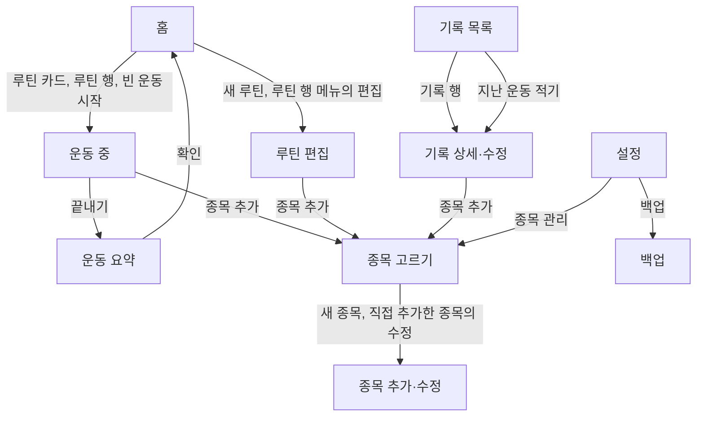
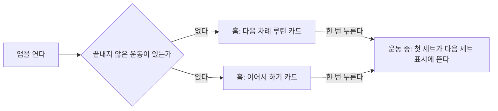

# 디자인 계약

작성일: 2026-11-18. 이슈 [#14](https://github.com/zzunsik/next-set/issues/14).

디자인 방향은 소유자 확인 전의 잠정안이다. 이 문서의 색, 크기, 모서리 값은 방향 B "굵은 숫자"를 기준으로 적었다.

화면을 구현할 때 따를 값과 화면 구성을 적는다. 요구사항은 [`requirements.md`](requirements.md), 원칙은 [`design-references.md`](design-references.md)의 "정리한 원칙"을 따른다. 이 문서에서 "원칙 n"은 그 절의 번호다. 토큰을 Compose 테마로 옮기는 일은 [#19](https://github.com/zzunsik/next-set/issues/19)에서 한다.

## 방향

후보는 셋이다. 방향을 바꾸면 아래 표의 값과 색 토큰만 바뀌고 컴포넌트 구성과 화면 흐름은 그대로다.

| 값 | A 차분한 기록장 | B 굵은 숫자(잠정) | C 부드러운 카드 |
|---|---|---|---|
| 바탕 | 옅은 회색 | 대비가 높은 흰색과 검정 | 남보라 기운 |
| 세트 행 높이 | 48dp | 56dp | 52dp |
| 카드 모서리 | 8dp | 14dp | 22dp |
| 큰 숫자 | 40sp | 56sp ExtraBold | 44sp |

세 방향이 함께 지키는 것

- 색은 고정한다. 다이내믹 컬러를 쓰지 않는다(NF-05).
- 강조색은 남보라 계열이고 "누를 수 있음"만 뜻한다. 완료 색은 초록 계열이고 "끝남"만 뜻한다(원칙 4).
- 밝은 화면과 어두운 화면을 함께 맞춘다(NF-04).
- Material 3는 안정판에 들어온 요소만 쓴다(NF-07). 판정 규칙은 "컴포넌트" 절 끝에 적었다.

## 색

### 토큰

| 토큰 | 이름 | 밝은 화면 | 어두운 화면 | 쓰임새 |
|---|---|---|---|---|
| `bg` | 배경 | `#FFFFFF` | `#07080A` | 화면 바탕, 운동 중 화면의 세트 표 바탕 |
| `surface` | 표면 | `#F1F2F6` | `#14161B` | 카드, 입력 칸, 숫자판과 휴식 타이머 바의 바탕 |
| `text` | 글자 | `#0A0B0E` | `#FFFFFF` | 본문, 제목, 완료한 세트의 값 |
| `text2` | 보조 글자 | `#4C505A` | `#A8ACB9` | 직전 기록, 단위, 라벨, 아직 안 한 세트의 값, 빈 칸 테두리 |
| `line` | 구분선 | `#D8DBE4` | `#2A2D37` | 종목 사이 선, 바의 윗선. 장식이다 |
| `accent` | 강조색 | `#5630D6` | `#B7A1FF` | 누르는 요소. 채운 버튼, 글자 버튼, 선택된 칸의 테두리 |
| `onAccent` | 강조색 위 글자 | `#FFFFFF` | `#1D0A57` | 채운 버튼의 글자와 아이콘 |
| `accentSoft` | 옅은 강조색 | `#EAE4FF` | `#2A2152` | 선택된 칸과 선택된 칩의 바탕 |
| `done` | 완료 색 | `#0D7440` | `#5EE0A0` | 완료 체크 버튼의 바탕, 완료 체크 아이콘 |
| `onDone` | 완료 색 위 글자 | `#FFFFFF` | `#052C19` | 완료 체크 버튼 안의 체크 모양 |
| `doneSoft` | 옅은 완료 색 | `#D3F1DF` | `#0F3925` | 완료한 세트 행의 바탕 |
| `error` | 오류 색 | `#B3261E` | `#F2B8B5` | 오류 문구, 지우기 확인 버튼의 글자 |

### 쓰임새 규칙

- 강조색은 누르면 무언가 일어나는 요소에만 쓴다. 제목, 장식, 현재 위치 표시에 쓰지 않는다.
- 완료 색은 끝난 세트와 끝난 종목에만 쓴다. "성공", "좋음", "추천"의 뜻으로 쓰지 않는다.
- 완료는 색과 체크 모양을 함께 쓴다(NF-06). 완료한 행은 바탕이 `doneSoft`로 바뀌고 체크 버튼 안에 체크 모양이 생긴다.
- 최고 기록 표시는 세 번째 색을 쓰지 않는다. 글자색 바탕에 배경색 글자를 얹은 반전 배지와 아이콘으로 구분한다.
- 오류 색은 글자와 아이콘에만 쓴다. 바탕을 오류 색으로 채우지 않는다.
- `line`과 `surface`는 배경과의 대비가 낮다(아래 표). 이 둘만으로 요소를 구분해야 하는 배치를 만들지 않는다.
  - 값이 든 입력 칸은 안의 글자로 알아본다.
  - 값이 없는 입력 칸에는 `text2` 색 1dp 테두리를 두른다.
  - 아직 누르지 않은 체크 버튼은 `text2` 색 2dp 테두리 상자다.
- 비활성 요소는 M3의 기본 비활성 표현을 따르고, 대비 기준의 대상이 아니다.
- 운동 중 화면과 기록 화면에는 장식 배경, 그림, 종목 이미지를 두지 않는다.

### 대비

WCAG 2.2의 상대 휘도 공식으로 계산했다. 채널 값 c(0~1)는 c ≤ 0.04045이면 c / 12.92, 아니면 ((c + 0.055) / 1.055)^2.4로 선형화한다. 휘도는 L = 0.2126 R + 0.7152 G + 0.0722 B, 대비는 (L밝은 쪽 + 0.05) / (L어두운 쪽 + 0.05)다. 값은 소수 둘째 자리 아래를 버렸다. 기준은 본문 글자 4.5:1, 큰 글자와 아이콘, 요소 테두리 3:1이다.

| 앞 / 바탕 | 쓰임 | 기준 | 밝은 화면 | 어두운 화면 |
|---|---|---|---|---|
| `text` / `bg` | 본문 | 4.5 | 19.67 | 20.03 |
| `text` / `surface` | 카드 안 본문, 입력 칸의 값 | 4.5 | 17.59 | 18.09 |
| `text2` / `bg` | 보조 글자, 직전 기록 | 4.5 | 8.06 | 8.84 |
| `text2` / `surface` | 카드 안 보조 글자, 안 한 세트의 값 | 4.5 | 7.21 | 7.98 |
| `accent` / `bg` | 글자 버튼 | 4.5 | 7.52 | 9.11 |
| `accent` / `surface` | 카드와 바 안의 글자 버튼 | 4.5 | 6.72 | 8.23 |
| `onAccent` / `accent` | 채운 버튼의 글자 | 4.5 | 7.52 | 7.74 |
| `accent` / `accentSoft` | 선택된 칩의 글자 | 4.5 | 6.10 | 6.64 |
| `text` / `accentSoft` | 선택된 칸의 값 | 4.5 | 15.96 | 14.60 |
| `done` / `bg` | 완료 체크 아이콘 | 3 | 5.85 | 12.06 |
| `done` / `surface` | 카드 안 완료 체크 아이콘 | 3 | 5.22 | 10.89 |
| `onDone` / `done` | 완료 체크 버튼 안의 체크 모양 | 3 | 5.85 | 9.15 |
| `done` / `doneSoft` | 완료 행 위의 체크 버튼 | 3 | 4.85 | 7.74 |
| `text` / `doneSoft` | 완료 행의 값 | 4.5 | 16.32 | 12.86 |
| `text2` / `doneSoft` | 완료 행의 직전 기록 | 4.5 | 6.69 | 5.67 |
| `error` / `bg` | 오류 문구 | 4.5 | 6.53 | 11.73 |
| `error` / `surface` | 카드 안 오류 문구 | 4.5 | 5.84 | 10.59 |
| `text2` / `bg` | 빈 칸과 빈 체크 버튼의 테두리 | 3 | 8.06 | 8.84 |
| `bg` / `text` | 최고 기록 배지의 글자 | 4.5 | 19.67 | 20.03 |

모든 조합이 기준을 넘는다. 가장 낮은 값은 밝은 화면의 `done` / `doneSoft` 4.85다.

장식으로만 쓰는 조합은 기준의 대상이 아니다. 참고로 적는다.

| 조합 | 밝은 화면 | 어두운 화면 |
|---|---|---|
| `line` / `bg` | 1.38 | 1.45 |
| `surface` / `bg` | 1.11 | 1.10 |
| `accentSoft` / `bg` | 1.23 | 1.37 |
| `doneSoft` / `bg` | 1.20 | 1.55 |

색 값이 문서와 코드 두 곳에 놓이게 된다. #19에서 테마의 색 값으로 위 표의 대비를 다시 계산해 기준 아래로 내려가면 실패하는 테스트를 둔다.

### 적록 색각에서의 구분

강조색과 완료 색이 적록 색각 이상에서 같은 색으로 보이지 않는지 계산으로 확인했다.

한 일

1. sRGB 값을 선형 RGB로 바꿨다(대비 계산과 같은 식).
2. Viénot, Brettel, Mollon(1999)의 행렬로 선형 RGB를 LMS로 바꾸고, 제1색각(L 원뿔 없음)과 제2색각(M 원뿔 없음)의 투영 행렬을 곱한 뒤 RGB로 되돌렸다. 범위를 벗어난 값은 0과 1로 잘랐다.
3. 변환한 두 색의 색차를 CIEDE2000(ΔE00)으로, 밝기 차이를 휘도 대비로 구했다. ΔE00 구현은 Sharma 등(2005)의 검증 값 한 쌍으로 맞는지 확인했다.

| 화면 | 보는 조건 | 강조색 | 완료 색 | ΔE00 | 휘도 대비 |
|---|---|---|---|---|---|
| 밝은 | 변환 없음 | `#5630D6` | `#0D7440` | 50.2 | 1.28 |
| 밝은 | 제1색각 | `#3636D6` | `#6E6E40` | 59.3 | 1.49 |
| 밝은 | 제2색각 | `#3E3ED6` | `#636342` | 52.6 | 1.18 |
| 어두운 | 변환 없음 | `#B7A1FF` | `#5EE0A0` | 45.8 | 1.32 |
| 어두운 | 제1색각 | `#A4A4FF` | `#D6D69F` | 50.3 | 1.50 |
| 어두운 | 제2색각 | `#A8A8FF` | `#C5C5A3` | 42.5 | 1.23 |

옅은 색 쌍(`accentSoft`와 `doneSoft`)의 ΔE00은 밝은 화면에서 23.9(변환 없음), 19.7(제1색각), 16.2(제2색각)이고 어두운 화면에서 32.7, 33.3, 29.0이다.

읽는 법

- 변환한 뒤에도 강조색은 파랑 쪽, 완료 색은 누런 쪽에 남는다. 색차는 변환 전과 비슷한 크기다.
- 두 색의 밝기는 거의 같다(휘도 대비 1.18~1.50). 흑백 화면이나 전색맹에서는 색으로 구분되지 않는다. 그래서 완료는 체크 모양과 행 바탕 변화를 함께 쓴다(NF-06).
- 옅은 색 쌍은 밝은 화면에서 차이가 작아진다. 선택된 칸은 2dp 강조색 테두리로, 완료 행은 체크 모양으로 구분하므로 옅은 색만으로 뜻을 전하는 곳은 없다.

이 확인의 한계는 "확인하지 못한 것"에 적었다.

### M3 색 역할과의 대응

#19가 `ColorScheme`을 채울 때 쓰는 제안이다. 이름이 겹치는 곳이 있어 적어 둔다.

| M3 역할 | 이 문서의 토큰 | 비고 |
|---|---|---|
| `background`, `surface` | `bg` | M3의 `surface`는 화면 바탕이다. 이 문서의 `surface`가 아니다 |
| `surfaceContainer` 계열 | `surface` | 카드, 시트, 바의 바탕 |
| `onBackground`, `onSurface` | `text` | |
| `onSurfaceVariant`, `outline` | `text2` | |
| `outlineVariant` | `line` | |
| `primary`, `onPrimary` | `accent`, `onAccent` | |
| `primaryContainer`, `secondaryContainer` | `accentSoft` | 그 위 글자는 `text` |
| `error` | `error` | |

`done`, `onDone`, `doneSoft`는 M3 역할에 넣지 않고 앱의 확장 색으로 둔다. `tertiary`에 넣으면 M3 컴포넌트가 완료와 상관없는 곳에 초록을 쓸 수 있다. 표에 없는 역할(`secondary`, `tertiary` 등)을 비워 두면 M3 기본 보라색이 나온다. 어떤 컴포넌트가 어느 역할을 쓰는지는 #19에서 컴포넌트마다 확인하고 남는 역할을 `accent`나 `text2`로 채운다.

## 타이포

글꼴은 시스템 글꼴을 추천한다. 근거는 "UI 라이브러리 선택"에 있다.

| 토큰 | 크기 / 줄 높이 | 굵기 | 쓰임 |
|---|---|---|---|
| `numeralLarge` | 56sp / 64sp | ExtraBold(800) | 다음 세트 표시의 무게, 횟수, 시간. 한 화면에 한 곳 |
| `numeralMedium` | 32sp / 40sp | Bold(700) | 휴식 타이머 바의 남은 시간 |
| `headline` | 28sp / 36sp | Bold(700) | 다음 차례 루틴 이름, 요약 화면의 결론 문장 |
| `title` | 22sp / 28sp | Bold(700) | 화면 제목, 숫자판의 숫자 키, 요약 화면의 숫자 |
| `numeralRow` | 20sp / 24sp | Bold(700) | 세트 행의 입력 값 |
| `heading` | 18sp / 24sp | SemiBold(600) | 종목 머리, 카드와 구역의 제목, 줄어든 다음 세트 표시 |
| `body` | 16sp / 24sp | Regular(400) | 본문, 목록 행 제목 |
| `label` | 14sp / 20sp | SemiBold(600) | 버튼, 칩, 증감 키, 세트 표의 머리 |
| `caption` | 13sp / 18sp | Regular(400) | 보조 글자, 직전 기록, 단위, 날짜 |

규칙

- 큰 숫자 스타일은 `numeralLarge`와 `numeralMedium` 둘이다. 다른 곳의 숫자를 이 크기로 키우지 않는다(원칙 5).
- 숫자는 크게, 단위는 작게 쓴다. `numeralLarge` 옆의 단위(kg, 회)는 `label`, `numeralRow` 옆의 단위는 `caption`이다. 단위는 숫자의 글자 밑선에 맞춘다.
- 모든 스타일에 폭이 같은 숫자를 켠다(`fontFeatureSettings = "tnum"`). 값이 바뀌어도 자리가 흔들리지 않는다. 휴식 시간, 경과 시간, 세트 표의 값이 대상이다.
- 크기는 sp로 둔다. 기기의 글자 크기 설정을 따른다(NF-10).
- `numeralLarge`는 한 줄에 들어가지 않으면 줄을 바꾸지 않고 크기를 줄인다. 하한은 32sp다. M3 `Text`의 `autoSize`를 쓴다.
- 행과 버튼의 높이는 고정하지 않고 최소 높이로 잡는다. 글자가 커지면 행이 늘어난다.
- 줄어든 글자가 잘릴 자리에는 말줄임을 쓰되 숫자와 단위는 자르지 않는다. 자리가 모자라면 종목 이름을 먼저 줄인다.

## 간격, 모서리, 누르는 영역

간격

| 토큰 | 값 | 쓰임 |
|---|---|---|
| `space.xs` | 4dp | 숫자와 단위 사이, 제목과 보조 줄 사이 |
| `space.sm` | 8dp | 행 안의 요소 사이, 숫자판 키 사이 |
| `space.md` | 12dp | 카드 안 묶음 사이, 칩 사이 |
| `space.lg` | 16dp | 화면 좌우 여백, 카드 안쪽 여백 |
| `space.xl` | 24dp | 종목과 종목 사이, 구역 사이 |
| `space.xxl` | 32dp | 빈 상태 문구 위아래 |

모서리

| 토큰 | 값 | 쓰임 |
|---|---|---|
| `radius.sm` | 10dp | 입력 칸, 체크 버튼, 숫자판 키 |
| `radius.md` | 14dp | 카드, 버튼 |
| `radius.full` | 높이의 절반 | 칩, 최고 기록 배지 |

하단 시트와 대화상자는 M3 기본 모양을 그대로 둔다.

크기

| 요소 | 값 |
|---|---|
| 누르는 요소의 최소 영역 | 48 × 48dp(NF-10). 보이는 모양이 작아도 영역은 48dp를 채운다 |
| 누르는 요소 사이 | 8dp 이상 |
| 세트 행, 목록 행의 최소 높이 | 56dp |
| 입력 칸 | 보이는 높이 44dp, 누르는 영역 48dp |
| 체크 버튼 | 보이는 크기 40 × 40dp, 누르는 영역 48 × 48dp |
| 숫자판 키 | 높이 52dp |
| 주요 버튼(운동 시작, 이어서 하기) | 높이 56dp, 화면 폭을 채운다 |
| 일반 버튼 | 높이 48dp |
| 아이콘 | 24dp |

## 컴포넌트

상태 이름은 표마다 같다. 눌림은 M3의 기본 눌림 표시(물결)를 쓴다.

### 다음 차례 루틴 카드 `NextRoutineCard`

쓰이는 화면: 홈.

| 구성 요소 | 내용 |
|---|---|
| 라벨 | "다음 차례"(`caption`, `text2`). 직접 고른 루틴이면 "직접 고름"과 "자동 순서로" 글자 버튼 |
| 루틴 이름 | `headline`. 두 줄까지 |
| 종목 미리보기 | "벤치 프레스, 인클라인 덤벨 프레스 외 3개"(`body`, `text2`). 두 줄까지 |
| 지난 기록 | "지난번 11월 14일 (토)"(`caption`). 한 적이 없으면 줄을 비운다 |
| 시작 버튼 | "운동 시작". 채운 강조색 버튼, 높이 56dp |
| 더보기 버튼 | 카드 오른쪽 위. 메뉴: 편집, 지우기 |

| 상태 | 모습 |
|---|---|
| 기본 | `surface` 바탕 카드. 더보기 버튼을 뺀 카드 전체가 누르는 영역이고 시작 버튼과 같은 일을 한다 |
| 눌림 | 카드 전체에 눌림 표시 |
| 직접 고름 | 라벨이 바뀌고 "자동 순서로" 버튼이 생긴다 |
| 진행 중 | 이어서 하기 카드로 바뀐다. 라벨 "진행 중", 루틴 이름, "12세트 중 5세트 완료 · 32분째", 버튼 "이어서 하기" |
| 비활성 | 없다. 루틴이 하나도 없으면 카드 대신 빈 상태를 보인다 |

### 루틴 목록 행 `RoutineRow`

쓰이는 화면: 홈.

| 구성 요소 | 내용 |
|---|---|
| 루틴 이름 | `body` SemiBold |
| 보조 줄 | "종목 5개 · 지난번 11월 12일"(`caption`, `text2`) |
| 시작 표시 | 오른쪽의 시작 아이콘(`accent`). 행을 누르면 바로 시작한다는 표시다 |
| 더보기 버튼 | 메뉴: 맨 위에 올리기, 편집, 지우기 |

| 상태 | 모습 |
|---|---|
| 기본 | `bg` 바탕, 행 사이에 `line` |
| 눌림 | 행 전체에 눌림 표시. 운동 중 화면으로 넘어간다 |
| 순서 편집 | 시작 표시와 더보기 버튼이 순서 바꾸기 손잡이와 지우기 버튼으로 바뀐다. 행을 눌러도 시작하지 않고 루틴 편집을 연다 |
| 비활성 | 없다 |

### 종목 머리 `ExerciseHeader`

쓰이는 화면: 운동 중, 기록 상세·수정, 운동 요약.

| 구성 요소 | 내용 |
|---|---|
| 종목 이름 | `heading`, `text`. 누르는 요소가 아니다 |
| 휴식 시간 | "휴식 2:00" 글자 버튼(`label`, `accent`). 누르면 이 종목의 휴식 시간을 고친다(REST-03) |
| 메모 | 적은 메모 한 줄(`caption`, `text2`). 없으면 줄을 비운다. 메뉴에서 연다(LOG-11) |
| 더보기 버튼 | 메뉴: 메모, 위로 옮기기, 아래로 옮기기, 마지막 세트 지우기, 종목 빼기 |
| 세트 표 머리 | "세트", "지난번", "kg", "회", 체크 자리(`label`, `text2`). 목표 횟수 범위가 있으면 "회 8~12"로 적는다(LOG-05) |

| 상태 | 모습 |
|---|---|
| 기본 | 위 구성 |
| 모두 완료 | 종목 이름 옆에 체크 아이콘(`done`) |
| 읽기 전용 | 기록 상세와 운동 요약. 휴식 시간과 더보기 버튼이 없다 |

세트 표 머리는 기록 방식에 따라 바뀐다(LOG-08). 횟수만이면 "세트, 지난번, 회", 시간이면 "세트, 지난번, 시간"이다.

### 세트 행 `SetRow`

쓰이는 화면: 운동 중, 기록 상세·수정, 운동 요약(읽기 전용).

| 구성 요소 | 폭 | 내용 |
|---|---|---|
| 순번 | 32dp | "1"(`body` SemiBold) |
| 직전 기록 | 남는 폭 | "60kg × 10"(`caption`, `text2`). 기록이 없으면 빈칸(원칙 2). 누르는 요소가 아니다 |
| 무게 칸 | 72dp | 값(`numeralRow`). 미리 채운 값이 들어 있다(LOG-03) |
| 횟수 칸 | 64dp | 값(`numeralRow`) |
| 완료 체크 | 48dp | 체크 버튼 |

요소 사이는 8dp다. 화면 폭 360dp에서 좌우 여백 16dp를 빼면 328dp가 남고 직전 기록에 80dp가 돌아간다. 직전 기록이 길면 두 줄로 나눈다. 횟수만 종목과 시간 종목은 입력 칸이 하나(88dp)다.

| 상태 | 모습 |
|---|---|
| 대기 | `bg` 바탕. 값은 `text2` 색. 체크 버튼은 `text2` 2dp 테두리 상자 |
| 다음 세트 | 대기와 같되 값이 `text` 색이고 순번이 굵다. 바탕색은 바꾸지 않는다 |
| 칸 선택 | 선택된 칸이 `accentSoft` 바탕에 `accent` 2dp 테두리. 값은 `text` 색. 숫자판이 열려 있다 |
| 눌림 | 칸과 체크 버튼에 눌림 표시 |
| 완료 | 행 바탕 `doneSoft`. 값은 `text` 색. 체크 버튼은 `done` 바탕에 `onDone` 체크 모양 |
| 완료, 최고 기록 | 완료 모습에 아이콘만 있는 최고 기록 배지가 순번 아래에 붙는다 |
| 값 없음 | 값이 빈 칸에 `text2` 1dp 테두리. 체크 버튼을 누르면 완료되지 않고 빈 칸의 숫자판이 열린다 |
| 읽기 전용 | 기록 상세와 운동 요약. 직전 기록 열과 체크 버튼이 없다. 값은 `text` 색 |

동작

- 체크 버튼을 누르면 값을 고치지 않고도 세트가 완료된다(LOG-04). 휴식 타이머가 시작된다(REST-01).
- 완료한 행의 체크 버튼을 다시 누르면 완료가 풀린다. 그 세트로 시작한 휴식 타이머도 멈춘다. 확인을 묻지 않는다.
- 완료한 행의 칸도 눌러서 고친다. 고친 값은 바로 저장된다(NF-09).
- 행을 길게 누르면 "이 세트 지우기" 메뉴가 뜬다. 지운 뒤에는 "되돌리기"가 있는 알림 줄을 보인다(LOG-09).
- 세트 표 아래에 "세트 추가" 글자 버튼이 있다. 새 행의 값은 바로 위 행의 값이다.

### 다음 세트 표시 `NextSetDisplay`

쓰이는 화면: 운동 중. 상단 바 아래에 고정한다. 목록을 내려도 남는다(LOG-06, 원칙 1).

| 구성 요소 | 내용 |
|---|---|
| 라벨 | "다음 세트 · 4세트 중 2번째"(`caption`, `text2`) |
| 종목 이름 | `heading` |
| 값 | "60 kg × 10 회". 숫자는 `numeralLarge`, 단위와 곱셈표는 `label` |
| 견줄 값 | "지난번 60kg × 10"(`caption`, `text2`). 직전 기록이 없으면 줄을 비운다(원칙 5) |

| 상태 | 모습 |
|---|---|
| 기본 | 위 구성. 누르면 목록이 그 세트 행으로 움직인다 |
| 숫자판 열림 | 한 줄로 줄어든다. "벤치 프레스 · 60kg × 10"(`heading`) |
| 값 없음 | 숫자 자리에 "직접 입력" 글자 버튼. 누르면 그 칸의 숫자판이 열린다 |
| 모두 완료 | "모든 세트를 끝냈어요."와 "운동 끝내기" 채운 버튼 |
| 종목 없음 | 표시하지 않는다. 화면 본문이 빈 상태를 보인다 |

값은 세트 행에 미리 채운 값과 같다. 칸에서 값을 고치면 이 표시도 바로 바뀐다. 횟수만 종목은 "12 회", 시간 종목은 "1:00"으로 적는다.

### 자체 숫자판 `NumberPad`

쓰이는 화면: 운동 중, 기록 상세·수정, 루틴 편집(목표 값). 입력 칸을 누르면 화면 아래에서 올라온다. 시스템 키보드를 띄우지 않는다(LOG-07).

배치는 네 열이다.

| 줄 | 1열 | 2열 | 3열 | 4열 |
|---|---|---|---|---|
| 증감 줄 | −2.5 | −1 | +1 | +2.5 |
| 1 | 1 | 2 | 3 | 지우기 |
| 2 | 4 | 5 | 6 | 다음 |
| 3 | 7 | 8 | 9 | (다음이 이어진다) |
| 4 | . | 0 | 숫자판 닫기 | (다음이 이어진다) |

"다음" 키 하나가 2~4줄의 4열을 세로로 차지한다.

| 칸 종류 | 증감 줄 | 소수점 키 | 입력 범위 |
|---|---|---|---|
| 무게 | −2.5, −1, +1, +2.5 | 있음 | 0~999.99, 소수 둘째 자리까지 |
| 횟수 | −1, +1(두 키가 줄을 나눠 쓴다) | 없음(빈 자리) | 0~999 |
| 시간 | −15초, −5초, +5초, +15초 | 없음(빈 자리) | 0:00~59:59. 숫자를 누르면 오른쪽부터 채운다(1, 3, 0 → 1:30) |

| 구성 요소 | 모습 |
|---|---|
| 숫자 키 | `bg` 바탕, 숫자는 `title` |
| 증감 키 | `bg` 바탕, 값은 `label`, `accent` 색. 아이콘만 두지 않고 값을 적는다 |
| 지우기 | 아이콘과 접근성 이름 "지우기". 한 번 누르면 한 글자, 길게 누르면 전부 지운다 |
| 다음 | 채운 강조색 키. 행의 마지막 칸에서는 글자가 "완료"로 바뀐다 |
| 숫자판 닫기 | 아이콘과 접근성 이름 "숫자판 닫기" |

| 상태 | 모습 |
|---|---|
| 닫힘 | 보이지 않는다 |
| 열림 | 화면 아래 고정. 바탕 `surface`, 윗선 `line`. 휴식 타이머 바는 숫자판 위에 붙는다 |
| 눌림 | 키에 눌림 표시 |
| 비활성 키 | 칸 종류에 없는 키는 자리만 남기고 그리지 않는다 |

동작

- 칸을 누르면 그 칸의 값 전체가 선택된다. 첫 숫자를 누르면 값이 새 숫자로 바뀐다. 증감 키는 지금 값에 더하거나 뺀다.
- 증감으로 값이 0 아래로 내려가지 않는다. 빈 칸은 0으로 보고 계산한다.
- "다음"은 같은 행의 다음 칸으로 옮긴다. 운동 중 화면에서 마지막 칸의 "완료"는 세트를 완료하고 숫자판을 닫는다. 휴식 타이머가 시작된다.
- 루틴 편집과 기록 수정에서는 "완료"가 숫자판만 닫는다.
- 값은 키를 누를 때마다 저장된다(NF-09).
- 무게는 뒤따르는 0을 떼고 적는다(60, 62.5, 61.25).

### 휴식 타이머 하단 바 `RestTimerBar`

쓰이는 화면: 운동 중. 화면 아래에 고정한다. 세트 표를 가리지 않도록 목록의 아래 여백을 바 높이만큼 늘린다(REST-02, 원칙 3).

| 구성 요소 | 내용 |
|---|---|
| 진행 막대 | 바의 윗변을 따라 4dp. 남은 비율만큼 `accent`, 나머지는 `line` |
| 남은 시간 | "1:45"(`numeralMedium`) |
| 다음 세트 | "다음 벤치 프레스 60kg × 10"(`caption`, `text2`). 한 줄 |
| 줄이기 버튼 | "−15초" |
| 늘리기 버튼 | "+15초" |
| 건너뛰기 버튼 | "건너뛰기" |

두 줄로 놓는다. 윗줄은 남은 시간과 다음 세트, 아랫줄은 버튼 셋이다. 버튼 셋은 폭을 똑같이 나눠 쓰고 높이는 48dp다. 아이콘만 두지 않고 값을 글자로 적는다. 바의 바탕은 `surface`다.

| 상태 | 모습 |
|---|---|
| 숨김 | 휴식 중이 아니다. 바가 없다 |
| 진행 중 | 위 구성. 남은 시간이 1초마다 바뀐다 |
| 눌림 | 버튼에 눌림 표시 |
| 종료 | 남은 시간 "0:00"을 2초 보인 뒤 바가 내려간다 |
| 숫자판 열림 | 바가 숫자판 바로 위에 붙고 한 줄로 줄어든다. 남은 시간과 버튼 셋만 남긴다. 다음 세트는 화면 위의 줄어든 다음 세트 표시가 보여 준다 |

동작

- 남은 시간이 15초 이하일 때 "−15초"를 누르면 휴식이 끝난다. "+15초"는 남은 시간이 10분이 될 때까지 누를 수 있다.
- 끝나기 전의 신호(REST-04)는 소리와 진동으로만 준다. 바의 색이나 크기를 바꾸지 않는다.
- 휴식 중에 다른 세트를 완료하면 타이머가 그 세트의 휴식 시간으로 다시 시작된다.
- 앱 밖의 표시는 #16에서 정한다. 상태바 칩에는 남은 시간만, 알림 본문에는 종목과 다음 세트를 적는다(REST-07).

### 종목 목록 행 `ExerciseRow`

쓰이는 화면: 종목 고르기, 루틴 편집.

| 구성 요소 | 내용 |
|---|---|
| 종목 이름 | `body` |
| 보조 줄 | "가슴 · 바벨"(`caption`, `text2`). 직접 추가한 종목은 "가슴 · 바벨 · 직접 추가" |
| 끝 요소 | 화면에 따라 다르다(아래) |

| 상태 | 모습 |
|---|---|
| 고르기 | 끝에 체크 상자. 행을 누르면 선택이 켜지고 꺼진다 |
| 선택됨 | 체크 상자가 `accent`로 채워진다. 행 바탕은 바꾸지 않는다 |
| 관리 | 끝 요소가 없다. 직접 추가한 종목의 행을 누르면 종목 수정이 열린다. 내장 종목의 행은 누르는 요소가 아니다 |
| 루틴 편집 | 앞에 순서 바꾸기 손잡이, 보조 줄에 "3세트 · 60kg × 8~12회". 행을 누르면 종목 설정 시트가 열린다 |

### 검색 칸 `SearchField`

쓰이는 화면: 종목 고르기.

| 구성 요소 | 내용 |
|---|---|
| 돋보기 아이콘 | `text2` |
| 입력 | 안내 글 "종목 이름 검색"(`body`, `text2`). 시스템 키보드를 쓴다 |
| 지우기 버튼 | 글자가 있을 때만 보인다 |

| 상태 | 모습 |
|---|---|
| 기본 | `surface` 바탕, 높이 48dp, 모서리 `radius.md` |
| 입력 중 | `accent` 2dp 테두리 |
| 결과 없음 | 목록 자리에 빈 상태를 보인다 |

이름과 별칭 모두에서 찾는다(EX-02). 글자를 칠 때마다 목록이 바뀐다.

### 부위 필터 `BodyPartFilter`

쓰이는 화면: 종목 고르기. 검색 칸 아래에 가로로 한 줄 놓고 넘치면 옆으로 민다.

칩은 "전체, 가슴, 등, 어깨, 팔, 하체, 코어"다. 부위 분류는 [`exercise-data.md`](exercise-data.md)의 큰 분류 여섯을 따른다.

| 상태 | 모습 |
|---|---|
| 기본 | `text2` 1dp 테두리, 글자 `text`(`label`). 높이 32dp, 누르는 영역 48dp |
| 선택됨 | `accentSoft` 바탕, 글자 `accent`, 앞에 체크 아이콘. 한 번에 하나만 선택된다 |
| 눌림 | 눌림 표시 |

검색어와 부위 필터는 함께 적용된다(EX-03).

### 최고 기록 표시 `RecordBadge`

쓰이는 화면: 운동 중(세트 행), 운동 요약, 기록 상세·수정, 기록 목록.

| 구성 요소 | 내용 |
|---|---|
| 아이콘 | 트로피 모양, 16dp |
| 글자 | "최고 기록"(`caption` SemiBold) |

| 상태 | 모습 |
|---|---|
| 기본 | `text` 바탕, `bg` 색 글자와 아이콘. 모서리 `radius.full`, 높이 24dp. 운동 요약과 기록 상세에서 쓴다 |
| 아이콘만 | 지름 24dp 원에 아이콘만 둔다. 접근성 이름 "최고 기록"을 붙인다. 운동 중의 세트 행과 기록 목록 행에서 쓴다 |
| 등장 | 운동 중에 최고 기록을 넘는 세트를 완료한 순간. 배지가 expressive 모션으로 나타나고 진동이 한 번 울린다. 화면 아래 알림 줄에 "벤치 프레스 최고 기록이에요."를 3초 보인다(LOG-14, 원칙 6) |

누르는 요소가 아니다. 색이 아니라 반전된 모양과 아이콘으로 눈에 띈다.

### Material 3 요소를 고르는 규칙

- `@OptIn` 표시 없이 컴파일되는 API만 쓴다. 실험 API는 옵트인을 요구하므로 이 규칙으로 NF-07을 검사한다.
- 릴리스 노트로 보면 2026-11-18 기준 안정판에서 `MotionScheme`, `ButtonGroup`, `MaterialExpressiveTheme`은 공개 API가 아니다. 안정판을 내기 전에 실험 API를 모두 뺐고, 이 셋은 출시 후보 단계인 다음 버전에서 안정 API가 됐다. `MaterialShapes`와 `LoadingIndicator`는 다음 버전에서도 안정 승격이 되돌려졌다(Compose Material 3 릴리스 노트).
- 그래서 이 문서의 컴포넌트는 버튼 묶음 컴포넌트와 도형 변형에 기대지 않는다. 버튼을 나란히 놓는 곳은 일반 행 배치로 만든다.

## 화면

### 이동 구조

하단 내비게이션에 "홈", "기록", "설정" 셋을 둔다. 운동 중과 그 밖의 하위 화면에서는 하단 내비게이션을 숨긴다.

### 한 번 눌러 시작

앱을 열어 운동을 시작하기까지 누르는 횟수는 한 번이다(HOME-01). 확인 화면, 준비 화면, 로딩 화면을 사이에 두지 않는다.

잘못 눌렀을 때를 위한 장치

- 완료한 세트도 고친 값도 없는 운동은 화면을 나가면 묻지 않고 버린다. 홈에 "이어서 하기"가 남지 않는다.
- 세트를 하나라도 완료했거나 값을 고쳤으면 운동이 남는다. 홈 맨 위에 이어서 하기 카드가 뜬다(HOME-06).

### 홈

| 순서 | 요소 |
|---|---|
| 1 | 상단 바. 제목 "다음 세트" |
| 2 | 다음 차례 루틴 카드. 끝내지 않은 운동이 있으면 이어서 하기 카드 |
| 3 | 구역 머리 "다른 루틴"과 "순서 편집" 글자 버튼 |
| 4 | 루틴 목록 행. 맨 위 카드의 루틴은 뺀다 |
| 5 | "새 루틴" 글자 버튼 |
| 6 | "빈 운동 시작" 글자 버튼(HOME-05) |
| 7 | 하단 내비게이션 |

- 빈 상태: 루틴이 없으면 2~4 자리에 "아직 루틴이 없어요."와 "루틴 만들기" 채운 버튼을 보인다. "빈 운동 시작"은 그대로 둔다.
- 루틴이 하나뿐이면 3~4를 보이지 않는다.
- 순서 편집: "순서 편집"을 누르면 목록이 맨 위 카드의 루틴까지 넣은 전체 목록으로 바뀌고 행이 순서 편집 상태가 된다. 버튼 글자는 "완료"로 바뀐다(RTN-05).
- 들어오는 길: 앱 실행, 하단 내비게이션, 운동 요약의 "확인", 운동 중 화면의 뒤로 가기.
- 나가는 길: 운동 중(카드, 행, 빈 운동 시작), 루틴 편집(새 루틴, 행 메뉴의 편집), 기록 목록과 설정(하단 내비게이션).

### 운동 중

| 순서 | 요소 |
|---|---|
| 1 | 상단 바. 뒤로 가기, 루틴 이름(`heading`)과 경과 시간(`caption`), "끝내기" 글자 버튼, 더보기 버튼 |
| 2 | 다음 세트 표시(고정) |
| 3 | 종목 블록의 목록. 블록마다 종목 머리, 세트 행, "세트 추가". 블록 사이는 24dp와 `line`(LOG-01) |
| 4 | "종목 추가" 버튼 |
| 5 | 휴식 타이머 하단 바(휴식 중일 때) |
| 6 | 자체 숫자판(칸을 골랐을 때) |

- 종목 블록은 카드로 만들지 않는다. `bg` 위에 바로 놓는다.
- 세트를 완료하면 목록이 다음 세트 행이 보이는 곳으로 움직인다.
- 더보기 메뉴: 운동 메모(LOG-11), 종목 순서 바꾸기(LOG-10), 운동 버리기.
- 종목 순서 바꾸기는 종목 이름만 나열한 시트에서 한다. 루틴 편집의 순서 바꾸기와 같은 방식이다.
- 화면이 저절로 꺼지지 않는다(LOG-12).
- 빈 상태: 종목이 없으면 3 자리에 "종목을 추가해 주세요."와 "종목 추가" 채운 버튼을 보인다. 빈 운동을 시작한 직후가 이 상태다.
- 들어오는 길: 홈의 루틴 카드, 루틴 행, 이어서 하기 카드, 빈 운동 시작.
- 나가는 길
  - 뒤로 가기: 홈으로 간다. 운동은 계속된다.
  - 끝내기: 아래 순서로 묻고 운동 요약으로 간다.
  - 운동 버리기: "이 운동을 버릴까요? 완료한 세트도 지워져요."를 확인한 뒤 홈으로 간다.
  - 종목 추가: 종목 고르기.

끝내기의 순서

| 조건 | 묻는 것 | 선택 |
|---|---|---|
| 완료한 세트가 없다 | "완료한 세트가 없어요. 운동을 버릴까요?" | 계속 운동, 버리기 |
| 완료하지 않은 세트가 있다 | "완료하지 않은 세트 3개는 기록에 남지 않아요." | 계속 운동, 끝내기 |
| 종목을 더하거나 빼거나 순서를 바꿨다 | "바뀐 종목 구성을 루틴에 반영할까요?"(LOG-10) | 이번만, 루틴에 반영 |

조건에 맞는 것만 차례로 묻는다. 맞는 조건이 없으면 바로 운동 요약으로 간다.

### 운동 요약

| 순서 | 요소 |
|---|---|
| 1 | 결론 문장(`headline`). "가슴 루틴을 끝냈어요." 최고 기록이 있으면 "최고 기록 2개를 세웠어요."(원칙 5) |
| 2 | 숫자 셋. 운동 시간, 세트 수, 볼륨. 숫자는 `title`, 라벨은 `caption`. 같은 루틴의 지난 기록이 있으면 아래에 "지난번보다 +120kg"(HIST-02) |
| 3 | 최고 기록 목록. 종목 이름과 값, 최고 기록 배지(HIST-03). 없으면 구역을 보이지 않는다 |
| 4 | 종목별 세트 기록. 종목 머리와 세트 행(읽기 전용) |
| 5 | 운동 메모 입력 칸(LOG-11) |
| 6 | "확인" 채운 버튼(아래 고정) |

- 빈 상태: 없다. 완료한 세트가 없는 운동은 요약으로 오지 않는다.
- 들어오는 길: 운동 중의 "끝내기".
- 나가는 길: "확인"과 뒤로 가기 모두 홈으로 간다. 운동 중 화면으로 돌아가지 않는다.

### 루틴 편집

| 순서 | 요소 |
|---|---|
| 1 | 상단 바. 뒤로 가기, 제목 "루틴 편집" 또는 "새 루틴" |
| 2 | 루틴 이름 입력 칸(시스템 키보드) |
| 3 | 종목 목록 행(루틴 편집 상태). 순서 바꾸기 손잡이가 있다(RTN-02) |
| 4 | "종목 추가" 버튼 |
| 5 | "루틴 지우기" 글자 버튼(`error`). 새 루틴에서는 보이지 않는다 |

- 종목 행을 누르면 종목 설정 시트가 열린다. 세트 수(− 3 +), 목표 값, 휴식 시간, "루틴에서 빼기"가 있다(RTN-03, REST-03).
  - 목표 값은 기록 방식에 따라 무게와 횟수 범위, 횟수 범위, 시간이다. 자체 숫자판으로 적는다. 비워 둬도 된다(RTN-04).
  - 휴식 시간은 "기본값 따름"과 직접 정한 값 가운데 고른다.
- 저장 버튼이 없다. 고친 내용은 바로 저장된다(NF-09). 이름을 비우면 "새 루틴"으로 저장한다. 이름도 종목도 없는 새 루틴은 화면을 나갈 때 버린다.
- 루틴 지우기는 "이 루틴을 지울까요? 운동 기록은 남아요."를 확인한다(RTN-01).
- 빈 상태: 종목이 없으면 3 자리에 "종목을 추가해 주세요."를 보인다.
- 들어오는 길: 홈의 "새 루틴", 루틴 행 메뉴의 "편집", 순서 편집 상태의 행.
- 나가는 길: 뒤로 가기(홈), 종목 추가(종목 고르기).

### 종목 고르기

| 순서 | 요소 |
|---|---|
| 1 | 상단 바. 뒤로 가기, 제목 "종목 고르기"(관리로 들어오면 "종목 관리"), "새 종목" 글자 버튼 |
| 2 | 검색 칸 |
| 3 | 부위 필터 |
| 4 | 종목 목록 행 |
| 5 | "3개 추가" 채운 버튼(아래 고정). 하나 이상 골랐을 때만 보인다. 관리로 들어오면 없다 |

- 빈 상태: 검색 결과가 없으면 "'케틀벨 스윙'에 맞는 종목이 없어요."와 "'케틀벨 스윙' 종목 만들기" 버튼을 보인다. 누르면 이름이 채워진 종목 추가가 열린다(EX-04).
- 들어오는 길: 루틴 편집, 운동 중, 기록 상세·수정의 "종목 추가"(고르기). 설정의 "종목 관리"(관리).
- 나가는 길: "n개 추가"를 누르면 고른 종목을 넘기고 앞 화면으로 돌아간다. 뒤로 가기는 고른 것을 버린다. "새 종목"과 직접 추가한 종목의 수정은 종목 추가·수정으로 간다.

### 종목 추가·수정

| 순서 | 요소 |
|---|---|
| 1 | 상단 바. 뒤로 가기, 제목 "새 종목" 또는 "종목 수정" |
| 2 | 이름 입력 칸(꼭 적는다) |
| 3 | 부위. 칩 여섯 가운데 하나 |
| 4 | 장비. 칩 여덟(바벨, 덤벨, 머신, 케이블, 맨몸, 케틀벨, 밴드, 기타) 가운데 하나 |
| 5 | 기록 방식. "무게와 횟수", "횟수만", "시간" 가운데 하나(LOG-08) |
| 6 | "저장" 채운 버튼(아래 고정) |
| 7 | "종목 지우기" 글자 버튼(`error`). 수정에서만 보인다 |

- 이 화면에는 저장 버튼을 둔다. 이름과 기록 방식이 정해져야 종목으로 쓸 수 있다. 이름이 비면 "저장"이 비활성이다.
- 직접 추가한 종목만 수정할 수 있다. 내장 종목은 고치거나 지우지 못한다(EX-04).
- 빈 상태: 없다.
- 들어오는 길: 종목 고르기의 "새 종목", 검색 빈 상태의 만들기 버튼, 직접 추가한 종목의 행.
- 나가는 길: "저장"과 뒤로 가기 모두 종목 고르기로 돌아간다. 새로 만든 종목은 고른 상태로 목록에 들어간다.

### 기록 목록

| 순서 | 요소 |
|---|---|
| 1 | 상단 바. 제목 "기록", "지난 운동 적기" 버튼(HIST-06) |
| 2 | 달 머리 "2026년 11월"(`label`, `text2`) |
| 3 | 기록 행. 날짜 "11월 14일 (토)", 루틴 이름, 보조 줄 "48분 · 15세트 · 4,250kg", 최고 기록이 있으면 배지 아이콘 |
| 4 | 하단 내비게이션 |

- 최근 날짜가 위다(HIST-01).
- 빈 상태: "아직 기록이 없어요. 운동을 마치면 여기에 쌓여요."와 "홈으로" 버튼을 보인다.
- 지난 운동 적기: 날짜를 고른 뒤 루틴이나 "빈 기록"을 고르면 기록 상세·수정이 수정 상태로 열린다.
- 들어오는 길: 하단 내비게이션.
- 나가는 길: 기록 상세·수정(기록 행, 지난 운동 적기).

### 기록 상세·수정

| 순서 | 요소 |
|---|---|
| 1 | 상단 바. 뒤로 가기, 날짜, "수정" 글자 버튼, 더보기 버튼(지우기) |
| 2 | 루틴 이름(`headline`)과 시작 시각 |
| 3 | 숫자 셋. 운동 요약과 같다(HIST-02) |
| 4 | 종목별 세트 기록. 종목 머리와 세트 행(읽기 전용). 최고 기록을 세운 세트에 배지(HIST-03) |
| 5 | 운동 메모 |

- 지우기는 "이 기록을 지울까요? 되돌릴 수 없어요."를 확인한다.
- 빈 상태: 지난 운동 적기로 들어와 종목이 없으면 "종목을 추가해 주세요."와 "종목 추가" 버튼을 보인다.
- 들어오는 길: 기록 목록의 행(보기), 지난 운동 적기(수정).
- 나가는 길: 뒤로 가기(기록 목록), 종목 추가(종목 고르기).

수정 상태에서 바뀌는 것(HIST-05)

- "수정"이 "완료"로 바뀐다.
- 날짜와 시작 시각, 운동 시간을 고친다.
- 세트 행의 칸을 눌러 자체 숫자판으로 고친다. 직전 기록 열과 체크 버튼은 없다.
- 세트 추가, 세트 지우기, 종목 추가, 종목 빼기가 생긴다.
- 고친 내용은 바로 저장되고 최고 기록은 다시 계산된다.

### 설정

| 순서 | 요소 |
|---|---|
| 1 | 상단 바. 제목 "설정" |
| 2 | "휴식 시간 기본값" 행. 지금 값 "2분". 누르면 값을 고르는 시트(SET-01) |
| 3 | "화면 모드" 행. 지금 값 "시스템 설정 따름". 누르면 셋 가운데 고르는 대화상자(SET-02) |
| 4 | "종목 관리" 행 |
| 5 | "백업" 행 |
| 6 | "앱 정보" 행. 버전과 오픈소스 라이선스 |
| 7 | 하단 내비게이션 |

- 휴식 시간 기본값은 30초부터 5분까지 15초 단위로 고른다. 종목마다 따로 정한 값은 이 값을 따르지 않는다(REST-03).
- 빈 상태: 없다.
- 들어오는 길: 하단 내비게이션.
- 나가는 길: 종목 고르기(관리), 백업.

### 백업

| 순서 | 요소 |
|---|---|
| 1 | 상단 바. 뒤로 가기, 제목 "백업" |
| 2 | 설명 "기록은 이 기기에만 저장돼요. 파일로 내보내 두면 다른 기기로 옮길 수 있어요." |
| 3 | "백업 파일 내보내기" 채운 버튼과 "마지막으로 내보낸 날 11월 10일"(DATA-03) |
| 4 | "백업 파일에서 가져오기" 버튼(DATA-04) |

- 내보내기: 시스템의 파일 저장 화면이 열린다. 끝나면 "백업 파일을 저장했어요." 알림 줄을 보인다.
- 가져오기: 시스템의 파일 선택 화면이 열린다. 파일을 읽은 뒤 내용("운동 기록 42건, 루틴 4개")을 보여 주고 확인을 받는다. 확인 문구는 요구사항의 확인이 남은 항목 5번이 정해진 뒤에 쓴다.
- 오류: 이 앱의 백업 파일이 아니면 "이 앱의 백업 파일이 아니에요. 다른 파일을 골라 주세요."를 보이고 기존 기록을 건드리지 않는다.
- 빈 상태: 내보낸 적이 없으면 3의 날짜 줄을 보이지 않는다.
- 들어오는 길: 설정의 "백업".
- 나가는 길: 뒤로 가기(설정).

### 진행 중인 운동이 있을 때 다른 루틴을 시작하려 하면

제안은 "묻는다"이다.

- 끝내지 않은 운동이 있으면 홈 맨 위는 이어서 하기 카드다. 루틴 목록 행과 "빈 운동 시작"은 그대로 보인다.
- 이 상태에서 루틴 행이나 "빈 운동 시작"을 누르면 바로 시작하지 않고 하단 시트로 묻는다.

| 시트의 요소 | 내용 |
|---|---|
| 문장 | "진행 중인 운동이 있어요." |
| 보조 문장 | "가슴 루틴 · 5세트 완료" |
| 선택 1 | "이어서 하기"(채운 버튼). 진행 중인 운동으로 간다 |
| 선택 2 | "끝내고 새로 시작". 진행 중인 운동을 완료한 세트만으로 저장하고 새 운동을 시작한다 |
| 선택 3 | "취소" |

- "끝내고 새로 시작"은 운동 요약을 건너뛴다. 종목 구성 변경을 루틴에 반영할지도 묻지 않고 반영하지 않는다.
- 진행 중인 운동을 묻지 않고 버리는 길은 두지 않는다. 버리기는 운동 중 화면의 메뉴에만 있다.
- HOME-01의 "확인 화면을 두지 않는다"는 진행 중인 운동이 없을 때의 규칙으로 읽었다. 기록을 잃을 수 있는 경우에만 묻는다.

## 모션

반복하는 동작은 standard, 드문 순간만 expressive로 한다(원칙 6). 모양이나 크기가 바뀌면 spatial, 색과 투명도만 바뀌면 effects다.

| 동작 | 구분 | 종류 | 내용 |
|---|---|---|---|
| 세트 체크 | standard | effects, 빠름 | 행 바탕과 체크 버튼의 색이 바뀐다. 크기는 바뀌지 않는다 |
| 완료 풀기 | standard | effects, 빠름 | 색이 돌아온다 |
| 값 입력, 증감 | 없음 | | 숫자가 바로 바뀐다. 굴러가거나 흐려지지 않는다 |
| 칸 선택 | standard | effects, 빠름 | 테두리와 바탕색 |
| 숫자판 열고 닫기 | standard | spatial, 기본 | 아래에서 올라오고 내려간다 |
| 다음 세트 표시가 줄어들고 늘어남 | standard | spatial, 기본 | 숫자판과 함께 움직인다 |
| 다음 세트 표시의 값이 바뀜 | standard | effects, 기본 | 옛 값이 사라지고 새 값이 나타난다 |
| 휴식 타이머 바가 나타나고 사라짐 | standard | spatial, 기본 | 아래에서 올라오고 내려간다 |
| 휴식 진행 막대 | 없음 | | 일정한 속도로 줄어든다 |
| 세트 완료 뒤 목록 이동 | standard | spatial, 기본 | 다음 세트 행까지 |
| 세트와 종목을 더하고 뺌, 순서 바꾸기 | standard | spatial, 기본 | 항목이 자리를 찾아 움직인다 |
| 칩 선택, 체크 상자 | standard | effects, 빠름 | |
| 화면 전환, 시트, 대화상자, 메뉴 | standard | | M3와 시스템의 기본 움직임 |
| 최고 기록 배지의 등장 | expressive | spatial, 빠름 | 작게 시작해 살짝 넘쳤다가 제 크기가 된다. 진동 한 번 |
| 운동 요약의 결론 문장과 숫자가 나타남 | expressive | spatial, 기본 | 아래에서 올라오며 차례로 나타난다. 진동 한 번 |

- expressive는 위의 두 곳뿐이다. 한 번 운동에 수십 번 일어나는 동작에는 쓰지 않는다.
- 진동도 그 두 곳과 휴식 신호(REST-04)에만 쓴다. 세트 체크와 숫자판 키에는 진동을 주지 않는다.
- 안정판에서 `MotionScheme`을 쓸 수 있게 될 때까지는 아래 스프링 값을 한곳에 모아 쓴다. 2026-11-18에 androidx 소스의 모션 토큰에서 옮긴 값이다.

| 스킴 | 종류 | 빠름 | 기본 | 느림 |
|---|---|---|---|---|
| standard | spatial | 감쇠 0.9, 강성 1400 | 감쇠 0.9, 강성 700 | 감쇠 0.9, 강성 300 |
| expressive | spatial | 감쇠 0.6, 강성 800 | 감쇠 0.8, 강성 380 | 감쇠 0.8, 강성 200 |
| 둘 다 | effects | 감쇠 1.0, 강성 3800 | 감쇠 1.0, 강성 1600 | 감쇠 1.0, 강성 800 |

## 문구

말투

- 해요체로 쓴다. 지금 시작 화면의 "아직 준비 중이에요."와 같다.
- 문장은 마침표로 끝낸다. 버튼, 라벨, 메뉴 항목에는 마침표를 붙이지 않는다.
- 느낌표와 이모지를 쓰지 않는다. 사용자를 탓하는 말을 쓰지 않는다.
- 문구는 문자열 리소스에 둔다(NF-03).

낱말

- 요구사항의 용어를 그대로 쓴다. 종목, 세트, 루틴, 운동 기록, 다음 세트, 최고 기록.
- "직전 기록"은 화면에서 "지난번"으로 적는다.
- 영어 약어(PR, 1RM, Rest)를 쓰지 않는다.

버튼

- 하는 일을 적는다. "확인"은 요약을 닫을 때만 쓴다.
- 여섯 자 안팎의 이름꼴로 적는다. "운동 시작", "이어서 하기", "세트 추가", "건너뛰기".
- 지우기처럼 되돌릴 수 없는 일만 대화상자로 확인한다. 확인 버튼에는 그 일을 적는다("지우기"). "예", "아니요"를 쓰지 않는다.
- 되돌릴 수 있는 일은 묻지 않고 한 뒤 "되돌리기"가 있는 알림 줄을 보인다.
- 시간 조절 버튼은 값을 적는다("+15초"). 아이콘만 두지 않는다.

빈 상태

- 지금 상태를 한 문장으로 적고 다음에 할 일을 버튼 하나로 준다.
- 설명을 길게 쓰지 않는다. 그림을 넣지 않는다.

오류

- 무슨 일이 있었는지와 할 일을 적는다. "이 앱의 백업 파일이 아니에요. 다른 파일을 골라 주세요."
- 오류 번호나 기술 용어를 보이지 않는다.

숫자와 단위

| 대상 | 적는 법 | 예 |
|---|---|---|
| 무게와 횟수 | 숫자와 단위를 붙이고 곱셈표 양옆을 띄운다 | 60kg × 10회 |
| 직전 기록, 좁은 자리 | 횟수 단위를 뗀다 | 60kg × 10 |
| 다음 세트 표시 | 숫자와 단위를 띄운다 | 60 kg × 10 회 |
| 시간 | 분:초 | 1:30 |
| 운동 시간 | 분 단위. 한 시간을 넘으면 시간과 분 | 48분, 1시간 12분 |
| 날짜 | 월 일 (요일). 올해가 아니면 연도를 붙인다 | 11월 14일 (토) |
| 볼륨 | 천 단위 쉼표 | 4,250kg |
| 범위 | 물결표 | 8~12회 |

## UI 라이브러리 선택

저장소 상태는 2026-11-18에 공식 저장소와 문서에서 확인했다. 버전은 `gradle/libs.versions.toml`에서만 관리한다.

| 항목 | 후보 | 추천 | 이유 | 라이선스 | 상태 | 출처 |
|---|---|---|---|---|---|---|
| 글꼴 | 시스템 글꼴 | 추천 | 파일이 늘지 않는다. 기기에서 고른 글꼴과 글자 크기를 따른다. AOSP의 Roboto는 숫자 폭이 처음부터 같고 `tnum` 기능도 있다(글꼴 파일을 열어 확인) | 기기에 든 글꼴이라 앱이 배포하지 않는다 | 플랫폼 기본 | [Compose 글꼴 문서](https://developer.android.com/develop/ui/compose/text/fonts), [AOSP roboto-fonts](https://android.googlesource.com/platform/external/roboto-fonts/) |
| 글꼴 | Pretendard 내장 | | 어느 기기에서나 같은 모양이다. `tnum` 기능이 있다(글꼴 파일을 열어 확인). 가변 글꼴 파일 하나가 6.7MB, 굵기별 정적 파일이 1.5~1.6MB(OTF)다. 필요한 글자만 추려 줄이면 OFL의 예약 이름 조항 때문에 이름을 바꿔야 한다 | SIL OFL 1.1. 저작권 표시와 라이선스 전문을 앱에 넣어야 한다 | 보관 처리되지 않았다. 마지막 릴리스 2023-11-05, 기본 브랜치의 마지막 커밋 2025-06-28 | [orioncactus/pretendard](https://github.com/orioncactus/pretendard), [OFL FAQ](https://openfontlicense.org/ofl-faq/) |
| 아이콘 | Material Symbols를 필요한 것만 벡터 XML로 내장 | 추천 | Android 공식 문서가 권하는 방법이다. 쓰는 아이콘이 20개 안팎이라 손으로 관리할 만하다 | Apache-2.0. 출처를 앱 정보에 적는다 | 저장소 마지막 푸시 2026-10-23 | [Compose 아이콘 문서](https://developer.android.com/develop/ui/compose/graphics/images/material), [Google Fonts Icons](https://fonts.google.com/icons), [google/material-design-icons](https://github.com/google/material-design-icons) |
| 아이콘 | `material-icons-extended` 라이브러리 | | 공식 문서가 더는 관리하지 않고 권하지 않는다고 적는다. 옛 모양이고 빌드 시간이 크게 늘어난다고 한다 | Apache-2.0 | 관리 중단(공식 문서) | [Compose 아이콘 문서](https://developer.android.com/develop/ui/compose/graphics/images/material), [Compose Material 3 릴리스 노트](https://developer.android.com/jetpack/androidx/releases/compose-material3) |
| 목록 순서 바꾸기 | Calvin-LL/Reorderable | 추천 | `LazyColumn`에서 손잡이 끌기, 가장자리 자동 스크롤, 항목 이동 애니메이션을 준다. 공개 앱 여럿이 쓴다. 화면 낭독기용 "위로", "아래로" 동작은 README의 안내대로 직접 붙인다 | Apache-2.0 | 마지막 릴리스 2026-04-20, 열린 이슈 19건. 개인 계정의 저장소이고 커밋 대부분을 한 사람이 했다 | [Calvin-LL/Reorderable](https://github.com/Calvin-LL/Reorderable) |
| 목록 순서 바꾸기 | aclassen/ComposeReorderable | | 마지막 릴리스가 2022-11-13이다. 기본 브랜치의 최근 커밋 둘(2025-05, 2026-02)은 의존성 갱신이다 | Apache-2.0 | 4년 동안 새 릴리스가 없다 | [aclassen/ComposeReorderable](https://github.com/aclassen/ComposeReorderable) |
| 목록 순서 바꾸기 | 직접 구현 | | 의존성이 늘지 않는다. 끌기 판정, 자동 스크롤, 놓을 자리 계산을 직접 만들고 테스트해야 한다. Compose에 목록 순서 바꾸기 전용 공식 API가 있다는 근거는 찾지 못했다 | 없음 | | |
| 목록 순서 바꾸기 | 끌기 없이 "위로", "아래로" 버튼 | | 라이브러리도 끌기 구현도 필요 없고 화면 낭독기에서 그대로 쓴다. 멀리 옮길 때 여러 번 눌러야 한다 | 없음 | | |

덧붙임

- 순서 바꾸기를 어느 쪽으로 만들든 종목 머리 메뉴의 "위로 옮기기", "아래로 옮기기"는 둔다. 끌기가 어려운 사용자와 화면 낭독기를 위한 길이다.
- 가변 글꼴은 Android 8.0부터 지원된다(Compose 글꼴 문서). 이 앱의 최소 버전과 같다.
- 글꼴이나 아이콘을 넣으면 설정의 "앱 정보"에 저작권 표시와 라이선스를 싣는다.

## 요구사항 대응

| ID | 화면 | 컴포넌트, 비고 |
|---|---|---|
| HOME-01 | 홈 | 다음 차례 루틴 카드. "한 번 눌러 시작" 절 |
| HOME-02 | 홈 | 다음 차례 루틴 카드에 올릴 루틴의 계산. "확인이 남은 항목" 1번 |
| HOME-03 | 홈 | 루틴 목록 행 메뉴의 "맨 위에 올리기", 카드의 "자동 순서로" |
| HOME-04 | 홈 | 루틴 목록 행 |
| HOME-05 | 홈, 운동 중 | "빈 운동 시작", 운동 중의 빈 상태 |
| HOME-06 | 홈 | 이어서 하기 카드 |
| RTN-01 | 홈, 루틴 편집 | "새 루틴", 이름 입력 칸, "루틴 지우기" |
| RTN-02 | 루틴 편집, 종목 고르기 | 종목 목록 행(루틴 편집 상태), "종목 추가" |
| RTN-03 | 루틴 편집 | 종목 설정 시트 |
| RTN-04 | 루틴 편집 | 종목 설정 시트. 목표는 비워 둔다 |
| RTN-05 | 홈 | 순서 편집 상태 |
| LOG-01 | 운동 중 | 종목 블록의 목록 |
| LOG-02 | 운동 중 | 세트 행 |
| LOG-03 | 운동 중 | 세트 행의 대기 상태, 다음 세트 표시 |
| LOG-04 | 운동 중 | 세트 행의 체크 버튼 |
| LOG-05 | 운동 중 | 종목 머리의 세트 표 머리("회 8~12") |
| LOG-06 | 운동 중 | 다음 세트 표시 |
| LOG-07 | 운동 중, 기록 상세·수정, 루틴 편집 | 자체 숫자판 |
| LOG-08 | 운동 중, 종목 추가·수정 | 세트 행과 숫자판의 칸 종류, 기록 방식 선택 |
| LOG-09 | 운동 중 | "세트 추가", 행을 길게 눌러 지우기, 종목 머리 메뉴 |
| LOG-10 | 운동 중, 종목 고르기 | "종목 추가", 종목 머리 메뉴, 종목 순서 바꾸기 시트, 끝내기의 물음 |
| LOG-11 | 운동 중, 운동 요약, 기록 상세·수정 | 종목 머리의 메모, 운동 메모 |
| LOG-12 | 운동 중 | 화면 요소 없음. 화면 켜 두기 |
| LOG-13 | 홈 | 이어서 하기 카드 |
| LOG-14 | 운동 중 | 최고 기록 표시의 등장 |
| LOG-15 | 운동 요약 | |
| REST-01 | 운동 중 | 세트 행의 체크 버튼이 휴식 타이머 하단 바를 연다 |
| REST-02 | 운동 중 | 휴식 타이머 하단 바 |
| REST-03 | 설정, 운동 중, 루틴 편집 | "휴식 시간 기본값", 종목 머리의 "휴식 2:00", 종목 설정 시트 |
| REST-04 | 운동 중 | 소리와 진동. 바의 모습은 바뀌지 않는다 |
| REST-05 | 화면 없음 | #16에서 정한다 |
| REST-06 | 화면 없음 | #16에서 정한다 |
| REST-07 | 앱 밖(상태바 칩, 알림) | 적을 내용만 이 문서의 휴식 타이머 하단 바 절에 있다. #16에서 정한다 |
| REST-08 | 앱 밖(알림) | #16에서 정한다 |
| EX-01 | 종목 고르기 | 종목 목록 행의 이름과 보조 줄 |
| EX-02 | 종목 고르기 | 검색 칸 |
| EX-03 | 종목 고르기 | 부위 필터 |
| EX-04 | 종목 고르기, 종목 추가·수정 | "새 종목", 관리 상태, "종목 지우기" |
| HIST-01 | 기록 목록 | 기록 행 |
| HIST-02 | 기록 상세·수정, 운동 요약 | 숫자 셋, 종목별 세트 기록 |
| HIST-03 | 기록 상세·수정, 운동 요약, 기록 목록 | 최고 기록 표시 |
| HIST-04 | 화면 없음 | 최고 기록의 계산 기준. 표시만 이 문서가 맡는다 |
| HIST-05 | 기록 상세·수정 | 수정 상태, 지우기 |
| HIST-06 | 기록 목록, 기록 상세·수정 | "지난 운동 적기" |
| SET-01 | 설정 | "휴식 시간 기본값" |
| SET-02 | 설정 | "화면 모드" |
| DATA-03 | 백업 | "백업 파일 내보내기" |
| DATA-04 | 백업 | "백업 파일에서 가져오기" |

## 확인이 남은 항목에 대한 제안

요구사항 문서의 "확인이 남은 항목" 가운데 이 이슈가 맡은 것이다. 소유자가 확인하면 `requirements.md`에 옮겨 적는다.

### 1번. 직접 고른 맨 위 루틴이 언제까지 유지되는가

제안: 그 루틴으로 운동을 마칠 때까지 유지한다.

- 직접 고른 루틴으로 운동을 마치면 선택이 풀리고 자동 순서로 돌아간다. 다음 차례는 방금 한 루틴의 다음 순서다(HOME-02).
- 다른 루틴이나 빈 운동을 마쳐도 선택은 풀리지 않는다.
- 카드의 "자동 순서로"를 누르거나 고른 루틴을 지우면 풀린다.
- 운동을 버리면 풀리지 않는다.

이유: "맨 위에 올리기"는 "다음에 이것을 하겠다"는 뜻이다. 한 번 하면 뜻을 다한 것이다. 계속 고정하면 HOME-02의 자동 순서가 쓸모없어지고, 다른 운동을 한 번 했다고 풀면 고른 뜻이 사라진다.

함께 정할 것(HOME-02의 빈 곳)

- 빈 운동은 순서 계산에 넣지 않는다. 마지막으로 한 "루틴"이 기준이다.
- 한 적이 없거나 마지막으로 한 루틴이 지워졌으면 목록의 첫 루틴이 다음 차례다.

### 2번. 휴식 시간의 기본값과 조절 폭

제안: 기본 2분, 15초씩.

- 기본값 2분은 Strong의 기본값과 같다(`design-references.md` 3번 관찰).
- 조절 폭은 참고 앱에서 10초(Strong, 번핏)와 15초(Hevy)로 갈린다. 15초는 두 번 누르면 30초라 계산이 쉽고, 설정의 선택 단위(15초)와 같아진다.
- 설정과 종목별 값은 30초부터 5분까지 15초 단위로 고른다.
- 남은 시간이 15초 이하일 때 "−15초"는 휴식을 끝낸다. "+15초"는 남은 시간 10분까지 받는다.

### 10번. 강조색과 완료 색의 값

제안: "색" 절의 토큰 값. 방향 B 기준이다.

| | 밝은 화면 | 어두운 화면 |
|---|---|---|
| 강조색 | `#5630D6` | `#B7A1FF` |
| 완료 색 | `#0D7440` | `#5EE0A0` |

이유: 두 화면 모두 대비 기준을 넘는다. 적록 색각 시뮬레이션에서 두 색이 서로 다른 색으로 남는다. 소유자가 방향 A나 C를 고르면 그 방향의 값으로 "색" 절의 표와 계산을 다시 채운다.

### 진행 중인 운동이 있는데 다른 루틴을 시작하려 할 때

제안: 하단 시트로 묻는다. "화면" 절의 같은 이름 항목에 적었다.

이유: 묻지 않고 새로 시작하면 하던 운동이 조용히 끝나고, 막기만 하면 운동을 끝내러 들어갔다 나와야 한다. 물으면 누르는 횟수는 한 번 늘지만 기록을 잃지 않는다.

## 이 문서에서 새로 정한 것

요구사항과 이슈에 적히지 않아 이 문서가 채운 것이다. 검토할 때 먼저 본다.

| 정한 것 | 이유 |
|---|---|
| 하단 내비게이션에 홈, 기록, 설정을 둔다 | 한 손으로 닿는 자리다. 최상위 화면이 셋이다 |
| 종목 관리는 설정에서 종목 고르기 화면으로 들어간다 | 화면 목록에 종목 관리 화면이 따로 없다 |
| 손대지 않은 운동은 화면을 나가면 버린다 | 한 번 눌러 시작하므로 잘못 누르는 일이 생긴다 |
| 시간 칸의 증감 키는 ±5초, ±15초다 | LOG-07이 시간 칸의 증감을 정하지 않았다 |
| 무게는 소수 둘째 자리까지 받는다 | 1.25kg 원판을 적을 수 있어야 한다. 데이터 설계(#15)와 맞춘다 |
| 숫자판의 "다음" 키는 마지막 칸에서 "완료"가 된다 | 숫자판에서 손을 옮기지 않고 세트를 끝낸다 |
| 목표 횟수 범위는 세트 표 머리에 적는다 | 목표는 종목마다 하나다. 360dp 폭의 행에 자리가 없다. LOG-05의 "횟수 칸 옆"을 "횟수 열의 머리"로 읽었다 |
| 세트는 행을 길게 눌러 지우고 종목 메뉴에 "마지막 세트 지우기"를 둔다 | 밀어서 지우기는 땀 묻은 손에 잘못 걸린다 |
| 종목 추가·수정에만 저장 버튼을 둔다 | 이름과 기록 방식이 정해져야 종목이 된다 |
| 다음 세트 행을 색으로 강조하지 않는다 | 색의 뜻을 둘로 지킨다(원칙 4) |
| 최고 기록 표시는 반전 배지다 | 세 번째 색을 들이지 않는다 |
| 진동은 최고 기록, 운동 완료, 휴식 신호에만 쓴다 | 원칙 6 |
| 설정에 "앱 정보"를 둔다 | 글꼴과 아이콘, 라이브러리의 라이선스를 실을 자리가 필요하다 |

## 확인하지 못한 것

기기에서 보지 못한 것

- 이 문서의 색, 크기, 배치는 계산과 문서로만 정했다. 기기 화면이나 에뮬레이터에서 그려 보지 않았다.
- 360dp 폭에서 세트 행의 열, 숫자판, 휴식 타이머 하단 바가 함께 들어가는지는 폭을 더해 본 것이 전부다.
- 글자 크기 설정을 200%로 키웠을 때 화면이 깨지지 않는지 확인하지 않았다. #19의 스크린샷 테스트에서 본다.
- 시스템 글꼴은 AOSP의 Roboto 파일 하나로 확인했다. 제조사가 바꾼 기본 글꼴과 사용자가 고른 글꼴에서 `tnum`이 듣는지, ExtraBold(800)가 어떤 굵기로 그려지는지 확인하지 않았다.
- 시스템에서 애니메이션을 끈 기기에서 expressive 모션이 어떻게 보이는지 확인하지 않았다.

계산의 한계

- 색각 확인은 2색형(원뿔 하나가 없는 경우) 시뮬레이션 계산이다. 색각 이상이 있는 사람이나 검증된 도구로 확인하지 않았다. 원 논문과 달리 sRGB 식으로 선형화했고 범위를 벗어난 값을 잘랐다.
- 제3색각(청황)은 계산하지 않았다.
- ΔE00이 얼마 이상이면 구분된다는 기준값은 세우지 않았다. 변환 전의 색차와 견주기만 했다.

라이브러리와 API

- `MotionScheme`이 안정판에서 공개 API가 아니라는 것은 릴리스 노트(실험 API를 안정판에서 뺐다는 기록과 다음 버전에서 실험 표시를 뗐다는 기록)로 미루어 판단했다. 컴파일해 보지 않았다.
- M3 컴포넌트가 기본으로 어느 색 역할을 쓰는지 컴포넌트마다 확인하지 않았다.
- Reorderable이 이 저장소의 Compose 버전과 함께 빌드되는지 확인하지 않았다.
- Pretendard를 넣었을 때 APK가 실제로 얼마나 커지는지 재지 않았다. 적은 값은 저장소에 있는 파일의 크기다.
- Compose에 목록 순서 바꾸기 공식 API가 없다는 것은 검색 결과가 없었다는 뜻이다. 릴리스 노트 전체를 읽지는 않았다.
- 쓸 Material Symbols 아이콘의 이름과 모양(Outlined, Rounded, Sharp)은 정하지 않았다.

다른 이슈에서 정해져야 하는 것

- 목표 횟수가 범위일 때 입력 칸에 미리 채울 값(LOG-03). 아래 끝인지 위 끝인지 요구사항에 없다.
- 기록에 쓰인 직접 추가 종목을 지웠을 때 그 기록을 어떻게 보여 주는가(#15).
- 백업을 가져올 때의 확인 문구. 확인이 남은 항목 5번이 정해져야 쓴다.
- 승격된 알림에 시간 조절과 건너뛰기 버튼을 붙일 수 있는가. 확인이 남은 항목 8번이다(#16).
- 휴식 타이머를 끄는 선택지. 요구사항에 없어 넣지 않았다.
- 루틴이 없는 첫 화면에 예시 루틴을 깔아 둘지. `design-references.md` 6번 관찰이 권하지만 요구사항에 없어 넣지 않았다.

## 출처

계산식과 기준

- [WCAG 2.2: relative luminance](https://www.w3.org/TR/WCAG22/#dfn-relative-luminance), [contrast ratio](https://www.w3.org/TR/WCAG22/#dfn-contrast-ratio)
- [WCAG 2.2: 1.4.3 Contrast (Minimum)](https://www.w3.org/TR/WCAG22/#contrast-minimum), [1.4.11 Non-text Contrast](https://www.w3.org/TR/WCAG22/#non-text-contrast)
- Viénot, F., Brettel, H., Mollon, J. D. (1999). Digital video colourmaps for checking the legibility of displays by dichromats. Color Research & Application, 24(4), 243~252.
- Sharma, G., Wu, W., Dalal, E. N. (2005). The CIEDE2000 color-difference formula: Implementation notes, supplementary test data, and mathematical observations. Color Research & Application, 30(1), 21~30.

플랫폼 공식 문서

- [Compose 글꼴 문서](https://developer.android.com/develop/ui/compose/text/fonts)
- [Compose 아이콘 문서](https://developer.android.com/develop/ui/compose/graphics/images/material)
- [Compose Material 3 릴리스 노트](https://developer.android.com/jetpack/androidx/releases/compose-material3)
- [MotionScheme API](https://developer.android.com/reference/kotlin/androidx/compose/material3/MotionScheme)
- androidx 소스의 모션 토큰: [StandardMotionTokens.kt](https://android.googlesource.com/platform/frameworks/support/+/refs/heads/androidx-main/compose/material3/material3/src/commonMain/kotlin/androidx/compose/material3/tokens/StandardMotionTokens.kt), [ExpressiveMotionTokens.kt](https://android.googlesource.com/platform/frameworks/support/+/refs/heads/androidx-main/compose/material3/material3/src/commonMain/kotlin/androidx/compose/material3/tokens/ExpressiveMotionTokens.kt)
- [AOSP roboto-fonts](https://android.googlesource.com/platform/external/roboto-fonts/)

라이브러리와 글꼴

- [orioncactus/pretendard](https://github.com/orioncactus/pretendard), [LICENSE](https://github.com/orioncactus/pretendard/blob/main/LICENSE)
- [OFL FAQ](https://openfontlicense.org/ofl-faq/)(앱에 넣을 때 포함할 것, 글자를 추린 글꼴은 예약 이름을 쓰지 못한다는 답)
- [Google Fonts Icons](https://fonts.google.com/icons), [google/material-design-icons](https://github.com/google/material-design-icons)
- [Calvin-LL/Reorderable](https://github.com/Calvin-LL/Reorderable)
- [aclassen/ComposeReorderable](https://github.com/aclassen/ComposeReorderable)

저장소 안의 문서

- [요구사항](requirements.md), [디자인 레퍼런스](design-references.md), [종목 데이터 조사](exercise-data.md)
