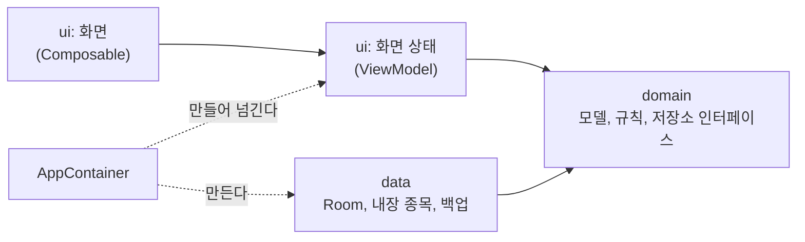
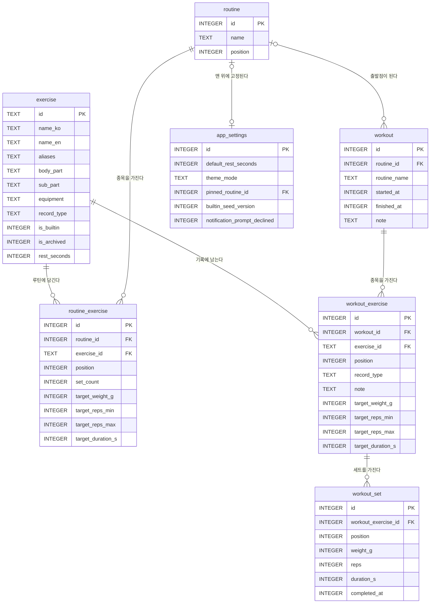

# 설계: 데이터 모델과 코드 구조

작성일: 2026-11-18. 이슈 [#15](https://github.com/zzunsik/next-set/issues/15).

구현 이슈들이 함께 쓸 코드 구조, 라이브러리, 저장 스키마, 백업 파일 형식을 정한다. 코드와 빌드 파일은 이 문서에서 바꾸지 않는다. 의존성을 추가하고 패키지를 만드는 일은 [#18](https://github.com/zzunsik/next-set/issues/18)에서 한다.

근거는 세 종류로 나눠 적었다.

- **공식**: 공식 문서와 릴리스 노트에서 확인했다. 링크는 문서 끝 "출처"에 있다.
- **탐침**: 저장소 사본에 후보 의존성을 넣고 직접 빌드하고 테스트했다. 사본은 저장소 밖에 만들었고 커밋하지 않았다. 조건은 "확인한 시점"에 있다.
- **협의**: 2026-11-18 협의에서 정했다.
- **제안**: 요구사항과 이슈에 없어서 이 문서가 채웠다. "이 문서에서 새로 정한 것"에 모았다. 1차 검토(2026-11-18)에서 그대로 두기로 했다. 그 뒤에 더한 것은 같은 절에 따로 적었다.

## 요약

| 항목 | 결정 |
|---|---|
| 코드 구조 | 모듈은 `app` 하나. 패키지를 `ui`, `domain`, `data`로 나누고 의존은 `ui → domain ← data` 한 방향이다 |
| 데이터베이스 | Room 3(`androidx.room3`)과 KSP, 드라이버는 `BundledSQLiteDriver` |
| 설정 값 저장 | 데이터베이스의 한 행짜리 테이블. DataStore는 쓰지 않는다 |
| 화면 이동 | Navigation 3 |
| 의존성 주입 | 라이브러리 없이 `AppContainer` 하나로 직접 넘긴다 |
| 직렬화 | kotlinx.serialization(JSON) |
| 비동기 | Kotlin 코루틴과 Flow |
| 무게 | 정수 그램으로 저장한다. 62.5kg은 `62500`이다 |
| 직전 기록, 최고 기록 | 따로 저장하지 않고 조회할 때 계산한다 |
| 진행 중인 운동 | 끝난 기록과 같은 테이블에 바로 쓴다. 끝난 시각이 비어 있으면 진행 중이다 |
| 지난 기록 보존 | 운동을 시작할 때 루틴 이름, 목표, 종목의 기록 방식을 운동 기록 쪽에 복사한다. 기록이 있는 종목은 지우지 않고 숨긴다(협의) |
| 기록 방식 바꾸기 | 기록이 쌓인 뒤에도 바꾼다(협의). 지난 세트는 적을 당시의 방식으로 남는다. 최고 기록과 직전 기록은 같은 방식으로 적은 세트끼리만 견준다 |
| 세부 부위 | 하체와 팔만 한 단계 더 나눈다(협의). 종목에 `sub_part` 열을 둔다 |
| 휴식 시간 | 종목마다 값 하나를 둔다. 없으면 설정의 기본값을 쓰고 기본값은 2분이다(협의) |
| 글꼴 | Pretendard 파일을 앱에 넣는다(협의). 라이선스 전문을 앱에 싣고 설정 화면에서 보여 준다 |
| 백업 파일 | JSON 파일 하나. 형식 버전은 데이터베이스 스키마 버전과 따로 센다 |
| 확인이 남은 항목 3번 | 무게가 같으면 횟수가 많은 쪽이 최고 기록이다(협의) |
| 확인이 남은 항목 5번 | 가져오기는 확인을 받은 뒤 전체를 바꾼다(협의) |
| 확인이 남은 항목 6번 | v1에서는 기기 간 직접 전송에 넣지 않는다(협의) |

## 코드 구조

### 패키지

```
io.github.zzunsik.nextset
├── MainActivity.kt
├── NextSetApplication.kt      앱 컨테이너를 만든다
├── AppContainer.kt            저장소 구현을 만들어 화면 상태에 넘긴다
├── ui/                        화면과 화면 상태
│   ├── theme/
│   ├── navigation/            화면 키, 화면 이동
│   ├── component/             여러 화면이 쓰는 요소(숫자판 등)
│   ├── home/
│   ├── workout/               운동 중, 요약
│   ├── routine/
│   ├── exercise/
│   ├── history/
│   └── settings/              설정, 오픈소스 라이선스
├── domain/                    Android에 기대지 않는 순수 Kotlin
│   ├── model/                 종목, 루틴, 운동 기록, 세트, 무게
│   ├── rule/                  다음 차례, 최고 기록, 미리 채우기, 루틴 변경 비교
│   └── repository/            저장소 인터페이스
└── data/
    ├── db/                    Room 엔티티, DAO, 마이그레이션
    ├── repository/            저장소 구현
    ├── seed/                  내장 종목 넣기
    └── backup/                백업 파일 형식, 내보내기, 가져오기
```

기능 폴더(`ui/home` 등)에는 화면(`HomeScreen.kt`)과 화면 상태(`HomeViewModel.kt`)를 함께 둔다. 지금 있는 `ui/HomeScreen.kt`는 #18에서 `ui/home/`으로 옮긴다.

코드가 아닌 파일은 다음 자리에 둔다.

| 위치 | 내용 |
|---|---|
| `app/src/main/res/font/` | Pretendard 글꼴 파일. `ui/theme`이 읽는다 |
| `app/src/main/assets/exercises.json` | 내장 종목 |
| `app/src/main/assets/licenses/` | 글꼴과 라이브러리의 라이선스 전문 |
| `app/schemas/` | Room이 내보낸 스키마 JSON |

### 계층과 의존 방향



| 계층 | 맡는 일 | 써도 되는 것 | 쓰면 안 되는 것 |
|---|---|---|---|
| 화면 | 상태를 그리고 사용자 입력을 화면 상태에 넘긴다 | Compose, 문자열 리소스, 화면 상태 | 저장소, DAO, 엔티티 |
| 화면 상태 | 저장소의 Flow를 화면용 상태(`StateFlow`)로 바꾸고 입력을 저장소 호출로 바꾼다 | `domain`, `ViewModel`, 코루틴 | `data`, Compose UI 타입, `Context` |
| domain | 모델과 계산 규칙. 저장소 인터페이스를 정의한다 | Kotlin 표준 라이브러리, 코루틴(Flow), `java.time` | `android.*`, `androidx.*`, `ui`, `data` |
| data | 저장소 인터페이스를 Room으로 구현한다. 엔티티와 모델을 서로 변환한다 | `domain`, Room, kotlinx.serialization, `Context` | `ui` |

- Room 엔티티는 `data` 밖으로 내보내지 않는다. 화면 상태는 `domain` 모델만 본다.
- 화면 상태는 저장소 인터페이스만 안다. 테스트에서는 가짜 저장소를 넘긴다.
- 모듈이 하나라서 컴파일러가 의존 방향을 지켜 주지 않는다. `domain` 아래 파일이 `android.`, `androidx.`, `.ui.`, `.data.`를 import하면 실패하는 단위 테스트를 #18에서 함께 넣는다(제안).

## 라이브러리 선택

### 고른 것과 견준 후보

| 용도 | 고른 것 | 견준 후보 | 고른 이유 |
|---|---|---|---|
| 데이터베이스 | Room 3 + KSP + `BundledSQLiteDriver` | Room 2, SQLDelight, 플랫폼 SQLite 직접 사용 | 아래 "데이터베이스" |
| 설정 값 저장 | 데이터베이스의 `app_settings` 테이블 | DataStore(Preferences), SharedPreferences | 아래 "설정 값 저장" |
| 화면 이동 | Navigation 3 | Navigation Compose(2 계열), 직접 구현 | 아래 "화면 이동" |
| 의존성 주입 | 쓰지 않는다(`AppContainer`) | Hilt, Koin | 아래 "의존성 주입" |
| 직렬화 | kotlinx.serialization(JSON) | 플랫폼 `org.json`, Moshi, Gson | 아래 "직렬화" |
| 비동기 | Kotlin 코루틴, Flow | RxJava, 스레드 풀 직접 사용 | Room 3이 코루틴을 요구한다 |
| 화면 상태 | `lifecycle-viewmodel-compose`, `lifecycle-runtime-compose` | | 화면 회전과 화면 이동을 거쳐도 상태를 유지한다 |
| 날짜와 시간 | `java.time` | kotlinx-datetime | minSdk 26부터 플랫폼에 들어 있어 의존성이 필요 없다 |
| 글꼴 | Pretendard 파일을 앱에 넣는다(협의) | 기기 기본 글꼴, 내려받는 글꼴 | 아래 "글꼴과 라이선스 고지" |
| 스크린샷 테스트(테스트 전용) | Roborazzi | Paparazzi | 아래 "화면 검증" |
| 접근성 검사(테스트 전용) | Roborazzi 접근성 검사 모듈(ATF)과 누르는 영역 크기 검사 | Compose UI 테스트의 `enableAccessibilityChecks()` | 아래 "화면 검증" |

### 빌드 전제와 인터넷 권한 확인

빌드 전제는 저장소의 지금 설정이다. AGP의 내장 Kotlin을 쓰고 JDK 25로 빌드하며 minSdk는 26이다. 버전은 "확인한 시점" 표에 있다. 고른 라이브러리를 저장소 사본에 모두 넣고 CI와 같은 명령(`./gradlew assembleDebug lint testDebugUnitTest`)에 `assembleRelease`를 더해 돌렸다. 빌드와 테스트가 통과했다(탐침).

| 라이브러리 | 주석 처리기 | 빌드 전제 | 인터넷 권한 | 근거 |
|---|---|---|---|---|
| Room 3 | KSP 필수. KAPT는 지원하지 않는다 | 통과 | 없음 | 공식, 탐침 |
| KSP | | 통과. AGP 9 내장 Kotlin 대응 수정이 릴리스 노트에 있다 | 빌드 도구라 해당 없음 | 공식, 탐침 |
| `androidx.sqlite` bundled | 없음 | 통과. 네이티브 라이브러리가 APK에 들어간다 | 없음 | 공식, 탐침 |
| Navigation 3 | 없음. 화면 키에 직렬화 플러그인이 필요하다 | 통과 | 없음 | 공식, 탐침 |
| Lifecycle(ViewModel) | 없음 | 통과 | 없음 | 탐침 |
| kotlinx.serialization | Kotlin 컴파일러 플러그인. KSP와 KAPT가 필요 없다 | 통과 | 없음(JVM 라이브러리라 매니페스트가 없다) | 공식, 탐침 |
| kotlinx.coroutines | 없음 | 통과 | 없음(위와 같다) | 공식, 탐침 |

- 인터넷 권한은 디버그와 릴리스 빌드의 병합된 매니페스트에서 확인했다. 두 쪽 모두 `uses-permission`은 `DYNAMIC_RECEIVER_NOT_EXPORTED_PERMISSION` 하나뿐이다. 이미 쓰고 있는 `androidx.core`가 넣는 앱 전용 권한이다(탐침).
- Room 3이 `androidx.room3.MultiInstanceInvalidationService` 서비스 선언을 매니페스트에 더한다. `exported="false"`이고 권한을 요구하지 않는다(탐침).
- 내장 Kotlin에서는 `kotlin-kapt` 플러그인을 쓸 수 없다. 주석 처리기가 필요한 라이브러리는 KSP를 지원하는 것만 고른다(공식).
- KSP는 Kotlin 컴파일러 버전과 따로 버전을 매긴다(공식). 릴리스 노트에서 Kotlin 2.4.21을 지원한다고 적은 문장은 찾지 못했지만 빌드가 통과하는 것은 확인했다(탐침).
- 직렬화 플러그인(`org.jetbrains.kotlin.plugin.serialization`)은 지금 `kotlin-compose` 플러그인처럼 Kotlin 버전을 그대로 쓴다(탐침).

DATA-02를 지키는 장치를 둘 둔다(제안).

- 단위 테스트 하나가 앱이 요청하는 권한 목록에 `android.permission.INTERNET`이 없는지 본다. Robolectric이 병합된 매니페스트를 읽으므로 의존성이 권한을 끌어오면 이 테스트가 실패한다(탐침).
- 이 테스트는 디버그 빌드의 매니페스트를 본다. 릴리스 빌드는 CI에서 병합된 매니페스트를 직접 검사한다.

### 데이터베이스

| 후보 | 장점 | 단점 |
|---|---|---|
| **Room 3** | SQL을 컴파일할 때 검사한다. 조회 결과를 Flow로 받아 화면이 저절로 갱신된다. 스키마를 JSON으로 내보내고 마이그레이션 테스트 도구가 있다. Kotlin 코드만 만들고 KSP만 쓴다 | 2026년 7월에 안정판이 나온 새 계열이다 |
| Room 2 | 오래 쓰여 자료가 많다 | 패키지(`androidx.room`)가 달라 나중에 3으로 옮기려면 import와 드라이버 설정을 모두 고쳐야 한다. 새 프로젝트가 여기서 시작할 이유가 없다 |
| SQLDelight | SQL 파일에서 타입 안전한 Kotlin을 만든다 | AGP 9 내장 Kotlin에서 Gradle 플러그인이 도는지 확인하지 않았다 |
| 플랫폼 SQLite 직접 사용 | 의존성이 없다 | 행과 객체 변환, 질의 검사, 변경 알림, 마이그레이션 검증을 모두 직접 만들어야 한다 |

Room 3은 Room 2와 다음이 다르다(공식).

- 패키지가 `androidx.room3`이다.
- KSP가 필수이고 Kotlin 코드만 만든다.
- DAO 함수는 `suspend`이거나 Flow를 돌려줘야 한다.
- `SQLiteDriver`를 반드시 지정해야 한다.

드라이버는 둘 가운데 고른다.

| 드라이버 | SQLite | APK | JVM 테스트 |
|---|---|---|---|
| **`BundledSQLiteDriver`** | 라이브러리에 든 것. 모든 기기에서 같다 | ABI마다 네이티브 라이브러리 약 1.2MB가 더해진다(탐침) | `sqlite-bundled-jvm`을 테스트 의존성에 더하면 돈다(탐침) |
| `AndroidSQLiteDriver` | 기기에 든 것. Android 버전마다 다르다 | 더해지는 것이 없다 | Robolectric에 든 SQLite로 돈다 |

`BundledSQLiteDriver`를 고른다.

- 공식 문서가 권장하는 구현이다(공식).
- 기기의 SQLite는 Android 버전을 따른다. API 26은 3.18이고 API 30은 3.28이다(공식). 윈도 함수는 3.25.0, UPSERT 구문은 3.24.0에서 들어왔다(공식). minSdk 26에서 `AndroidSQLiteDriver`를 쓰면 Android 8~10 기기에서 이 구문들이 실패한다.
- 그 실패를 테스트가 잡지 못한다. Robolectric 테스트에서 `AndroidSQLiteDriver`는 Robolectric에 든 새 SQLite로 돌았고 윈도 함수가 든 질의가 통과했다(탐침). 기기에서만 깨지는 질의가 CI를 지나간다.
- `BundledSQLiteDriver`는 기기와 테스트가 같은 SQLite를 쓴다.
- JVM 테스트에는 `androidx.sqlite:sqlite-bundled-jvm`이 따로 필요하다. 없으면 `UnsatisfiedLinkError: no sqliteJni`로 실패한다(탐침).

### 설정 값 저장

사용자가 정하는 값은 셋이다. 기본 휴식 시간, 화면 모드, 직접 고른 맨 위 루틴이다. 기기 상태 둘도 같은 곳에 둔다. 내장 종목 판 번호와 알림 켜기 안내를 거절했는지다.

| 후보 | 장점 | 단점 |
|---|---|---|
| **데이터베이스 테이블** | 저장소가 하나다. 백업을 가져올 때 기록과 설정이 한 트랜잭션으로 바뀐다. 직접 고른 루틴이 외래 키라 루틴을 지우면 저절로 비워진다. 의존성이 늘지 않는다 | 설정을 더할 때 마이그레이션이 필요하다 |
| DataStore(Preferences) | 키와 값만 더하면 된다. 공식 문서가 SharedPreferences의 단점을 보완한 저장소로 소개한다 | 저장소가 둘이 된다. 가져오기가 데이터베이스와 DataStore에 따로 쓰므로 중간에 실패하면 한쪽만 바뀐다. 직접 고른 루틴이 지워졌는지 읽을 때마다 확인해야 한다 |
| SharedPreferences | 의존성이 없다 | 위 단점에 더해 Flow가 없고 쓰기가 끝났는지 알기 어렵다 |

값이 적고 그 가운데 하나가 루틴을 가리키므로 데이터베이스에 둔다. 값이 늘어 마이그레이션이 번거로워지면 그때 DataStore로 옮긴다. DataStore(Preferences)도 탐침에 넣어 빌드와 Robolectric 테스트가 통과하는 것은 확인해 두었다(탐침).

### 화면 이동

| 후보 | 장점 | 단점 |
|---|---|---|
| **Navigation 3** | 뒤로 가기 스택이 앱이 가진 목록이다. 화면을 더하고 빼는 것이 목록 조작이라 JVM 테스트에서 목록만 보고 확인한다. Compose 전용으로 만들어졌다 | 2 계열보다 자료가 적다 |
| Navigation Compose(2 계열) | 오래 쓰였다 | 스택을 `NavController`가 쥐고 있어 상태를 테스트하려면 컨트롤러를 거쳐야 한다 |
| 직접 구현 | 의존성이 없다 | 화면마다 상태 보존, 뒤로 가기, ViewModel 범위를 직접 만들어야 한다 |

- 화면 키는 `@Serializable`을 붙인 `NavKey` 구현으로 만든다. 프로세스가 죽었다 살아나도 스택이 복원된다(공식). 직렬화 플러그인은 백업에도 쓰므로 따로 드는 비용이 없다.
- 화면별 ViewModel 범위는 `lifecycle-viewmodel-navigation3`으로 잡는다. 이 아티팩트는 의존성이 풀리는 것까지만 확인했다(탐침).
- `NavDisplay`, `entryProvider`, `rememberNavBackStack`을 쓰는 코드가 컴파일되는 것을 확인했다(탐침). 화면 테스트에서 그려지는지는 확인하지 않았다.

### 의존성 주입

| 후보 | 장점 | 단점 |
|---|---|---|
| **쓰지 않는다** | 플러그인과 코드 생성이 없다. 객체를 만드는 곳이 `AppContainer` 한 파일이라 읽으면 안다. 테스트는 생성자에 가짜를 넘긴다 | 객체가 늘면 손으로 잇는 코드가 늘어난다 |
| Hilt | 컴파일할 때 그래프를 검사한다. 공식 문서가 권한다 | Gradle 플러그인과 주석 처리기가 더해진다. 이 규모에서는 얻는 것보다 설정이 많다 |
| Koin | 코드 생성이 없다 | 의존성과 배울 문법이 하나 더해진다. 이 규모에서는 얻는 것이 적다 |

공식 문서는 가능하면 Hilt를 쓰라고 권한다(공식). 그래도 쓰지 않기로 한다. 모듈이 하나이고 만들 객체가 데이터베이스 하나와 저장소 대여섯 개라 손으로 잇는 코드가 수십 줄이다. 모듈을 나누거나 화면 흐름마다 범위가 다른 객체가 생기면 다시 본다. Hilt와 Koin은 고르지 않았으므로 이 빌드 조합으로 빌드해 보지 않았다.

```kotlin
// 개요만 적는다. 실제 코드는 #18에서 쓴다.
class AppContainer(context: Context) {
    private val database = buildDatabase(context)
    val exerciseRepository: ExerciseRepository = RoomExerciseRepository(database)
    val workoutRepository: WorkoutRepository = RoomWorkoutRepository(database)
}
```

### 직렬화

| 후보 | 장점 | 단점 |
|---|---|---|
| **kotlinx.serialization** | 컴파일러 플러그인이라 리플렉션과 KSP가 필요 없다. 기본값과 `ignoreUnknownKeys`로 필드가 늘어난 파일을 읽는다. Navigation 3 화면 키에도 필요하다 | |
| `org.json` | 의존성이 없다 | 필드를 손으로 옮겨야 하고 빠뜨려도 컴파일러가 모른다 |
| Moshi | 코드 생성으로 타입 안전하다 | KSP 처리기와 Okio가 더해진다 |
| Gson | 널리 쓰인다 | 리플렉션으로 값을 넣어 Kotlin의 null 검사와 기본값을 건너뛴다 |

### 글꼴과 라이선스 고지

글꼴은 Pretendard로 정했다(협의). 본문과 숫자에 모두 쓴다. 쓰는 굵기와 글자 크기는 디자인 문서(#14)가 정하고 파일을 넣는 일은 #19에서 한다.

- 의존성이 아니라 파일이다. `app/src/main/res/font/`에 두고 `ui/theme`에서 `Font(R.font.…)`로 `FontFamily`를 만든다(공식).
- `res/font`의 글꼴 리소스는 Android 8.0(API 26)부터 쓴다(공식). minSdk와 같아 지원 라이브러리가 필요 없다.
- 리소스 파일 이름은 소문자와 밑줄로 바꾼다(공식). 예) `pretendard_regular.otf`.
- 내려받는 글꼴은 쓰지 않는다. 기기의 Google Play 서비스에 든 글꼴 제공자를 거쳐 내려받는 방식이라(공식) 네트워크 없이 동작해야 하는 요구(NF-08)와 맞지 않는다.
- 권한과 매니페스트는 바뀌지 않는다.

앱 크기는 다음만큼 커진다. 서명하지 않은 릴리스 APK를 글꼴을 넣기 전과 견줬다(탐침).

| 넣는 파일 | 파일 크기 합계 | APK 증가 |
|---|---|---|
| **정적 OTF 3개**(Regular 400, SemiBold 600, Bold 700) | 4.73MB | 약 3.2MB |
| 가변 TTF 1개(굵기 전체) | 6.74MB | 약 3.0MB |

- 정적 파일 3개로 간다(협의). APK 안에서는 압축되어 파일 크기보다 적게 늘어난다.
- 가변 파일 하나는 굵기를 모두 담고도 APK 증가가 비슷했다. 굵기가 더 필요해지면 다시 본다. 가변 글꼴은 Android 8.0부터 지원한다(공식).
- 글꼴 파일은 받은 그대로 넣는다. 쓰는 글자만 남겨 줄이는 가공은 하지 않는다. 가공한 판에는 Pretendard라는 이름을 쓰지 못하는데(공식, OFL 3항), 글자를 덜어 낸 파일이 여기에 드는지는 확인하지 못했다.

라이선스는 SIL Open Font License 1.1이다(공식).

- 글꼴을 소프트웨어에 묶어 배포해도 된다. 조건은 사본마다 저작권 표시와 라이선스를 담는 것이다. 독립된 텍스트 파일로 담아도 된다(공식, OFL 2항).
- Pretendard 저장소의 `LICENSE` 파일에 저작권 표시와 OFL 전문이 함께 있다. 약 4.8KB다. 이 파일을 고치지 않고 `app/src/main/assets/licenses/pretendard.txt`로 싣는다.
  - v1.3.9 릴리스 묶음의 `LICENSE.txt`(4,419바이트)에는 Pretendard의 저작권 줄만 있다. 바탕 글꼴(Source, Inter, M PLUS 1)의 저작권 줄은 그 뒤 저장소 커밋 `0189074`("Add missing copyright notices to license", 2024-04-21)에서 더해졌다. 그래서 글꼴 파일은 v1.3.9 릴리스에서, 라이선스는 이 커밋의 `LICENSE`(4,816바이트)에서 받아 고치지 않고 넣었다(#19).
- 설정 화면에 "오픈소스 라이선스" 항목을 둔다(협의). 누르면 `assets/licenses/`의 파일을 읽어 전문을 보여 준다. 네트워크를 쓰지 않는다.
- 라이브러리 고지도 같은 화면에서 다룬다. 고른 라이브러리는 모두 Apache License 2.0으로 배포된다(공식, 각 POM). 이 라이선스는 받는 사람에게 라이선스 사본을 주라고 요구한다(공식, 4조). Apache 2.0 전문 하나와 라이브러리 이름 목록을 같은 폴더에 둔다.
- 라이브러리 목록은 손으로 적는다(#28). `assets/licenses/index.json`에 항목마다 이름, 만든 곳, 라이선스 이름, 전문 파일, 고지하는 Maven 모듈을 적는다. Apache 2.0 전문은 `assets/licenses/apache-2.0.txt` 하나를 함께 쓴다.
  - Gradle 플러그인(AboutLibraries 등)은 쓰지 않는다. 직접 넣은 라이브러리가 열 개 남짓이고 모두 Apache 2.0이라 손으로 적는 쪽이 의존성과 빌드 설정을 늘리지 않는다.
  - 손으로 적으면 라이브러리를 더할 때 목록을 빠뜨릴 수 있다. `AssetLicenseRepositoryTest`가 `app/build.gradle.kts`의 `implementation` 라이브러리를 버전 목록에서 찾아 모두 목록에 있는지, 목록에 앱이 쓰지 않는 모듈이 없는지 본다.
  - 함께 딸려 오는 의존성(전이 의존성)은 목록에 따로 적지 않는다. 아래 "확인하지 못한 것"의 "라이브러리 고지의 범위"와 같다.
  - 화면은 `domain`의 `LicenseRepository`로 읽는다. 구현(`data/repository/AssetLicenseRepository`)이 assets를 읽는다.

### 화면 검증

#19에서 정했다. 스크린샷 테스트와 접근성 검사는 테스트에만 쓰고 APK에는 들어가지 않는다.

| 용도 | 후보 | 도는 곳 | 고른 것과 이유 |
|---|---|---|---|
| 스크린샷 테스트 | **Roborazzi** | Robolectric 위 JVM | 고름. 지금 화면 테스트와 같은 Robolectric 러너와 Compose 테스트 규칙을 그대로 쓴다. 접근성 검사 모듈이 함께 있다 |
| | Paparazzi | layoutlib 위 JVM | Robolectric을 쓰지 않아 이슈의 조건과 맞지 않는다. Compose 테스트 규칙의 조작과 검사를 같은 테스트에서 쓰지 못한다 |
| 접근성 검사 | Compose UI 테스트의 `enableAccessibilityChecks()`(`ui-test-junit4-accessibility`) | 기기 | Robolectric에서는 ATF의 모든 검사가 `NOT_RUN`으로 끝나 라벨 없는 버튼과 흐린 글자를 하나도 잡지 못했다(탐침) |
| | **Roborazzi 접근성 검사 모듈**(`roborazzi-accessibility-check`, ATF) | Robolectric 위 JVM | 고름. 같은 예시에서 라벨 없음(`SpeakableTextPresentCheck`)과 대비 부족(`TextContrastCheck`)을 잡았다(탐침) |
| | 누르는 영역 크기 검사(직접 작성) | Robolectric 위 JVM | 고름. 아래 이유로 ATF와 함께 쓴다 |

- ATF의 누르는 영역 검사(`TouchTargetSizeCheck`)는 Compose에서 32dp 버튼도 통과시켰다. Compose가 48dp보다 작은 누르는 요소의 접근성 영역(`touchBoundsInRoot`)을 48dp로 늘려 알리기 때문이다(탐침: 배치 32dp, 알린 영역 48dp). 늘린 영역은 옆 요소와 겹치면 줄어들 수 있다. 그래서 누르는 요소의 배치 크기(`boundsInRoot`)가 48dp 이상인지 따로 검사한다(NF-10).
- 접근성 검사의 실패 기준은 ATF의 경고(WARNING) 이상이다. 대비 부족이 경고로 나오기 때문이다.
- 검사 자체가 조용히 꺼지는 일을 막으려고, 잘못 만든 예시(40dp 버튼, 라벨 없는 버튼, 흐린 글자)에서 검사가 실패하는지 보는 테스트를 둔다(`AccessibilityChecksTest`).
- 기준 이미지는 `app/src/test/screenshots/`에 커밋한다. `gradle.properties`의 `roborazzi.test.verify=true`로 `testDebugUnitTest`가 늘 기준 이미지와 비교한다. 검사 명령과 CI가 따로 비교 단계를 부르지 않아도 화면이 바뀌면 실패한다.
- 기기 조건은 폭 360dp, xhdpi다. 밝은 화면과 어두운 화면, 글자 크기 기본(100%)과 크게(200%)의 네 조합을 찍는다. Robolectric의 `@Config(qualifiers = "+night", fontScale = 2.0f)`로 시스템 설정을 바꿔 찍으므로 화면 모드의 "시스템 설정 따름"과 Android 14의 비선형 글자 크기 조절을 함께 거친다.

## 저장 스키마

이슈의 초안에서 출발해 다음을 고쳤다.

- 설정을 테이블로 확정했다.
- 운동 기록에 루틴 이름 사본을, 운동 기록 종목에 목표 사본을 더했다.
- 종목에 숨김 여부를 더했다.
- 내장 종목 판 번호를 설정에 더했다.

1차 검토 뒤에 셋을 더 고쳤다(협의).

- 종목에 세부 부위를 더했다.
- 운동 기록 종목에 그때의 기록 방식 사본을 더했다.
- 설정에 알림 켜기 안내를 거절했는지를 더했다.

### ER 그림



### 공통 규칙

| 항목 | 규칙 |
|---|---|
| 이름 | 테이블과 열은 영어 소문자와 밑줄로 쓴다. `set`은 SQL 예약어라 세트 테이블은 `workout_set`이다 |
| 시각 | UTC 기준 밀리초 정수(`INTEGER`)로 저장한다. `domain`에서는 `java.time.Instant`다. 날짜는 화면에 그릴 때 기기의 시간대로 바꾼다 |
| 무게 | 그램 정수. 아래 "무게 저장 형식" |
| 시간 길이 | 초 정수 |
| 참, 거짓 | `INTEGER` 0과 1 |
| 열거 값 | 상수 이름을 `TEXT`로 저장한다. Room이 열거 타입을 이렇게 저장한다(탐침). 이 이름은 스키마와 백업 형식의 일부라 배포한 뒤에는 바꾸지 않는다 |
| 순서 | `position`은 0부터 센다. 화면에는 1을 더해 보여 준다. 순서를 바꾸면 한 트랜잭션에서 0부터 다시 매긴다. 유일 인덱스는 걸지 않는다 |
| 값 검증 | CHECK 제약을 쓰지 않고 저장소 구현이 쓰기 전에 검증한다. 규칙은 `domain`에 둔다 |
| 외래 키 | 모든 외래 키 열에 인덱스를 건다. Room은 외래 키 검사를 켠 채로 데이터베이스를 연다(탐침) |

### exercise (종목)

| 열 | 타입 | null | 설명 |
|---|---|---|---|
| `id` | TEXT | 아니오 | 기본 키. 내장 종목은 영문 슬러그(`barbell-bench-press`), 직접 만든 종목은 `custom-`에 UUID를 붙인다 |
| `name_ko` | TEXT | 아니오 | 한국어 이름 |
| `name_en` | TEXT | 예 | 영어 이름. 직접 만든 종목은 비워도 된다 |
| `aliases` | TEXT | 아니오 | 검색용 별칭. 줄바꿈으로 구분한다. 없으면 빈 문자열 |
| `body_part` | TEXT | 아니오 | `CHEST`, `BACK`, `SHOULDERS`, `ARMS`, `LEGS`, `CORE` |
| `sub_part` | TEXT | 예 | 세부 부위. `QUADS`(허벅지 앞), `HAMSTRINGS`(허벅지 뒤), `GLUTES`(엉덩이), `CALVES`(종아리), `BICEPS`(이두), `TRICEPS`(삼두), `FOREARMS`(전완). 하체와 팔이 아니면 비운다 |
| `equipment` | TEXT | 아니오 | `BARBELL`, `DUMBBELL`, `MACHINE`, `CABLE`, `BODYWEIGHT`, `KETTLEBELL`, `BAND`, `OTHER` |
| `record_type` | TEXT | 아니오 | 종목의 지금 기록 방식. `WEIGHT_REPS`, `REPS`, `DURATION`. 기록이 쌓인 뒤에도 바꾼다 |
| `is_builtin` | INTEGER | 아니오 | 내장 종목이면 1 |
| `is_archived` | INTEGER | 아니오 | 숨긴 종목이면 1. 기본 0 |
| `rest_seconds` | INTEGER | 예 | 이 종목의 휴식 시간. 비어 있으면 설정의 기본값을 쓴다 |

- 세부 부위는 하체와 팔만 넣고 보조 부위는 넣지 않는다(협의). 보조 부위는 쓰는 기능이 없다.
- `sub_part`는 `body_part`와 맞아야 한다. `LEGS`면 `QUADS`, `HAMSTRINGS`, `GLUTES`, `CALVES` 가운데 하나이고 `ARMS`면 `BICEPS`, `TRICEPS`, `FOREARMS` 가운데 하나다. 그 밖의 부위는 비운다. 저장소 구현이 쓰기 전에 검증한다.
- 내장 종목 가운데 하체와 팔은 모두 세부 부위를 하나 갖는다. 여러 곳을 쓰는 종목은 주로 쓰는 곳 하나를 적는다. 직접 만든 종목은 비워도 된다.
- 직접 만든 종목의 부위를 바꿔 세부 부위가 맞지 않게 되면 같은 쓰기에서 세부 부위를 비운다(제안).
- 걸러 보기(EX-03)는 부위로 먼저 거르고 하체나 팔에서 세부 부위를 고르면 그 값이 같은 종목만 남긴다. 세부 부위를 고르지 않으면 세부 부위가 빈 종목까지 그 부위 전체가 보인다.
- 검색(EX-02)은 질의로 하지 않는다. 종목 전체(수백 행)를 Flow로 받아 `domain`에서 공백을 빼고 소문자로 맞춘 뒤 이름과 별칭을 비교한다. "벤치프레스"로 "벤치 프레스"를 찾는 규칙은 순수 Kotlin 테스트로 다룬다.

### routine (루틴)

| 열 | 타입 | null | 설명 |
|---|---|---|---|
| `id` | INTEGER | 아니오 | 기본 키. 자동 증가 |
| `name` | TEXT | 아니오 | 이름 |
| `position` | INTEGER | 아니오 | 루틴 목록에서의 순서(RTN-05, HOME-02) |

### routine_exercise (루틴 종목)

| 열 | 타입 | null | 설명 |
|---|---|---|---|
| `id` | INTEGER | 아니오 | 기본 키. 자동 증가 |
| `routine_id` | INTEGER | 아니오 | `routine.id`. 루틴을 지우면 함께 지운다(CASCADE) |
| `exercise_id` | TEXT | 아니오 | `exercise.id`. 종목 행을 지우면 함께 지운다(CASCADE) |
| `position` | INTEGER | 아니오 | 루틴 안에서의 순서 |
| `set_count` | INTEGER | 아니오 | 세트 수. 1 이상(RTN-04) |
| `target_weight_g` | INTEGER | 예 | 목표 무게 |
| `target_reps_min` | INTEGER | 예 | 목표 횟수 하한 |
| `target_reps_max` | INTEGER | 예 | 목표 횟수 상한 |
| `target_duration_s` | INTEGER | 예 | 목표 시간 |

- 인덱스: `(routine_id, position)`, `(exercise_id)`.
- 한 루틴에 같은 종목을 두 번 넣는 것을 막지 않는다.
- 종목의 기록 방식에 맞지 않는 목표 열은 비워 둔다. 종목의 기록 방식을 바꾸면 같은 트랜잭션에서 새 방식에 쓰지 않는 목표 열을 비운다.

### workout (운동 기록)

| 열 | 타입 | null | 설명 |
|---|---|---|---|
| `id` | INTEGER | 아니오 | 기본 키. 자동 증가 |
| `routine_id` | INTEGER | 예 | 출발한 루틴. 빈 운동이면 비어 있다. 루틴을 지우면 비운다(SET NULL) |
| `routine_name` | TEXT | 예 | 시작할 때의 루틴 이름 사본 |
| `started_at` | INTEGER | 아니오 | 시작 시각 |
| `finished_at` | INTEGER | 예 | 끝난 시각. 비어 있으면 진행 중이다 |
| `note` | TEXT | 예 | 메모(LOG-11) |

- 인덱스: `(started_at)`, `(routine_id)`.
- 진행 중인 운동은 많아야 하나다. 저장소 구현이 시작하기 전에 확인한다.

### workout_exercise (운동 기록 종목)

| 열 | 타입 | null | 설명 |
|---|---|---|---|
| `id` | INTEGER | 아니오 | 기본 키. 자동 증가 |
| `workout_id` | INTEGER | 아니오 | `workout.id`. 운동 기록을 지우면 함께 지운다(CASCADE) |
| `exercise_id` | TEXT | 아니오 | `exercise.id`. 기록이 있는 종목 행은 지우지 못한다(RESTRICT) |
| `position` | INTEGER | 아니오 | 운동 기록 안에서의 순서 |
| `record_type` | TEXT | 아니오 | 이 행을 만들 때의 종목 기록 방식 사본. `WEIGHT_REPS`, `REPS`, `DURATION` |
| `note` | TEXT | 예 | 종목 메모(LOG-11) |
| `target_weight_g` | INTEGER | 예 | 시작할 때의 목표 사본 |
| `target_reps_min` | INTEGER | 예 | 위와 같다 |
| `target_reps_max` | INTEGER | 예 | 위와 같다 |
| `target_duration_s` | INTEGER | 예 | 위와 같다 |

- 인덱스: `(workout_id, position)`, `(exercise_id)`.
- 이 행에 딸린 세트는 이 행의 `record_type`으로 읽는다. 종목의 기록 방식을 나중에 바꿔도 이 값은 바뀌지 않는다.

### workout_set (세트)

| 열 | 타입 | null | 설명 |
|---|---|---|---|
| `id` | INTEGER | 아니오 | 기본 키. 자동 증가 |
| `workout_exercise_id` | INTEGER | 아니오 | `workout_exercise.id`. 함께 지운다(CASCADE) |
| `position` | INTEGER | 아니오 | 순번 |
| `weight_g` | INTEGER | 예 | 무게 |
| `reps` | INTEGER | 예 | 횟수 |
| `duration_s` | INTEGER | 예 | 시간 |
| `completed_at` | INTEGER | 예 | 완료 시각. 비어 있으면 아직 완료하지 않은 세트다 |

- 인덱스: `(workout_exercise_id, position)`.
- 직전 기록, 최고 기록, 볼륨은 `completed_at`이 있는 세트만 센다.
- 어느 값 열을 채우는지는 `workout_exercise.record_type`을 따른다. 무게와 횟수는 `weight_g`와 `reps`, 횟수만은 `reps`, 시간은 `duration_s`다. 나머지 열은 비운다.

### app_settings (설정)

| 열 | 타입 | null | 설명 |
|---|---|---|---|
| `id` | INTEGER | 아니오 | 기본 키. 항상 1이다 |
| `default_rest_seconds` | INTEGER | 아니오 | 기본 휴식 시간(SET-01) |
| `theme_mode` | TEXT | 아니오 | `SYSTEM`, `LIGHT`, `DARK`(SET-02) |
| `pinned_routine_id` | INTEGER | 예 | 직접 고른 맨 위 루틴(HOME-03). 루틴을 지우면 비운다(SET NULL) |
| `builtin_seed_version` | INTEGER | 아니오 | 마지막으로 반영한 내장 종목 판 번호. 기본 0 |
| `notification_prompt_declined` | INTEGER | 아니오 | 알림 켜기 안내를 거절했으면 1. 기본 0 |

- 행이 없으면 저장소 구현이 기본값을 돌려준다. 처음 쓸 때 행을 만든다.
- 기본 휴식 시간의 초깃값은 120초(2분)다(협의). 늘리고 줄이는 폭 15초는 화면이 갖는 값이라 저장하지 않는다.
- `notification_prompt_declined`는 휴식 바의 '알림 켜기'를 눌러 뜬 시스템 창에서 알림을 거절했는지다(협의). 1이면 버튼을 숨기고 설정 화면에서만 안내한다. 언제 1로 바꾸는지는 휴식 타이머 설계(#16)가 정한다.
- `builtin_seed_version`과 `notification_prompt_declined`는 기기 상태다. 백업에 넣지 않는다.

### 삭제 전파

| 지우는 것 | 함께 바뀌는 것 |
|---|---|
| 루틴 | `routine_exercise` 삭제. `workout.routine_id`와 `app_settings.pinned_routine_id`는 비운다 |
| 종목 행 | `routine_exercise` 삭제. `workout_exercise`가 가리키면 삭제가 거부된다 |
| 운동 기록 | `workout_exercise`, `workout_set` 삭제 |
| 운동 기록 종목 | `workout_set` 삭제 |

## 무게 저장 형식

무게는 그램 단위 정수로 저장한다. 62.5kg은 `62500`이다.

| 후보 | 판단 |
|---|---|
| 실수(`REAL`) | 0.5 단위는 오차 없이 표현되지만 숫자판으로 친 61.3 같은 값은 그렇지 않다. 최고 기록을 가릴 때 같은 무게인지 비교하는 일과 볼륨 합계가 흔들린다 |
| 0.5kg 단위 정수 | 증감 키로 만든 값은 담지만 0.25kg 단위처럼 직접 친 값을 담지 못한다 |
| **그램 정수** | 소수 셋째 자리까지 오차 없이 담는다. 비교와 합계가 정수 연산이다 |

- `domain`에 `Weight(grams: Int)` 타입을 둔다. 증감 키는 `±1000`, `±2500`을 더한다.
- 숫자판에서 친 문자열은 실수를 거치지 않고 정수 그램으로 바로 바꾼다.
- 화면에는 kg으로 보여 주고 뒤의 0을 뗀다. `62500`은 "62.5", `60000`은 "60"이다.
- 볼륨(HIST-02)은 `weight_g × reps`의 합을 64비트 정수로 구한 뒤 kg으로 바꾼다.
- lb 단위는 범위 밖이다. 나중에 넣더라도 저장은 그램으로 두고 화면에서만 바꾼다.

## 직전 기록과 최고 기록

### 계산해서 구한다

둘 다 따로 저장하지 않고 조회할 때 세트 테이블에서 계산한다.

| 방식 | 판단 |
|---|---|
| **조회할 때 계산** | 기록을 고치거나 지워도(HIST-05) 맞출 것이 없다. 다음 조회가 바뀐 세트에서 다시 계산한다 |
| 따로 저장 | 조회가 빠르지만 세트를 고치고 지울 때마다, 백업을 가져올 때마다 다시 계산해 써야 한다. 빠뜨리면 틀린 최고 기록이 남는다 |

- 한 종목의 세트는 몇 년을 써도 수천 행으로 예상한다. `workout_exercise(exercise_id)` 인덱스로 종목의 기록을 찾고 `workout_set(workout_exercise_id, position)` 인덱스로 세트를 읽는다.
- Room이 테이블 변경을 감지해 Flow를 다시 내보내므로 화면도 따로 갱신할 필요가 없다.
- 조회가 느려지는 것이 측정되면 그때 요약 테이블을 더한다.

### 직전 기록(LOG-03)

요구사항의 정의는 "같은 종목을 마지막으로 한 운동 기록에서 같은 순번에 있는 세트"다. 다음처럼 구체화한다(제안).

- "마지막"은 운동 기록의 시작 시각으로 가린다. 지난 날짜를 나중에 적어 넣은 기록(HIST-06)도 날짜에 맞는 자리에 놓인다.
- 기준이 되는 운동보다 먼저 시작했고 이미 끝났으며 그 종목에 완료한 세트가 하나라도 있는 운동 기록만 본다.
- 같은 기록 방식으로 적은 기록만 본다(협의). 방식이 다른 기록은 건너뛰고 그보다 앞선 기록을 찾는다.
- 한 운동 기록에 같은 종목이 두 번 있으면 앞의 것을 쓴다.

```sql
-- :exerciseId 종목의 직전 기록. :startedAt은 지금 보고 있는 운동 기록의 시작 시각이다.
-- :recordType은 지금 채우려는 운동 기록 종목의 record_type이다.
SELECT s.position, s.weight_g, s.reps, s.duration_s
FROM workout_set s
WHERE s.completed_at IS NOT NULL
  AND s.workout_exercise_id = (
    SELECT we.id
    FROM workout_exercise we
    JOIN workout w ON w.id = we.workout_id
    WHERE we.exercise_id = :exerciseId
      AND we.record_type = :recordType
      AND w.finished_at IS NOT NULL
      AND w.started_at < :startedAt
      AND EXISTS (
        SELECT 1 FROM workout_set s2
        WHERE s2.workout_exercise_id = we.id AND s2.completed_at IS NOT NULL
      )
    ORDER BY w.started_at DESC, we.position ASC
    LIMIT 1
  )
ORDER BY s.position;
```

새로 시작한 운동의 `record_type`은 종목의 지금 방식이다. 그래서 직전 기록은 종목의 지금 방식으로 적은 세트만 본다.

입력 칸을 채우는 순서는 `domain`의 함수 하나가 정한다.

1. 직전 기록에 같은 순번의 세트가 있으면 그 값
2. 없으면 `workout_exercise`의 목표 사본. 횟수는 목표 하한을 쓴다(제안)
3. 그것도 없으면 비워 둔다

방식을 바꾼 뒤 처음 하는 운동에는 같은 방식의 직전 기록이 없다. 2번이나 3번으로 넘어간다.

채운 값은 세트 행을 만들 때 행에 써 둔다. 체크만 눌러 완료할 때(LOG-04)는 `completed_at`만 채운다.

### 최고 기록(LOG-14, HIST-03, HIST-04)

최고 기록은 같은 기록 방식으로 적은 세트끼리만 견준다(협의). 종목의 최고 기록은 종목의 지금 방식으로 적은 세트 가운데 가장 좋은 것이다. 방식을 되돌리면 예전 세트가 다시 대상이 된다.

비교 규칙은 기록 방식마다 다르다.

| 기록 방식 | 더 좋은 기록 |
|---|---|
| 무게와 횟수 | 무게가 무거운 쪽. 무게가 같으면 횟수가 많은 쪽(협의) |
| 횟수만 | 횟수가 많은 쪽 |
| 시간 | 시간이 긴 쪽 |

값이 모두 같으면 먼저 세운 쪽이 최고 기록으로 남는다.

```sql
-- :exerciseId 종목을 무게와 횟수로 적은 세트 가운데 최고 기록. :excludeSetId는 방금 완료한 세트다.
SELECT s.id, s.weight_g, s.reps
FROM workout_set s
JOIN workout_exercise we ON we.id = s.workout_exercise_id
JOIN workout w ON w.id = we.workout_id
WHERE we.exercise_id = :exerciseId
  AND we.record_type = 'WEIGHT_REPS'
  AND s.completed_at IS NOT NULL
  AND s.id != :excludeSetId
ORDER BY s.weight_g DESC, s.reps DESC, w.started_at ASC, s.position ASC
LIMIT 1;
```

횟수만은 `we.record_type = 'REPS'`와 `ORDER BY s.reps DESC`, 시간은 `we.record_type = 'DURATION'`과 `ORDER BY s.duration_s DESC`로 바꾼다. 어느 질의를 쓸지는 방금 완료한 세트가 딸린 운동 기록 종목의 `record_type`이 정한다.

| 쓰는 곳 | 구하는 방법 |
|---|---|
| 세트를 완료할 때 알림(LOG-14) | 위 질의로 방금 완료한 세트를 뺀 같은 방식의 최고 기록을 구한다. 진행 중인 운동에서 이미 완료한 세트도 여기에 든다. 방금 세트가 그것보다 좋으면 알린다. 그 운동보다 먼저 시작한 다른 운동에 같은 방식의 완료 세트가 없으면 알리지 않는다(#20) |
| 요약의 표시(HIST-03) | 종목마다 그 운동보다 먼저 시작한 운동 기록에서 같은 방식의 최고 기록을 구한다(위 질의에 `w.started_at < :startedAt`을 더한다). 그 운동의 세트를 순서대로 보며 그때까지의 최고를 넘은 세트에 표시한다 |

- 같은 방식으로 적은 이전 기록이 하나도 없으면 알리지 않고 표시하지 않는다. 처음 하는 종목의 모든 세트에 표시가 붙는 것을 막는다(제안). 방식을 바꾼 뒤 처음 하는 운동도 여기에 든다.
- 지난 기록 화면의 표시는 그 기록을 적은 방식 안에서 붙인다. 종목의 방식을 바꿔도 지난 기록 화면은 달라지지 않는다(제안).
- 지난 기록을 고칠 때(HIST-05)는 알림을 띄우지 않는다. 표시는 조회할 때 다시 계산되므로 저절로 맞는다.
- 비교 규칙이 질의의 `ORDER BY`와 `domain` 함수 두 곳에 있다. 두 곳이 같은 결과를 내는지 견주는 테스트를 둔다.

```kotlin
// domain/rule: 방금 세트가 지금까지의 최고 기록보다 좋은지. type은 두 세트가 딸린 운동 기록 종목의 방식이다.
fun isBetter(type: RecordType, candidate: SetValue, best: SetValue): Boolean = when (type) {
    RecordType.WEIGHT_REPS ->
        candidate.weightG > best.weightG ||
            (candidate.weightG == best.weightG && candidate.reps > best.reps)
    RecordType.REPS -> candidate.reps > best.reps
    RecordType.DURATION -> candidate.durationS > best.durationS
}
```

## 다음 차례 루틴

### 계산(HOME-02)

"마지막으로 한 루틴"은 루틴에서 출발해 끝난 운동 기록 가운데 시작 시각이 가장 늦은 기록의 루틴이다.

```sql
SELECT routine_id FROM workout
WHERE finished_at IS NOT NULL AND routine_id IS NOT NULL
ORDER BY started_at DESC
LIMIT 1;
```

다음 차례는 `domain`의 함수가 정한다.

```kotlin
fun nextRoutine(routines: List<Routine>, lastRoutineId: Long?): Routine? {
    if (routines.isEmpty()) return null
    val index = routines.indexOfFirst { it.id == lastRoutineId }
    return routines[(index + 1) % routines.size]   // 못 찾으면 첫 루틴
}
```

| 경우 | 결과 |
|---|---|
| 끝낸 운동이 없다 | 첫 루틴 |
| 마지막 루틴이 목록의 끝이다 | 첫 루틴 |
| 마지막으로 한 루틴이 지워졌다 | 그 기록의 `routine_id`가 비므로 그보다 앞서 한 루틴을 기준으로 삼는다 |
| 빈 운동을 했다 | 차례가 바뀌지 않는다 |
| 지난 날짜의 운동을 적어 넣었다 | 시작 시각이 가장 늦지 않으면 차례가 바뀌지 않는다 |
| 운동을 끝내지 않고 버렸다 | 기록이 지워지므로 차례가 바뀌지 않는다 |

### 직접 고른 루틴(HOME-03)

- `app_settings.pinned_routine_id`에 저장한다.
- 홈 맨 위에는 이 값이 있으면 그 루틴을, 없으면 계산한 다음 차례를 띄운다.
- 고른 루틴을 지우면 외래 키가 값을 비워 자동 순서로 돌아간다.
- 그 루틴으로 시작한 운동을 마칠 때까지 유지한다(협의). 운동을 끝내는 트랜잭션에서 값을 비운다. 운동을 버리면 비우지 않는다(제안).

## 진행 중인 운동의 저장

진행 중인 운동을 따로 담는 임시 저장소를 두지 않는다. 끝난 기록과 같은 테이블에 바로 쓴다.

| 시점 | 쓰는 것 |
|---|---|
| 운동 시작 | 한 트랜잭션에서 `workout`(`finished_at` 비움), 루틴의 종목마다 `workout_exercise`(목표와 기록 방식 사본), 세트 수만큼 `workout_set`(미리 채운 값, `completed_at` 비움)을 만든다 |
| 값을 고침 | 그 세트 행을 바로 고친다(NF-09) |
| 체크 | `completed_at`을 채운다 |
| 세트, 종목을 더하고 빼고 옮김 | 행을 바로 더하고 지우고 `position`을 다시 매긴다 |
| 운동 끝 | 한 트랜잭션에서 완료하지 않은 세트를 지우고, 세트가 남지 않은 종목을 지우고, 남은 종목과 세트의 `position`을 0부터 다시 매기고, `finished_at`을 채운다 |
| 운동 버림 | `workout` 행을 지운다. 종목과 세트가 함께 지워진다 |

- 앱이 다시 켜지면 `SELECT * FROM workout WHERE finished_at IS NULL LIMIT 1`로 진행 중인 운동을 찾는다. 있으면 홈에 이어서 하기를 띄운다(HOME-06, LOG-13).
- 입력 한 번이 쓰기 한 번이다. 모았다가 쓰는 버퍼를 두지 않는다. 화면은 데이터베이스에서 흘러온 값을 그린다.
- "다음 세트"는 저장하지 않는다. 순서대로 봤을 때 완료하지 않은 첫 세트다.
- 운동 중에 종목을 더하면 그때 종목의 기록 방식을 복사한다. 세트는 하나를 미리 채워 만든다(#20, 저장소 함수의 인자로 바꿀 수 있다). 운동 중에 종목의 기록 방식을 바꿔도 이미 들어 있는 종목은 시작할 때의 방식을 유지한다("기록 방식을 바꿀 때").
- 진행 중인 운동이 있는데 다른 루틴을 누르면 화면이 먼저 묻는다(협의, 디자인 문서 #14). "끝내고 새로 시작"을 고르면 운동 끝 트랜잭션 다음에 운동 시작 트랜잭션을 돈다.
- 완료한 세트가 하나도 없이 끝내면 빈 기록을 남기지 않고 버린다(제안).
- 운동을 끝낼 때 완료하지 않은 세트를 지우기 전에 확인을 받을지는 화면 설계에서 정한다.
- 휴식 타이머의 남은 시간을 어디에 둘지는 이 문서의 범위가 아니다. 휴식 타이머 설계(#16)가 정한다.

## 지난 기록이 바뀌지 않게 하는 방법

### 루틴을 고치거나 지웠을 때

운동을 시작할 때 필요한 것을 운동 기록 쪽에 복사한다. 그 뒤로 운동 기록은 루틴 행을 읽지 않는다.

| 복사하는 것 | 두는 곳 |
|---|---|
| 루틴 이름 | `workout.routine_name` |
| 종목 목록과 순서 | `workout_exercise` 행 |
| 종목별 목표 | `workout_exercise.target_*` |
| 종목의 기록 방식 | `workout_exercise.record_type` |
| 세트 수 | `workout_set` 행의 수 |

| 루틴에 생긴 일 | 지난 기록 |
|---|---|
| 이름을 바꿨다 | 시작할 때의 이름이 그대로 보인다 |
| 종목이나 목표를 고쳤다 | 바뀌지 않는다 |
| 지웠다 | `routine_id`만 비고 이름과 종목, 세트는 남는다 |

`workout.routine_id`는 두 군데에만 쓴다. 다음 차례 계산(HOME-02)과 운동을 끝낼 때 바뀐 내용을 루틴에 반영할지 묻는 것(LOG-10)이다.

### 종목을 지웠을 때

기록이 있는 종목은 지우지 않고 숨긴다(협의).

| 종목의 상태 | 처리 |
|---|---|
| 기록에 한 번도 쓰이지 않았다 | 행을 지운다. 루틴에 들어 있던 것은 함께 지워진다 |
| 기록에 쓰였다 | 행을 지우지 않고 `is_archived`를 1로 바꾼다. 같은 트랜잭션에서 루틴에 들어 있던 것을 뺀다 |

- 숨긴 종목은 종목 목록과 종목 고르기에 나오지 않는다. 지난 기록에는 이름이 그대로 보이고 최고 기록 계산에도 남는다.
- 지우는 기능은 직접 만든 종목에만 둔다(EX-04). 내장 종목에는 두지 않는다.
- 기록에 쓰인 종목 행을 실수로 지우는 코드는 외래 키(RESTRICT)가 막는다.
- 종목 이름을 고치면 지난 기록에도 새 이름이 보인다. 같은 종목이기 때문이다.

### 기록 방식을 바꿀 때

종목의 기록 방식은 기록이 쌓인 뒤에도 바꾼다(협의). 지난 세트는 지우지도 고치지도 않는다.

지난 세트를 어느 방식으로 적었는지는 `workout_exercise.record_type`이 갖고 있다. 운동 기록 종목 행을 만들 때 종목의 방식을 복사해 둔 값이다.

| 후보 | 판단 |
|---|---|
| **운동 기록 종목에 방식을 복사** | 목표를 복사해 두는 지금 구조와 같다. 한 종목 블록의 세트는 입력 칸이 같으므로 방식도 블록에 하나면 된다 |
| 세트마다 방식을 저장 | 한 블록 안에서 방식이 섞일 일이 없어 같은 값이 되풀이된다 |
| 채워진 열을 보고 방식을 추정 | 열을 더하지 않아도 되지만 값을 아직 넣지 않은 세트는 방식을 알 수 없어 진행 중인 운동의 입력 칸을 정하지 못한다. 질의의 조건도 길어진다 |

규칙은 하나다. 견줄 때는 같은 기록 방식으로 적은 세트끼리만 견준다.

| 경우 | 결과 |
|---|---|
| 방식을 바꾼 뒤 새로 시작한 운동 | 새 방식을 복사한다. 직전 기록과 최고 기록은 새 방식으로 적은 세트만 본다. 처음에는 견줄 기록이 없어 입력 칸을 목표로 채우거나 비운다 |
| 방식을 되돌렸다 | 예전에 그 방식으로 적은 세트가 다시 직전 기록과 최고 기록의 대상이 된다 |
| 지난 기록 화면 | 세트가 적을 당시의 방식대로 보인다. 최고 기록 표시(HIST-03)도 그 방식으로 적은 세트끼리 견줘 붙인다 |
| 진행 중인 운동에 그 종목이 들어 있다 | 그 운동에는 시작할 때의 방식이 유지된다. 이미 적은 세트와 남은 세트의 입력 칸이 바뀌지 않는다. 바꾼 방식은 그 종목을 다음에 운동에 넣을 때부터 쓴다(제안) |
| 지난 기록을 고친다(HIST-05) | 있던 종목 블록에 더하는 세트는 그 블록의 방식을 따른다. 종목을 새로 더하면 지금 방식을 복사한다 |
| 루틴에 그 종목이 들어 있다 | 같은 트랜잭션에서 새 방식에 쓰지 않는 목표 열을 비운다(제안) |
| 볼륨(HIST-02) | 무게와 횟수로 적은 세트만 더한다 |

- 방식을 바꾸는 쓰기는 `exercise.record_type` 한 열과 루틴 목표 정리뿐이다. 세트 테이블은 건드리지 않는다.
- 종목을 고치는 화면에서 방식을 바꿀 때 한 줄로 알린다(협의). 지난 기록은 그대로 남고 최고 기록과 직전 기록은 새 방식으로 적은 기록만 본다는 내용이다. 문구는 디자인 문서(#14)가 정한다.
- 고치는 화면은 직접 만든 종목에만 있다(EX-04). 내장 종목의 방식을 사용자가 바꾸는 기능은 두지 않는다(제안). 내장 종목의 방식은 내장 종목 파일이 정한다. 앱이 올라가 그 값이 바뀌면 위 규칙이 똑같이 적용된다.
- 위 규칙을 탐침에서 확인했다. 무게와 횟수로 적은 뒤 횟수만으로 바꾸면 최고 기록과 직전 기록 질의가 빈 결과를 냈고 횟수만으로 적은 뒤에는 그 세트만 나왔고 되돌리면 처음 세트가 다시 나왔다(탐침).

## 종목별 휴식 시간(REST-03)

`exercise.rest_seconds`에 둔다. 루틴 종목에는 두지 않는다(협의). 종목마다 값이 하나다.

| 후보 | 장점 | 단점 |
|---|---|---|
| **종목에 둔다** | 한 번 정하면 어느 루틴에서든, 빈 운동에서든, 운동 중에 더한 종목에서든 적용된다. 요구사항의 "종목마다"와 그대로 맞는다 | 같은 종목을 루틴에 따라 다르게 쉬도록 정하지 못한다 |
| 루틴 종목에 둔다 | 루틴마다 다르게 정한다 | 빈 운동과 운동 중에 더한 종목에는 값이 없다. 같은 종목을 넣을 때마다 다시 정해야 한다 |
| 둘 다 둔다 | 둘의 장점을 갖는다 | 어느 값이 적용되는지 사용자가 알기 어렵다. 화면이 둘 필요하다 |

- 쉬는 시간은 주로 동작에 따라 달라진다. 스쿼트는 길게, 컬은 짧게 쉰다.
- 적용 순서는 종목의 값, 없으면 설정의 기본값이다. 기본값의 초깃값은 2분이다(협의).
- 루틴마다 다르게 쉬고 싶다는 요구가 생기면 `routine_exercise`에 null을 허용하는 열을 더하고 그 값을 먼저 본다. 기존 데이터는 바뀌지 않는다.

## 내장 종목

### 넣는 방법

- 원본은 `app/src/main/assets/exercises.json` 파일 하나다. 종목 한 줄에 식별자, 한국어 이름, 영어 이름, 별칭, 부위, 세부 부위(`subPart`), 장비, 기록 방식을 적는다. 세부 부위는 하체와 팔 종목에만 적고 나머지는 `null`이다. 파일 맨 위에 판 번호(`version`)를 둔다.
- 종목을 고치는 PR의 diff가 종목 단위로 읽힌다. 코드를 몰라도 목록 검수(확인이 남은 항목 9번)를 한다.
- 앱이 켜진 뒤 종목을 처음 읽을 때(종목 목록, 종목 하나 조회) 파일의 판 번호와 `app_settings.builtin_seed_version`을 견준다. 다르면 한 트랜잭션에서 반영하고 판 번호를 맞춘다. 앱 시작 때 디스크를 건드리지 않으려고 시작 시점이 아니라 처음 읽을 때로 정했다(#20). 루틴과 운동에 종목을 넣으려면 종목 목록을 먼저 거치므로 그 전에 반영된다.
- 표와 데이터 파일이 어긋나지 않게 `BuiltinExerciseFileTest`가 `docs/exercise-list.md`의 종목 표를 읽어 데이터 파일과 줄마다 견준다. 표를 고치면 데이터 파일의 같은 줄을 고치고 판 번호를 올린다.

| 후보 | 판단 |
|---|---|
| **JSON 파일을 읽어 반영** | 위와 같다 |
| 미리 만든 데이터베이스 파일을 복사 | 바이너리라 리뷰가 안 되고, 앱이 올라갈 때 사용자 데이터가 든 데이터베이스에 합치는 방법이 따로 필요하다 |
| Kotlin 코드에 목록 | 파싱이 필요 없지만 데이터 수정이 코드 수정이 된다 |

### 앱이 올라갈 때

반영은 식별자를 기준으로 한다.

| 파일에 생긴 일 | 처리 |
|---|---|
| 종목이 늘었다 | 행을 더한다 |
| 이름, 별칭, 부위, 세부 부위, 장비가 바뀌었다 | 그 열만 고친다. 지난 기록은 식별자로 이어져 있어 새 이름으로 보인다 |
| 기록 방식이 바뀌었다 | `exercise.record_type`을 고친다. 지난 세트는 그대로 두고 "기록 방식을 바꿀 때"의 규칙을 따른다 |
| 종목을 뺀다 | 파일에서 지우지 않고 `"retired": true`를 붙인다. 행은 `is_archived`가 1이 되어 목록에서 사라지고 지난 기록에는 남는다. 루틴에 들어 있던 것은 그대로 둔다(#20) |
| 사용자가 정한 휴식 시간 | 건드리지 않는다 |

지키는 규칙은 넷이다.

1. 한 번 배포한 식별자는 바꾸지 않고 다시 쓰지 않는다. 영어 이름을 고쳐도 식별자는 그대로 둔다.
2. 한 번 배포한 종목의 기록 방식은 되도록 바꾸지 않는다. 바꾸면 지난 기록은 남지만 그 종목의 최고 기록과 직전 기록이 새 방식에서 다시 시작한다.
3. 종목을 파일에서 지우지 않는다.
4. 종목을 고치면 판 번호를 올린다.

테스트가 파일을 읽어 다음을 본다.

- 식별자가 겹치지 않고 슬러그 형식이다.
- 열거 값이 유효하다.
- 하체와 팔 종목은 모두 부위에 맞는 세부 부위를 갖고 그 밖의 종목은 세부 부위가 비어 있다.
- 개수가 종목 목록(#17)과 같다. 지금은 130개다(EX-01).

직접 만든 종목과 이름이 같은 내장 종목이 나중에 들어오면 둘이 따로 남는다. v1에서는 합치는 기능을 두지 않는다.

## 백업 파일 형식

### 파일

| 항목 | 값 |
|---|---|
| 개수 | 파일 하나(DATA-03) |
| 형식 | JSON, UTF-8. 압축하지 않는다 |
| 파일 이름 | `next-set-backup-20261118-093000.json`처럼 내보낸 날짜와 시각을 붙인다 |
| 내보내기 | 시스템 파일 선택기(`ACTION_CREATE_DOCUMENT`)로 사용자가 저장할 곳을 고른다 |
| 가져오기 | 시스템 파일 선택기(`ACTION_OPEN_DOCUMENT`)로 사용자가 파일을 고른다 |
| 권한 | 필요 없다. 파일 선택기를 거치는 접근은 시스템 권한을 요구하지 않는다(공식) |
| 암호화 | 하지 않는다. 사용자가 고른 곳에 평문으로 저장된다 |

- 백업 파일은 데이터베이스 파일의 복사본이 아니다. `domain` 모델을 JSON으로 적은 것이다. 데이터베이스 스키마가 바뀌어도 형식은 그대로 둔다.
- 세트 하나가 60~70바이트라고 보면 세트 2만 개가 1.5MB 안팎이다. 계산한 값이고 재 보지 않았다. 이 크기는 한 번에 메모리로 읽는다.

### 들어가는 범위

| 넣는 것 | 내용 |
|---|---|
| 종목 | 내장 종목을 포함한 전부. 세부 부위, 숨김 여부, 종목별 휴식 시간이 함께 간다 |
| 루틴 | 루틴과 루틴 종목 |
| 운동 기록 | 운동 기록, 운동 기록 종목, 세트. 운동 기록 종목마다 적을 당시의 기록 방식이 함께 간다. 진행 중인 운동도 넣는다 |
| 설정 | 기본 휴식 시간, 화면 모드, 직접 고른 루틴 |

| 넣지 않는 것 | 이유 |
|---|---|
| 내장 종목 판 번호 | 기기에 설치된 앱의 상태다. 가져온 뒤 그 기기의 앱이 다시 반영한다 |
| 알림 켜기 안내를 거절했는지 | 그 기기의 알림 권한에 딸린 값이다. 새 기기에서는 권한이 없는 상태에서 다시 시작한다 |
| 화면 상태, 휴식 타이머 상태 | 기록이 아니다 |

파일 하나로 뜻이 통하게 하려고 내장 종목까지 넣는다. 새 앱에서 만든 백업을 그보다 옛 앱에서 가져와도 옛 앱이 모르는 내장 종목이 파일에 들어 있어 기록이 깨지지 않는다.

### 예시

값은 지어냈다.

```json
{
  "format": "next-set-backup",
  "formatVersion": 1,
  "exportedAt": 1794961800000,
  "app": { "versionName": "0.1.0", "versionCode": 1 },
  "settings": {
    "defaultRestSeconds": 120,
    "themeMode": "SYSTEM",
    "pinnedRoutineId": null
  },
  "exercises": [
    {
      "id": "barbell-bench-press",
      "builtin": true,
      "nameKo": "바벨 벤치 프레스",
      "nameEn": "Barbell Bench Press",
      "aliases": ["벤치프레스", "벤치"],
      "bodyPart": "CHEST",
      "subPart": null,
      "equipment": "BARBELL",
      "recordType": "WEIGHT_REPS",
      "archived": false,
      "restSeconds": 180
    },
    {
      "id": "custom-0b9f6c1e-3a57-4d2c-9e41-7f2a5c8d1e60",
      "builtin": false,
      "nameKo": "원암 케이블 푸시다운",
      "nameEn": null,
      "aliases": [],
      "bodyPart": "ARMS",
      "subPart": "TRICEPS",
      "equipment": "CABLE",
      "recordType": "WEIGHT_REPS",
      "archived": false,
      "restSeconds": null
    }
  ],
  "routines": [
    {
      "id": 1,
      "name": "가슴과 삼두",
      "position": 0,
      "exercises": [
        {
          "exerciseId": "barbell-bench-press",
          "setCount": 4,
          "targetWeightG": 60000,
          "targetRepsMin": 8,
          "targetRepsMax": 10,
          "targetDurationS": null
        }
      ]
    }
  ],
  "workouts": [
    {
      "routineId": 1,
      "routineName": "가슴과 삼두",
      "startedAt": 1794825000000,
      "finishedAt": 1794828720000,
      "note": null,
      "exercises": [
        {
          "exerciseId": "barbell-bench-press",
          "recordType": "WEIGHT_REPS",
          "note": "어깨가 뻐근했다",
          "targetWeightG": 60000,
          "targetRepsMin": 8,
          "targetRepsMax": 10,
          "targetDurationS": null,
          "sets": [
            { "weightG": 60000, "reps": 10, "durationS": null, "completedAt": 1794825250000 },
            { "weightG": 62500, "reps": 8, "durationS": null, "completedAt": 1794825445000 }
          ]
        }
      ]
    }
  ]
}
```

- 운동 기록, 종목, 세트는 안쪽에 넣어 적는다. 순서는 배열의 순서다. 어느 운동의 세트인지 식별자로 잇지 않아도 되므로 파일만 보고 맞는지 검사하기 쉽다.
- 루틴의 `id`는 파일 안에서 `routineId`와 `pinnedRoutineId`가 가리키는 번호로만 쓴다.
- 종목의 `recordType`은 지금 방식이고 운동 기록 종목의 `recordType`은 적을 당시의 방식이다. 둘은 달라도 된다.

### 가져오기(확인이 남은 항목 5번)

확인을 받은 뒤 전체를 바꾼다(협의). 합치지 않는다.

1. 파일을 읽어 검사한다. `format`이 맞는지, `formatVersion`이 앱이 아는 범위인지, 가리키는 종목과 루틴이 파일 안에 있는지, 열거 값과 숫자 범위가 맞는지, 세부 부위가 부위와 맞는지, 세트의 값이 그 운동 기록 종목의 기록 방식과 맞는지 본다. 여기까지는 데이터베이스를 건드리지 않는다.
2. 옛 형식이면 메모리에서 지금 형식으로 올린다.
3. 지금 기기의 기록 수와 파일의 기록 수를 보여 주고 확인을 받는다.
4. 한 트랜잭션에서 모든 테이블을 비우고, 파일의 내용을 넣고, 내장 종목을 다시 반영한다. 설정 가운데 알림 켜기 안내를 거절했는지는 가져오기 전 값을 그대로 둔다.
5. 도중에 실패하면 트랜잭션이 되돌아가 기존 기록이 그대로 남는다.

| 후보 | 장점 | 단점 |
|---|---|---|
| **전체 교체** | 결과가 파일과 같다. 규칙이 하나라 설명하기 쉽고 테스트하기 쉽다. 같은 파일을 두 번 가져와도 결과가 같다 | 가져오기 전에 그 기기에 쌓은 기록이 사라진다 |
| 합치기 | 두 기기의 기록이 모두 남는다 | 같은 운동인지 가리는 기준, 이름이 같은 루틴과 종목을 처리하는 규칙, 양쪽에서 고친 기록을 고르는 규칙이 필요하다. 잘못 합쳐진 결과는 되돌리기 어렵다 |

- 서버와 동기화가 없는 앱이라 기록은 한 기기에서만 쌓인다. 가져오기는 새 기기로 옮기거나 초기화한 뒤 되살릴 때 쓰고, 이때는 받는 쪽이 비어 있다.
- 실수로 덮어쓰는 일은 3번 단계의 확인으로 막는다.
- 형식은 나중에 합치기를 더할 수 있게 해 두었다. 직접 만든 종목의 식별자가 UUID라 기기가 달라도 겹치지 않고, 운동 기록은 시작 시각으로 구분된다.

### 옛 백업 호환

| 규칙 | 내용 |
|---|---|
| 형식 버전 | `formatVersion`은 1에서 시작하는 정수다. 데이터베이스 스키마 버전과 따로 센다 |
| 버전을 올릴 때 | 필드의 뜻을 바꿀 때, 필수 필드를 더할 때, 열거 값을 더할 때 |
| 버전을 올리지 않을 때 | 기본값이 있는 선택 필드를 더할 때. 옛 앱은 모르는 필드를 무시한다(`ignoreUnknownKeys`) |
| 옛 파일 | 앱은 1부터 지금 버전까지 모두 읽는다. 버전마다 한 단계씩 올리는 변환 함수를 두고 차례로 적용한다 |
| 새 파일 | `formatVersion`이 앱이 아는 것보다 크면 가져오지 않고 앱을 업데이트하라고 알린다. 기존 기록은 건드리지 않는다 |
| 내장 종목 | 식별자를 바꾸지 않으므로 옛 백업의 종목이 새 앱의 종목과 그대로 이어진다. 가져온 뒤 이름 같은 값은 그 앱의 내장 종목 파일로 다시 맞춘다 |
| 표본 | 형식 버전마다 표본 파일을 `app/src/test/resources/backup/`에 두고 지우지 않는다. 테스트가 모든 표본을 가져와 결과를 확인한다 |
| 첫 릴리스 전 | 형식 버전 1을 고쳐 쓴다. 1차 검토 뒤에 더한 `subPart`와 운동 기록 종목의 `recordType`은 버전 1에 들어간다 |

## 스키마 버전 관리

### 규칙

1. 스키마 JSON을 내보내고(`app/schemas/`) 커밋한다. Room Gradle 플러그인의 `schemaDirectory`로 켠다.
2. 엔티티를 바꾸면 같은 PR에서 버전을 올리고 마이그레이션과 그 테스트를 넣는다.
3. 릴리스에 들어간 버전의 스키마 JSON은 고치지 않는다.
4. 데이터를 지우고 다시 만드는 설정(`fallbackToDestructiveMigration`)을 쓰지 않는다. 마이그레이션이 없으면 앱이 열리지 않는 편이 기록이 조용히 사라지는 것보다 낫다.
5. 첫 릴리스 태그를 달기 전까지는 버전 1을 고쳐 쓴다. 설치한 사용자가 없기 때문이다. 첫 릴리스부터 위 규칙을 적용한다.
6. 열을 더하는 것처럼 단순한 변경은 자동 마이그레이션(`@AutoMigration`)을 쓰고, 데이터를 옮겨야 하면 손으로 쓴다. 둘 다 같은 테스트를 거친다.

1차 검토 뒤에 더한 열 셋(`exercise.sub_part`, `workout_exercise.record_type`, `app_settings.notification_prompt_declined`)은 5번에 따라 버전 1에 넣는다. 마이그레이션은 쓰지 않는다. 릴리스 뒤에 `record_type` 같은 사본 열을 더하게 되면 손으로 쓴 마이그레이션에서 원본 열의 값으로 채운다.

CI에서 빌드한 뒤 `git status --porcelain app/schemas`가 비어 있는지 본다(#20). 엔티티를 바꾸고 버전을 올리지 않으면 빌드가 지금 버전의 JSON을 다시 쓰므로 여기서 걸린다. 버전을 올리고 새 JSON을 커밋하지 않은 경우도 추적하지 않은 파일로 걸린다. `git diff --exit-code`는 추적하지 않은 파일을 보지 못해 바꿨다. 다시 쓰이는 것은 확인했다(탐침).

### 마이그레이션 테스트

`room3-testing`의 `MigrationTestHelper`를 Robolectric에서 돌린다.

- 버전 `n`에서 `n+1`로 가는 테스트: 버전 `n`의 스키마로 데이터베이스를 만들고 SQL로 표본 행을 넣는다. 마이그레이션을 돌린다. 도우미가 결과 스키마를 버전 `n+1`의 JSON과 견준다. 테스트는 표본 행이 남아 있는지 본다.
- 처음부터 끝까지 가는 테스트: 버전 1에서 최신까지 올린 뒤 실제 Room 데이터베이스로 열어 DAO 질의를 돌린다.
- 탐침에서 버전 1에서 2로 가는 마이그레이션을 이 방식으로 돌려 통과했다(탐침).
- 도우미가 `Instrumentation`을 받는다. 테스트 의존성에 `androidx.test:core`를 더해 `InstrumentationRegistry`에서 얻었다(탐침).

설정에서 걸리는 것이 하나 있다.

- 도우미는 스키마 JSON을 앱의 assets에서 읽는다. 단위 테스트는 디버그 빌드의 병합된 assets를 읽는다. `test` 소스 세트의 assets에 스키마 폴더를 더했을 때는 파일을 찾지 못했고(`FileNotFoundException`), `debug` 소스 세트의 assets에 더했을 때 통과했다(탐침).
- 이렇게 하면 스키마 JSON이 디버그 APK에 들어간다. 릴리스 APK에는 들어가지 않는다. #20에서 이 방법을 받아들였다. 디버그 APK는 배포하지 않고 스키마 JSON은 공개 저장소에 이미 있는 테이블 정의라 감출 것이 없다. 도우미는 `Instrumentation.getContext().getAssets()`로만 읽어 다른 경로를 넘길 방법이 없고, 가짜 `AssetManager`를 만드는 것은 Robolectric 내부에 기대는 일이라 고르지 않았다.
- 틀은 `MigrationTest`에 있다. 버전마다 스키마 JSON이 있는지, 버전 1로 만든 표본 행이 최신 버전까지 올린 뒤 Room으로 열었을 때 남아 있는지 본다. 버전을 올릴 때 `n`에서 `n+1`로 가는 테스트를 같은 파일에 더한다.

## 테스트 전략

화면 테스트는 Robolectric으로 JVM에서 돌린다(`AGENTS.md`). 기기나 에뮬레이터가 필요한 테스트는 두지 않는다.

| 대상 | 확인하는 것 | 방법 |
|---|---|---|
| `domain/rule` | 다음 차례 계산, 최고 기록 비교, 입력 칸 채우는 순서, 종목 검색, 부위와 세부 부위로 거르기, 부위와 세부 부위가 맞는지, 루틴 변경 비교 | 순수 JVM 단위 테스트. Robolectric을 쓰지 않는다 |
| `domain/model` | 무게의 문자열 변환과 표시, 증감 | 순수 JVM 단위 테스트 |
| `data/db` DAO | 직전 기록과 최고 기록 질의, 진행 중인 운동 조회, 삭제 전파, 종목 삭제 거부 | Robolectric, 메모리 데이터베이스, `BundledSQLiteDriver` |
| 질의와 규칙의 일치 | 최고 기록 질의의 결과와 `domain` 비교 함수의 결과가 같은지 | 위와 같은 환경에서 여러 세트 조합으로 견준다 |
| 기록 방식 바꾸기 | 바꾼 뒤 직전 기록과 최고 기록이 같은 방식의 세트만 보는지. 되돌리면 예전 세트가 돌아오는지. 지난 세트와 진행 중인 운동의 방식이 그대로인지. 루틴의 맞지 않는 목표 열이 비는지. 볼륨이 무게와 횟수 세트만 더하는지 | 위와 같은 환경 |
| `data/db` 마이그레이션 | 위 "마이그레이션 테스트" | Robolectric, `MigrationTestHelper` |
| `data/seed` | 내장 종목 파일의 유효성(세부 부위, 개수 포함). 종목 추가, 이름 변경, 기록 방식 변경, 은퇴 반영. 사용자가 정한 휴식 시간 보존 | 파일 검증은 순수 JVM, 반영은 Robolectric |
| `data/backup` | 내보낸 파일을 가져오면 원래와 같은지. 기록 방식이 섞인 종목의 기록도 같은지. 형식 버전별 표본. 깨진 파일과 새 버전 파일을 거부하고 기존 기록이 그대로인지. 가져온 뒤 알림 안내 거절 여부가 그대로인지 | 형식 변환은 순수 JVM, 가져오기는 Robolectric |
| 앱 재시작 | 파일 데이터베이스에 진행 중인 운동을 쓰고 닫았다 다시 열어 그대로인지(LOG-13) | Robolectric, 파일 데이터베이스 |
| 화면 상태 | 저장소의 값이 화면용 상태로 바뀌는지, 입력이 저장소 호출로 이어지는지 | JVM 단위 테스트, 가짜 저장소, `kotlinx-coroutines-test` |
| 화면 | 상태에 따라 요소가 보이는지, 누르면 콜백이 불리는지 | Robolectric, Compose 테스트 규칙. 지금 `HomeScreenTest`와 같은 방식 |
| 화면의 모양 | 밝은 화면과 어두운 화면, 글자 크기 기본과 200%에서 기준 이미지와 같은지 | Robolectric NATIVE 그래픽, Roborazzi. 위 "화면 검증" |
| 접근성 | 누르는 영역 48dp, 빠진 라벨, 글자 대비 | Roborazzi 접근성 검사(ATF)와 누르는 영역 크기 검사. 스크린샷 테스트에서 함께 돈다 |
| 디자인 토큰 | `docs/DESIGN.md`의 색, 타입, 간격, 모서리 표와 테마 코드가 같은지. 대비 표를 테마 색으로 다시 계산 | 문서를 읽는 순수 JVM 단위 테스트 |
| 글꼴 | Pretendard로 그려지는지, 모든 스타일의 숫자 폭이 같은지, 글꼴을 못 읽으면 시스템 글꼴로 그리는지 | Robolectric NATIVE 그래픽에서 글자 폭을 잰다 |
| 권한 | 요청 권한에 `INTERNET`이 없는지(DATA-02) | Robolectric 단위 테스트 |
| 라이선스 고지 | 앱에 넣는 라이브러리가 모두 `assets/licenses/index.json`에 있는지, 전문 파일이 있는지(SET-03) | 빌드 파일과 assets를 읽는 JVM 단위 테스트 |
| 의존 방향 | `domain`이 Android, `ui`, `data`를 import하지 않는지 | 소스 파일을 읽는 단위 테스트 |

- 버그 수정은 실패하는 재현 테스트부터 넣는다(`AGENTS.md`). 저장과 계산 버그는 위 표의 `domain`과 `data` 테스트로 재현한다.
- 테스트 데이터는 지어낸 값만 쓴다.

## 요구사항 대응 표

| ID | 테이블 | 계층 | 비고 |
|---|---|---|---|
| HOME-01 | `routine`, `workout` | 화면, 화면 상태 | 누르면 운동 시작 트랜잭션을 돈다 |
| HOME-02 | `routine.position`, `workout` | `domain/rule`, DAO | "다음 차례 루틴" |
| HOME-03 | `app_settings.pinned_routine_id` | `domain`, DAO | 운동을 끝낼 때 비운다 |
| HOME-04 | `routine` | 화면 상태 | 맨 위 루틴을 뺀 나머지 |
| HOME-05 | `workout`(`routine_id` 비움) | 저장소 | |
| HOME-06 | `workout`(`finished_at` 비움) | DAO, 화면 상태 | |
| RTN-01 | `routine` | 저장소 | 삭제 전파는 외래 키 |
| RTN-02 | `routine_exercise` | 저장소 | |
| RTN-03 | `routine_exercise.set_count`, `target_*` | 저장소, `domain` 검증 | |
| RTN-04 | `routine_exercise` | `domain` 검증 | 세트 수 1 이상, 목표는 null 허용 |
| RTN-05 | `routine.position` | 저장소 | |
| LOG-01 | `workout_exercise`, `workout_set` | 화면 | |
| LOG-02 | `workout_set` | 화면, DAO | 직전 기록 열은 질의로 구한다 |
| LOG-03 | `workout_set`, `workout_exercise.record_type`, `target_*` | `domain/rule`, DAO | "직전 기록". 같은 방식의 기록만 본다 |
| LOG-04 | `workout_set.completed_at` | 저장소 | |
| LOG-05 | `workout_exercise.target_reps_*` | 화면 | |
| LOG-06 | `workout_set` | 화면 상태 | 완료하지 않은 첫 세트 |
| LOG-07 | `workout_set.weight_g`, `reps` | 화면, `domain/model` | "무게 저장 형식" |
| LOG-08 | `exercise.record_type`, `workout_exercise.record_type` | `domain`, 화면 | 입력 칸은 운동 기록 종목의 방식을 따른다 |
| LOG-09 | `workout_set` | 저장소 | |
| LOG-10 | `workout_exercise`, `routine_exercise` | `domain/rule`, 저장소 | 끝낼 때 둘을 견준다 |
| LOG-11 | `workout.note`, `workout_exercise.note` | 저장소 | |
| LOG-12 | 없음 | 화면 | |
| LOG-13 | `workout`(`finished_at` 비움) | 저장소 | "진행 중인 운동의 저장" |
| LOG-14 | `workout_set`, `workout_exercise.record_type` | `domain/rule`, DAO | "최고 기록". 같은 방식의 세트끼리 견준다 |
| LOG-15 | `workout`, `workout_set` | 화면 상태 | |
| REST-01, REST-02 | 없음 | 화면, 타이머 | 이 문서의 범위 밖 |
| REST-03 | `app_settings.default_rest_seconds`, `exercise.rest_seconds` | 저장소 | "종목별 휴식 시간" |
| REST-04 ~ REST-09 | `app_settings.notification_prompt_declined` | 타이머, 저장소 | 알림 켜기 안내를 거절했는지만 저장한다. 나머지는 이 문서의 범위 밖(#16) |
| EX-01 | `exercise` | `data/seed` | "내장 종목" |
| EX-02 | `exercise.name_ko`, `name_en`, `aliases` | `domain/rule` | 메모리에서 견준다 |
| EX-03 | `exercise.body_part`, `sub_part` | `domain/rule`, 화면 상태 | 하체와 팔은 세부 부위로 한 번 더 거른다 |
| EX-04 | `exercise`(`is_builtin` 0, `is_archived`, `record_type`) | 저장소 | "종목을 지웠을 때", "기록 방식을 바꿀 때" |
| HIST-01 | `workout.started_at` | DAO | 끝난 기록을 시작 시각의 역순으로 |
| HIST-02 | `workout`, `workout_exercise.record_type`, `workout_set` | DAO, 화면 상태 | 세트는 적을 당시의 방식대로 보인다. 볼륨은 무게와 횟수 세트만 정수로 합한다 |
| HIST-03 | `workout_set`, `workout_exercise.record_type` | `domain/rule`, DAO | 그 기록을 적은 방식 안에서 표시한다 |
| HIST-04 | `exercise.record_type`, `workout_exercise.record_type`, `workout_set` | `domain/rule` | 지금 방식으로 적은 세트만 견준다 |
| HIST-05 | `workout`, `workout_exercise`, `workout_set` | 저장소 | 따로 맞출 값이 없다 |
| HIST-06 | `workout.started_at` | 저장소 | 끝난 기록으로 바로 만든다 |
| SET-01 | `app_settings.default_rest_seconds` | 저장소 | |
| SET-02 | `app_settings.theme_mode` | 저장소, 화면 | `MainActivity`가 저장한 값으로 테마와 시스템 바를 정한다 |
| SET-03 | 없음 | `assets/licenses/`, 화면 | 위 "글꼴과 라이선스 고지" |
| DATA-01 | 전체 | `data` | 앱 내부 저장소의 데이터베이스 파일 하나 |
| DATA-02 | 없음 | 빌드, 테스트 | 권한 테스트 |
| DATA-03 | 전체 | `data/backup` | |
| DATA-04 | 전체 | `data/backup` | 확인을 받은 뒤 전체를 바꾼다 |
| DATA-05 | 없음 | 매니페스트 | 지금 설정을 유지한다. 기기 간 직접 전송에도 넣지 않는다 |
| REL-01 | 없음 | CI | 이 문서의 범위 밖 |
| NF-01 | 없음 | 빌드 | 고른 라이브러리가 minSdk 26에서 빌드된다 |
| NF-08 | 전체 | `data` | 네트워크를 쓰는 의존성이 없다 |
| NF-09 | `workout_set` | 저장소 | 입력 한 번이 쓰기 한 번 |

나머지 비기능 요구사항(NF-02 ~ NF-07, NF-10, NF-11)은 화면과 배포의 몫이라 이 표에 넣지 않았다.

## 확인이 남은 항목 3, 5, 6번

요구사항 문서의 "확인이 남은 항목" 가운데 이 이슈가 맡은 셋이다. 2026-11-18 협의에서 정했고 `docs/requirements.md`에 옮겨 적었다.

### 3번: 무게가 같은 세트끼리 최고 기록을 가릴 때

**정함: 횟수가 많은 쪽이 최고 기록이다.**

- HIST-04는 무게만 본다. 같은 무게를 여러 번 들었을 때 요약에서 어느 세트에 표시할지(HIST-03) 정하려면 둘째 기준이 필요하다.
- 같은 무게를 더 많이 든 쪽이 더 나은 수행이다.
- 따라오는 결과가 하나 있다. 무게를 올리지 않고 횟수만 늘려도 기록 경신으로 알린다(LOG-14). 60kg 8회 다음에 60kg 9회를 하면 알림이 뜬다.
- 무게와 횟수가 모두 같으면 먼저 세운 쪽이 남고 알리지 않는다.

### 5번: 백업 파일을 가져올 때

**정함: 확인을 받은 뒤 전체를 바꾼다.**

이유와 절차는 "백업 파일 형식"의 "가져오기"에 적었다.

### 6번: 기기 간 직접 전송에 앱 데이터를 넣는가

**정함: v1에서는 넣지 않는다. 지금 설정을 유지한다.**

확인한 사실은 다음과 같다(공식).

- 기기 간 직접 전송은 옛 기기에서 새 기기로 케이블 등으로 바로 보낸다. 서버를 거치지 않는다.
- 클라우드 백업과 기기 간 전송의 규칙은 `data_extraction_rules.xml`에서 따로 정한다. 지금은 둘 다 모든 영역을 뺐다.
- 매니페스트의 `android:allowBackup`은 지금 `false`다. Android 12 이상을 대상으로 하는 앱에서 이 값은 클라우드 백업을 끄지만, 기기 간 전송까지 끄는지는 제조사에 따라 다르다.

넣지 않는 이유는 셋이다.

- 문서는 `allowBackup="false"`일 때 일부 제조사 기기에서만 기기 간 전송이 남는다고 적는다. 모든 기기에서 전송되게 하려면 `true`로 바꿔야 한다고 읽힌다. 그러면 클라우드 백업을 막는 장치가 규칙 파일 하나만 남는다. 규칙을 잘못 고치면 DATA-05가 조용히 깨진다.
- v1은 GitHub Releases로 배포한다. 스토어에서 받지 않은 앱을 기기 이전 도구가 새 기기에 옮겨 주는지, 데이터까지 옮기는지 확인하지 못했다. 효과를 모르는 채 위험만 더하게 된다.
- 백업 파일 내보내기와 가져오기(DATA-03, DATA-04)가 같은 일을 하고 모든 기기에서 같은 방식으로 동작한다.

넣어도 DATA-01과 DATA-05에는 어긋나지 않는다. 서버를 거치지 않기 때문이다. Play 스토어 출시를 검토할 때 실제 기기 두 대로 확인한 뒤 다시 본다.

## 이 문서에서 새로 정한 것

이슈와 요구사항에 적히지 않은 것을 이 문서가 정했다. PR 본문에 옮겨 적는다. 1차 검토(2026-11-18 협의)에서 아래 표를 그대로 두기로 했다. 처음 표에 있던 두 줄은 협의에서 반대로 정해져 뺐다. 기록이 있는 종목의 기록 방식을 바꾸지 못하게 하는 것과 세부 부위를 넣지 않는 것이다.

| 정한 것 | 이유 |
|---|---|
| 설정을 DataStore가 아니라 데이터베이스 테이블에 둔다 | 가져오기가 한 트랜잭션이 되고 직접 고른 루틴이 외래 키가 된다 |
| 기기에 있는 SQLite가 아니라 라이브러리에 든 SQLite를 쓴다 | minSdk 26 기기와 JVM 테스트의 SQLite가 달라 생기는 차이를 없앤다. APK가 ABI마다 약 1.2MB 커진다 |
| 운동을 시작할 때 루틴 이름과 목표를 운동 기록 쪽에 복사한다 | 루틴을 고치거나 지워도 지난 기록이 바뀌지 않는다 |
| 기록이 있는 종목은 지우지 않고 숨긴다 | 지난 기록과 최고 기록을 지킨다 |
| 직전 기록의 "마지막"을 운동 기록의 시작 시각으로 가린다 | 나중에 적어 넣은 지난 기록이 날짜에 맞는 자리에 선다 |
| 이전 기록이 없는 종목은 최고 기록으로 알리지 않는다 | 처음 하는 종목의 모든 세트가 기록 경신이 되는 것을 막는다 |
| 운동을 끝낼 때 완료하지 않은 세트를 지운다. 완료한 세트가 없으면 기록을 남기지 않는다 | 기록에는 실제로 한 세트만 남긴다 |
| 목표 횟수로 입력 칸을 채울 때 하한을 쓴다 | 범위에서 값 하나를 골라야 한다 |
| 내장 종목은 지우는 기능을 두지 않는다 | EX-04가 직접 만든 종목만 말한다 |
| 날짜는 저장하지 않고 시각을 기기의 시간대로 바꿔 보여 준다 | 열이 하나 줄어든다. 시간대를 옮기면 자정 무렵 기록의 날짜가 달라져 보인다 |

1차 검토 뒤에 협의 내용을 옮기면서 더 정한 것이다. 아직 검토받지 않았다.

| 정한 것 | 이유 |
|---|---|
| 적을 당시의 기록 방식을 세트가 아니라 운동 기록 종목에 둔다 | 목표 사본과 같은 구조다. 값을 넣기 전 세트도 방식을 안다 |
| 진행 중인 운동에 든 종목은 시작할 때의 기록 방식을 유지한다 | 적던 세트의 입력 칸이 운동 도중에 바뀌지 않는다 |
| 지난 기록 화면의 최고 기록 표시는 그 기록을 적은 방식 안에서 붙인다 | 종목의 방식을 바꿔도 지난 기록 화면이 달라지지 않는다 |
| 기록 방식을 바꾸면 루틴의 맞지 않는 목표 열을 비운다 | 목표 열이 늘 지금 방식과 맞는다. 방식을 되돌려도 비운 목표는 돌아오지 않는다 |
| 내장 종목의 기록 방식은 사용자가 바꾸지 못한다 | 고치는 화면이 직접 만든 종목에만 있다(EX-04) |
| 부위를 바꿔 세부 부위가 맞지 않게 되면 세부 부위를 비운다 | 부위와 세부 부위가 어긋난 행을 만들지 않는다 |
| 알림 켜기 안내를 거절했는지는 백업에 넣지 않고 가져올 때 그 기기의 값을 유지한다 | 기기의 알림 권한에 딸린 값이다 |
| 직접 고른 루틴은 운동을 버렸을 때는 비우지 않는다 | 협의는 "그 루틴으로 운동을 마칠 때까지"라고 정했다 |
| 라이선스 전문을 `assets/licenses/`에 텍스트 파일로 싣는다 | OFL이 독립된 텍스트 파일을 허용한다. 화면은 파일을 읽어 보여 주기만 한다 |

## 확인한 시점

2026-11-18에 확인했다. 버전은 Google Maven과 Maven Central의 메타데이터에서 그날의 최신 안정판을 골랐다. 문서의 다른 곳에는 버전을 적지 않는다. 실제 버전은 `gradle/libs.versions.toml`이 정한다.

| 대상 | 확인에 쓴 버전 | 확인한 방법 |
|---|---|---|
| 빌드 환경 | AGP 9.5.1, Kotlin 2.4.21, Gradle 9.9.1, JDK 25(Temurin 25.0.5) | 저장소 설정 그대로 |
| KSP | 2.3.14 | 탐침 빌드, 릴리스 노트 |
| Room 3(`room3-runtime`, `room3-compiler`, `room3-testing`, Gradle 플러그인) | 3.0.3 | 탐침 빌드와 테스트, 릴리스 노트 |
| `androidx.sqlite`(`sqlite-bundled`, `sqlite-bundled-jvm`) | 2.7.1. 들어 있는 SQLite는 3.50.1 | 탐침 테스트에서 `sqlite_version()` 조회 |
| Navigation 3(`navigation3-runtime`, `navigation3-ui`) | 1.2.1 | 탐침 빌드, 릴리스 노트 |
| Lifecycle(`lifecycle-viewmodel-compose`, `lifecycle-runtime-compose`, `lifecycle-viewmodel-navigation3`) | 2.11.0 | 탐침 빌드 |
| kotlinx.serialization(`kotlinx-serialization-json`) | 1.13.0. 플러그인은 Kotlin과 같은 2.4.21 | 탐침 테스트, 릴리스 노트 |
| kotlinx.coroutines(`kotlinx-coroutines-android`, `kotlinx-coroutines-test`) | 1.11.0 | 탐침 테스트, 릴리스 노트 |
| Robolectric | 4.18(SDK 36). 들어 있는 SQLite는 3.44.3 | 저장소 설정 그대로. 탐침 테스트에서 `sqlite_version()` 조회 |
| `androidx.test:core`(마이그레이션 테스트용) | 1.7.0 | 탐침 테스트 |
| DataStore(`datastore-preferences`). 고르지 않았다 | 1.3.0 | 탐침 테스트 |
| Pretendard | 1.3.9(2023-11-05 릴리스) | 저장소의 파일 크기와 `LICENSE`, 탐침 빌드 |
| Roborazzi(`roborazzi`, `roborazzi-accessibility-check`, Gradle 플러그인) | 1.79.0(2026-11-12 릴리스). #19에서 2026-11-19에 확인 | Maven Central 메타데이터, 빌드와 테스트, 릴리스 노트 |
| Accessibility Test Framework | 4.1.1. `roborazzi-accessibility-check`가 끌어온다. 같은 날 Google Maven의 최신 안정판 | POM, 테스트 |

탐침에서 한 일은 다음과 같다.

- 저장소 사본에 위 의존성과 KSP, Room, 직렬화 플러그인을 더했다.
- Room 엔티티 둘과 DAO, `@Serializable` 화면 키, `NavDisplay`를 쓰는 Composable을 넣었다.
- `./gradlew assembleDebug assembleRelease lint testDebugUnitTest`를 돌렸다. 통과했다. lint는 탐침이 좌표를 직접 적은 의존성 두 줄에 대한 경고만 냈다.
- Robolectric 테스트로 Room 메모리 데이터베이스(두 드라이버), JSON 왕복, 마이그레이션 도우미(버전 1에서 2), 요청 권한 목록을 확인했다.
- 디버그와 릴리스의 병합된 매니페스트에서 `uses-permission`을 확인했다.

1차 검토 뒤에 스키마를 고치고 같은 사본에서 다시 확인했다(2026-11-18).

- 이 문서의 일곱 테이블을 열, 외래 키, 인덱스까지 그대로 Room 엔티티로 옮겼다. 열거 타입 다섯, `sub_part`, `workout_exercise.record_type`, `notification_prompt_declined`가 들어 있다. 빌드가 통과했고 스키마 JSON이 나왔다.
- 직전 기록, 최고 기록(무게와 횟수, 횟수만), 볼륨 질의를 `record_type` 조건과 함께 DAO에 넣었다. Room이 컴파일할 때 통과시켰다.
- Robolectric과 `BundledSQLiteDriver`로 테스트 둘을 돌렸다. 하나는 기록 방식을 바꾸고 되돌리는 흐름이다. 다른 하나는 삭제 전파다. 기록에 쓰인 종목 삭제가 거부되는지, 안 쓰인 종목을 지우면 루틴 종목이 함께 지워지는지, 루틴을 지우면 운동 기록의 `routine_id`와 고정 루틴이 비는지, 운동 기록을 지우면 세트까지 지워지는지 봤다. 모두 통과했다.
- 열거 값이 `TEXT`로, 참과 거짓이 `INTEGER`로 저장되고 `PRAGMA foreign_keys`가 1인 것을 질의로 확인했다.
- Pretendard 파일을 `res/font`에 넣고 릴리스 APK를 다시 만들어 크기를 견줬다. 글꼴이 화면에 그려지는지는 보지 않았다.
- 탐침 코드는 저장소에 남기지 않았다.

## 확인하지 못한 것

- **실제 기기에서의 동작.** 탐침은 빌드와 JVM 테스트까지다. API 26 기기에서 `BundledSQLiteDriver`의 네이티브 라이브러리가 올라가는지 확인하지 않았다.
- **기기 간 직접 전송.** 어느 제조사 기기가 `allowBackup="false"`인 앱의 데이터를 옮기는지, 스토어에서 받지 않은 앱을 옮겨 주는지 확인하지 못했다. 기기 두 대가 필요하다.
- **KSP와 Kotlin 2.4.21.** 릴리스 노트에서 이 버전을 지원한다고 적은 문장을 찾지 못했다. 빌드 통과로만 확인했다. 바로 앞 KSP 릴리스의 노트에는 회귀가 있다는 안내가 있는데 내용은 확인하지 않았다.
- **고르지 않은 후보의 호환.** Hilt, Koin, SQLDelight는 이 빌드 조합에서 빌드해 보지 않았다. Hilt는 Gradle 플러그인이 AGP 9를 요구한다는 것만 릴리스 노트에서 확인했다.
- **Room 2의 앞날.** Room 2가 유지보수만 받는다는 공식 문장은 찾지 못했다. 그래서 고른 이유에 넣지 않았다.
- **코드 축소(R8).** 릴리스 빌드는 지금 축소를 끈 상태다. 켰을 때 Room 3과 직렬화에 규칙이 더 필요한지 확인하지 않았다.
- **전원이 갑자기 끊길 때.** Room 기본값으로 파일 데이터베이스는 WAL 저널에 `synchronous = NORMAL`(1)이다(#20, Robolectric에서 `PRAGMA`로 확인. 테스트가 이 값을 붙잡아 둔다). 이 조합에서 앱이 죽어도 커밋한 쓰기는 남는다. 전원이 갑자기 끊기면 마지막 커밋 몇 개가 되돌아갈 수 있지만 파일은 깨지지 않는다. LOG-13의 재시작 테스트는 데이터베이스를 닫았다 다시 열어 확인했고, 실제 전원 차단은 기기가 필요해 확인하지 않았다. `FULL`로 올릴지는 실제로 잃는 일이 생기면 다시 본다.
- **화면 이동의 화면 테스트.** `NavDisplay`가 Robolectric에서 그려지는지 돌려 보지 않았다.
- **파일 선택기의 형식 필터.** JSON 파일을 `application/json`으로 걸렀을 때 문서 제공자마다 파일이 보이는지 확인하지 않았다. 걸러지지 않으면 형식 필터를 넓히고 파일 내용의 `format` 값으로 가린다.
- **마이그레이션 테스트의 스키마 위치.** `debug` 소스 세트의 assets에 넣는 방법만 통했다. 디버그 APK에 스키마가 들어가지 않는 방법은 찾지 못했다. #20에서 이 방법을 받아들였다("마이그레이션 테스트").
- **백업 파일 크기.** 계산한 값이다.
- **바꾼 스키마의 나머지.** 탐침은 스키마와 질의, 삭제 전파까지 봤다. 내장 종목 반영과 방식을 바꿀 때 루틴 목표를 비우는 트랜잭션은 #20에서 코드와 테스트로 확인했다. 백업 내보내기와 가져오기는 #29에서 다룬다.
- **글꼴.** 실제 기기에서 Pretendard가 그려지는지 확인하지 않았다. Robolectric 스크린샷과 글자 폭 테스트에서는 Pretendard로 그려지고 굵기별 파일이 골라지는 것을 확인했다(#19). APK 증가는 서명하지 않은 릴리스 APK로 잰 값이다. 글자를 덜어 낸 파일이 OFL의 고친 판에 드는지도 확인하지 못했다.
- **라이브러리 고지의 범위.** 직접 고른 라이브러리의 라이선스만 POM에서 확인했다. 함께 딸려 오는 의존성과 `sqlite-bundled`에 든 SQLite 자체의 고지 조건은 확인하지 않았다.
- **알림 권한 창을 선택 없이 닫은 경우.** 이때 `notification_prompt_declined`를 어떻게 둘지는 #16 문서가 정한다. 이 문서는 열만 정의했다.
- **JDK의 네이티브 접근 경고.** JDK 25에서 Robolectric이 네이티브 라이브러리를 올릴 때 "앞으로 막힌다"는 경고가 나온다. 지금 테스트에도 있는 경고다. `sqlite-bundled-jvm`도 네이티브 라이브러리를 올리므로 같은 영향을 받는다. 다음 JDK에서 설정이 필요한지 확인하지 않았다.

## 출처

라이브러리 릴리스 노트와 버전

- [Room 3 릴리스 노트](https://developer.android.com/jetpack/androidx/releases/room3)
- [Room 2 릴리스 노트](https://developer.android.com/jetpack/androidx/releases/room)
- [Navigation 3 릴리스 노트](https://developer.android.com/jetpack/androidx/releases/navigation3)
- [DataStore 릴리스 노트](https://developer.android.com/jetpack/androidx/releases/datastore)
- [KSP 릴리스](https://github.com/google/ksp/releases), [KSP 2.3.0](https://github.com/google/ksp/releases/tag/2.3.0)
- [kotlinx.serialization 릴리스](https://github.com/Kotlin/kotlinx.serialization/releases)
- [kotlinx.coroutines 릴리스](https://github.com/Kotlin/kotlinx.coroutines/releases)
- [Dagger 릴리스](https://github.com/google/dagger/releases)
- [Google Maven의 `androidx.room3` 버전 목록](https://dl.google.com/android/maven2/androidx/room3/group-index.xml)
- [Maven Central의 KSP 버전 목록](https://repo1.maven.org/maven2/com/google/devtools/ksp/symbol-processing-api/maven-metadata.xml)

- [Roborazzi 1.79.0 릴리스](https://github.com/takahirom/roborazzi/releases/tag/1.79.0), [Roborazzi 접근성 검사 모듈](https://github.com/takahirom/roborazzi/tree/1.79.0/roborazzi-accessibility-check)
- [Accessibility Test Framework for Android](https://github.com/google/Accessibility-Test-Framework-for-Android)
- [Google Maven의 ATF 버전 목록](https://dl.google.com/android/maven2/com/google/android/apps/common/testing/accessibility/framework/accessibility-test-framework/maven-metadata.xml)
- [Pretendard v1.3.9 릴리스](https://github.com/orioncactus/pretendard/releases/tag/v1.3.9), [라이선스 커밋 0189074](https://github.com/orioncactus/pretendard/commit/0189074fdad117a5e360aad00a59b47225429c31)

빌드

- [Migrate to built-in Kotlin](https://developer.android.com/build/migrate-to-built-in-kotlin)

데이터베이스

- [SQLite (Kotlin Multiplatform)](https://developer.android.com/kotlin/multiplatform/sqlite): 드라이버 구현과 권장
- [android.database.sqlite](https://developer.android.com/reference/android/database/sqlite/package-summary): Android 버전별 SQLite 버전
- [SQLite Window Functions](https://www.sqlite.org/windowfunctions.html), [SQLite UPSERT](https://www.sqlite.org/lang_upsert.html)
- [Migrate your Room database](https://developer.android.com/training/data-storage/room/migrating-db-versions)

화면 이동과 의존성 주입

- [Navigation 3](https://developer.android.com/guide/navigation/navigation-3)
- [Manual dependency injection](https://developer.android.com/training/dependency-injection/manual)

백업과 파일

- [Back up user data with Auto Backup](https://developer.android.com/identity/data/autobackup)
- [Behavior changes: Apps targeting Android 12](https://developer.android.com/about/versions/12/backup-restore): 기기 간 전송의 변경
- [Access documents and other files from shared storage](https://developer.android.com/training/data-storage/shared/documents-files)

글꼴과 라이선스

- [Pretendard](https://github.com/orioncactus/pretendard), [LICENSE](https://github.com/orioncactus/pretendard/blob/main/LICENSE): 파일 크기, 저작권 표시와 라이선스 전문
- [SIL Open Font License 1.1 공식 본문](https://openfontlicense.org/open-font-license-official-text/)
- [Work with fonts (Compose)](https://developer.android.com/develop/ui/compose/text/fonts): `res/font`의 글꼴 쓰기, 내려받는 글꼴, 가변 글꼴
- [Fonts in XML](https://developer.android.com/develop/ui/views/text-and-emoji/fonts-in-xml): 글꼴 리소스와 API 26
- [Apache License 2.0](https://www.apache.org/licenses/LICENSE-2.0.txt)
- [`room3-runtime` POM](https://dl.google.com/android/maven2/androidx/room3/room3-runtime/3.0.3/room3-runtime-3.0.3.pom), [`kotlinx-serialization-json` POM](https://repo1.maven.org/maven2/org/jetbrains/kotlinx/kotlinx-serialization-json/1.13.0/kotlinx-serialization-json-1.13.0.pom): 라이브러리의 라이선스 표기

저장소 안의 문서

- [요구사항](requirements.md), [종목 데이터 조사](exercise-data.md), [디자인 레퍼런스](design-references.md)
